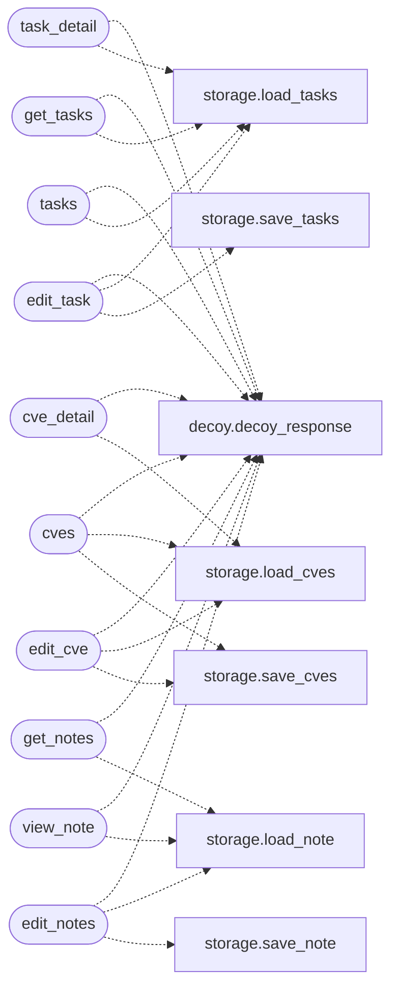

# `lazyc2.blueprints.operations`

> Source: [lazyc2/blueprints/operations.py:1](../../lazyc2/blueprints/operations.py#L1) | language `py` | coverage 100.0% | [API index](../index.md)

Operations blueprint — tasks, CVEs, notes, and event management.

CRUD endpoints for the C2 operator's daily workflow.
Registered under no prefix in [`lazyc2.app_factory.create_app`](lazyc2.app_factory.py.md#create_app).

## Contents

- **Functions:** [`task_detail`](#task_detail), [`get_tasks`](#get_tasks), [`tasks`](#tasks), [`edit_task`](#edit_task), [`cves`](#cves), [`cve_detail`](#cve_detail), [`edit_cve`](#edit_cve), [`edit_notes`](#edit_notes), [`get_notes`](#get_notes), [`view_note`](#view_note), [`event_config`](#event_config), [`event_config_view`](#event_config_view), [`events`](#events)

## Call Graph

Solid arrows stay in this module, dashed arrows leave it.



## Functions

<a id="task_detail"></a>

### `task_detail`

`function` | [lazyc2/blueprints/operations.py:33](../../lazyc2/blueprints/operations.py#L33)

Decorators: `@operations_bp.route('/task/<int:task_id>')`

```python
def task_detail(task_id: int)
```

View a single task by ID.

**Parameters**

| Name | Type | Default | Description |
|---|---|---|---|
| `task_id` | `int` |  |  |

*Calls:* [`decoy_response`](lazyc2.extensions.decoy.py.md#decoy_response), [`load_tasks`](lazyc2.extensions.storage.py.md#load_tasks)

---

<a id="get_tasks"></a>

### `get_tasks`

`function` | [lazyc2/blueprints/operations.py:48](../../lazyc2/blueprints/operations.py#L48)

Decorators: `@operations_bp.route('/gettasks')`

```python
def get_tasks()
```

Return all tasks as JSON.

*Calls:* [`decoy_response`](lazyc2.extensions.decoy.py.md#decoy_response), [`load_tasks`](lazyc2.extensions.storage.py.md#load_tasks)

---

<a id="tasks"></a>

### `tasks`

`function` | [lazyc2/blueprints/operations.py:57](../../lazyc2/blueprints/operations.py#L57)

Decorators: `@operations_bp.route('/tasks')`

```python
def tasks()
```

Render the tasks list page.

*Calls:* [`decoy_response`](lazyc2.extensions.decoy.py.md#decoy_response), [`load_tasks`](lazyc2.extensions.storage.py.md#load_tasks)

---

<a id="edit_task"></a>

### `edit_task`

`function` | [lazyc2/blueprints/operations.py:66](../../lazyc2/blueprints/operations.py#L66)

Decorators: `@operations_bp.route('/task/<int:task_id>/edit', methods=['GET', 'POST'])`

```python
def edit_task(task_id: int)
```

Edit an existing task.

**Parameters**

| Name | Type | Default | Description |
|---|---|---|---|
| `task_id` | `int` |  |  |

*Calls:* [`decoy_response`](lazyc2.extensions.decoy.py.md#decoy_response), [`load_tasks`](lazyc2.extensions.storage.py.md#load_tasks), [`save_tasks`](lazyc2.extensions.storage.py.md#save_tasks)

---

<a id="cves"></a>

### `cves`

`function` | [lazyc2/blueprints/operations.py:92](../../lazyc2/blueprints/operations.py#L92)

Decorators: `@operations_bp.route('/cves', methods=['GET', 'POST'])`

```python
def cves()
```

List all CVEs or create a new one.

*Calls:* [`decoy_response`](lazyc2.extensions.decoy.py.md#decoy_response), [`load_cves`](lazyc2.extensions.storage.py.md#load_cves), [`save_cves`](lazyc2.extensions.storage.py.md#save_cves)

---

<a id="cve_detail"></a>

### `cve_detail`

`function` | [lazyc2/blueprints/operations.py:117](../../lazyc2/blueprints/operations.py#L117)

Decorators: `@operations_bp.route('/cve/<int:cve_id>')`

```python
def cve_detail(cve_id: int)
```

View a single CVE by ID.

**Parameters**

| Name | Type | Default | Description |
|---|---|---|---|
| `cve_id` | `int` |  |  |

*Calls:* [`decoy_response`](lazyc2.extensions.decoy.py.md#decoy_response), [`load_cves`](lazyc2.extensions.storage.py.md#load_cves)

---

<a id="edit_cve"></a>

### `edit_cve`

`function` | [lazyc2/blueprints/operations.py:132](../../lazyc2/blueprints/operations.py#L132)

Decorators: `@operations_bp.route('/cve/<int:cve_id>/edit', methods=['GET', 'POST'])`

```python
def edit_cve(cve_id: int)
```

Edit an existing CVE entry.

**Parameters**

| Name | Type | Default | Description |
|---|---|---|---|
| `cve_id` | `int` |  |  |

*Calls:* [`decoy_response`](lazyc2.extensions.decoy.py.md#decoy_response), [`load_cves`](lazyc2.extensions.storage.py.md#load_cves), [`save_cves`](lazyc2.extensions.storage.py.md#save_cves)

---

<a id="edit_notes"></a>

### `edit_notes`

`function` | [lazyc2/blueprints/operations.py:158](../../lazyc2/blueprints/operations.py#L158)

Decorators: `@operations_bp.route('/notes', methods=['GET', 'POST'])`

```python
def edit_notes()
```

View or edit the operator notes.

*Calls:* [`decoy_response`](lazyc2.extensions.decoy.py.md#decoy_response), [`load_note`](lazyc2.extensions.storage.py.md#load_note), [`save_note`](lazyc2.extensions.storage.py.md#save_note)

---

<a id="get_notes"></a>

### `get_notes`

`function` | [lazyc2/blueprints/operations.py:173](../../lazyc2/blueprints/operations.py#L173)

Decorators: `@operations_bp.route('/getnotes')`

```python
def get_notes()
```

Return notes as JSON.

*Calls:* [`decoy_response`](lazyc2.extensions.decoy.py.md#decoy_response), [`load_note`](lazyc2.extensions.storage.py.md#load_note)

---

<a id="view_note"></a>

### `view_note`

`function` | [lazyc2/blueprints/operations.py:182](../../lazyc2/blueprints/operations.py#L182)

Decorators: `@operations_bp.route('/view_note')`

```python
def view_note()
```

Render the notes view page.

*Calls:* [`decoy_response`](lazyc2.extensions.decoy.py.md#decoy_response), [`load_note`](lazyc2.extensions.storage.py.md#load_note)

---

<a id="event_config"></a>

### `event_config`

`function` | [lazyc2/blueprints/operations.py:192](../../lazyc2/blueprints/operations.py#L192)

Decorators: `@operations_bp.route('/event_config')`

```python
def event_config()
```

Return event configuration as JSON.

*Calls:* [`load_event_config`](lazyc2.extensions.storage.py.md#load_event_config)

---

<a id="event_config_view"></a>

### `event_config_view`

`function` | [lazyc2/blueprints/operations.py:198](../../lazyc2/blueprints/operations.py#L198)

Decorators: `@operations_bp.route('/event_config_view', methods=['GET', 'POST'])`

```python
def event_config_view()
```

View or update event configuration.

*Calls:* [`decoy_response`](lazyc2.extensions.decoy.py.md#decoy_response), [`load_event_config`](lazyc2.extensions.storage.py.md#load_event_config)

---

<a id="events"></a>

### `events`

`function` | [lazyc2/blueprints/operations.py:218](../../lazyc2/blueprints/operations.py#L218)

Decorators: `@operations_bp.route('/events')`

```python
def events()
```

Render the events page.

*Calls:* [`decoy_response`](lazyc2.extensions.decoy.py.md#decoy_response), [`load_event_config`](lazyc2.extensions.storage.py.md#load_event_config)

---
