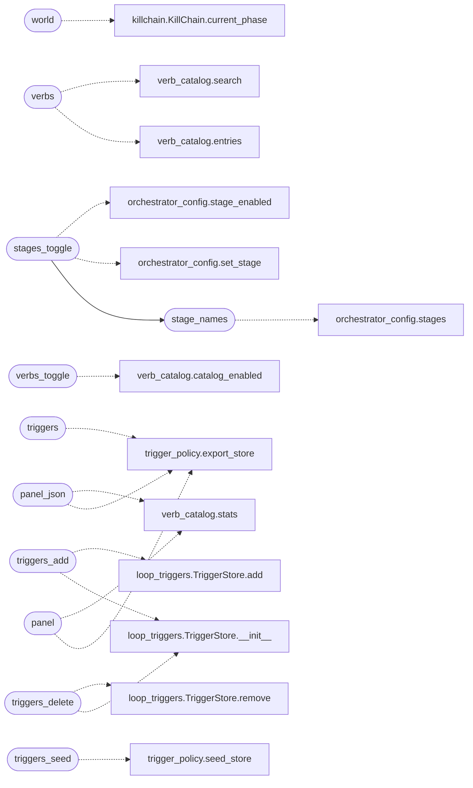

# `lazyc2.blueprints.orchestrator`

> Source: [lazyc2/blueprints/orchestrator.py:1](../../lazyc2/blueprints/orchestrator.py#L1) | language `py` | coverage 100.0% | [API index](../index.md)

Orchestrator REST + web panel for the LazyOwn C2 dashboard.

Exposes the autonomous-loop administration contract over HTTP so a
remote operator or the web panel sees the same truth as the shell and
the Textual console:

- ``GET /api/v1/orchestrator/status`` — world model, kill chain, verbs,
  triggers and stage view in one call;
- ``GET /api/v1/orchestrator/world`` — raw world model + kill chain;
- ``GET /api/v1/orchestrator/verbs`` — verb catalog with optional search;
- ``POST /api/v1/orchestrator/verbs/toggle`` — flip one catalog verb;
- ``POST /api/v1/orchestrator/stages/toggle`` — flip one loop stage;
- ``GET/POST /api/v1/orchestrator/triggers`` — list / add triggers;
- ``GET /api/v1/orchestrator/triggers/seed`` — re-merge the YAML seeds;
- ``DELETE /api/v1/orchestrator/triggers/<id>`` — remove one trigger.

X-API-Key guards every route (same store as the rest of ``/api/v1``).
The panel route reuses the dashboard session login instead.

Design (SOLID): Single Responsibility — HTTP adaptation only, no domain
logic; Open/Closed — new layers append one helper; Dependency Inversion
— domain contracts are imported lazily at call time so partial installs
degrade to JSON errors instead of crashing the whole service.

## Contents

- **Functions:** [`status`](#status), [`world`](#world), [`verbs`](#verbs), [`verbs_toggle`](#verbs_toggle), [`stages_toggle`](#stages_toggle), [`stage_names`](#stage_names), [`triggers`](#triggers), [`triggers_add`](#triggers_add), [`triggers_seed`](#triggers_seed), [`triggers_delete`](#triggers_delete), [`panel`](#panel), [`panel_json`](#panel_json)
- **Constants:** [`BODY_NAME_REQUIRED`](#body_name_required)

## Call Graph

Solid arrows stay in this module, dashed arrows leave it.



## Functions

<a id="status"></a>

### `status`

`function` | [lazyc2/blueprints/orchestrator.py:104](../../lazyc2/blueprints/orchestrator.py#L104)

Decorators: `@orchestrator_bp.route('/status', methods=['GET'])`, `@require_api_auth_with_store`

```python
def status()
```

One-call awareness: world model, verbs, triggers and stages.

---

<a id="world"></a>

### `world`

`function` | [lazyc2/blueprints/orchestrator.py:111](../../lazyc2/blueprints/orchestrator.py#L111)

Decorators: `@orchestrator_bp.route('/world', methods=['GET'])`, `@require_api_auth_with_store`

```python
def world()
```

Return the raw world-model + kill chain snapshot.

*Calls:* [`KillChain.current_phase`](modules.killchain.py.md#killchain-current_phase)

---

<a id="verbs"></a>

### `verbs`

`function` | [lazyc2/blueprints/orchestrator.py:125](../../lazyc2/blueprints/orchestrator.py#L125)

Decorators: `@orchestrator_bp.route('/verbs', methods=['GET'])`, `@require_api_auth_with_store`

```python
def verbs()
```

Verb catalog view with optional search filtering.

*Calls:* [`entries`](modules.verb_catalog.py.md#entries), [`search`](modules.verb_catalog.py.md#search)

---

<a id="verbs_toggle"></a>

### `verbs_toggle`

`function` | [lazyc2/blueprints/orchestrator.py:149](../../lazyc2/blueprints/orchestrator.py#L149)

Decorators: `@orchestrator_bp.route('/verbs/toggle', methods=['POST'])`, `@require_api_auth_with_store`

```python
def verbs_toggle()
```

Flip one loop verb between enabled and disabled.

*Calls:* [`catalog_enabled`](modules.verb_catalog.py.md#catalog_enabled)

---

<a id="stages_toggle"></a>

### `stages_toggle`

`function` | [lazyc2/blueprints/orchestrator.py:166](../../lazyc2/blueprints/orchestrator.py#L166)

Decorators: `@orchestrator_bp.route('/stages/toggle', methods=['POST'])`, `@require_api_auth_with_store`

```python
def stages_toggle()
```

Flip one autonomous-loop stage between enabled and disabled.

*Calls:* [`stage_names`](#stage_names), [`set_stage`](modules.orchestrator_config.py.md#set_stage), [`stage_enabled`](modules.orchestrator_config.py.md#stage_enabled)

---

<a id="stage_names"></a>

### `stage_names`

`function` | [lazyc2/blueprints/orchestrator.py:180](../../lazyc2/blueprints/orchestrator.py#L180)

```python
def stage_names() -> set[str]
```

Return the known stage names (fallback builtins included).

**Returns:** `set[str]`

*Calls:* [`stages`](modules.orchestrator_config.py.md#stages)

*Called by:* [`stages_toggle`](#stages_toggle)

---

<a id="triggers"></a>

### `triggers`

`function` | [lazyc2/blueprints/orchestrator.py:193](../../lazyc2/blueprints/orchestrator.py#L193)

Decorators: `@orchestrator_bp.route('/triggers', methods=['GET'])`, `@require_api_auth_with_store`

```python
def triggers()
```

List the scheduler triggers pinned in the store.

*Calls:* [`export_store`](modules.trigger_policy.py.md#export_store)

---

<a id="triggers_add"></a>

### `triggers_add`

`function` | [lazyc2/blueprints/orchestrator.py:202](../../lazyc2/blueprints/orchestrator.py#L202)

Decorators: `@orchestrator_bp.route('/triggers', methods=['POST'])`, `@require_api_auth_with_store`

```python
def triggers_add()
```

Register one scheduler trigger from the JSON body.

*Calls:* [`TriggerStore.__init__`](modules.loop_triggers.py.md#triggerstore-__init__), [`TriggerStore.add`](modules.loop_triggers.py.md#triggerstore-add)

---

<a id="triggers_seed"></a>

### `triggers_seed`

`function` | [lazyc2/blueprints/orchestrator.py:222](../../lazyc2/blueprints/orchestrator.py#L222)

Decorators: `@orchestrator_bp.route('/triggers/seed', methods=['GET'])`, `@require_api_auth_with_store`

```python
def triggers_seed()
```

Re-merge the declarative YAML seeds into the store once.

*Calls:* [`seed_store`](modules.trigger_policy.py.md#seed_store)

---

<a id="triggers_delete"></a>

### `triggers_delete`

`function` | [lazyc2/blueprints/orchestrator.py:231](../../lazyc2/blueprints/orchestrator.py#L231)

Decorators: `@orchestrator_bp.route('/triggers/<int:trigger_id>', methods=['DELETE'])`, `@require_api_auth_with_store`

```python
def triggers_delete(trigger_id: int)
```

Remove one scheduler trigger by id.

**Parameters**

| Name | Type | Default | Description |
|---|---|---|---|
| `trigger_id` | `int` |  |  |

*Calls:* [`TriggerStore.__init__`](modules.loop_triggers.py.md#triggerstore-__init__), [`TriggerStore.remove`](modules.loop_triggers.py.md#triggerstore-remove)

---

<a id="panel"></a>

### `panel`

`function` | [lazyc2/blueprints/orchestrator.py:242](../../lazyc2/blueprints/orchestrator.py#L242)

Decorators: `@orchestrator_bp.route('/panel', methods=['GET'])`, `@login_required`

```python
def panel()
```

Dashboard panel mirroring the orchestrator console state.

*Calls:* [`export_store`](modules.trigger_policy.py.md#export_store), [`stats`](modules.verb_catalog.py.md#stats)

---

<a id="panel_json"></a>

### `panel_json`

`function` | [lazyc2/blueprints/orchestrator.py:262](../../lazyc2/blueprints/orchestrator.py#L262)

Decorators: `@orchestrator_bp.route('/panel.json', methods=['GET'])`, `@require_api_auth_with_store`

```python
def panel_json()
```

JSON mirror of the panel payload for automation.

*Calls:* [`export_store`](modules.trigger_policy.py.md#export_store), [`stats`](modules.verb_catalog.py.md#stats)

---

## Constants

<a id="body_name_required"></a>

### `BODY_NAME_REQUIRED`

`constant` | [lazyc2/blueprints/orchestrator.py:53](../../lazyc2/blueprints/orchestrator.py#L53)

```python
BODY_NAME_REQUIRED = 'verb name required'
```

---
