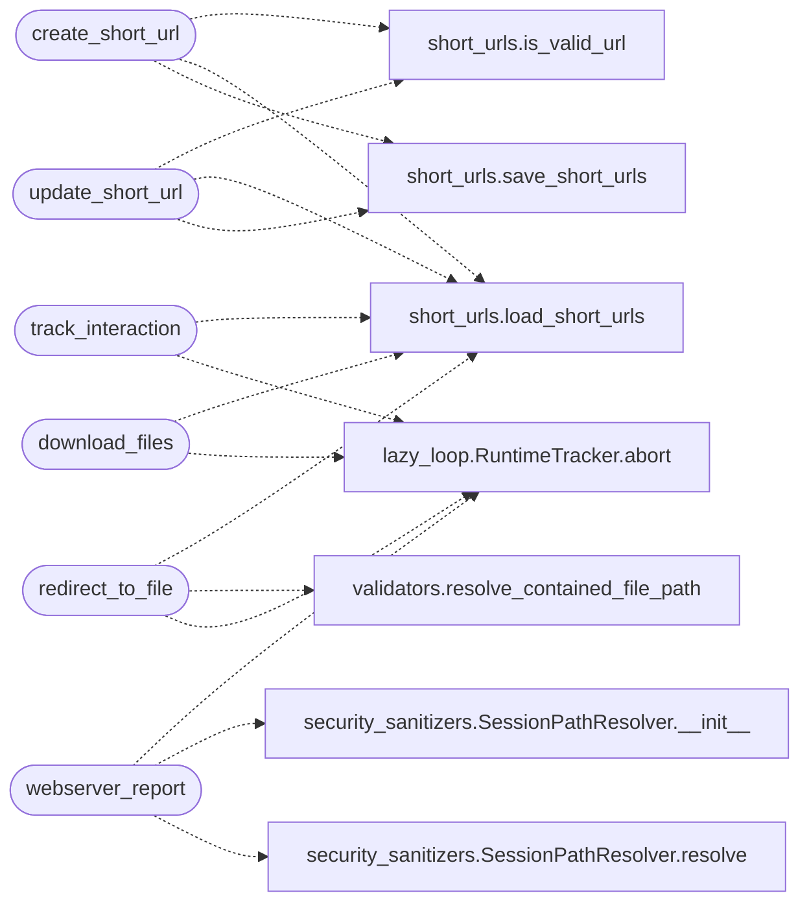

# `lazyc2.blueprints.phishing`

> Source: [lazyc2/blueprints/phishing.py:1](../../lazyc2/blueprints/phishing.py#L1) | language `py` | coverage 100.0% | [API index](../index.md)

Phishing blueprint for the LazyOwn C2 server.

Short URL management, phishing campaign tracking, behavioural
logging, and file-serving endpoints.

Registered under no prefix (the short URL redirect endpoint must
live at ``/`` so it can capture arbitrary paths).

## Contents

- **Functions:** [`create_short_url`](#create_short_url), [`track_interaction`](#track_interaction), [`update_short_url`](#update_short_url), [`redirect_to_file`](#redirect_to_file), [`webserver_report`](#webserver_report), [`download_files`](#download_files)

## Call Graph

Solid arrows stay in this module, dashed arrows leave it.



## Functions

<a id="create_short_url"></a>

### `create_short_url`

`function` | [lazyc2/blueprints/phishing.py:49](../../lazyc2/blueprints/phishing.py#L49)

Decorators: `@redirect_bp.route('/create_short_url', methods=['POST'])`

```python
def create_short_url()
```

Create one or more short URLs for a single original URL.

Request JSON:
    ``original_url`` (str, required): Target URL or file path.
    ``custom_short_url`` (str, optional): Custom short code.
    ``count`` (int, optional): Number of short URLs to create
        (default 1).

**Returns:** 200 with the list of generated short codes, or 400 on
validation failure.

*Calls:* [`is_valid_url`](lazyc2.extensions.short_urls.py.md#is_valid_url), [`load_short_urls`](lazyc2.extensions.short_urls.py.md#load_short_urls), [`save_short_urls`](lazyc2.extensions.short_urls.py.md#save_short_urls)

---

<a id="track_interaction"></a>

### `track_interaction`

`function` | [lazyc2/blueprints/phishing.py:89](../../lazyc2/blueprints/phishing.py#L89)

Decorators: `@redirect_bp.route('/track/<short_url>')`

```python
def track_interaction(short_url)
```

Serve a tracking page and log behavioural data.

Logs client IP, user-agent, and optional behaviour data to the
C2 database. Renders ``tracking_page.html`` for real-user
simulation.

**Parameters**

| Name | Type | Default | Description |
|---|---|---|---|
| `short_url` |  |  |  |

*Calls:* [`load_short_urls`](lazyc2.extensions.short_urls.py.md#load_short_urls), [`RuntimeTracker.abort`](modules.lazy_loop.py.md#runtimetracker-abort)

---

<a id="update_short_url"></a>

### `update_short_url`

`function` | [lazyc2/blueprints/phishing.py:125](../../lazyc2/blueprints/phishing.py#L125)

Decorators: `@redirect_bp.route('/update_short_url/<short_url>', methods=['PUT'])`

```python
def update_short_url(short_url)
```

Update an existing short URL's target or active status.

Request JSON (at least one):
    ``original_url`` (str): New target URL.
    ``active`` (bool): Enable or disable the short URL.

**Parameters**

| Name | Type | Default | Description |
|---|---|---|---|
| `short_url` |  |  |  |

*Calls:* [`is_valid_url`](lazyc2.extensions.short_urls.py.md#is_valid_url), [`load_short_urls`](lazyc2.extensions.short_urls.py.md#load_short_urls), [`save_short_urls`](lazyc2.extensions.short_urls.py.md#save_short_urls)

---

<a id="redirect_to_file"></a>

### `redirect_to_file`

`function` | [lazyc2/blueprints/phishing.py:151](../../lazyc2/blueprints/phishing.py#L151)

Decorators: `@redirect_bp.route('/<short_url>')`

```python
def redirect_to_file(short_url)
```

Resolve a short URL and redirect (or serve a local file).

File targets are resolved through `[`resolve_contained_file_path`](lazyc2.security.validators.py.md#resolve_contained_file_path)`
so only files inside the sessions directory are served; anything
else fails closed with 404. Remote targets issue an HTTP redirect.

**Parameters**

| Name | Type | Default | Description |
|---|---|---|---|
| `short_url` |  |  |  |

*Calls:* [`load_short_urls`](lazyc2.extensions.short_urls.py.md#load_short_urls), [`resolve_contained_file_path`](lazyc2.security.validators.py.md#resolve_contained_file_path), [`RuntimeTracker.abort`](modules.lazy_loop.py.md#runtimetracker-abort)

---

<a id="webserver_report"></a>

### `webserver_report`

`function` | [lazyc2/blueprints/phishing.py:174](../../lazyc2/blueprints/phishing.py#L174)

Decorators: `@redirect_bp.route('/webserver-report')`, `@redirect_bp.route('/webserver-report/<path:filename>')`

```python
def webserver_report(filename='index2.html')
```

Serve nmap HTML report assets from the sessions directory.

Path validation is enforced through [`SessionPathResolver`](modules.security_sanitizers.py.md#sessionpathresolver).

**Parameters**

| Name | Type | Default | Description |
|---|---|---|---|
| `filename` |  | `'index2.html'` |  |

*Calls:* [`RuntimeTracker.abort`](modules.lazy_loop.py.md#runtimetracker-abort), [`SessionPathResolver.__init__`](modules.security_sanitizers.py.md#sessionpathresolver-__init__), [`SessionPathResolver.resolve`](modules.security_sanitizers.py.md#sessionpathresolver-resolve)

---

<a id="download_files"></a>

### `download_files`

`function` | [lazyc2/blueprints/phishing.py:192](../../lazyc2/blueprints/phishing.py#L192)

Decorators: `@redirect_bp.route('/s/<filename>')`

```python
def download_files(filename)
```

Serve a session file by name with path-traversal protection.

Enforces strict basename containment, secure filename sanitisation,
realpath containment, and an extension allowlist.

**Parameters**

| Name | Type | Default | Description |
|---|---|---|---|
| `filename` |  |  |  |

*Calls:* [`load_short_urls`](lazyc2.extensions.short_urls.py.md#load_short_urls), [`RuntimeTracker.abort`](modules.lazy_loop.py.md#runtimetracker-abort)

---
