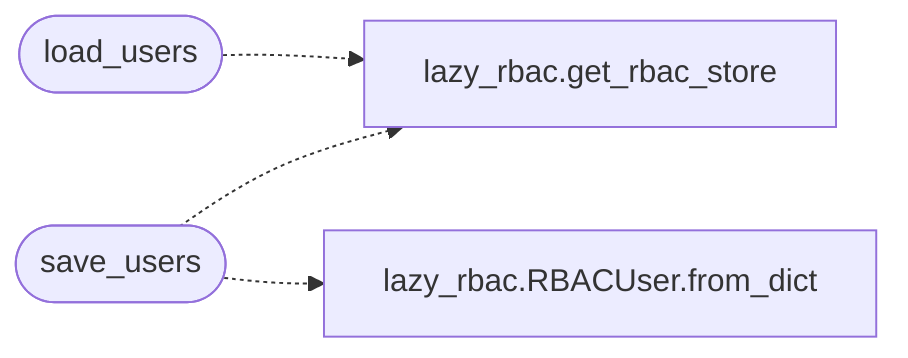

# `lazyc2.extensions.users`

> Source: [lazyc2/extensions/users.py:1](../../lazyc2/extensions/users.py#L1) | language `py` | coverage 100.0% | [API index](../index.md)

User management utilities for the C2 auth module.

Provides load/save helpers for both the legacy JSON user store and
the RBAC-backed store. The RBAC path falls through to lazyc2.py
globals during the migration period.

## Contents

- **Functions:** [`configure`](#configure), [`load_users`](#load_users), [`save_users`](#save_users)
- **Constants:** [`USER_DATA_PATH`](#user_data_path)

## Call Graph

Solid arrows stay in this module, dashed arrows leave it.



## Functions

<a id="configure"></a>

### `configure`

`function` | [lazyc2/extensions/users.py:16](../../lazyc2/extensions/users.py#L16)

```python
def configure(users_path: str = 'users.json') -> None
```

Set the path for the legacy JSON user file.

**Parameters**

| Name | Type | Default | Description |
|---|---|---|---|
| `users_path` | `str` | `'users.json'` | Path to the users JSON file. |

---

<a id="load_users"></a>

### `load_users`

`function` | [lazyc2/extensions/users.py:26](../../lazyc2/extensions/users.py#L26)

```python
def load_users() -> list[dict]
```

Load users from the JSON store or RBAC store.

**Returns:** `list[dict]` - A list of user dicts.

*Calls:* [`get_rbac_store`](modules.lazy_rbac.py.md#get_rbac_store)

*Called by:* [`login`](lazyc2.blueprints.auth.py.md#login), [`register`](lazyc2.blueprints.auth.py.md#register)

---

<a id="save_users"></a>

### `save_users`

`function` | [lazyc2/extensions/users.py:48](../../lazyc2/extensions/users.py#L48)

```python
def save_users(users: list[dict]) -> None
```

Persist users to the JSON store or RBAC store.

**Parameters**

| Name | Type | Default | Description |
|---|---|---|---|
| `users` | `list[dict]` |  | List of user dicts. |

*Calls:* [`RBACUser.from_dict`](modules.lazy_rbac.py.md#rbacuser-from_dict), [`get_rbac_store`](modules.lazy_rbac.py.md#get_rbac_store)

*Called by:* [`register`](lazyc2.blueprints.auth.py.md#register)

---

## Constants

<a id="user_data_path"></a>

### `USER_DATA_PATH`

`constant` | [lazyc2/extensions/users.py:13](../../lazyc2/extensions/users.py#L13)

```python
USER_DATA_PATH = 'users.json'
```

---
