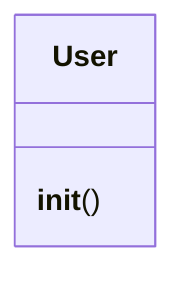

# `lazyc2.models`

> Source: [lazyc2/models.py:1](../../lazyc2/models.py#L1) | language `py` | coverage 33.3% | [API index](../index.md)

C2 data models extracted from lazyc2.py.

Breaking the circular dependency between lazyc2.py and blueprints.

## Contents

- **Classes:** [`User`](#user)

## Type Diagram



## Classes

<a id="user"></a>

### `User`

`class` | [lazyc2/models.py:16](../../lazyc2/models.py#L16)

```python
class User(UserMixin)
```

Bases: `UserMixin`

**Members**

| Member | Kind | Summary |
|---|---|---|
| [`__init__`](#user-__init__) | constructor |  |

<a id="user-__init__"></a>

#### `User.__init__`

`constructor` | [lazyc2/models.py:17](../../lazyc2/models.py#L17)

```python
def __init__(self, user_data)
```

**Parameters**

| Name | Type | Default | Description |
|---|---|---|---|
| `user_data` |  |  |  |

---
