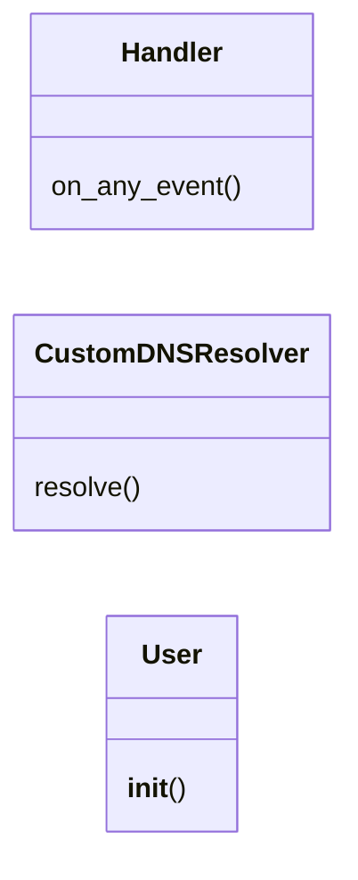
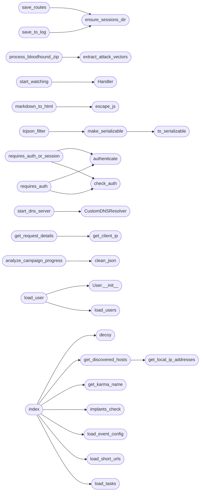

# `lazyc2`

> Source: [lazyc2.py:1](../../lazyc2.py#L1) | language `py` | coverage 38.4% | [API index](../index.md)

## Contents

- **Classes:** [`Handler`](#handler), [`CustomDNSResolver`](#customdnsresolver), [`User`](#user)
- **Functions:** [`is_insecure_credential`](#is_insecure_credential), [`ensure_sessions_dir`](#ensure_sessions_dir), [`load_routes`](#load_routes), [`save_routes`](#save_routes), [`validate_route_path`](#validate_route_path), [`validate_template_name`](#validate_template_name), [`is_safe_template_path`](#is_safe_template_path), [`is_binary`](#is_binary), [`clean_expired_tokens`](#clean_expired_tokens), [`clean_json`](#clean_json), [`load_yaml_safely`](#load_yaml_safely), [`get_karma_name`](#get_karma_name), [`fromjson`](#fromjson), [`run_shell`](#run_shell), [`load_banners`](#load_banners), [`load_mitre_data`](#load_mitre_data), [`load_event_config`](#load_event_config), [`load_notifications`](#load_notifications), [`implants_check`](#implants_check), [`extract_attack_vectors`](#extract_attack_vectors), [`process_bloodhound_zip`](#process_bloodhound_zip), [`start_watching`](#start_watching), [`load_tasks`](#load_tasks), [`create_cves`](#create_cves), [`load_cves`](#load_cves), [`save_cves`](#save_cves), [`create_report`](#create_report), [`save_tasks`](#save_tasks), [`load_note`](#load_note), [`aumentar_elo`](#aumentar_elo), [`save_note`](#save_note), [`escape_js`](#escape_js), [`markdown_to_html`](#markdown_to_html), [`to_serializable`](#to_serializable), [`make_serializable`](#make_serializable), [`datetime_now_iso`](#datetime_now_iso), [`escape_js_string`](#escape_js_string), [`check_auth`](#check_auth), [`authenticate`](#authenticate), [`requires_auth_or_session`](#requires_auth_or_session), [`requires_auth`](#requires_auth), [`csrf_protect`](#csrf_protect), [`aicmd_deepseek`](#aicmd_deepseek), [`aicmd`](#aicmd), [`search_database`](#search_database), [`execute_command`](#execute_command), [`start_dns_server`](#start_dns_server), [`tcp_bridge`](#tcp_bridge), [`handle_client`](#handle_client), [`decoy`](#decoy), [`encrypt_data`](#encrypt_data), [`decrypt_data`](#decrypt_data), [`set_winsize`](#set_winsize), [`read_and_forward_pty_output`](#read_and_forward_pty_output), [`get_discovered_hosts`](#get_discovered_hosts), [`get_local_ip_addresses`](#get_local_ip_addresses), [`sanitize_json`](#sanitize_json), [`add_dynamic_data`](#add_dynamic_data), [`get_client_ip`](#get_client_ip), [`get_request_details`](#get_request_details), [`save_to_log`](#save_to_log), [`parse_access_log_for_short_url`](#parse_access_log_for_short_url), [`parse_execution_log`](#parse_execution_log), [`load_implant_config`](#load_implant_config), [`load_short_urls`](#load_short_urls), [`save_short_urls`](#save_short_urls), [`is_valid_url`](#is_valid_url), [`analyze_behavioral_data`](#analyze_behavioral_data), [`analyze_campaign_progress`](#analyze_campaign_progress), [`__getattr__`](#__getattr__), [`load_users`](#load_users), [`save_users`](#save_users), [`load_data`](#load_data), [`load_user`](#load_user), [`tojson_filter`](#tojson_filter), [`index`](#index), [`send_command`](#send_command), [`receive_result`](#receive_result), [`issue_command`](#issue_command), [`upload`](#upload), [`download_file`](#download_file), [`serve_file`](#serve_file), [`create_route`](#create_route), [`dynamic_route`](#dynamic_route), [`log`](#log), [`favicon`](#favicon), [`palette_view`](#palette_view), [`palette_api`](#palette_api), [`api_data`](#api_data), [`create_short_url`](#create_short_url), [`track_interaction`](#track_interaction), [`update_short_url`](#update_short_url), [`redirect_to_file`](#redirect_to_file), [`webserver_report`](#webserver_report), [`download_files`](#download_files), [`view_yaml`](#view_yaml), [`run_command`](#run_command), [`get_output`](#get_output), [`run_shellcode`](#run_shellcode), [`get_results`](#get_results), [`send_lcommand`](#send_lcommand), [`chatbot`](#chatbot), [`vuln`](#vuln), [`taskbot`](#taskbot), [`search`](#search), [`script`](#script), [`redop`](#redop), [`adversary`](#adversary), [`generalbot`](#generalbot), [`csv_to_html`](#csv_to_html), [`search_results`](#search_results), [`graph`](#graph), [`task`](#task), [`get_tasks`](#get_tasks), [`tasks`](#tasks), [`edit_task`](#edit_task), [`cves`](#cves), [`cve`](#cve), [`edit_cve`](#edit_cve), [`edit_notes`](#edit_notes), [`get_notes`](#get_notes), [`view_note`](#view_note), [`push_notification`](#push_notification), [`edit_event`](#edit_event), [`get_event_config`](#get_event_config), [`get_event_config_view`](#get_event_config_view), [`aicmd_view`](#aicmd_view), [`get_events`](#get_events), [`list_tools`](#list_tools), [`create_tool`](#create_tool), [`view_tool`](#view_tool), [`update_tool`](#update_tool), [`delete_tool`](#delete_tool), [`register`](#register), [`login`](#login), [`mfa_setup`](#mfa_setup), [`mfa_qr`](#mfa_qr), [`mfa_verify`](#mfa_verify), [`admin_users`](#admin_users), [`admin_set_role`](#admin_set_role), [`admin_reset_mfa`](#admin_reset_mfa), [`admin_delete_user`](#admin_delete_user), [`admin_tenants`](#admin_tenants), [`admin_create_tenant`](#admin_create_tenant), [`admin_switch_tenant`](#admin_switch_tenant), [`profile`](#profile), [`logout`](#logout), [`change_password`](#change_password), [`aumentar_elo_route`](#aumentar_elo_route), [`banners`](#banners), [`mitre`](#mitre), [`get_connected_clients`](#get_connected_clients), [`lazybot`](#lazybot), [`compliance_dashboard`](#compliance_dashboard), [`compliance_report`](#compliance_report), [`compliance_add_evidence`](#compliance_add_evidence), [`compliance_verify_evidence`](#compliance_verify_evidence), [`compliance_export`](#compliance_export), [`lazyreport`](#lazyreport), [`teamserver`](#teamserver), [`report`](#report), [`lazyreport_view`](#lazyreport_view), [`killchain_view`](#killchain_view), [`api_killchain`](#api_killchain), [`api_beacon_results`](#api_beacon_results), [`connect`](#connect), [`listener`](#listener), [`listener_connect`](#listener_connect), [`listener_disconnect`](#listener_disconnect), [`pty_input`](#pty_input), [`resize`](#resize), [`pty_connect`](#pty_connect), [`handle_input`](#handle_input), [`listener_command`](#listener_command), [`terminal`](#terminal), [`terminal_connect`](#terminal_connect), [`terminal_disconnect`](#terminal_disconnect), [`terminal_input`](#terminal_input), [`terminal_command`](#terminal_command), [`terminal_resize`](#terminal_resize), [`start_reverse_shell`](#start_reverse_shell), [`start_bridge`](#start_bridge), [`page_not_found`](#page_not_found), [`internal_server_error`](#internal_server_error), [`get_config`](#get_config), [`capture_image`](#capture_image), [`capture_audio`](#capture_audio), [`surface`](#surface), [`surface_live`](#surface_live), [`api_surface_live`](#api_surface_live), [`intel_view`](#intel_view), [`intel_bundle_view`](#intel_bundle_view), [`attack3d_view`](#attack3d_view), [`attack_bundle_view`](#attack_bundle_view), [`api_intel_graph`](#api_intel_graph), [`broadcast_view`](#broadcast_view), [`api_loop_broadcast_stream`](#api_loop_broadcast_stream), [`api_loop_broadcast`](#api_loop_broadcast), [`api_guard_audit`](#api_guard_audit), [`api_loop_graph`](#api_loop_graph), [`api_lazy_mentions`](#api_lazy_mentions), [`api_intel_bundle`](#api_intel_bundle), [`api_attack_graph`](#api_attack_graph), [`api_attack_bundle`](#api_attack_bundle), [`get_data`](#get_data), [`upload_zip_file`](#upload_zip_file), [`list_campaigns`](#list_campaigns), [`create_campaign`](#create_campaign), [`lazyphishingai`](#lazyphishingai), [`track_pixel`](#track_pixel), [`campaign_report`](#campaign_report), [`orchestrate_campaign`](#orchestrate_campaign), [`create_multivector_campaign`](#create_multivector_campaign), [`serve_landing_page`](#serve_landing_page), [`health_check`](#health_check), [`metrics_exposition`](#metrics_exposition), [`api_dashboard`](#api_dashboard), [`api_listeners`](#api_listeners), [`api_listeners_create`](#api_listeners_create), [`api_listeners_start`](#api_listeners_start), [`api_listeners_stop`](#api_listeners_stop), [`api_listeners_delete`](#api_listeners_delete)
- **Constants:** [`SAVE_DIR`](#save_dir), [`SESSION_ID`](#session_id), [`BASE_DIR`](#base_dir), [`TOOLS_DIR`](#tools_dir), [`LAZYADDONS_DIR`](#lazyaddons_dir), [`UPLOAD_FOLDER`](#upload_folder), [`ALLOWED_DIRECTORY`](#allowed_directory), [`MODEL`](#model), [`JSON_FILE_PATH_REPORT`](#json_file_path_report), [`USER_DATA_PATH`](#user_data_path), [`ENV`](#env), [`DATA_FILE`](#data_file), [`LOG_DIR`](#log_dir), [`LOG_FILE`](#log_file), [`CAMPAIGNS_DIR`](#campaigns_dir), [`TEMPLATES_DIR`](#templates_dir), [`DB_PATH`](#db_path), [`GMAIL_ADDRESS`](#gmail_address), [`GMAIL_APP_PASSWORD`](#gmail_app_password), [`SESSIONS_PHISHING_DIR`](#sessions_phishing_dir), [`SHORT_URLS_FILE`](#short_urls_file), [`SESSIONS_DIR`](#sessions_dir), [`GROQ_API_KEY`](#groq_api_key), [`ALLOWED_EXTENSIONS`](#allowed_extensions), [`IMPLANT_STAGE_FILES`](#implant_stage_files), [`BINARY_HEADERS`](#binary_headers), [`AES_KEY_SIZE_BYTES`](#aes_key_size_bytes), [`DIRECTORY_TO_WATCH`](#directory_to_watch), [`LINPEAS_CANDIDATES`](#linpeas_candidates), [`WINPEAS_CANDIDATES`](#winpeas_candidates)

## Type Diagram



## Call Graph

Solid arrows stay in this module, dashed arrows leave it.



## Classes

<a id="handler"></a>

### `Handler`

`class` | [lazyc2.py:728](../../lazyc2.py#L728)

```python
class Handler(FileSystemEventHandler)
```

Bases: `FileSystemEventHandler`

**Members**

| Member | Kind | Summary |
|---|---|---|
| [`on_any_event`](#handler-on_any_event) | staticmethod |  |

<a id="handler-on_any_event"></a>

#### `Handler.on_any_event`

`staticmethod` | [lazyc2.py:730](../../lazyc2.py#L730)

Decorators: `@staticmethod`

```python
def on_any_event(event)
```

**Parameters**

| Name | Type | Default | Description |
|---|---|---|---|
| `event` |  |  |  |

---

<a id="customdnsresolver"></a>

### `CustomDNSResolver`

`class` | [lazyc2.py:1728](../../lazyc2.py#L1728)

```python
class CustomDNSResolver(BaseResolver)
```

Bases: `BaseResolver`

**Members**

| Member | Kind | Summary |
|---|---|---|
| [`resolve`](#customdnsresolver-resolve) | method |  |

<a id="customdnsresolver-resolve"></a>

#### `CustomDNSResolver.resolve`

`method` | [lazyc2.py:1729](../../lazyc2.py#L1729)

```python
def resolve(self, request, handler)
```

**Parameters**

| Name | Type | Default | Description |
|---|---|---|---|
| `request` |  |  |  |
| `handler` |  |  |  |

*Calls:* [`A`](static.js.quill-2.0.3.js.md#a)

---

<a id="user"></a>

### `User`

`class` | [lazyc2.py:2964](../../lazyc2.py#L2964)

```python
class User(UserMixin)
```

Bases: `UserMixin`

**Members**

| Member | Kind | Summary |
|---|---|---|
| [`__init__`](#user-__init__) | constructor |  |

<a id="user-__init__"></a>

#### `User.__init__`

`constructor` | [lazyc2.py:2965](../../lazyc2.py#L2965)

```python
def __init__(self, user_data)
```

**Parameters**

| Name | Type | Default | Description |
|---|---|---|---|
| `user_data` |  |  |  |

*Called by:* [`load_user`](#load_user)

---

## Functions

<a id="is_insecure_credential"></a>

### `is_insecure_credential`

`function` | [lazyc2.py:204](../../lazyc2.py#L204)

```python
def is_insecure_credential(user: str, pwd: str) -> bool
```

Check for weak or default credentials

**Parameters**

| Name | Type | Default | Description |
|---|---|---|---|
| `user` | `str` |  |  |
| `pwd` | `str` |  |  |

**Returns:** `bool`

---

<a id="ensure_sessions_dir"></a>

### `ensure_sessions_dir`

`function` | [lazyc2.py:471](../../lazyc2.py#L471)

```python
def ensure_sessions_dir()
```

Ensure the sessions directory exists with safe permissions.

*Called by:* [`save_routes`](#save_routes), [`save_to_log`](#save_to_log)

---

<a id="load_routes"></a>

### `load_routes`

`function` | [lazyc2.py:482](../../lazyc2.py#L482)

```python
def load_routes()
```

Load dynamic routes from JSON file.

*Called by:* [`create_route`](#create_route), [`dynamic_route`](#dynamic_route)

---

<a id="save_routes"></a>

### `save_routes`

`function` | [lazyc2.py:492](../../lazyc2.py#L492)

```python
def save_routes(routes)
```

Save dynamic routes to JSON file with safe permissions.

**Parameters**

| Name | Type | Default | Description |
|---|---|---|---|
| `routes` |  |  |  |

*Calls:* [`ensure_sessions_dir`](#ensure_sessions_dir)

*Called by:* [`create_route`](#create_route)

---

<a id="validate_route_path"></a>

### `validate_route_path`

`function` | [lazyc2.py:506](../../lazyc2.py#L506)

```python
def validate_route_path(route_path)
```

Module-level boolean adapter for [`lazyc2.security.validators.validate_route_path`](lazyc2.security.validators.py.md#validate_route_path).

Returns ``True`` when ``route_path`` passes the canonical validator
and ``False`` otherwise. Existing call sites that only need a
boolean signal can keep their current shape; new call sites should
prefer the underlying ``(is_valid, error)`` tuple for richer
diagnostics.

**Parameters**

| Name | Type | Default | Description |
|---|---|---|---|
| `route_path` |  |  |  |

---

<a id="validate_template_name"></a>

### `validate_template_name`

`function` | [lazyc2.py:519](../../lazyc2.py#L519)

```python
def validate_template_name(template_name)
```

Module-level boolean adapter for [`lazyc2.security.validators.validate_template_name`](lazyc2.security.validators.py.md#validate_template_name).

Returns ``True`` when `[`template_name`](modules.dotnet_payload.py.md#dotnetpayloadconfig-template_name)` passes the canonical
validator and ``False`` otherwise.

**Parameters**

| Name | Type | Default | Description |
|---|---|---|---|
| `template_name` |  |  |  |

---

<a id="is_safe_template_path"></a>

### `is_safe_template_path`

`function` | [lazyc2.py:529](../../lazyc2.py#L529)

```python
def is_safe_template_path(template_path, template_name)
```

Verify ``template_path`` resolves inside ``app.template_folder``.

Delegates to the canonical traversal validator in
[`lazyc2.security.validators`](lazyc2.security.validators.py.md) so the confinement check stays
consistent with every other security-sensitive call site. Retained
on the module surface because operators wire it into custom
templates from external scripts.

**Parameters**

| Name | Type | Default | Description |
|---|---|---|---|
| `template_path` |  |  | Candidate filesystem path produced by the caller. |
| `template_name` |  |  | Expected template basename. The candidate must match this filename exactly, preventing the caller from substituting an unrelated path that happens to live inside the template folder. |

**Returns:** True when the resolved path is strictly equal to
``app.template_folder / template_name`` and lives inside the
template folder; False otherwise.

---

<a id="is_binary"></a>

### `is_binary`

`function` | [lazyc2.py:569](../../lazyc2.py#L569)

```python
def is_binary(safe_filename)
```

Check whether a session file is binary based on its header bytes.

Accepts a single basename, never a path. Reconstructing the absolute
path inside this function prevents a malicious caller from supplying
traversal sequences to read host files outside `[`SESSIONS_DIR`](#sessions_dir)`.

**Parameters**

| Name | Type | Default | Description |
|---|---|---|---|
| `safe_filename` |  |  | Basename of a candidate file within `[`SESSIONS_DIR`](#sessions_dir)`. |

**Returns:** True only when the resolved file lives inside `[`SESSIONS_DIR`](#sessions_dir)` and
its leading bytes match a known binary header. Any validation
failure or I/O error returns False.

*Called by:* [`LazyOwnGUI.scan_system_for_binaries`](modules.LazyOwnExplorer.py.md#lazyowngui-scan_system_for_binaries)

---

<a id="clean_expired_tokens"></a>

### `clean_expired_tokens`

`function` | [lazyc2.py:610](../../lazyc2.py#L610)

```python
def clean_expired_tokens()
```

---

<a id="clean_json"></a>

### `clean_json`

`function` | [lazyc2.py:618](../../lazyc2.py#L618)

```python
def clean_json(text)
```

Extract only the JSON content between ```json and ```, discarding everything else.

**Parameters**

| Name | Type | Default | Description |
|---|---|---|---|
| `text` |  |  |  |

*Called by:* [`analyze_campaign_progress`](#analyze_campaign_progress)

---

<a id="load_yaml_safely"></a>

### `load_yaml_safely`

`function` | [lazyc2.py:646](../../lazyc2.py#L646)

```python
def load_yaml_safely(file_path)
```

Load a YAML file safely with error handling and default values.

**Parameters**

| Name | Type | Default | Description |
|---|---|---|---|
| `file_path` |  |  |  |

---

<a id="get_karma_name"></a>

### `get_karma_name`

`function` | [lazyc2.py:755](../../lazyc2.py#L755)

```python
def get_karma_name(elo)
```

**Parameters**

| Name | Type | Default | Description |
|---|---|---|---|
| `elo` |  |  |  |

*Called by:* [`index`](#index)

---

<a id="fromjson"></a>

### `fromjson`

`function` | [lazyc2.py:772](../../lazyc2.py#L772)

```python
def fromjson(value)
```

**Parameters**

| Name | Type | Default | Description |
|---|---|---|---|
| `value` |  |  |  |

---

<a id="run_shell"></a>

### `run_shell`

`function` | [lazyc2.py:776](../../lazyc2.py#L776)

```python
def run_shell()
```

---

<a id="load_banners"></a>

### `load_banners`

`function` | [lazyc2.py:786](../../lazyc2.py#L786)

```python
def load_banners()
```

Loads the banners from the JSON file.

---

<a id="load_mitre_data"></a>

### `load_mitre_data`

`function` | [lazyc2.py:806](../../lazyc2.py#L806)

```python
def load_mitre_data()
```

---

<a id="load_event_config"></a>

### `load_event_config`

`function` | [lazyc2.py:812](../../lazyc2.py#L812)

```python
def load_event_config()
```

*Called by:* [`edit_event`](#edit_event), [`get_event_config`](#get_event_config), [`index`](#index), [`vuln`](#vuln)

---

<a id="load_notifications"></a>

### `load_notifications`

`function` | [lazyc2.py:820](../../lazyc2.py#L820)

```python
def load_notifications()
```

*Called by:* [`push_notification`](#push_notification)

---

<a id="implants_check"></a>

### `implants_check`

`function` | [lazyc2.py:838](../../lazyc2.py#L838)

```python
def implants_check()
```

*Called by:* [`index`](#index)

---

<a id="extract_attack_vectors"></a>

### `extract_attack_vectors`

`function` | [lazyc2.py:855](../../lazyc2.py#L855)

```python
def extract_attack_vectors(nodes, edges)
```

Analyzes BloodHound nodes and edges to extract critical attack vectors for AD compromise.

**Parameters**

| Name | Type | Default | Description |
|---|---|---|---|
| `nodes` | `list` |  | List of node dictionaries from process_bloodhound_zip. |
| `edges` | `list` |  | List of edge dictionaries from process_bloodhound_zip. |

**Returns:** `dict` - Structured data containing critical attack vectors.

*Called by:* [`process_bloodhound_zip`](#process_bloodhound_zip)

---

<a id="process_bloodhound_zip"></a>

### `process_bloodhound_zip`

`function` | [lazyc2.py:942](../../lazyc2.py#L942)

```python
def process_bloodhound_zip(zip_filepath)
```

Processes a BloodHound ZIP file to extract nodes and edges for graph visualization.

**Parameters**

| Name | Type | Default | Description |
|---|---|---|---|
| `zip_filepath` | `str` |  | The path to the BloodHound ZIP file. |

**Returns:** `tuple` - (nodes, edges, error_message, ad_data). Nodes, edges, attack vectors for viz.js, and error message.

*Calls:* [`extract_attack_vectors`](#extract_attack_vectors)

---

<a id="start_watching"></a>

### `start_watching`

`function` | [lazyc2.py:1040](../../lazyc2.py#L1040)

```python
def start_watching()
```

*Calls:* [`Handler`](#handler)

---

<a id="load_tasks"></a>

### `load_tasks`

`function` | [lazyc2.py:1056](../../lazyc2.py#L1056)

```python
def load_tasks()
```

*Called by:* [`edit_task`](#edit_task), [`get_tasks`](#get_tasks), [`index`](#index), [`task`](#task), [`tasks`](#tasks)

---

<a id="create_cves"></a>

### `create_cves`

`function` | [lazyc2.py:1064](../../lazyc2.py#L1064)

```python
def create_cves()
```

---

<a id="load_cves"></a>

### `load_cves`

`function` | [lazyc2.py:1070](../../lazyc2.py#L1070)

```python
def load_cves()
```

*Called by:* [`cve`](#cve), [`cves`](#cves), [`edit_cve`](#edit_cve)

---

<a id="save_cves"></a>

### `save_cves`

`function` | [lazyc2.py:1078](../../lazyc2.py#L1078)

```python
def save_cves(cves)
```

**Parameters**

| Name | Type | Default | Description |
|---|---|---|---|
| `cves` |  |  |  |

*Called by:* [`cves`](#cves), [`edit_cve`](#edit_cve)

---

<a id="create_report"></a>

### `create_report`

`function` | [lazyc2.py:1083](../../lazyc2.py#L1083)

```python
def create_report()
```

---

<a id="save_tasks"></a>

### `save_tasks`

`function` | [lazyc2.py:1089](../../lazyc2.py#L1089)

```python
def save_tasks(tasks)
```

**Parameters**

| Name | Type | Default | Description |
|---|---|---|---|
| `tasks` |  |  |  |

*Called by:* [`edit_task`](#edit_task), [`index`](#index)

---

<a id="load_note"></a>

### `load_note`

`function` | [lazyc2.py:1094](../../lazyc2.py#L1094)

```python
def load_note()
```

*Called by:* [`edit_notes`](#edit_notes), [`get_notes`](#get_notes), [`view_note`](#view_note)

---

<a id="aumentar_elo"></a>

### `aumentar_elo`

`function` | [lazyc2.py:1112](../../lazyc2.py#L1112)

```python
def aumentar_elo(user_id, cantidad)
```

**Parameters**

| Name | Type | Default | Description |
|---|---|---|---|
| `user_id` |  |  |  |
| `cantidad` |  |  |  |

*Calls:* [`get_rbac_store`](modules.lazy_rbac.py.md#get_rbac_store)

---

<a id="save_note"></a>

### `save_note`

`function` | [lazyc2.py:1142](../../lazyc2.py#L1142)

```python
def save_note(content)
```

**Parameters**

| Name | Type | Default | Description |
|---|---|---|---|
| `content` |  |  |  |

*Called by:* [`edit_notes`](#edit_notes)

---

<a id="escape_js"></a>

### `escape_js`

`function` | [lazyc2.py:1148](../../lazyc2.py#L1148)

```python
def escape_js(s)
```

**Parameters**

| Name | Type | Default | Description |
|---|---|---|---|
| `s` |  |  |  |

*Called by:* [`markdown_to_html`](#markdown_to_html)

---

<a id="markdown_to_html"></a>

### `markdown_to_html`

`function` | [lazyc2.py:1185](../../lazyc2.py#L1185)

```python
def markdown_to_html(text)
```

**Parameters**

| Name | Type | Default | Description |
|---|---|---|---|
| `text` |  |  |  |

*Calls:* [`escape_js`](#escape_js)

---

<a id="to_serializable"></a>

### `to_serializable`

`function` | [lazyc2.py:1193](../../lazyc2.py#L1193)

```python
def to_serializable(obj)
```

Convert objects to serializable format.

**Parameters**

| Name | Type | Default | Description |
|---|---|---|---|
| `obj` |  |  |  |

*Called by:* [`make_serializable`](#make_serializable)

---

<a id="make_serializable"></a>

### `make_serializable`

`function` | [lazyc2.py:1200](../../lazyc2.py#L1200)

```python
def make_serializable(data)
```

Recursively convert data to serializable format.

**Parameters**

| Name | Type | Default | Description |
|---|---|---|---|
| `data` |  |  |  |

*Calls:* [`to_serializable`](#to_serializable)

*Called by:* [`index`](#index), [`tojson_filter`](#tojson_filter)

---

<a id="datetime_now_iso"></a>

### `datetime_now_iso`

`function` | [lazyc2.py:1218](../../lazyc2.py#L1218)

```python
def datetime_now_iso() -> str
```

Return the current UTC timestamp as an ISO-8601 string.

**Returns:** `str`

*Called by:* [`receive_result`](#receive_result)

---

<a id="escape_js_string"></a>

### `escape_js_string`

`function` | [lazyc2.py:1336](../../lazyc2.py#L1336)

```python
def escape_js_string(value)
```

Escape special characters in a string for JavaScript.

**Parameters**

| Name | Type | Default | Description |
|---|---|---|---|
| `value` |  |  |  |

*Called by:* [`view_yaml`](#view_yaml)

---

<a id="check_auth"></a>

### `check_auth`

`function` | [lazyc2.py:1348](../../lazyc2.py#L1348)

```python
def check_auth(username: str, password: str) -> bool
```

Verify credentials.

Checks RBACStore first, falls back to CLI creds.

**Parameters**

| Name | Type | Default | Description |
|---|---|---|---|
| `username` | `str` |  |  |
| `password` | `str` |  |  |

**Returns:** `bool`

*Calls:* [`get_rbac_store`](modules.lazy_rbac.py.md#get_rbac_store)

*Called by:* [`requires_auth`](#requires_auth), [`requires_auth_or_session`](#requires_auth_or_session)

---

<a id="authenticate"></a>

### `authenticate`

`function` | [lazyc2.py:1363](../../lazyc2.py#L1363)

```python
def authenticate()
```

Requests authentication.

*Called by:* [`requires_auth`](#requires_auth), [`requires_auth_or_session`](#requires_auth_or_session)

---

<a id="requires_auth_or_session"></a>

### `requires_auth_or_session`

`function` | [lazyc2.py:1372](../../lazyc2.py#L1372)

```python
def requires_auth_or_session(f)
```

Require Basic auth credentials or a valid Flask-Login session.

Used on endpoints that are driven both by the CLI (which sends HTTP
Basic credentials) and by the GUI dashboard deep the operator has
already authenticated through ``/login`` (session cookie). Either
channel satisfies the gate.

**Parameters**

| Name | Type | Default | Description |
|---|---|---|---|
| `f` |  |  |  |

*Calls:* [`authenticate`](#authenticate), [`check_auth`](#check_auth), [`Ct.G.I.J.L.M.N.N.Ot.Q.R.S.S.St.T.X.Y.Z.a.b.c.c.d.et.extends.extends.extends.extends.extends.extends.extends.extends.extends.extends.extends.f`](static.js.quill-2.0.3.js.md#ct-g-i-j-l-m-n-n-ot-q-r-s-s-st-t-x-y-z-a-b-c-c-d-et-extends-extends-extends-extends-extends-extends-extends-extends-extends-extends-extends-f)

---

<a id="requires_auth"></a>

### `requires_auth`

`function` | [lazyc2.py:1393](../../lazyc2.py#L1393)

```python
def requires_auth(f)
```

**Parameters**

| Name | Type | Default | Description |
|---|---|---|---|
| `f` |  |  |  |

*Calls:* [`authenticate`](#authenticate), [`check_auth`](#check_auth), [`Ct.G.I.J.L.M.N.N.Ot.Q.R.S.S.St.T.X.Y.Z.a.b.c.c.d.et.extends.extends.extends.extends.extends.extends.extends.extends.extends.extends.extends.f`](static.js.quill-2.0.3.js.md#ct-g-i-j-l-m-n-n-ot-q-r-s-s-st-t-x-y-z-a-b-c-c-d-et-extends-extends-extends-extends-extends-extends-extends-extends-extends-extends-extends-f)

---

<a id="csrf_protect"></a>

### `csrf_protect`

`function` | [lazyc2.py:1404](../../lazyc2.py#L1404)

```python
def csrf_protect(view)
```

Decorator that enforces the per-session CSRF token.

The CSRF policy is the module-level `_csrf_policy`. When the
payload key ``c2_csrf_enabled`` is ``False`` the decorator is a
no-op so existing operators can disable the gate without touching
the codebase.

**Parameters**

| Name | Type | Default | Description |
|---|---|---|---|
| `view` |  |  |  |

---

<a id="aicmd_deepseek"></a>

### `aicmd_deepseek`

`function` | [lazyc2.py:1425](../../lazyc2.py#L1425)

```python
def aicmd_deepseek(cmd)
```

**Parameters**

| Name | Type | Default | Description |
|---|---|---|---|
| `cmd` |  |  |  |

*Calls:* [`strip_ansi`](core.parsers.py.md#strip_ansi)

---

<a id="aicmd"></a>

### `aicmd`

`function` | [lazyc2.py:1539](../../lazyc2.py#L1539)

```python
def aicmd(cmd)
```

**Parameters**

| Name | Type | Default | Description |
|---|---|---|---|
| `cmd` |  |  |  |

---

<a id="search_database"></a>

### `search_database`

`function` | [lazyc2.py:1644](../../lazyc2.py#L1644)

```python
def search_database(term, data_path='parquets/techniques.parquet')
```

Busca un término en un DataFrame, manejando listas, dicts y distintas estructuras.

**Parameters**

| Name | Type | Default | Description |
|---|---|---|---|
| `term` |  |  |  |
| `data_path` |  | `'parquets/techniques.parquet'` |  |

*Called by:* [`search_results`](#search_results)

---

<a id="execute_command"></a>

### `execute_command`

`function` | [lazyc2.py:1699](../../lazyc2.py#L1699)

```python
def execute_command(command)
```

**Parameters**

| Name | Type | Default | Description |
|---|---|---|---|
| `command` |  |  |  |

---

<a id="start_dns_server"></a>

### `start_dns_server`

`function` | [lazyc2.py:1833](../../lazyc2.py#L1833)

```python
def start_dns_server() -> None
```

Start the C2 DNS server, gracefully degrading when binding is unsafe.

The DNS server is optional and runs in a daemon thread, so any
uncaught exception in this function would be surfaced by the
threading runtime onto stderr and pollute the operator's terminal.
All errors are therefore funnelled through the logger and the
function returns cleanly instead of letting the thread crash.

Binding is attempted only after a UDP probe confirms the chosen
address is available, which avoids the common ``EADDRNOTAVAIL``
failure seen when ``lhost`` points to an inactive VPN interface.
The server can be disabled entirely via the ``enable_c2_dns``
payload flag.

*Calls:* [`CustomDNSResolver`](#customdnsresolver)

---

<a id="tcp_bridge"></a>

### `tcp_bridge`

`function` | [lazyc2.py:1873](../../lazyc2.py#L1873)

```python
def tcp_bridge(local_port, remote_host, remote_port)
```

Establish a TCP bridge between a local port and a remote host.

**Parameters**

| Name | Type | Default | Description |
|---|---|---|---|
| `local_port` |  |  |  |
| `remote_host` |  |  |  |
| `remote_port` |  |  |  |

---

<a id="handle_client"></a>

### `handle_client`

`function` | [lazyc2.py:1897](../../lazyc2.py#L1897)

```python
def handle_client(client_socket, remote_host, remote_port)
```

Handle communication between the client and the remote server.

**Parameters**

| Name | Type | Default | Description |
|---|---|---|---|
| `client_socket` |  |  |  |
| `remote_host` |  |  |  |
| `remote_port` |  |  |  |

---

<a id="decoy"></a>

### `decoy`

`function` | [lazyc2.py:1916](../../lazyc2.py#L1916)

```python
def decoy()
```

Serve a decoy page to non-operator IPs when decoy mode is enabled.

Behaviour is driven by ``c2_decoy_mode`` in payload.json:

- ``"off"``: disabled; every request proceeds to normal handling.
- ``"page"`` (default): requests from IPs outside the operator allowlist
  receive a fake decoy page. This preserves the legacy honeypot look.
- ``"deny"``: requests from non-operator IPs receive HTTP 403 instead
  of a misleading page. Use this when the decoy is not wanted.

The operator allowlist is ``lhost``, ``127.0.0.1`` and the entries of
``c2_operator_ip_allowlist``.

*Calls:* [`RuntimeTracker.abort`](modules.lazy_loop.py.md#runtimetracker-abort)

*Called by:* [`adversary`](#adversary), [`chatbot`](#chatbot), [`csv_to_html`](#csv_to_html), [`cve`](#cve), [`cves`](#cves), [`edit_cve`](#edit_cve), [`edit_event`](#edit_event), [`edit_notes`](#edit_notes), [`edit_task`](#edit_task), [`generalbot`](#generalbot), [`get_notes`](#get_notes), [`get_tasks`](#get_tasks) and 12 more

---

<a id="encrypt_data"></a>

### `encrypt_data`

`function` | [lazyc2.py:1954](../../lazyc2.py#L1954)

```python
def encrypt_data(data)
```

**Parameters**

| Name | Type | Default | Description |
|---|---|---|---|
| `data` |  |  |  |

*Called by:* [`send_command`](#send_command), [`serve_file`](#serve_file)

---

<a id="decrypt_data"></a>

### `decrypt_data`

`function` | [lazyc2.py:1963](../../lazyc2.py#L1963)

```python
def decrypt_data(encrypted_data, is_file=False)
```

**Parameters**

| Name | Type | Default | Description |
|---|---|---|---|
| `encrypted_data` |  |  |  |
| `is_file` |  | `False` |  |

*Called by:* [`receive_result`](#receive_result), [`upload`](#upload)

---

<a id="set_winsize"></a>

### `set_winsize`

`function` | [lazyc2.py:1976](../../lazyc2.py#L1976)

```python
def set_winsize(fd, row, col, xpix=0, ypix=0)
```

Configura el tamaño de la terminal

**Parameters**

| Name | Type | Default | Description |
|---|---|---|---|
| `fd` |  |  |  |
| `row` |  |  |  |
| `col` |  |  |  |
| `xpix` |  | `0` |  |
| `ypix` |  | `0` |  |

---

<a id="read_and_forward_pty_output"></a>

### `read_and_forward_pty_output`

`function` | [lazyc2.py:1982](../../lazyc2.py#L1982)

```python
def read_and_forward_pty_output()
```

Lectura continua del PTY y envío por WebSocket

---

<a id="get_discovered_hosts"></a>

### `get_discovered_hosts`

`function` | [lazyc2.py:1999](../../lazyc2.py#L1999)

```python
def get_discovered_hosts()
```

Reads the sessions/hostsdiscovery.txt file and returns a list of discovered hosts.

Also reads IPs from scan_discovery*.csv files in the sessions directory.

*Calls:* [`get_local_ip_addresses`](#get_local_ip_addresses)

*Called by:* [`index`](#index)

---

<a id="get_local_ip_addresses"></a>

### `get_local_ip_addresses`

`function` | [lazyc2.py:2049](../../lazyc2.py#L2049)

```python
def get_local_ip_addresses()
```

*Called by:* [`get_discovered_hosts`](#get_discovered_hosts)

---

<a id="sanitize_json"></a>

### `sanitize_json`

`function` | [lazyc2.py:2074](../../lazyc2.py#L2074)

```python
def sanitize_json(data)
```

Elimina datos sensibles del diccionario JSON.

Adaptar esta función según la estructura específica de tu payload.json.

**Parameters**

| Name | Type | Default | Description |
|---|---|---|---|
| `data` |  |  |  |

---

<a id="add_dynamic_data"></a>

### `add_dynamic_data`

`function` | [lazyc2.py:2104](../../lazyc2.py#L2104)

```python
def add_dynamic_data(data)
```

Agrega datos dinámicos al diccionario JSON si es necesario, basándose en el contenido del diccionario 'data'.

Also normalises boolean fields that Go implants expect as strings.

**Parameters**

| Name | Type | Default | Description |
|---|---|---|---|
| `data` |  |  |  |

---

<a id="get_client_ip"></a>

### `get_client_ip`

`function` | [lazyc2.py:2126](../../lazyc2.py#L2126)

```python
def get_client_ip()
```

Get the client's IP address, handling proxies.

*Called by:* [`get_request_details`](#get_request_details)

---

<a id="get_request_details"></a>

### `get_request_details`

`function` | [lazyc2.py:2135](../../lazyc2.py#L2135)

```python
def get_request_details()
```

Collect comprehensive request details.

*Calls:* [`get_client_ip`](#get_client_ip)

*Called by:* [`dynamic_route`](#dynamic_route), [`log`](#log)

---

<a id="save_to_log"></a>

### `save_to_log`

`function` | [lazyc2.py:2170](../../lazyc2.py#L2170)

```python
def save_to_log(data)
```

Append request data to the JSON log file with safe permissions.

**Parameters**

| Name | Type | Default | Description |
|---|---|---|---|
| `data` |  |  |  |

*Calls:* [`ensure_sessions_dir`](#ensure_sessions_dir)

*Called by:* [`dynamic_route`](#dynamic_route), [`log`](#log)

---

<a id="parse_access_log_for_short_url"></a>

### `parse_access_log_for_short_url`

`function` | [lazyc2.py:2192](../../lazyc2.py#L2192)

```python
def parse_access_log_for_short_url(short_url)
```

Parse access.log for entries matching the given short URL.

**Parameters**

| Name | Type | Default | Description |
|---|---|---|---|
| `short_url` |  |  |  |

---

<a id="parse_execution_log"></a>

### `parse_execution_log`

`function` | [lazyc2.py:2214](../../lazyc2.py#L2214)

```python
def parse_execution_log(implante)
```

Parse execution log for the given implante, returning execution events.

**Parameters**

| Name | Type | Default | Description |
|---|---|---|---|
| `implante` |  |  |  |

---

<a id="load_implant_config"></a>

### `load_implant_config`

`function` | [lazyc2.py:2240](../../lazyc2.py#L2240)

```python
def load_implant_config(implante)
```

Load implant configuration from JSON file.

**Parameters**

| Name | Type | Default | Description |
|---|---|---|---|
| `implante` |  |  |  |

---

<a id="load_short_urls"></a>

### `load_short_urls`

`function` | [lazyc2.py:2250](../../lazyc2.py#L2250)

```python
def load_short_urls()
```

Load short URLs from JSON file, creating it if it doesn't exist.

*Called by:* [`create_short_url`](#create_short_url), [`download_files`](#download_files), [`index`](#index), [`redirect_to_file`](#redirect_to_file), [`track_interaction`](#track_interaction), [`update_short_url`](#update_short_url)

---

<a id="save_short_urls"></a>

### `save_short_urls`

`function` | [lazyc2.py:2270](../../lazyc2.py#L2270)

```python
def save_short_urls(data)
```

Save short URLs to JSON file.

**Parameters**

| Name | Type | Default | Description |
|---|---|---|---|
| `data` |  |  |  |

*Called by:* [`create_short_url`](#create_short_url), [`update_short_url`](#update_short_url)

---

<a id="is_valid_url"></a>

### `is_valid_url`

`function` | [lazyc2.py:2280](../../lazyc2.py#L2280)

```python
def is_valid_url(url)
```

Validate if the input is a valid URL or existing local file path.

**Parameters**

| Name | Type | Default | Description |
|---|---|---|---|
| `url` |  |  |  |

*Called by:* [`create_short_url`](#create_short_url), [`update_short_url`](#update_short_url)

---

<a id="analyze_behavioral_data"></a>

### `analyze_behavioral_data`

`function` | [lazyc2.py:2358](../../lazyc2.py#L2358)

```python
def analyze_behavioral_data(behavioral_events)
```

Analyze behavioral events using Groq AI to generate risk scores.

**Parameters**

| Name | Type | Default | Description |
|---|---|---|---|
| `behavioral_events` |  |  |  |

*Calls:* [`safe_groq_client`](modules.llm_adapter.py.md#safe_groq_client)

---

<a id="analyze_campaign_progress"></a>

### `analyze_campaign_progress`

`function` | [lazyc2.py:2386](../../lazyc2.py#L2386)

```python
def analyze_campaign_progress(campaign_id, events)
```

Analyze campaign progress and suggest adaptations using Grok AI.

**Parameters**

| Name | Type | Default | Description |
|---|---|---|---|
| `campaign_id` |  |  |  |
| `events` |  |  |  |

*Calls:* [`clean_json`](#clean_json), [`safe_groq_client`](modules.llm_adapter.py.md#safe_groq_client)

---

<a id="__getattr__"></a>

### `__getattr__`

`function` | [lazyc2.py:2601](../../lazyc2.py#L2601)

```python
def __getattr__(name)
```

Serve the lazily created `[`shell`](lazyc2.state.py.md#shell)` attribute (PEP 562).

Only used when this file is imported as a module. When executed
as a script, in-module reads go through the `[`shell`](lazyc2.state.py.md#shell)` proxy below.

**Parameters**

| Name | Type | Default | Description |
|---|---|---|---|
| `name` |  |  | Requested module attribute name. |

**Returns:** The shared shell for `[`shell`](lazyc2.state.py.md#shell)`.

**Raises**

- `AttributeError`: For any other missing attribute.

---

<a id="load_users"></a>

### `load_users`

`function` | [lazyc2.py:2987](../../lazyc2.py#L2987)

```python
def load_users()
```

*Calls:* [`get_rbac_store`](modules.lazy_rbac.py.md#get_rbac_store)

*Called by:* [`load_user`](#load_user)

---

<a id="save_users"></a>

### `save_users`

`function` | [lazyc2.py:2997](../../lazyc2.py#L2997)

```python
def save_users(users)
```

**Parameters**

| Name | Type | Default | Description |
|---|---|---|---|
| `users` |  |  |  |

*Calls:* [`RBACUser.from_dict`](modules.lazy_rbac.py.md#rbacuser-from_dict), [`get_rbac_store`](modules.lazy_rbac.py.md#get_rbac_store)

---

<a id="load_data"></a>

### `load_data`

`function` | [lazyc2.py:3008](../../lazyc2.py#L3008)

```python
def load_data()
```

---

<a id="load_user"></a>

### `load_user`

`function` | [lazyc2.py:3025](../../lazyc2.py#L3025)

Decorators: `@login_manager.user_loader`

```python
def load_user(user_id)
```

**Parameters**

| Name | Type | Default | Description |
|---|---|---|---|
| `user_id` |  |  |  |

*Calls:* [`User.__init__`](#user-__init__), [`load_users`](#load_users), [`get_rbac_store`](modules.lazy_rbac.py.md#get_rbac_store)

---

<a id="tojson_filter"></a>

### `tojson_filter`

`function` | [lazyc2.py:3040](../../lazyc2.py#L3040)

Decorators: `@app.template_filter('tojson')`

```python
def tojson_filter(value, **kwargs)
```

Custom tojson filter to handle non-serializable objects.

**Parameters**

| Name | Type | Default | Description |
|---|---|---|---|
| `value` |  |  |  |
| `**kwargs` |  |  |  |

*Calls:* [`make_serializable`](#make_serializable)

---

<a id="index"></a>

### `index`

`function` | [lazyc2.py:3047](../../lazyc2.py#L3047)

Decorators: `@app.route('/', methods=['GET', 'POST'])`, `@requires_auth`

```python
def index()
```

*Calls:* [`decoy`](#decoy), [`get_discovered_hosts`](#get_discovered_hosts), [`get_karma_name`](#get_karma_name), [`implants_check`](#implants_check), [`load_event_config`](#load_event_config), [`load_short_urls`](#load_short_urls), [`load_tasks`](#load_tasks), [`make_serializable`](#make_serializable), [`save_tasks`](#save_tasks), [`getprompt`](utils.py.md#getprompt)

*Called by:* [`Ct.G.I.J.L.M.N.N.Ot.Q.R.S.S.St.T.X.Y.Z.a.b.c.c.d.et.extends.extends.extends.extends.extends.extends.extends.extends.extends.extends.extends.f.g.h.h.h.i.i.i.i.i.j.jt.k.k.m.m.n.o.o.o.o.ot.qt.rt.s.s.t.t.t.t.t.tt.u.u.w`](static.js.quill-2.0.3.js.md#ct-g-i-j-l-m-n-n-ot-q-r-s-s-st-t-x-y-z-a-b-c-c-d-et-extends-extends-extends-extends-extends-extends-extends-extends-extends-extends-extends-f-g-h-h-h-i-i-i-i-i-j-jt-k-k-m-m-n-o-o-o-o-ot-qt-rt-s-s-t-t-t-t-t-tt-u-u-w)

---

<a id="send_command"></a>

### `send_command`

`function` | [lazyc2.py:3197](../../lazyc2.py#L3197)

Decorators: `@app.route('/command/<client_id>', methods=['GET'])`, `@app.route(f'{route_malleable}<client_id>', methods=['GET'])`

```python
def send_command(client_id)
```

**Parameters**

| Name | Type | Default | Description |
|---|---|---|---|
| `client_id` |  |  |  |

*Calls:* [`encrypt_data`](#encrypt_data)

---

<a id="receive_result"></a>

### `receive_result`

`function` | [lazyc2.py:3341](../../lazyc2.py#L3341)

Decorators: `@app.route('/command/<client_id>', methods=['POST'])`, `@app.route(f'{route_malleable}<client_id>', methods=['POST'])`

```python
def receive_result(client_id)
```

**Parameters**

| Name | Type | Default | Description |
|---|---|---|---|
| `client_id` |  |  |  |

*Calls:* [`datetime_now_iso`](#datetime_now_iso), [`decrypt_data`](#decrypt_data), [`get_event_bus`](modules.collab_bp.py.md#get_event_bus), [`LazyEvent`](modules.event_bus.py.md#lazyevent)

---

<a id="issue_command"></a>

### `issue_command`

`function` | [lazyc2.py:3882](../../lazyc2.py#L3882)

Decorators: `@app.route('/issue_command', methods=['POST'])`, `@requires_auth_or_session`, `@csrf_protect`, `@limiter.limit('20 per minute')`

```python
def issue_command()
```

---

<a id="upload"></a>

### `upload`

`function` | [lazyc2.py:3896](../../lazyc2.py#L3896)

Decorators: `@app.route('/upload', methods=['GET', 'POST'])`, `@app.route(f'{route_malleable}/upload', methods=['GET', 'POST'])`

```python
def upload()
```

*Calls:* [`decrypt_data`](#decrypt_data)

*Called by:* [`Ct.G.I.J.L.M.N.N.Ot.Q.R.S.S.St.T.X.Y.Z.a.b.c.c.d.et.extends.extends.extends.extends.extends.extends.extends.extends.extends.extends.extends.f.g.h.h.h.i.i.i.i.i.j.jt.k.k.m.m.n.o.o.o.o.ot.qt.rt.s.s.t.t.t.t.t.tt.u.u.w`](static.js.quill-2.0.3.js.md#ct-g-i-j-l-m-n-n-ot-q-r-s-s-st-t-x-y-z-a-b-c-c-d-et-extends-extends-extends-extends-extends-extends-extends-extends-extends-extends-extends-f-g-h-h-h-i-i-i-i-i-j-jt-k-k-m-m-n-o-o-o-o-ot-qt-rt-s-s-t-t-t-t-t-tt-u-u-w)

---

<a id="download_file"></a>

### `download_file`

`function` | [lazyc2.py:3933](../../lazyc2.py#L3933)

Decorators: `@app.route('/download_file', methods=['POST'])`, `@app.route(f'{route_malleable}download_file', methods=['POST'])`

```python
def download_file()
```

---

<a id="serve_file"></a>

### `serve_file`

`function` | [lazyc2.py:3960](../../lazyc2.py#L3960)

Decorators: `@app.route('/download/<path:file_path>', methods=['GET'])`, `@app.route(f'{route_malleable}download/<path:file_path>', methods=['GET'])`

```python
def serve_file(file_path)
```

Serve a file from ``sessions/temp_uploads`` through [`SafeFileService`](lazyc2.security.services.py.md#safefileservice).

**Parameters**

| Name | Type | Default | Description |
|---|---|---|---|
| `file_path` |  |  | Operator-supplied path component. The [`SafeFileService`](lazyc2.security.services.py.md#safefileservice) is responsible for resolving it canonically and rejecting any attempt to escape the base directory (including Windows-style ``..\`` traversal and null-byte injection). |

**Returns:** A Flask response with the AES-encrypted payload, or a 403/404
error JSON when the path is unsafe or missing.

*Calls:* [`encrypt_data`](#encrypt_data)

---

<a id="create_route"></a>

### `create_route`

`function` | [lazyc2.py:4062](../../lazyc2.py#L4062)

Decorators: `@app.route('/mkendpoint', methods=['GET', 'POST'])`, `@login_required`

```python
def create_route()
```

Register a new operator-supplied dynamic route bound to a template.

All validation delegates to the canonical validators in
[`lazyc2.security.validators`](lazyc2.security.validators.py.md) so the regex, length limits, and
traversal checks remain single-source-of-truth.

**Returns:** A Flask response. On GET the registration form is rendered. On
POST the new route is persisted and the operator is redirected
back to the form with a success or error message.

*Calls:* [`load_routes`](#load_routes), [`save_routes`](#save_routes)

---

<a id="dynamic_route"></a>

### `dynamic_route`

`function` | [lazyc2.py:4131](../../lazyc2.py#L4131)

Decorators: `@app.route('/<path:route_path>/log/<path:data>', methods=['GET', 'POST'])`

```python
def dynamic_route(route_path, data)
```

Handle dynamic routes based on stored route-to-template mappings.

**Parameters**

| Name | Type | Default | Description |
|---|---|---|---|
| `route_path` |  |  |  |
| `data` |  |  |  |

*Calls:* [`get_request_details`](#get_request_details), [`load_routes`](#load_routes), [`save_to_log`](#save_to_log)

---

<a id="log"></a>

### `log`

`function` | [lazyc2.py:4227](../../lazyc2.py#L4227)

Decorators: `@app.route('/log/<path:data>', methods=['GET', 'POST'])`

```python
def log(data)
```

Log request details to JSON file.

**Parameters**

| Name | Type | Default | Description |
|---|---|---|---|
| `data` |  |  |  |

*Calls:* [`get_request_details`](#get_request_details), [`save_to_log`](#save_to_log)

---

<a id="favicon"></a>

### `favicon`

`function` | [lazyc2.py:4245](../../lazyc2.py#L4245)

Decorators: `@app.route('/favicon.ico')`

```python
def favicon()
```

Serve the favicon.ico file.

---

<a id="palette_view"></a>

### `palette_view`

`function` | [lazyc2.py:4258](../../lazyc2.py#L4258)

Decorators: `@app.route('/palette', methods=['GET'])`, `@requires_auth`

```python
def palette_view()
```

Render the operator command palette browser.

Reads ``cli/command_index.json`` via [`cli.palette.load_index`](cli.palette.py.md#load_index), builds
a flat template context with [`cli.palette_command.build_palette_view`](cli.palette_command.py.md#build_palette_view)
and serves :file:`templates/palette.html`. The full payload is embedded in
the page so the client-side JavaScript can filter without round-trips.

---

<a id="palette_api"></a>

### `palette_api`

`function` | [lazyc2.py:4286](../../lazyc2.py#L4286)

Decorators: `@app.route('/api/palette', methods=['GET'])`, `@requires_auth`, `@limiter.limit(_PALETTE_API_RATE_LIMIT)`

```python
def palette_api()
```

JSON catalogue feed for the global Cmd+K / Ctrl+K overlay.

Same payload as [`palette_view`](#palette_view) but without HTML chrome — every C2
template injects a small client-side overlay that fetches this endpoint
once on first open and renders results locally so navigation between
pages stays cheap. A missing command index returns 503 with a JSON error
so the overlay can fall back to a hint instead of breaking the page. The
handler is rate-limited via ``c2_palette_limit`` (default ``60 per minute``)
so a runaway browser tab cannot drown the operator session.

---

<a id="api_data"></a>

### `api_data`

`function` | [lazyc2.py:4307](../../lazyc2.py#L4307)

Decorators: `@app.route('/api/data')`, `@requires_auth`

```python
def api_data()
```

---

<a id="create_short_url"></a>

### `create_short_url`

`function` | [lazyc2.py:4469](../../lazyc2.py#L4469)

Decorators: `@app.route('/create_short_url', methods=['POST'])`, `@requires_auth`

```python
def create_short_url()
```

Create multiple short URLs for a single original URL.

*Calls:* [`is_valid_url`](#is_valid_url), [`load_short_urls`](#load_short_urls), [`save_short_urls`](#save_short_urls)

---

<a id="track_interaction"></a>

### `track_interaction`

`function` | [lazyc2.py:4497](../../lazyc2.py#L4497)

Decorators: `@app.route('/track/<short_url>', methods=['GET'])`

```python
def track_interaction(short_url)
```

Serve tracking page and log behavioral data.

**Parameters**

| Name | Type | Default | Description |
|---|---|---|---|
| `short_url` |  |  |  |

*Calls:* [`load_short_urls`](#load_short_urls), [`RuntimeTracker.abort`](modules.lazy_loop.py.md#runtimetracker-abort)

---

<a id="update_short_url"></a>

### `update_short_url`

`function` | [lazyc2.py:4522](../../lazyc2.py#L4522)

Decorators: `@app.route('/update_short_url/<short_url>', methods=['PUT'])`, `@requires_auth`

```python
def update_short_url(short_url)
```

**Parameters**

| Name | Type | Default | Description |
|---|---|---|---|
| `short_url` |  |  |  |

*Calls:* [`is_valid_url`](#is_valid_url), [`load_short_urls`](#load_short_urls), [`save_short_urls`](#save_short_urls)

---

<a id="redirect_to_file"></a>

### `redirect_to_file`

`function` | [lazyc2.py:4549](../../lazyc2.py#L4549)

Decorators: `@app.route('/<short_url>')`

```python
def redirect_to_file(short_url)
```

**Parameters**

| Name | Type | Default | Description |
|---|---|---|---|
| `short_url` |  |  |  |

*Calls:* [`load_short_urls`](#load_short_urls), [`RuntimeTracker.abort`](modules.lazy_loop.py.md#runtimetracker-abort)

---

<a id="webserver_report"></a>

### `webserver_report`

`function` | [lazyc2.py:4577](../../lazyc2.py#L4577)

Decorators: `@app.route('/webserver-report')`, `@app.route('/webserver-report/<path:filename>')`, `@requires_auth`

```python
def webserver_report(filename='index2.html')
```

Serve nmap HTML report assets from the sessions directory over HTTPS.

All untrusted path components are resolved through
[`SessionPathResolver`](modules.security_sanitizers.py.md#sessionpathresolver), which encapsulates the allowlist
regex, depth limit and realpath containment checks so CodeQL
data-flow analysis can prove the path stays under the sessions
directory in a single, audited code path.

**Parameters**

| Name | Type | Default | Description |
|---|---|---|---|
| `filename` |  | `'index2.html'` |  |

*Calls:* [`RuntimeTracker.abort`](modules.lazy_loop.py.md#runtimetracker-abort), [`SessionPathResolver.__init__`](modules.security_sanitizers.py.md#sessionpathresolver-__init__), [`SessionPathResolver.resolve`](modules.security_sanitizers.py.md#sessionpathresolver-resolve)

---

<a id="download_files"></a>

### `download_files`

`function` | [lazyc2.py:4597](../../lazyc2.py#L4597)

Decorators: `@app.route('/s/<filename>')`

```python
def download_files(filename)
```

Serve implant stage files by name, enforcing strict containment.

Only files explicitly registered in the operator-controlled short URL
registry (implant delivery) or the fixed implant stage names are
served. Captured credentials, hashes, loot and other session files are
never exposed through this unauthenticated route.

**Parameters**

| Name | Type | Default | Description |
|---|---|---|---|
| `filename` |  |  |  |

*Calls:* [`load_short_urls`](#load_short_urls), [`RuntimeTracker.abort`](modules.lazy_loop.py.md#runtimetracker-abort)

---

<a id="view_yaml"></a>

### `view_yaml`

`function` | [lazyc2.py:4649](../../lazyc2.py#L4649)

Decorators: `@app.route('/view_yaml', methods=['POST'])`, `@requires_auth`

```python
def view_yaml()
```

*Calls:* [`decoy`](#decoy), [`escape_js_string`](#escape_js_string)

---

<a id="run_command"></a>

### `run_command`

`function` | [lazyc2.py:4743](../../lazyc2.py#L4743)

Decorators: `@app.route('/api/run', methods=['POST'])`, `@requires_auth`, `@csrf_protect`, `@limiter.limit('30 per minute')`

```python
def run_command()
```

Execute one shell command and return a sanitised, JSON-safe result.

The handler is wrapped in a defence-in-depth boundary: every code
path that could surface exception state to the HTTP client is
funnelled through `_sanitize_command_output`, and any
exception escaping the shell invocation is converted into a generic
error so internal class names, stack traces and file paths never
reach the caller.

In addition the command must clear [`CommandAllowlist`](lazyc2.security.command_allowlist.py.md#commandallowlist); the
first whitespace-delimited token must be on the configured list and
no shell metacharacter is permitted anywhere in the payload. The
decision (allowed or denied) is appended to the audit log.

*Calls:* [`get_event_bus`](modules.collab_bp.py.md#get_event_bus), [`LazyEvent`](modules.event_bus.py.md#lazyevent)

---

<a id="get_output"></a>

### `get_output`

`function` | [lazyc2.py:4812](../../lazyc2.py#L4812)

Decorators: `@app.route('/api/output', methods=['GET'])`, `@requires_auth`

```python
def get_output()
```

---

<a id="run_shellcode"></a>

### `run_shellcode`

`function` | [lazyc2.py:4839](../../lazyc2.py#L4839)

Decorators: `@app.route('/run_shellcode', methods=['POST'])`, `@requires_auth`

```python
def run_shellcode()
```

---

<a id="get_results"></a>

### `get_results`

`function` | [lazyc2.py:4848](../../lazyc2.py#L4848)

Decorators: `@app.route('/get_results', methods=['GET'])`, `@requires_auth`

```python
def get_results()
```

---

<a id="send_lcommand"></a>

### `send_lcommand`

`function` | [lazyc2.py:4946](../../lazyc2.py#L4946)

Decorators: `@app.route('/lazyos/<ip>/<port>', methods=['POST'])`, `@requires_auth`

```python
def send_lcommand(ip, port)
```

**Parameters**

| Name | Type | Default | Description |
|---|---|---|---|
| `ip` |  |  |  |
| `port` |  |  |  |

**Raises**

- `ValueError`: (raised in the body, not documented)

---

<a id="chatbot"></a>

### `chatbot`

`function` | [lazyc2.py:4979](../../lazyc2.py#L4979)

Decorators: `@app.route('/chatbot', methods=['POST'])`, `@login_required`

```python
def chatbot()
```

*Calls:* [`decoy`](#decoy), [`process_prompt`](modules.llm_adapter.py.md#process_prompt)

---

<a id="vuln"></a>

### `vuln`

`function` | [lazyc2.py:4995](../../lazyc2.py#L4995)

Decorators: `@app.route('/vuln', methods=['POST'])`, `@login_required`

```python
def vuln()
```

*Calls:* [`decoy`](#decoy), [`load_event_config`](#load_event_config), [`process_prompt_vuln`](modules.llm_adapter.py.md#process_prompt_vuln)

---

<a id="taskbot"></a>

### `taskbot`

`function` | [lazyc2.py:5034](../../lazyc2.py#L5034)

Decorators: `@app.route('/taskbot', methods=['POST'])`, `@login_required`

```python
def taskbot()
```

*Calls:* [`decoy`](#decoy), [`process_prompt_task`](modules.llm_adapter.py.md#process_prompt_task)

---

<a id="search"></a>

### `search`

`function` | [lazyc2.py:5050](../../lazyc2.py#L5050)

Decorators: `@app.route('/search', methods=['POST'])`, `@login_required`

```python
def search()
```

*Calls:* [`decoy`](#decoy), [`process_prompt_search`](modules.llm_adapter.py.md#process_prompt_search)

---

<a id="script"></a>

### `script`

`function` | [lazyc2.py:5066](../../lazyc2.py#L5066)

Decorators: `@app.route('/script', methods=['POST'])`, `@login_required`

```python
def script()
```

*Calls:* [`decoy`](#decoy), [`process_prompt_script`](modules.llm_adapter.py.md#process_prompt_script)

---

<a id="redop"></a>

### `redop`

`function` | [lazyc2.py:5082](../../lazyc2.py#L5082)

Decorators: `@app.route('/redop', methods=['POST'])`, `@login_required`

```python
def redop()
```

*Calls:* [`decoy`](#decoy), [`process_prompt_redop`](modules.llm_adapter.py.md#process_prompt_redop)

---

<a id="adversary"></a>

### `adversary`

`function` | [lazyc2.py:5101](../../lazyc2.py#L5101)

Decorators: `@app.route('/adversary', methods=['POST'])`, `@login_required`

```python
def adversary()
```

*Calls:* [`decoy`](#decoy), [`process_prompt_adversary`](modules.llm_adapter.py.md#process_prompt_adversary)

---

<a id="generalbot"></a>

### `generalbot`

`function` | [lazyc2.py:5117](../../lazyc2.py#L5117)

Decorators: `@app.route('/generalbot', methods=['POST'])`, `@login_required`

```python
def generalbot()
```

*Calls:* [`decoy`](#decoy), [`process_prompt_general`](modules.llm_adapter.py.md#process_prompt_general)

---

<a id="csv_to_html"></a>

### `csv_to_html`

`function` | [lazyc2.py:5133](../../lazyc2.py#L5133)

Decorators: `@app.route('/csv_to_html', methods=['POST'])`, `@login_required`

```python
def csv_to_html()
```

*Calls:* [`decoy`](#decoy)

---

<a id="search_results"></a>

### `search_results`

`function` | [lazyc2.py:5184](../../lazyc2.py#L5184)

Decorators: `@app.route('/search_results', methods=['POST'])`, `@login_required`

```python
def search_results()
```

*Calls:* [`decoy`](#decoy), [`search_database`](#search_database)

---

<a id="graph"></a>

### `graph`

`function` | [lazyc2.py:5232](../../lazyc2.py#L5232)

Decorators: `@app.route('/graph')`, `@requires_auth_or_session`

```python
def graph()
```

*Calls:* [`decoy`](#decoy)

---

<a id="task"></a>

### `task`

`function` | [lazyc2.py:5241](../../lazyc2.py#L5241)

Decorators: `@app.route('/task/<int:task_id>')`, `@requires_auth_or_session`

```python
def task(task_id)
```

**Parameters**

| Name | Type | Default | Description |
|---|---|---|---|
| `task_id` |  |  |  |

*Calls:* [`decoy`](#decoy), [`load_tasks`](#load_tasks)

---

<a id="get_tasks"></a>

### `get_tasks`

`function` | [lazyc2.py:5256](../../lazyc2.py#L5256)

Decorators: `@app.route('/gettasks', methods=['GET'])`, `@requires_auth_or_session`

```python
def get_tasks()
```

*Calls:* [`decoy`](#decoy), [`load_tasks`](#load_tasks)

---

<a id="tasks"></a>

### `tasks`

`function` | [lazyc2.py:5266](../../lazyc2.py#L5266)

Decorators: `@app.route('/tasks', methods=['GET'])`, `@requires_auth_or_session`

```python
def tasks()
```

*Calls:* [`decoy`](#decoy), [`load_tasks`](#load_tasks)

---

<a id="edit_task"></a>

### `edit_task`

`function` | [lazyc2.py:5276](../../lazyc2.py#L5276)

Decorators: `@app.route('/task/<int:task_id>/edit', methods=['GET', 'POST'])`, `@requires_auth_or_session`

```python
def edit_task(task_id)
```

**Parameters**

| Name | Type | Default | Description |
|---|---|---|---|
| `task_id` |  |  |  |

*Calls:* [`decoy`](#decoy), [`load_tasks`](#load_tasks), [`save_tasks`](#save_tasks)

---

<a id="cves"></a>

### `cves`

`function` | [lazyc2.py:5310](../../lazyc2.py#L5310)

Decorators: `@app.route('/cves', methods=['GET', 'POST'])`, `@requires_auth_or_session`

```python
def cves()
```

*Calls:* [`decoy`](#decoy), [`load_cves`](#load_cves), [`save_cves`](#save_cves)

---

<a id="cve"></a>

### `cve`

`function` | [lazyc2.py:5336](../../lazyc2.py#L5336)

Decorators: `@app.route('/cve/<int:cve_id>')`, `@requires_auth_or_session`

```python
def cve(cve_id)
```

**Parameters**

| Name | Type | Default | Description |
|---|---|---|---|
| `cve_id` |  |  |  |

*Calls:* [`decoy`](#decoy), [`load_cves`](#load_cves)

---

<a id="edit_cve"></a>

### `edit_cve`

`function` | [lazyc2.py:5351](../../lazyc2.py#L5351)

Decorators: `@app.route('/cve/<int:cve_id>/edit', methods=['GET', 'POST'])`, `@requires_auth_or_session`

```python
def edit_cve(cve_id)
```

**Parameters**

| Name | Type | Default | Description |
|---|---|---|---|
| `cve_id` |  |  |  |

*Calls:* [`decoy`](#decoy), [`load_cves`](#load_cves), [`save_cves`](#save_cves)

---

<a id="edit_notes"></a>

### `edit_notes`

`function` | [lazyc2.py:5385](../../lazyc2.py#L5385)

Decorators: `@app.route('/notes', methods=['GET', 'POST'])`, `@requires_auth_or_session`

```python
def edit_notes()
```

*Calls:* [`decoy`](#decoy), [`load_note`](#load_note), [`save_note`](#save_note)

---

<a id="get_notes"></a>

### `get_notes`

`function` | [lazyc2.py:5403](../../lazyc2.py#L5403)

Decorators: `@app.route('/getnotes', methods=['GET'])`, `@requires_auth_or_session`

```python
def get_notes()
```

*Calls:* [`decoy`](#decoy), [`load_note`](#load_note)

---

<a id="view_note"></a>

### `view_note`

`function` | [lazyc2.py:5413](../../lazyc2.py#L5413)

Decorators: `@app.route('/view_note')`, `@requires_auth_or_session`

```python
def view_note()
```

*Calls:* [`decoy`](#decoy), [`load_note`](#load_note)

---

<a id="push_notification"></a>

### `push_notification`

`function` | [lazyc2.py:5423](../../lazyc2.py#L5423)

Decorators: `@app.route('/push_notification', methods=['POST'])`, `@requires_auth`

```python
def push_notification()
```

*Calls:* [`load_notifications`](#load_notifications)

---

<a id="edit_event"></a>

### `edit_event`

`function` | [lazyc2.py:5450](../../lazyc2.py#L5450)

Decorators: `@app.route('/edit_event/<event_name>', methods=['GET', 'POST'])`, `@requires_auth_or_session`

```python
def edit_event(event_name)
```

**Parameters**

| Name | Type | Default | Description |
|---|---|---|---|
| `event_name` |  |  |  |

*Calls:* [`decoy`](#decoy), [`load_event_config`](#load_event_config)

---

<a id="get_event_config"></a>

### `get_event_config`

`function` | [lazyc2.py:5485](../../lazyc2.py#L5485)

Decorators: `@app.route('/event_config', methods=['GET'])`, `@requires_auth_or_session`

```python
def get_event_config()
```

*Calls:* [`load_event_config`](#load_event_config)

---

<a id="get_event_config_view"></a>

### `get_event_config_view`

`function` | [lazyc2.py:5492](../../lazyc2.py#L5492)

Decorators: `@app.route('/event_config_view', methods=['GET', 'POST'])`, `@requires_auth_or_session`

```python
def get_event_config_view()
```

---

<a id="aicmd_view"></a>

### `aicmd_view`

`function` | [lazyc2.py:5527](../../lazyc2.py#L5527)

Decorators: `@app.route('/aicmd', methods=['GET'])`, `@login_required`

```python
def aicmd_view()
```

---

<a id="get_events"></a>

### `get_events`

`function` | [lazyc2.py:5552](../../lazyc2.py#L5552)

Decorators: `@app.route('/events', methods=['GET'])`, `@requires_auth_or_session`

```python
def get_events()
```

---

<a id="list_tools"></a>

### `list_tools`

`function` | [lazyc2.py:5584](../../lazyc2.py#L5584)

Decorators: `@app.route('/tools', methods=['GET'])`, `@requires_auth_or_session`

```python
def list_tools()
```

---

<a id="create_tool"></a>

### `create_tool`

`function` | [lazyc2.py:5594](../../lazyc2.py#L5594)

Decorators: `@app.route('/tools/create', methods=['GET', 'POST'])`, `@requires_auth_or_session`

```python
def create_tool()
```

---

<a id="view_tool"></a>

### `view_tool`

`function` | [lazyc2.py:5621](../../lazyc2.py#L5621)

Decorators: `@app.route('/tools/<toolname>', methods=['GET'])`, `@requires_auth_or_session`

```python
def view_tool(toolname)
```

**Parameters**

| Name | Type | Default | Description |
|---|---|---|---|
| `toolname` |  |  |  |

---

<a id="update_tool"></a>

### `update_tool`

`function` | [lazyc2.py:5652](../../lazyc2.py#L5652)

Decorators: `@app.route('/tools/<toolname>/update', methods=['GET', 'POST'])`, `@requires_auth_or_session`

```python
def update_tool(toolname)
```

**Parameters**

| Name | Type | Default | Description |
|---|---|---|---|
| `toolname` |  |  |  |

---

<a id="delete_tool"></a>

### `delete_tool`

`function` | [lazyc2.py:5700](../../lazyc2.py#L5700)

Decorators: `@app.route('/tools/<toolname>/delete', methods=['POST'])`, `@requires_auth_or_session`

```python
def delete_tool(toolname)
```

**Parameters**

| Name | Type | Default | Description |
|---|---|---|---|
| `toolname` |  |  |  |

---

<a id="register"></a>

### `register`

`function` | [lazyc2.py:5735](../../lazyc2.py#L5735)

Decorators: `@app.route('/register', methods=['GET', 'POST'])`, `@limiter.limit(getattr(config, 'c2_register_limit', '5 per minute'))`

```python
def register()
```

---

<a id="login"></a>

### `login`

`function` | [lazyc2.py:5794](../../lazyc2.py#L5794)

Decorators: `@app.route('/login', methods=['GET', 'POST'])`, `@limiter.limit(getattr(config, 'c2_login_limit', '10 per minute') or '10 per minute')`

```python
def login()
```

---

<a id="mfa_setup"></a>

### `mfa_setup`

`function` | [lazyc2.py:5841](../../lazyc2.py#L5841)

Decorators: `@app.route('/mfa/setup', methods=['GET', 'POST'])`, `@login_required`

```python
def mfa_setup()
```

---

<a id="mfa_qr"></a>

### `mfa_qr`

`function` | [lazyc2.py:5915](../../lazyc2.py#L5915)

Decorators: `@app.route('/mfa/qr/<username>')`, `@login_required`

```python
def mfa_qr(username)
```

Serve a locally-generated QR code SVG for MFA setup.

Zero external API calls. The QR code is generated server-side using
pure Python (no external dependencies beyond pyotp). Works offline.

**Parameters**

| Name | Type | Default | Description |
|---|---|---|---|
| `username` |  |  |  |

---

<a id="mfa_verify"></a>

### `mfa_verify`

`function` | [lazyc2.py:5937](../../lazyc2.py#L5937)

Decorators: `@app.route('/mfa/verify', methods=['GET', 'POST'])`

```python
def mfa_verify()
```

---

<a id="admin_users"></a>

### `admin_users`

`function` | [lazyc2.py:5985](../../lazyc2.py#L5985)

Decorators: `@app.route('/admin/users', methods=['GET'])`, `@login_required`, `@require_role(Role.ADMIN.value)`

```python
def admin_users()
```

---

<a id="admin_set_role"></a>

### `admin_set_role`

`function` | [lazyc2.py:6000](../../lazyc2.py#L6000)

Decorators: `@app.route('/admin/users/<int:user_id>/role', methods=['POST'])`, `@login_required`, `@require_role(Role.ADMIN.value)`

```python
def admin_set_role(user_id)
```

**Parameters**

| Name | Type | Default | Description |
|---|---|---|---|
| `user_id` |  |  |  |

---

<a id="admin_reset_mfa"></a>

### `admin_reset_mfa`

`function` | [lazyc2.py:6022](../../lazyc2.py#L6022)

Decorators: `@app.route('/admin/users/<int:user_id>/mfa/reset', methods=['POST'])`, `@login_required`, `@require_role(Role.ADMIN.value)`

```python
def admin_reset_mfa(user_id)
```

**Parameters**

| Name | Type | Default | Description |
|---|---|---|---|
| `user_id` |  |  |  |

---

<a id="admin_delete_user"></a>

### `admin_delete_user`

`function` | [lazyc2.py:6034](../../lazyc2.py#L6034)

Decorators: `@app.route('/admin/users/<int:user_id>/delete', methods=['POST'])`, `@login_required`, `@require_role(Role.ADMIN.value)`

```python
def admin_delete_user(user_id)
```

**Parameters**

| Name | Type | Default | Description |
|---|---|---|---|
| `user_id` |  |  |  |

---

<a id="admin_tenants"></a>

### `admin_tenants`

`function` | [lazyc2.py:6052](../../lazyc2.py#L6052)

Decorators: `@app.route('/admin/tenants', methods=['GET'])`, `@login_required`, `@require_role(Role.ADMIN.value)`

```python
def admin_tenants()
```

---

<a id="admin_create_tenant"></a>

### `admin_create_tenant`

`function` | [lazyc2.py:6073](../../lazyc2.py#L6073)

Decorators: `@app.route('/admin/tenants/create', methods=['POST'])`, `@login_required`, `@require_role(Role.ADMIN.value)`

```python
def admin_create_tenant()
```

---

<a id="admin_switch_tenant"></a>

### `admin_switch_tenant`

`function` | [lazyc2.py:6093](../../lazyc2.py#L6093)

Decorators: `@app.route('/admin/tenants/<tenant_id>/switch', methods=['POST'])`, `@login_required`, `@require_role(Role.ADMIN.value)`

```python
def admin_switch_tenant(tenant_id)
```

**Parameters**

| Name | Type | Default | Description |
|---|---|---|---|
| `tenant_id` |  |  |  |

---

<a id="profile"></a>

### `profile`

`function` | [lazyc2.py:6108](../../lazyc2.py#L6108)

Decorators: `@app.route('/profile')`, `@login_required`

```python
def profile()
```

---

<a id="logout"></a>

### `logout`

`function` | [lazyc2.py:6132](../../lazyc2.py#L6132)

Decorators: `@app.route('/logout')`, `@login_required`

```python
def logout()
```

---

<a id="change_password"></a>

### `change_password`

`function` | [lazyc2.py:6147](../../lazyc2.py#L6147)

Decorators: `@app.route('/profile/change_password', methods=['GET', 'POST'])`, `@login_required`

```python
def change_password()
```

Force rotation of the initial one-time admin password.

Both the RBAC store and the legacy JSON store are updated. The
`[`must_change_password`](modules.lazy_rbac.py.md#rbacuser-must_change_password)` flag is cleared once a strong password
is set.

---

<a id="aumentar_elo_route"></a>

### `aumentar_elo_route`

`function` | [lazyc2.py:6213](../../lazyc2.py#L6213)

Decorators: `@app.route('/aumentar_elo/<int:user_id>', methods=['POST'])`, `@login_required`

```python
def aumentar_elo_route(user_id)
```

**Parameters**

| Name | Type | Default | Description |
|---|---|---|---|
| `user_id` |  |  |  |

---

<a id="banners"></a>

### `banners`

`function` | [lazyc2.py:6229](../../lazyc2.py#L6229)

Decorators: `@app.route('/banners')`, `@login_required`

```python
def banners()
```

---

<a id="mitre"></a>

### `mitre`

`function` | [lazyc2.py:6265](../../lazyc2.py#L6265)

Decorators: `@app.route('/mitre')`, `@login_required`

```python
def mitre()
```

---

<a id="get_connected_clients"></a>

### `get_connected_clients`

`function` | [lazyc2.py:6310](../../lazyc2.py#L6310)

Decorators: `@app.route('/get_connected_clients', methods=['GET'])`, `@login_required`

```python
def get_connected_clients()
```

---

<a id="lazybot"></a>

### `lazybot`

`function` | [lazyc2.py:6321](../../lazyc2.py#L6321)

Decorators: `@app.route('/lazybot', methods=['POST'])`, `@login_required`

```python
def lazybot()
```

---

<a id="compliance_dashboard"></a>

### `compliance_dashboard`

`function` | [lazyc2.py:6338](../../lazyc2.py#L6338)

Decorators: `@app.route('/compliance', methods=['GET'])`, `@login_required`, `@require_permission(Permission.AUDIT_VIEW.value)`

```python
def compliance_dashboard()
```

---

<a id="compliance_report"></a>

### `compliance_report`

`function` | [lazyc2.py:6360](../../lazyc2.py#L6360)

Decorators: `@app.route('/compliance/report', methods=['GET'])`, `@login_required`, `@require_permission(Permission.REPORT_GENERATE.value)`

```python
def compliance_report()
```

---

<a id="compliance_add_evidence"></a>

### `compliance_add_evidence`

`function` | [lazyc2.py:6390](../../lazyc2.py#L6390)

Decorators: `@app.route('/compliance/evidence/add', methods=['POST'])`, `@login_required`, `@require_permission(Permission.CMD_RUN.value)`

```python
def compliance_add_evidence()
```

---

<a id="compliance_verify_evidence"></a>

### `compliance_verify_evidence`

`function` | [lazyc2.py:6426](../../lazyc2.py#L6426)

Decorators: `@app.route('/compliance/evidence/verify', methods=['GET'])`, `@login_required`, `@require_permission(Permission.AUDIT_VIEW.value)`

```python
def compliance_verify_evidence()
```

---

<a id="compliance_export"></a>

### `compliance_export`

`function` | [lazyc2.py:6440](../../lazyc2.py#L6440)

Decorators: `@app.route('/compliance/export/<format>', methods=['GET'])`, `@login_required`, `@require_permission(Permission.REPORT_GENERATE.value)`

```python
def compliance_export(format)
```

**Parameters**

| Name | Type | Default | Description |
|---|---|---|---|
| `format` |  |  |  |

---

<a id="lazyreport"></a>

### `lazyreport`

`function` | [lazyc2.py:6470](../../lazyc2.py#L6470)

Decorators: `@app.route('/lazyreport', methods=['POST'])`, `@login_required`

```python
def lazyreport()
```

---

<a id="teamserver"></a>

### `teamserver`

`function` | [lazyc2.py:6489](../../lazyc2.py#L6489)

Decorators: `@app.route('/teamserver', methods=['GET', 'POST'])`, `@login_required`

```python
def teamserver()
```

---

<a id="report"></a>

### `report`

`function` | [lazyc2.py:6518](../../lazyc2.py#L6518)

Decorators: `@app.route('/report', methods=['GET'])`, `@login_required`

```python
def report()
```

---

<a id="lazyreport_view"></a>

### `lazyreport_view`

`function` | [lazyc2.py:6525](../../lazyc2.py#L6525)

Decorators: `@app.route('/lazyreport', methods=['GET'])`, `@login_required`

```python
def lazyreport_view()
```

---

<a id="killchain_view"></a>

### `killchain_view`

`function` | [lazyc2.py:6531](../../lazyc2.py#L6531)

Decorators: `@app.route('/killchain', methods=['GET'])`, `@login_required`

```python
def killchain_view()
```

---

<a id="api_killchain"></a>

### `api_killchain`

`function` | [lazyc2.py:6561](../../lazyc2.py#L6561)

Decorators: `@app.route('/api/killchain', methods=['GET'])`, `@requires_auth`, `@limiter.limit('60 per minute')`

```python
def api_killchain()
```

Return the unified kill-chain snapshot consumed by every surface.

Delegates entirely to `[`modules.killchain.KillChain.snapshot`](modules.killchain.py.md#killchain-snapshot)` so the
web dashboard, /killchain page, GUI2 and the CLI all render identical
state derived from the single source of truth (world_model.json).

---

<a id="api_beacon_results"></a>

### `api_beacon_results`

`function` | [lazyc2.py:6592](../../lazyc2.py#L6592)

Decorators: `@app.route('/api/beacon_results/<client_id>', methods=['GET'])`, `@requires_auth`, `@limiter.limit('120 per minute')`

```python
def api_beacon_results(client_id)
```

Return the full ordered command/result history for one beacon.

Falls back to the in-memory latest result when the on-disk JSONL
history is missing so GUI2 always has something to render.

**Parameters**

| Name | Type | Default | Description |
|---|---|---|---|
| `client_id` |  |  |  |

---

<a id="connect"></a>

### `connect`

`function` | [lazyc2.py:6692](../../lazyc2.py#L6692)

Decorators: `@app.route('/connect')`, `@login_required`

```python
def connect()
```

---

<a id="listener"></a>

### `listener`

`function` | [lazyc2.py:6701](../../lazyc2.py#L6701)

Decorators: `@app.route('/listener')`, `@login_required`

```python
def listener()
```

---

<a id="listener_connect"></a>

### `listener_connect`

`function` | [lazyc2.py:6710](../../lazyc2.py#L6710)

Decorators: `@socketio.on('connect', namespace='/listener')`, `@login_required`

```python
def listener_connect()
```

---

<a id="listener_disconnect"></a>

### `listener_disconnect`

`function` | [lazyc2.py:6721](../../lazyc2.py#L6721)

Decorators: `@socketio.on('disconnect', namespace='/listener')`, `@login_required`

```python
def listener_disconnect()
```

---

<a id="pty_input"></a>

### `pty_input`

`function` | [lazyc2.py:6731](../../lazyc2.py#L6731)

Decorators: `@socketio.on('pty-input', namespace='/pty')`, `@login_required`

```python
def pty_input(data)
```

**Parameters**

| Name | Type | Default | Description |
|---|---|---|---|
| `data` |  |  |  |

---

<a id="resize"></a>

### `resize`

`function` | [lazyc2.py:6745](../../lazyc2.py#L6745)

Decorators: `@socketio.on('resize', namespace='/pty')`, `@login_required`

```python
def resize(data)
```

**Parameters**

| Name | Type | Default | Description |
|---|---|---|---|
| `data` |  |  |  |

*Called by:* [`P.S.a.a.a.c.c.c.c.d.d.e.extends.extends.extends.extends.extends.extends.extends.extends.extends.extends.extends.extends.extends.extends.extends.h.i.i.i.k.l.l.n.n.n.n.n.n.o.o.o.o.r.r.s.s.t`](static.js.xterm.js.md#p-s-a-a-a-c-c-c-c-d-d-e-extends-extends-extends-extends-extends-extends-extends-extends-extends-extends-extends-extends-extends-extends-extends-h-i-i-i-k-l-l-n-n-n-n-n-n-o-o-o-o-r-r-s-s-t)

---

<a id="pty_connect"></a>

### `pty_connect`

`function` | [lazyc2.py:6758](../../lazyc2.py#L6758)

Decorators: `@socketio.on('connect', namespace='/pty')`, `@login_required`

```python
def pty_connect()
```

---

<a id="handle_input"></a>

### `handle_input`

`function` | [lazyc2.py:6789](../../lazyc2.py#L6789)

Decorators: `@socketio.on('input')`, `@login_required`

```python
def handle_input(data)
```

**Parameters**

| Name | Type | Default | Description |
|---|---|---|---|
| `data` |  |  |  |

---

<a id="listener_command"></a>

### `listener_command`

`function` | [lazyc2.py:6813](../../lazyc2.py#L6813)

Decorators: `@socketio.on('command', namespace='/listener')`, `@login_required`

```python
def listener_command(msg)
```

**Parameters**

| Name | Type | Default | Description |
|---|---|---|---|
| `msg` |  |  |  |

---

<a id="terminal"></a>

### `terminal`

`function` | [lazyc2.py:6827](../../lazyc2.py#L6827)

Decorators: `@app.route('/terminal')`, `@login_required`

```python
def terminal()
```

---

<a id="terminal_connect"></a>

### `terminal_connect`

`function` | [lazyc2.py:6836](../../lazyc2.py#L6836)

Decorators: `@socketio.on('connect', namespace='/terminal')`, `@login_required`

```python
def terminal_connect()
```

---

<a id="terminal_disconnect"></a>

### `terminal_disconnect`

`function` | [lazyc2.py:6846](../../lazyc2.py#L6846)

Decorators: `@socketio.on('disconnect', namespace='/terminal')`, `@login_required`

```python
def terminal_disconnect()
```

---

<a id="terminal_input"></a>

### `terminal_input`

`function` | [lazyc2.py:6856](../../lazyc2.py#L6856)

Decorators: `@socketio.on('input', namespace='/terminal')`, `@login_required`

```python
def terminal_input(data)
```

**Parameters**

| Name | Type | Default | Description |
|---|---|---|---|
| `data` |  |  |  |

---

<a id="terminal_command"></a>

### `terminal_command`

`function` | [lazyc2.py:6869](../../lazyc2.py#L6869)

Decorators: `@socketio.on('command', namespace='/terminal')`, `@login_required`

```python
def terminal_command(data)
```

**Parameters**

| Name | Type | Default | Description |
|---|---|---|---|
| `data` |  |  |  |

---

<a id="terminal_resize"></a>

### `terminal_resize`

`function` | [lazyc2.py:6884](../../lazyc2.py#L6884)

Decorators: `@socketio.on('resize', namespace='/terminal')`, `@login_required`

```python
def terminal_resize(data)
```

**Parameters**

| Name | Type | Default | Description |
|---|---|---|---|
| `data` |  |  |  |

---

<a id="start_reverse_shell"></a>

### `start_reverse_shell`

`function` | [lazyc2.py:6893](../../lazyc2.py#L6893)

Decorators: `@login_required`

```python
def start_reverse_shell()
```

---

<a id="start_bridge"></a>

### `start_bridge`

`function` | [lazyc2.py:6940](../../lazyc2.py#L6940)

Decorators: `@app.route('/start_bridge', methods=['POST'])`, `@requires_auth`

```python
def start_bridge()
```

Start a TCP bridge to a specified remote host and port.

---

<a id="page_not_found"></a>

### `page_not_found`

`function` | [lazyc2.py:6957](../../lazyc2.py#L6957)

Decorators: `@app.errorhandler(404)`

```python
def page_not_found(e)
```

**Parameters**

| Name | Type | Default | Description |
|---|---|---|---|
| `e` |  |  |  |

---

<a id="internal_server_error"></a>

### `internal_server_error`

`function` | [lazyc2.py:6965](../../lazyc2.py#L6965)

Decorators: `@app.errorhandler(500)`

```python
def internal_server_error(e)
```

**Parameters**

| Name | Type | Default | Description |
|---|---|---|---|
| `e` |  |  |  |

---

<a id="get_config"></a>

### `get_config`

`function` | [lazyc2.py:6974](../../lazyc2.py#L6974)

Decorators: `@app.route('/config.json')`, `@requires_auth_or_session`

```python
def get_config()
```

Lee el archivo payload.json, lo manipula y lo expone como /config.json.

---

<a id="capture_image"></a>

### `capture_image`

`function` | [lazyc2.py:6993](../../lazyc2.py#L6993)

Decorators: `@app.route('/capture', methods=['POST'])`

```python
def capture_image()
```

---

<a id="capture_audio"></a>

### `capture_audio`

`function` | [lazyc2.py:7019](../../lazyc2.py#L7019)

Decorators: `@app.route('/audio', methods=['POST'])`

```python
def capture_audio()
```

---

<a id="surface"></a>

### `surface`

`function` | [lazyc2.py:7037](../../lazyc2.py#L7037)

Decorators: `@app.route('/surface')`, `@requires_auth_or_session`

```python
def surface()
```

---

<a id="surface_live"></a>

### `surface_live`

`function` | [lazyc2.py:7043](../../lazyc2.py#L7043)

Decorators: `@app.route('/surface_live')`, `@requires_auth_or_session`

```python
def surface_live()
```

Render the live attack-surface graph page.

**Returns:** The decoy response for unauthorized origins, otherwise the
``surface_live.html`` template that polls ``/api/surface_live``.

---

<a id="api_surface_live"></a>

### `api_surface_live`

`function` | [lazyc2.py:7058](../../lazyc2.py#L7058)

Decorators: `@app.route('/api/surface_live')`, `@requires_auth_or_session`

```python
def api_surface_live()
```

Return the live attack-surface graph derived from the world model.

Reads ``sessions/world_model.json`` on every request so the topology
reflects current campaign state, then projects it to a vis-network payload
via [`modules.live_surface.build_live_graph`](modules.live_surface.py.md#build_live_graph).

**Returns:** A JSON object with ``nodes``, ``edges`` and ``stats`` keys. A missing
or unreadable world model yields an empty but well-formed graph.

---

<a id="intel_view"></a>

### `intel_view`

`function` | [lazyc2.py:7083](../../lazyc2.py#L7083)

Decorators: `@app.route('/intel')`, `@login_required`

```python
def intel_view()
```

Render the fused sessions intel graph page (ReadMenator engine).

Data loads via ``/api/intel_graph`` inside LazyOwn chrome. Defaults to
the 2D map with fit-to-view; 3D orbit, clusters, layers, tree and the
circular/spherical bundles stay one click away.

**Returns:** The decoy response for unauthorized origins, otherwise the
``intel.html`` explorer embedded in the LazyOwn layout.

---

<a id="intel_bundle_view"></a>

### `intel_bundle_view`

`function` | [lazyc2.py:7102](../../lazyc2.py#L7102)

Decorators: `@app.route('/intel_bundle')`, `@login_required`

```python
def intel_bundle_view()
```

Render the circular/spherical bundle view of the intel graph.

**Returns:** The decoy response for unauthorized origins, otherwise the
``intel_bundle.html`` explorer embedded in the LazyOwn layout.

---

<a id="attack3d_view"></a>

### `attack3d_view`

`function` | [lazyc2.py:7117](../../lazyc2.py#L7117)

Decorators: `@app.route('/attack3d')`, `@login_required`

```python
def attack3d_view()
```

Render the C2-centred attack-surface graph (ReadMenator engine).

Shows the LazyOwn C2 root, implants, discovered machines, open ports,
services, findings and objectives fused from every session artefact.
The current ``/graph`` and ``/surface`` views stay untouched.

**Returns:** The decoy response for unauthorized origins, otherwise the
``attack3d.html`` explorer embedded in the LazyOwn layout.

---

<a id="attack_bundle_view"></a>

### `attack_bundle_view`

`function` | [lazyc2.py:7136](../../lazyc2.py#L7136)

Decorators: `@app.route('/attack_bundle')`, `@login_required`

```python
def attack_bundle_view()
```

Render the circular/spherical bundle view of the attack surface.

**Returns:** The decoy response for unauthorized origins, otherwise the
``attack_bundle.html`` explorer embedded in the LazyOwn layout.

---

<a id="api_intel_graph"></a>

### `api_intel_graph`

`function` | [lazyc2.py:7151](../../lazyc2.py#L7151)

Decorators: `@app.route('/api/intel_graph')`, `@login_required`

```python
def api_intel_graph()
```

Return the fused C2-centred intel graph with precomputed layout.

Query param ``layout`` selects `[`force`](cli.output_mode.py.md#outputmode-force)` (default, physics runs
client-side, no preset positions so every graph fits on screen),
``cluster``, ``radial``, ``dag`` (same, client-side), ``circular`` or
``spherical`` (server-side positions). Legacy ``force2d``/``force3d``
still map to `[`force`](cli.output_mode.py.md#outputmode-force)`. Every request also refreshes
``sessions/intel_summary.json`` so the autonomous loop planner scores
probes from current campaign state.

**Returns:** A JSON object with ``nodes``, ``edges``, ``stats``, `[`settings`](modules.notify.py.md#channel-settings)`
and ``analytics`` keys.

---

<a id="broadcast_view"></a>

### `broadcast_view`

`function` | [lazyc2.py:7207](../../lazyc2.py#L7207)

Decorators: `@app.route('/broadcast')`, `@login_required`

```python
def broadcast_view()
```

Render the exploration timeline board for one loop task.

**Returns:** The ``broadcast.html`` timeline embedded in the LazyOwn layout.

---

<a id="api_loop_broadcast_stream"></a>

### `api_loop_broadcast_stream`

`function` | [lazyc2.py:7221](../../lazyc2.py#L7221)

Decorators: `@app.route('/api/loop_broadcast/stream')`, `@login_required`

```python
def api_loop_broadcast_stream()
```

SSE live tail of one loop task's activity stream.

Query params `[`task`](#task)` (required), ``cursor`` (resume line index),
``interval`` (poll seconds, 0.2..5) and ``seconds`` (stream
lifetime, max 1800). Every event carries ``id: <cursor>`` so an
operator reconnects without gaps after a page reload.

**Returns:** ``text/event-stream`` response with keep-alive comments.

---

<a id="api_loop_broadcast"></a>

### `api_loop_broadcast`

`function` | [lazyc2.py:7279](../../lazyc2.py#L7279)

Decorators: `@app.route('/api/loop_broadcast')`, `@login_required`

```python
def api_loop_broadcast()
```

Return the paginated exploration timeline for one loop task.

Query params `[`task`](#task)` (required), ``kind`` (repeatable),
``q``, `[`order`](cli.banner_config.py.md#segmentspec-order)` (asc/desc), ``page``, ``per_page``. Rows carry
upstream/downstream neighbours and anchored assets inline so the
board expands without extra requests.

**Returns:** A JSON object with ``items``, `[`total`](modules.auto_purple.py.md#purplescore-total)`, ``page``,
``per_page``, ``has_more`` and ``days`` keys.

---

<a id="api_guard_audit"></a>

### `api_guard_audit`

`function` | [lazyc2.py:7322](../../lazyc2.py#L7322)

Decorators: `@app.route('/api/guard_audit')`, `@login_required`

```python
def api_guard_audit()
```

Return guard history with pending approvals kept independent.

Query params `[`task`](#task)`, ``action``, ``source``, ``q``, ``limit``,
`[`lookup`](modules.lazy_loop.py.md#guard-lookup)` (a ``tool_use_id`` jumping to the exact execution).
Pending intercept requests always ride along unpaginated so paging
through history never hides work waiting for approval.

**Returns:** A JSON object with ``pending``, `[`history`](modules.collab_bp.py.md#history)` and optional
`[`lookup`](modules.lazy_loop.py.md#guard-lookup)` keys.

---

<a id="api_loop_graph"></a>

### `api_loop_graph`

`function` | [lazyc2.py:7368](../../lazyc2.py#L7368)

Decorators: `@app.route('/api/loop_graph')`, `@login_required`

```python
def api_loop_graph()
```

Return one loop task as ForceGraph-ready nodes/links plus context.

Query param `[`task`](#task)` (required). Nodes carry exploration kind/state
and asset kind/value; links keep exploration kinds plus `[`anchors`](modules.loop_progress.py.md#loopsnapshot-anchors)`
edges into assets. ``context`` holds hubs, islands and suggested
next probes computed from the same topology the planner ranks on.

**Returns:** A JSON object with ``nodes``, ``links`` and ``context`` keys.

---

<a id="api_lazy_mentions"></a>

### `api_lazy_mentions`

`function` | [lazyc2.py:7399](../../lazyc2.py#L7399)

Decorators: `@app.route('/api/lazy_mentions')`, `@login_required`

```python
def api_lazy_mentions()
```

Search @ mention candidates with scroll pagination.

Query params ``kind``, ``q`` and ``cursor`` (opaque page position
from the previous page). Returns ``items`` plus `[`next_cursor`](modules.lazy_mentions.py.md#lazymentionpage-next_cursor)`.

**Returns:** A JSON object with ``items`` and `[`next_cursor`](modules.lazy_mentions.py.md#lazymentionpage-next_cursor)` keys.

---

<a id="api_intel_bundle"></a>

### `api_intel_bundle`

`function` | [lazyc2.py:7435](../../lazyc2.py#L7435)

Decorators: `@app.route('/api/intel_bundle')`, `@login_required`

```python
def api_intel_bundle()
```

Return the circular/spherical bundle payload of the intel graph.

**Returns:** A JSON object with ``bundle`` (nodes, groups, edges) and
`[`settings`](modules.notify.py.md#channel-settings)` keys consumed by ``intel_bundle.html``.

---

<a id="api_attack_graph"></a>

### `api_attack_graph`

`function` | [lazyc2.py:7468](../../lazyc2.py#L7468)

Decorators: `@app.route('/api/attack_graph')`, `@login_required`

```python
def api_attack_graph()
```

Return the fused C2-centred attack-surface graph.

Merges live surface scans (C2, implants, hosts, ports, services) with
campaign intel (objectives, findings, tasks, log mentions). Query param
``layout`` accepts `[`force`](cli.output_mode.py.md#outputmode-force)` (default, client-side physics),
``cluster``, ``radial``, ``dag``, ``circular`` and ``spherical``.
Every request refreshes ``sessions/intel_summary.json`` so the
autonomous loop scores probes from current campaign state.

**Returns:** A JSON object with ``nodes``, ``edges``, ``stats``, `[`settings`](modules.notify.py.md#channel-settings)`
and ``analytics`` keys.

---

<a id="api_attack_bundle"></a>

### `api_attack_bundle`

`function` | [lazyc2.py:7520](../../lazyc2.py#L7520)

Decorators: `@app.route('/api/attack_bundle')`, `@login_required`

```python
def api_attack_bundle()
```

Return the circular/spherical bundle payload of the attack surface.

**Returns:** A JSON object with ``bundle`` (nodes, groups, edges) and
`[`settings`](modules.notify.py.md#channel-settings)` keys consumed by ``attack_bundle.html``.

---

<a id="get_data"></a>

### `get_data`

`function` | [lazyc2.py:7550](../../lazyc2.py#L7550)

Decorators: `@app.route('/data')`, `@requires_auth_or_session`

```python
def get_data()
```

---

<a id="upload_zip_file"></a>

### `upload_zip_file`

`function` | [lazyc2.py:7559](../../lazyc2.py#L7559)

Decorators: `@app.route('/upload_zip', methods=['POST'])`

```python
def upload_zip_file()
```

Handles the file upload, processes the BloodHound ZIP, and prepares data for visualization.

---

<a id="list_campaigns"></a>

### `list_campaigns`

`function` | [lazyc2.py:7617](../../lazyc2.py#L7617)

Decorators: `@phishing_bp.route('/phishing/campaigns', methods=['GET'])`, `@login_required`

```python
def list_campaigns()
```

---

<a id="create_campaign"></a>

### `create_campaign`

`function` | [lazyc2.py:7630](../../lazyc2.py#L7630)

Decorators: `@phishing_bp.route('/phishing/campaigns/new', methods=['GET', 'POST'])`, `@login_required`

```python
def create_campaign()
```

---

<a id="lazyphishingai"></a>

### `lazyphishingai`

`function` | [lazyc2.py:7708](../../lazyc2.py#L7708)

Decorators: `@app.route('/lazyphishingai', methods=['POST'])`, `@requires_auth_or_session`

```python
def lazyphishingai()
```

---

<a id="track_pixel"></a>

### `track_pixel`

`function` | [lazyc2.py:7724](../../lazyc2.py#L7724)

Decorators: `@phishing_bp.route('/phishing/<campaign_id>/track/<email>')`

```python
def track_pixel(campaign_id, email)
```

Píxel de seguimiento para registrar aperturas.

**Parameters**

| Name | Type | Default | Description |
|---|---|---|---|
| `campaign_id` |  |  |  |
| `email` |  |  |  |

---

<a id="campaign_report"></a>

### `campaign_report`

`function` | [lazyc2.py:7746](../../lazyc2.py#L7746)

Decorators: `@phishing_bp.route('/phishing/<campaign_id>/report')`, `@login_required`

```python
def campaign_report(campaign_id)
```

**Parameters**

| Name | Type | Default | Description |
|---|---|---|---|
| `campaign_id` |  |  |  |

---

<a id="orchestrate_campaign"></a>

### `orchestrate_campaign`

`function` | [lazyc2.py:7828](../../lazyc2.py#L7828)

Decorators: `@phishing_bp.route('/phishing/<campaign_id>/orchestrate', methods=['GET', 'POST'])`, `@login_required`

```python
def orchestrate_campaign(campaign_id)
```

**Parameters**

| Name | Type | Default | Description |
|---|---|---|---|
| `campaign_id` |  |  |  |

---

<a id="create_multivector_campaign"></a>

### `create_multivector_campaign`

`function` | [lazyc2.py:7875](../../lazyc2.py#L7875)

Decorators: `@phishing_bp.route('/phishing/create_multivector_campaign', methods=['GET', 'POST'])`, `@login_required`

```python
def create_multivector_campaign()
```

---

<a id="serve_landing_page"></a>

### `serve_landing_page`

`function` | [lazyc2.py:8027](../../lazyc2.py#L8027)

Decorators: `@phishing_bp.route('/phishing/landing/<campaign_id>/<short_url>')`

```python
def serve_landing_page(campaign_id, short_url)
```

**Parameters**

| Name | Type | Default | Description |
|---|---|---|---|
| `campaign_id` |  |  |  |
| `short_url` |  |  |  |

---

<a id="health_check"></a>

### `health_check`

`function` | [lazyc2.py:8052](../../lazyc2.py#L8052)

Decorators: `@app.route('/health', methods=['GET'])`

```python
def health_check()
```

Basic health and readiness endpoint.

---

<a id="metrics_exposition"></a>

### `metrics_exposition`

`function` | [lazyc2.py:8091](../../lazyc2.py#L8091)

Decorators: `@app.route('/metrics', methods=['GET'])`

```python
def metrics_exposition()
```

Prometheus-compatible metrics endpoint.

---

<a id="api_dashboard"></a>

### `api_dashboard`

`function` | [lazyc2.py:8098](../../lazyc2.py#L8098)

Decorators: `@app.route('/api/dashboard', methods=['GET'])`, `@requires_auth`

```python
def api_dashboard()
```

Aggregated JSON dashboard: beacons, campaign, events, facts summary.

---

<a id="api_listeners"></a>

### `api_listeners`

`function` | [lazyc2.py:8168](../../lazyc2.py#L8168)

Decorators: `@app.route('/api/listeners', methods=['GET'])`, `@requires_auth`

```python
def api_listeners()
```

List all configured C2 listeners and their runtime status.

---

<a id="api_listeners_create"></a>

### `api_listeners_create`

`function` | [lazyc2.py:8175](../../lazyc2.py#L8175)

Decorators: `@app.route('/api/listeners', methods=['POST'])`, `@requires_auth`

```python
def api_listeners_create()
```

Create a new listener.

---

<a id="api_listeners_start"></a>

### `api_listeners_start`

`function` | [lazyc2.py:8191](../../lazyc2.py#L8191)

Decorators: `@app.route('/api/listeners/<listener_id>/start', methods=['POST'])`, `@requires_auth`

```python
def api_listeners_start(listener_id)
```

Start an existing listener.

**Parameters**

| Name | Type | Default | Description |
|---|---|---|---|
| `listener_id` |  |  |  |

---

<a id="api_listeners_stop"></a>

### `api_listeners_stop`

`function` | [lazyc2.py:8199](../../lazyc2.py#L8199)

Decorators: `@app.route('/api/listeners/<listener_id>/stop', methods=['POST'])`, `@requires_auth`

```python
def api_listeners_stop(listener_id)
```

Stop a running listener.

**Parameters**

| Name | Type | Default | Description |
|---|---|---|---|
| `listener_id` |  |  |  |

---

<a id="api_listeners_delete"></a>

### `api_listeners_delete`

`function` | [lazyc2.py:8207](../../lazyc2.py#L8207)

Decorators: `@app.route('/api/listeners/<listener_id>', methods=['DELETE'])`, `@requires_auth`

```python
def api_listeners_delete(listener_id)
```

Remove a listener configuration.

**Parameters**

| Name | Type | Default | Description |
|---|---|---|---|
| `listener_id` |  |  |  |

---

## Constants

<a id="save_dir"></a>

### `SAVE_DIR`

`constant` | [lazyc2.py:2406](../../lazyc2.py#L2406)

```python
SAVE_DIR = 'sessions/captured_images'
```

---

<a id="session_id"></a>

### `SESSION_ID`

`constant` | [lazyc2.py:2490](../../lazyc2.py#L2490)

```python
SESSION_ID = str(uuid.uuid4())
```

---

<a id="base_dir"></a>

### `BASE_DIR`

`constant` | [lazyc2.py:2532](../../lazyc2.py#L2532)

```python
BASE_DIR = os.getcwd()
```

---

<a id="tools_dir"></a>

### `TOOLS_DIR`

`constant` | [lazyc2.py:2533](../../lazyc2.py#L2533)

```python
TOOLS_DIR = f'{BASE_DIR}/tools'
```

---

<a id="lazyaddons_dir"></a>

### `LAZYADDONS_DIR`

`constant` | [lazyc2.py:2534](../../lazyc2.py#L2534)

```python
LAZYADDONS_DIR = os.path.join(BASE_DIR, 'lazyaddons')
```

---

<a id="upload_folder"></a>

### `UPLOAD_FOLDER`

`constant` | [lazyc2.py:2562](../../lazyc2.py#L2562)

```python
UPLOAD_FOLDER = BASE_DIR + 'uploads'
```

---

<a id="allowed_directory"></a>

### `ALLOWED_DIRECTORY`

`constant` | [lazyc2.py:2566](../../lazyc2.py#L2566)

```python
ALLOWED_DIRECTORY = BASE_DIR
```

---

<a id="model"></a>

### `MODEL`

`constant` | [lazyc2.py:2567](../../lazyc2.py#L2567)

```python
MODEL = retModel()
```

---

<a id="json_file_path_report"></a>

### `JSON_FILE_PATH_REPORT`

`constant` | [lazyc2.py:2645](../../lazyc2.py#L2645)

```python
JSON_FILE_PATH_REPORT = 'static/body_report.json'
```

---

<a id="user_data_path"></a>

### `USER_DATA_PATH`

`constant` | [lazyc2.py:2664](../../lazyc2.py#L2664)

```python
USER_DATA_PATH = 'users.json'
```

---

<a id="env"></a>

### `ENV`

`constant` | [lazyc2.py:2665](../../lazyc2.py#L2665)

```python
ENV = _env_tag()
```

---

<a id="data_file"></a>

### `DATA_FILE`

`constant` | [lazyc2.py:2776](../../lazyc2.py#L2776)

```python
DATA_FILE = BASE_DIR + 'surface_attack.json'
```

---

<a id="log_dir"></a>

### `LOG_DIR`

`constant` | [lazyc2.py:2777](../../lazyc2.py#L2777)

```python
LOG_DIR = os.path.join('sessions', 'logs', 'c2')
```

---

<a id="log_file"></a>

### `LOG_FILE`

`constant` | [lazyc2.py:2778](../../lazyc2.py#L2778)

```python
LOG_FILE = os.path.join(LOG_DIR, 'log_c2.txt')
```

---

<a id="campaigns_dir"></a>

### `CAMPAIGNS_DIR`

`constant` | [lazyc2.py:2779](../../lazyc2.py#L2779)

```python
CAMPAIGNS_DIR = os.path.join(os.getcwd(), 'sessions', 'phishing', 'campaigns')
```

---

<a id="templates_dir"></a>

### `TEMPLATES_DIR`

`constant` | [lazyc2.py:2780](../../lazyc2.py#L2780)

```python
TEMPLATES_DIR = os.path.join(os.getcwd(), 'templates', 'phishing', 'emails')
```

---

<a id="db_path"></a>

### `DB_PATH`

`constant` | [lazyc2.py:2781](../../lazyc2.py#L2781)

```python
DB_PATH = os.path.join(os.getcwd(), 'sessions', 'phishing', 'tracking.db')
```

---

<a id="gmail_address"></a>

### `GMAIL_ADDRESS`

`constant` | [lazyc2.py:2782](../../lazyc2.py#L2782)

```python
GMAIL_ADDRESS = config.email_username
```

---

<a id="gmail_app_password"></a>

### `GMAIL_APP_PASSWORD`

`constant` | [lazyc2.py:2783](../../lazyc2.py#L2783)

```python
GMAIL_APP_PASSWORD = config.email_password
```

---

<a id="sessions_phishing_dir"></a>

### `SESSIONS_PHISHING_DIR`

`constant` | [lazyc2.py:2784](../../lazyc2.py#L2784)

```python
SESSIONS_PHISHING_DIR = os.path.join(os.getcwd(), 'sessions', 'phishing', 'campaigns')
```

---

<a id="short_urls_file"></a>

### `SHORT_URLS_FILE`

`constant` | [lazyc2.py:2785](../../lazyc2.py#L2785)

```python
SHORT_URLS_FILE = SESSIONS_PHISHING_DIR + '/short_urls.json'
```

---

<a id="sessions_dir"></a>

### `SESSIONS_DIR`

`constant` | [lazyc2.py:2786](../../lazyc2.py#L2786)

```python
SESSIONS_DIR = os.path.join(os.getcwd(), 'sessions')
```

---

<a id="groq_api_key"></a>

### `GROQ_API_KEY`

`constant` | [lazyc2.py:2794](../../lazyc2.py#L2794)

```python
GROQ_API_KEY = config.api_key
```

---

<a id="allowed_extensions"></a>

### `ALLOWED_EXTENSIONS`

`constant` | [lazyc2.py:2795](../../lazyc2.py#L2795)

```python
ALLOWED_EXTENSIONS = {'txt', 'enc', 'exe', 'sh'}
```

---

<a id="implant_stage_files"></a>

### `IMPLANT_STAGE_FILES`

`constant` | [lazyc2.py:2796](../../lazyc2.py#L2796)

```python
IMPLANT_STAGE_FILES = {'stub', 'stub.exe', 'r', 'beacon.enc'}
```

---

<a id="binary_headers"></a>

### `BINARY_HEADERS`

`constant` | [lazyc2.py:2798](../../lazyc2.py#L2798)

```python
BINARY_HEADERS = [b'\x7fELF', b'MZ']
```

---

<a id="aes_key_size_bytes"></a>

### `AES_KEY_SIZE_BYTES`

`constant` | [lazyc2.py:2835](../../lazyc2.py#L2835)

```python
AES_KEY_SIZE_BYTES = _AES_KEY_SIZE_BYTES
```

---

<a id="directory_to_watch"></a>

### `DIRECTORY_TO_WATCH`

`constant` | [lazyc2.py:2858](../../lazyc2.py#L2858)

```python
DIRECTORY_TO_WATCH = f'{BASE_DIR}'
```

---

<a id="linpeas_candidates"></a>

### `LINPEAS_CANDIDATES`

`constant` | [lazyc2.py:3276](../../lazyc2.py#L3276)

```python
LINPEAS_CANDIDATES
```

---

<a id="winpeas_candidates"></a>

### `WINPEAS_CANDIDATES`

`constant` | [lazyc2.py:3281](../../lazyc2.py#L3281)

```python
WINPEAS_CANDIDATES
```

---
