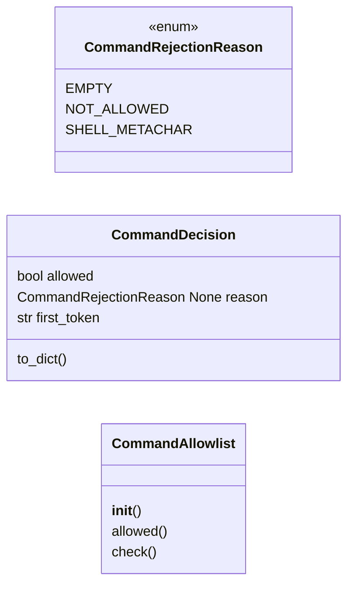
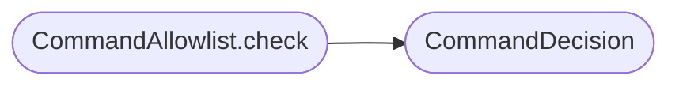

# `lazyc2.security.command_allowlist`

> Source: [lazyc2/security/command_allowlist.py:1](../../lazyc2/security/command_allowlist.py#L1) | language `py` | coverage 100.0% | [API index](../index.md)

Command allowlist policy for the LazyOwn C2 ``/api/run`` endpoint.

Contract: this module gates arbitrary command execution so only commands
whose first whitespace-delimited token is on a configurable allowlist can
reach the LazyOwn shell. Shell metacharacters are always rejected as a
defence-in-depth check independent of the allowlist.

Invariants:

1. The first non-whitespace token of the command is matched against the
   allowlist in a case-insensitive way.
2. Any of the characters ``;``, ``|``, ``&``, ``$``, ``>``, ``<``,
   backtick, newline, carriage return, or backslash causes a rejection
   with reason [`CommandRejectionReason.SHELL_METACHAR`](#commandrejectionreason-shell_metachar).
3. Empty / whitespace / non-string commands reject with reason
   [`CommandRejectionReason.EMPTY`](#commandrejectionreason-empty).
4. When ``audit_log_path`` is set, every decision is appended as a single
   JSON line so the operator can review what was attempted.

Config keys owned:

- ``c2_api_command_allowlist`` (CSV string, default
  ``"ping,set,show,help,status,sessions,sitrep,gets,get,downloader,getosession,osession,setar,getar,session,clean"``)

## Contents

- **Classes:** [`CommandDecision`](#commanddecision), [`CommandAllowlist`](#commandallowlist)
- **Enums:** [`CommandRejectionReason`](#commandrejectionreason)

## Type Diagram



## Call Graph

Solid arrows stay in this module, dashed arrows leave it.



## Classes

<a id="commanddecision"></a>

### `CommandDecision`

`class` `dataclass` | [lazyc2/security/command_allowlist.py:48](../../lazyc2/security/command_allowlist.py#L48)

Decorators: `@dataclass(frozen=True)`

```python
class CommandDecision
```

The outcome of a single command allowlist check.

**Attributes**

| Name | Type | Default | Description |
|---|---|---|---|
| [`allowed`](#commanddecision-allowed) | `bool` |  | ``True`` if the command may be executed. |
| [`reason`](#commanddecision-reason) | `CommandRejectionReason \| None` |  | The rejection reason, or ``None`` when allowed. |
| [`first_token`](#commanddecision-first_token) | `str` |  | The normalized first token, useful for audit logs. |

**Members**

| Member | Kind | Summary |
|---|---|---|
| [`to_dict`](#commanddecision-to_dict) | method | Return a JSON-serializable dict for the audit log. |

<a id="commanddecision-to_dict"></a>

#### `CommandDecision.to_dict`

`method` | [lazyc2/security/command_allowlist.py:61](../../lazyc2/security/command_allowlist.py#L61)

```python
def to_dict(self) -> dict[str, str | bool | None]
```

Return a JSON-serializable dict for the audit log.

**Returns:** `dict[str, str | bool | None]`

---

<a id="commandallowlist"></a>

### `CommandAllowlist`

`class` | [lazyc2/security/command_allowlist.py:70](../../lazyc2/security/command_allowlist.py#L70)

```python
class CommandAllowlist
```

Allowlist gate for the ``/api/run`` endpoint.

**Parameters**

| Name | Type | Default | Description |
|---|---|---|---|
| `allowed` |  |  | Iterable of allowed first tokens. Order is irrelevant; matching is case-insensitive. |
| `audit_log_path` |  |  | Optional filesystem path. When provided, every decision is appended as one JSON object per line. |

**Members**

| Member | Kind | Summary |
|---|---|---|
| [`__init__`](#commandallowlist-__init__) | constructor |  |
| [`allowed`](#commandallowlist-allowed) | property | Return the immutable set of allowed first tokens (lowercased). |
| [`check`](#commandallowlist-check) | method | Return the [`CommandDecision`](#commanddecision) for ``command``. |

<a id="commandallowlist-__init__"></a>

#### `CommandAllowlist.__init__`

`constructor` | [lazyc2/security/command_allowlist.py:82](../../lazyc2/security/command_allowlist.py#L82)

```python
def __init__(self, allowed: Iterable[str], audit_log_path: str | Path | None = None) -> None
```

**Parameters**

| Name | Type | Default | Description |
|---|---|---|---|
| `allowed` | `Iterable[str]` |  | Iterable of allowed first tokens. Order is irrelevant; matching is case-insensitive. |
| `audit_log_path` | `str \| Path \| None` | `None` | Optional filesystem path. When provided, every decision is appended as one JSON object per line. |

**Raises**

- `ValueError`: (raised in the body, not documented)

<a id="commandallowlist-allowed"></a>

#### `CommandAllowlist.allowed`

`property` | [lazyc2/security/command_allowlist.py:94](../../lazyc2/security/command_allowlist.py#L94)

Decorators: `@property`

```python
def allowed(self) -> frozenset[str]
```

Return the immutable set of allowed first tokens (lowercased).

**Returns:** `frozenset[str]`

<a id="commandallowlist-check"></a>

#### `CommandAllowlist.check`

`method` | [lazyc2/security/command_allowlist.py:98](../../lazyc2/security/command_allowlist.py#L98)

```python
def check(self, command: object) -> CommandDecision
```

Return the [`CommandDecision`](#commanddecision) for ``command``.

**Parameters**

| Name | Type | Default | Description |
|---|---|---|---|
| `command` | `object` |  | The raw command string from the request. |

**Returns:** `CommandDecision` - A [`CommandDecision`](#commanddecision) describing the outcome. The
decision is also written to the audit log if configured.

*Calls:* [`CommandDecision`](#commanddecision)

---

## Enums

<a id="commandrejectionreason"></a>

### `CommandRejectionReason`

`enum` | [lazyc2/security/command_allowlist.py:36](../../lazyc2/security/command_allowlist.py#L36)

```python
class CommandRejectionReason(StrEnum)
```

Bases: `StrEnum`

Why a command was rejected by [`CommandAllowlist`](#commandallowlist).

**Attributes**

| Name | Type | Default | Description |
|---|---|---|---|
| [`EMPTY`](#commandrejectionreason-empty) |  | `'empty'` |  |
| [`NOT_ALLOWED`](#commandrejectionreason-not_allowed) |  | `'not_allowed'` |  |
| [`SHELL_METACHAR`](#commandrejectionreason-shell_metachar) |  | `'shell_metachar'` |  |

---
