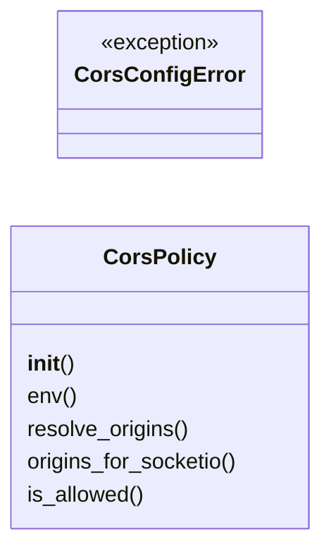
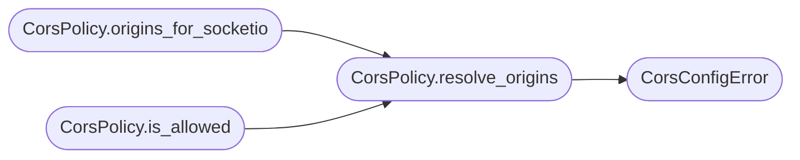

# `lazyc2.security.cors`

> Source: [lazyc2/security/cors.py:1](../../lazyc2/security/cors.py#L1) | language `py` | coverage 100.0% | [API index](../index.md)

CORS origin allowlist policy for the LazyOwn C2 web layer.

Contract: this module owns the single source of truth for which origins the
C2 web layer and its Socket.IO transport are willing to serve.

Invariants:

1. The wildcard ``"*"`` is never permitted; an empty allowlist is allowed
   only when ``env != "PROD"`` and falls back to ``https://{lhost}``.
2. CSV strings are split on comma, trimmed, and empty tokens skipped.
3. ``"*"`` tokens inside a CSV are silently dropped (defence in depth).
4. ``is_allowed(origin)`` matches by ``scheme://hostname[:port]`` so the
   port may differ between the configured origin and the request.
5. `[`origins_for_socketio`](#corspolicy-origins_for_socketio)` returns the allowlist expanded with the
   configured ``c2_port`` and the common C2 ports so flask-socketio's
   exact-match check on the ``Origin`` header passes for the xterm.js
   and beacon clients.
6. The policy is intentionally immutable: `[`resolve_origins`](#corspolicy-resolve_origins)` can be
   called repeatedly and returns a fresh list each time.

Config keys owned:

- `[`env`](#corspolicy-env)` (string, default ``"DEV"``)
- ``lhost`` (string, used for the dev fallback)
- ``c2_port`` (int, used to expand the socketio allowlist)
- ``c2_allowed_origins`` (string CSV or list of strings, default ``""``)

## Contents

- **Classes:** [`CorsPolicy`](#corspolicy)
- **Exceptions:** [`CorsConfigError`](#corsconfigerror)

## Type Diagram



## Call Graph

Solid arrows stay in this module, dashed arrows leave it.



## Classes

<a id="corspolicy"></a>

### `CorsPolicy`

`class` | [lazyc2/security/cors.py:50](../../lazyc2/security/cors.py#L50)

```python
class CorsPolicy
```

Immutable CORS allowlist derived from the LazyOwn runtime config.

**Parameters**

| Name | Type | Default | Description |
|---|---|---|---|
| `env` |  |  | Runtime environment tag, usually ``"PROD"`` or ``"DEV"``. |
| `lhost` |  |  | Loopback or operator-side address used for the dev fallback. |
| `allowed_origins` |  |  | Either a CSV string or a sequence of origins. |
| `c2_port` |  |  | Optional C2 port used to expand the Socket.IO allowlist. |
| `extra_socketio_ports` |  |  | Optional additional ports to include in the Socket.IO expansion. Defaults to the common C2 ports. |

**Members**

| Member | Kind | Summary |
|---|---|---|
| [`__init__`](#corspolicy-__init__) | constructor |  |
| [`env`](#corspolicy-env) | property | Return the normalized environment tag (``"PROD"`` or ``"DEV"``). |
| [`resolve_origins`](#corspolicy-resolve_origins) | method | Return the validated allowlist of origins for the current env. |
| [`origins_for_socketio`](#corspolicy-origins_for_socketio) | method | Return the allowlist to feed ``flask_socketio.SocketIO``. |
| [`is_allowed`](#corspolicy-is_allowed) | method | Return ``True`` if `[`origin`](modules.c2_profile_engine.py.md#websocketprofile-origin)` matches any allowed entry. |

<a id="corspolicy-__init__"></a>

#### `CorsPolicy.__init__`

`constructor` | [lazyc2/security/cors.py:70](../../lazyc2/security/cors.py#L70)

```python
def __init__(self, env: str, lhost: str, allowed_origins: str | Iterable[str] | None, c2_port: int | None = None, extra_socketio_ports: Iterable[int] | None = None) -> None
```

**Parameters**

| Name | Type | Default | Description |
|---|---|---|---|
| `env` | `str` |  | Runtime environment tag, usually ``"PROD"`` or ``"DEV"``. |
| `lhost` | `str` |  | Loopback or operator-side address used for the dev fallback. |
| `allowed_origins` | `str \| Iterable[str] \| None` |  | Either a CSV string or a sequence of origins. |
| `c2_port` | `int \| None` | `None` | Optional C2 port used to expand the Socket.IO allowlist. |
| `extra_socketio_ports` | `Iterable[int] \| None` | `None` | Optional additional ports to include in the Socket.IO expansion. Defaults to the common C2 ports. |

<a id="corspolicy-env"></a>

#### `CorsPolicy.env`

`property` | [lazyc2/security/cors.py:85](../../lazyc2/security/cors.py#L85)

Decorators: `@property`

```python
def env(self) -> str
```

Return the normalized environment tag (``"PROD"`` or ``"DEV"``).

**Returns:** `str`

<a id="corspolicy-resolve_origins"></a>

#### `CorsPolicy.resolve_origins`

`method` | [lazyc2/security/cors.py:89](../../lazyc2/security/cors.py#L89)

```python
def resolve_origins(self) -> list[str]
```

Return the validated allowlist of origins for the current env.

**Returns:** `list[str]` - A list of origins such as ``["https://c2.example"]``.

**Raises**

- [`CorsConfigError`](#corsconfigerror): when `[`env`](#corspolicy-env)` is ``"PROD"`` and the resolved allowlist is empty.

*Calls:* [`CorsConfigError`](#corsconfigerror)

*Called by:* [`CorsPolicy.is_allowed`](#corspolicy-is_allowed), [`CorsPolicy.origins_for_socketio`](#corspolicy-origins_for_socketio)

<a id="corspolicy-origins_for_socketio"></a>

#### `CorsPolicy.origins_for_socketio`

`method` | [lazyc2/security/cors.py:110](../../lazyc2/security/cors.py#L110)

```python
def origins_for_socketio(self) -> list[str]
```

Return the allowlist to feed ``flask_socketio.SocketIO``.

``flask_socketio`` does an exact match between the request
``Origin`` header and the list passed as ``cors_allowed_origins``.
The browser typically sends the full origin including the port
(e.g. ``https://127.0.0.1:5000``), so this method expands the
policy with the configured ``c2_port`` and the common C2 ports
so the WebSocket upgrade succeeds.

**Returns:** `list[str]` - A deduplicated list of origins with explicit ports.

*Calls:* [`CorsPolicy.resolve_origins`](#corspolicy-resolve_origins)

<a id="corspolicy-is_allowed"></a>

#### `CorsPolicy.is_allowed`

`method` | [lazyc2/security/cors.py:136](../../lazyc2/security/cors.py#L136)

```python
def is_allowed(self, origin: str | None) -> bool
```

Return ``True`` if `[`origin`](modules.c2_profile_engine.py.md#websocketprofile-origin)` matches any allowed entry.

**Parameters**

| Name | Type | Default | Description |
|---|---|---|---|
| `origin` | `str \| None` |  | The ``Origin`` header from the incoming request. |

**Returns:** `bool` - ``True`` when the origin is in the allowlist (port-insensitive),
``False`` otherwise.

*Calls:* [`CorsPolicy.resolve_origins`](#corspolicy-resolve_origins)

---

## Exceptions

<a id="corsconfigerror"></a>

### `CorsConfigError`

`exception` | [lazyc2/security/cors.py:46](../../lazyc2/security/cors.py#L46)

```python
class CorsConfigError(ValueError)
```

Bases: `ValueError`

Raised when the CORS configuration is invalid for the current env.

---
