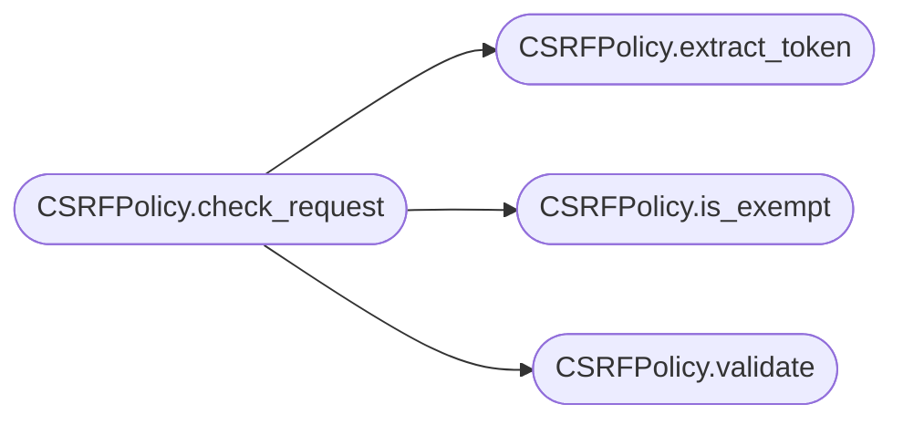

# `lazyc2.security.csrf`

> Source: [lazyc2/security/csrf.py:1](../../lazyc2/security/csrf.py#L1) | language `py` | coverage 100.0% | [API index](../index.md)

CSRF protection policy for the LazyOwn C2 web layer.

Contract: this module issues per-session tokens that the client must echo
back on every mutating request, except for a configured allowlist of
exempt paths (login, logout, beacon endpoints).

Invariants:

1. Tokens are 32 URL-safe bytes (43 characters base64-encoded) generated
   with `secrets.token_urlsafe`.
2. The token store is keyed by session id, so the same session always
   receives the same token until it is rotated.
3. Validation is constant-time to defeat timing oracles.
4. The exempt set is configurable; ``/login`` and ``/logout`` are always
   exempt by default, and ``/api/beacon/`` is exempt because implants
   cannot parse HTML to read a token.
5. ``GET``, ``HEAD``, ``OPTIONS``, and ``TRACE`` requests are treated as
   safe and bypass the check.

Config keys owned:

- ``c2_csrf_enabled`` (bool, default ``True``)
- ``c2_csrf_exempt_paths`` (CSV string, default
  ``"/login,/logout,/register,/api/beacon"``)
- ``c2_csrf_header`` (string, default ``"X-XSRF-TOKEN"``)

## Contents

- **Classes:** [`CSRFPolicy`](#csrfpolicy)

## Call Graph

Solid arrows stay in this module, dashed arrows leave it.



## Classes

<a id="csrfpolicy"></a>

### `CSRFPolicy`

`class` | [lazyc2/security/csrf.py:48](../../lazyc2/security/csrf.py#L48)

```python
class CSRFPolicy
```

Per-session CSRF token issuer and validator.

**Parameters**

| Name | Type | Default | Description |
|---|---|---|---|
| `header` |  |  | HTTP header name carrying the token from the client. |
| `form_field` |  |  | Form field name used as a fallback for older clients. |
| `cookie_name` |  |  | Cookie name used to seed the client-side read. |
| `exempt_paths` |  |  | Tuple of path prefixes that bypass the check. |
| `secret` |  |  | Optional pre-shared secret. When ``None`` a fresh ``secrets.token_urlsafe(32)`` is generated at construction. |

**Members**

| Member | Kind | Summary |
|---|---|---|
| [`__init__`](#csrfpolicy-__init__) | constructor |  |
| [`header`](#csrfpolicy-header) | property | Return the HTTP header name carrying the token. |
| [`cookie_name`](#csrfpolicy-cookie_name) | property | Return the cookie name that should hold the readable token. |
| [`issue`](#csrfpolicy-issue) | method | Return the token bound to ``session_id``. |
| [`rotate`](#csrfpolicy-rotate) | method | Force a fresh token for ``session_id``. |
| [`forget`](#csrfpolicy-forget) | method | Drop the token bound to ``session_id`` (e.g. on logout). |
| [`validate`](#csrfpolicy-validate) | method | Return ``True`` iff ``candidate`` matches the stored token. |
| [`is_exempt`](#csrfpolicy-is_exempt) | method | Return ``True`` if ``path`` is in the exempt set. |
| [`extract_token`](#csrfpolicy-extract_token) | method | Return the token from a Flask-shaped request. |
| [`check_request`](#csrfpolicy-check_request) | method | Run the full CSRF gate against a request. |

<a id="csrfpolicy-__init__"></a>

#### `CSRFPolicy.__init__`

`constructor` | [lazyc2/security/csrf.py:69](../../lazyc2/security/csrf.py#L69)

```python
def __init__(self, header: str = _DEFAULT_HEADER, form_field: str = _DEFAULT_FORM_FIELD, cookie_name: str = _DEFAULT_COOKIE, exempt_paths: tuple[str, ...] = _DEFAULT_EXEMPT_PATHS, secret: str | None = None) -> None
```

**Parameters**

| Name | Type | Default | Description |
|---|---|---|---|
| `header` | `str` | `_DEFAULT_HEADER` | HTTP header name carrying the token from the client. |
| `form_field` | `str` | `_DEFAULT_FORM_FIELD` | Form field name used as a fallback for older clients. |
| `cookie_name` | `str` | `_DEFAULT_COOKIE` | Cookie name used to seed the client-side read. |
| `exempt_paths` | `tuple[str, ...]` | `_DEFAULT_EXEMPT_PATHS` | Tuple of path prefixes that bypass the check. |
| `secret` | `str \| None` | `None` | Optional pre-shared secret. When ``None`` a fresh ``secrets.token_urlsafe(32)`` is generated at construction. |

<a id="csrfpolicy-header"></a>

#### `CSRFPolicy.header`

`property` | [lazyc2/security/csrf.py:85](../../lazyc2/security/csrf.py#L85)

Decorators: `@property`

```python
def header(self) -> str
```

Return the HTTP header name carrying the token.

**Returns:** `str`

<a id="csrfpolicy-cookie_name"></a>

#### `CSRFPolicy.cookie_name`

`property` | [lazyc2/security/csrf.py:90](../../lazyc2/security/csrf.py#L90)

Decorators: `@property`

```python
def cookie_name(self) -> str
```

Return the cookie name that should hold the readable token.

**Returns:** `str`

<a id="csrfpolicy-issue"></a>

#### `CSRFPolicy.issue`

`method` | [lazyc2/security/csrf.py:94](../../lazyc2/security/csrf.py#L94)

```python
def issue(self, session_id: str) -> str
```

Return the token bound to ``session_id``.

**Parameters**

| Name | Type | Default | Description |
|---|---|---|---|
| `session_id` | `str` |  | The Flask session id; must be a non-empty string. |

**Returns:** `str` - A URL-safe token string, stable for the same session id.

**Raises**

- `ValueError`: (raised in the body, not documented)

<a id="csrfpolicy-rotate"></a>

#### `CSRFPolicy.rotate`

`method` | [lazyc2/security/csrf.py:111](../../lazyc2/security/csrf.py#L111)

```python
def rotate(self, session_id: str) -> str
```

Force a fresh token for ``session_id``.

**Parameters**

| Name | Type | Default | Description |
|---|---|---|---|
| `session_id` | `str` |  | The session id to rotate. |

**Returns:** `str` - The new token.

**Raises**

- `ValueError`: (raised in the body, not documented)

<a id="csrfpolicy-forget"></a>

#### `CSRFPolicy.forget`

`method` | [lazyc2/security/csrf.py:126](../../lazyc2/security/csrf.py#L126)

```python
def forget(self, session_id: str) -> None
```

Drop the token bound to ``session_id`` (e.g. on logout).

**Parameters**

| Name | Type | Default | Description |
|---|---|---|---|
| `session_id` | `str` |  |  |

<a id="csrfpolicy-validate"></a>

#### `CSRFPolicy.validate`

`method` | [lazyc2/security/csrf.py:130](../../lazyc2/security/csrf.py#L130)

```python
def validate(self, session_id: str, candidate: str | None) -> bool
```

Return ``True`` iff ``candidate`` matches the stored token.

**Parameters**

| Name | Type | Default | Description |
|---|---|---|---|
| `session_id` | `str` |  | The session id to look up. |
| `candidate` | `str \| None` |  | The token echoed back by the client. |

**Returns:** `bool` - ``True`` when the constant-time comparison succeeds.

*Called by:* [`CSRFPolicy.check_request`](#csrfpolicy-check_request)

<a id="csrfpolicy-is_exempt"></a>

#### `CSRFPolicy.is_exempt`

`method` | [lazyc2/security/csrf.py:147](../../lazyc2/security/csrf.py#L147)

```python
def is_exempt(self, path: str) -> bool
```

Return ``True`` if ``path`` is in the exempt set.

**Parameters**

| Name | Type | Default | Description |
|---|---|---|---|
| `path` | `str` |  | The request path (e.g. ``"/login"``). |

**Returns:** `bool` - ``True`` when any exempt prefix is a prefix of ``path``.

*Called by:* [`CSRFPolicy.check_request`](#csrfpolicy-check_request)

<a id="csrfpolicy-extract_token"></a>

#### `CSRFPolicy.extract_token`

`method` | [lazyc2/security/csrf.py:163](../../lazyc2/security/csrf.py#L163)

```python
def extract_token(self, request: object) -> str | None
```

Return the token from a Flask-shaped request.

**Parameters**

| Name | Type | Default | Description |
|---|---|---|---|
| `request` | `object` |  | An object exposing ``headers`` and ``form`` mappings. |

**Returns:** `str | None` - The token string or ``None`` if absent.

*Called by:* [`CSRFPolicy.check_request`](#csrfpolicy-check_request)

<a id="csrfpolicy-check_request"></a>

#### `CSRFPolicy.check_request`

`method` | [lazyc2/security/csrf.py:182](../../lazyc2/security/csrf.py#L182)

```python
def check_request(self, session_id: str, request: object) -> bool
```

Run the full CSRF gate against a request.

**Parameters**

| Name | Type | Default | Description |
|---|---|---|---|
| `session_id` | `str` |  | The session id derived from the request cookie. |
| `request` | `object` |  | A Flask-shaped request. |

**Returns:** `bool` - ``True`` when the request should be allowed, ``False`` otherwise.

*Calls:* [`CSRFPolicy.extract_token`](#csrfpolicy-extract_token), [`CSRFPolicy.is_exempt`](#csrfpolicy-is_exempt), [`CSRFPolicy.validate`](#csrfpolicy-validate)

---
