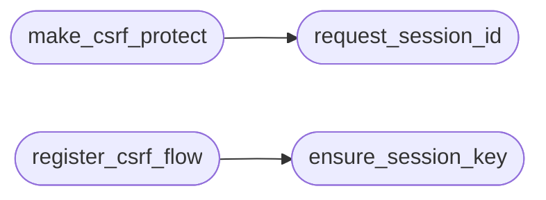

# `lazyc2.security.csrf_flow`

> Source: [lazyc2/security/csrf_flow.py:1](../../lazyc2/security/csrf_flow.py#L1) | language `py` | coverage 100.0% | [API index](../index.md)

End-to-end CSRF token flow for the LazyOwn C2 web layer.

Contract: this module wires [`lazyc2.security.csrf.CSRFPolicy`](lazyc2.security.csrf.py.md#csrfpolicy) into a
Flask application so every authenticated browser session receives a token
and every mutating request must echo it back. Non-browser clients (the CLI
driving the C2 over HTTP Basic) are exempt because a cross-site page cannot
attach the operator's Basic credentials.

Flow:

1. ``before_request`` primes a stable per-session key inside the signed
   Flask session and issues (or reuses) the token bound to that key.
2. ``after_request`` attaches two cookies: the policy cookie (session key,
   read back server-side by the gate, ``HttpOnly``) and a readable token
   cookie the browser JavaScript echoes as the policy header. Both carry
   ``Secure`` whenever ``secure_fn()`` reports TLS (or the request itself
   arrived over HTTPS), and ``SameSite=Strict`` always.
3. A context processor exposes the token to templates for hidden form
   fields (``<input type="hidden" name="xsrf_token" value="{{ csrf_token }}">``).

The pure token policy stays in [`lazyc2.security.csrf`](lazyc2.security.csrf.py.md); only Flask
wiring lives here.

## Contents

- **Functions:** [`ensure_session_key`](#ensure_session_key), [`request_session_id`](#request_session_id), [`make_csrf_protect`](#make_csrf_protect), [`register_csrf_flow`](#register_csrf_flow), [`token_cookie_name`](#token_cookie_name)
- **Constants:** [`SESSION_KEY`](#session_key)

## Call Graph

Solid arrows stay in this module, dashed arrows leave it.



## Functions

<a id="ensure_session_key"></a>

### `ensure_session_key`

`function` | [lazyc2/security/csrf_flow.py:42](../../lazyc2/security/csrf_flow.py#L42)

```python
def ensure_session_key(session: dict[str, Any]) -> str
```

Return the per-session CSRF key, creating it on first use.

**Parameters**

| Name | Type | Default | Description |
|---|---|---|---|
| `session` | `dict[str, Any]` |  | Flask session mapping. |

**Returns:** `str` - A stable per-session key indexing the token store.

*Called by:* [`register_csrf_flow`](#register_csrf_flow)

---

<a id="request_session_id"></a>

### `request_session_id`

`function` | [lazyc2/security/csrf_flow.py:58](../../lazyc2/security/csrf_flow.py#L58)

```python
def request_session_id(policy: CSRFPolicy, request: Request, session: dict[str, Any]) -> str
```

Derive the token-store key for the incoming request.

Lookup order: the policy cookie (sent automatically by the browser),
the Flask session key, then the legacy ``X-Session-Id`` header.

**Parameters**

| Name | Type | Default | Description |
|---|---|---|---|
| `policy` | `CSRFPolicy` |  | Active [`lazyc2.security.csrf.CSRFPolicy`](lazyc2.security.csrf.py.md#csrfpolicy). |
| `request` | `Request` |  | Flask request. |
| `session` | `dict[str, Any]` |  | Flask session mapping. |

**Returns:** `str` - The session id string (possibly empty).

*Called by:* [`make_csrf_protect`](#make_csrf_protect)

---

<a id="make_csrf_protect"></a>

### `make_csrf_protect`

`function` | [lazyc2/security/csrf_flow.py:81](../../lazyc2/security/csrf_flow.py#L81)

```python
def make_csrf_protect(policy: CSRFPolicy, enabled_fn: Callable[[], bool], basic_authenticated_fn: Callable[[], bool] | None = None) -> Callable[..., Any]
```

Build the `[`csrf_protect`](lazyc2.blueprints.addons.py.md#csrf_protect)` decorator bound to ``policy``.

**Parameters**

| Name | Type | Default | Description |
|---|---|---|---|
| `policy` | `CSRFPolicy` |  | Active [`lazyc2.security.csrf.CSRFPolicy`](lazyc2.security.csrf.py.md#csrfpolicy). |
| `enabled_fn` | `Callable[[], bool]` |  | Callable returning whether the gate is enabled. |
| `basic_authenticated_fn` | `Callable[[], bool] \| None` | `None` | Callable returning ``True`` when the request already authenticated over HTTP Basic. Non-browser channels are exempt from CSRF. |

**Returns:** `Callable[..., Any]` - A decorator enforcing the per-session CSRF token on mutations.

*Calls:* [`request_session_id`](#request_session_id)

---

<a id="register_csrf_flow"></a>

### `register_csrf_flow`

`function` | [lazyc2/security/csrf_flow.py:116](../../lazyc2/security/csrf_flow.py#L116)

```python
def register_csrf_flow(app: Flask, policy: CSRFPolicy, enabled_fn: Callable[[], bool], secure_fn: Callable[[], bool] | None = None) -> None
```

Wire token issuance, delivery cookies and template globals.

**Parameters**

| Name | Type | Default | Description |
|---|---|---|---|
| `app` | `Flask` |  | Flask application. |
| `policy` | `CSRFPolicy` |  | Active [`lazyc2.security.csrf.CSRFPolicy`](lazyc2.security.csrf.py.md#csrfpolicy). |
| `enabled_fn` | `Callable[[], bool]` |  | Callable returning whether the gate is enabled. |
| `secure_fn` | `Callable[[], bool] \| None` | `None` | Optional callable reporting whether the listener runs with TLS. When it returns True (or the request itself arrived over HTTPS), both CSRF cookies carry the ``Secure`` flag. Defaults to per-request ``request.is_secure`` detection. |

**Returns:** `None` - None.

*Calls:* [`ensure_session_key`](#ensure_session_key)

---

<a id="token_cookie_name"></a>

### `token_cookie_name`

`function` | [lazyc2/security/csrf_flow.py:192](../../lazyc2/security/csrf_flow.py#L192)

```python
def token_cookie_name() -> str
```

Return the readable cookie name carrying the CSRF token.

**Returns:** `str`

---

## Constants

<a id="session_key"></a>

### `SESSION_KEY`

`constant` | [lazyc2/security/csrf_flow.py:37](../../lazyc2/security/csrf_flow.py#L37)

```python
SESSION_KEY = 'csrf_key'
```

---
