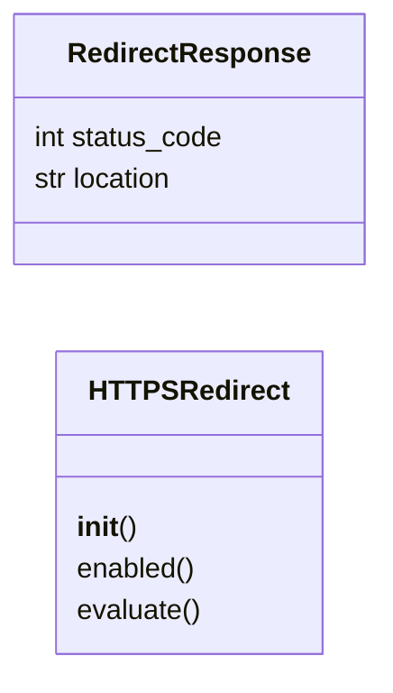
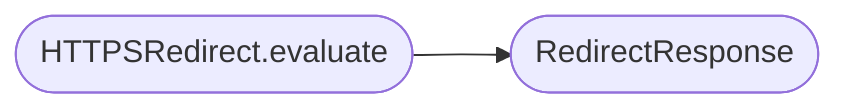

# `lazyc2.security.https_redirect`

> Source: [lazyc2/security/https_redirect.py:1](../../lazyc2/security/https_redirect.py#L1) | language `py` | coverage 100.0% | [API index](../index.md)

HTTPS redirect policy for the LazyOwn C2 web layer.

Contract: this module produces the response that a Flask ``before_request``
handler must return to force the client onto TLS in PROD, while leaving
DEV traffic alone.

Invariants:

1. ``is_secure=True`` requests always pass through.
2. ``is_secure=False`` + ``env="PROD"`` + ``enabled=True`` returns a
   301 redirect to the same URL with the scheme replaced by ``https``.
3. ``env="DEV"`` or ``enabled=False`` lets the request pass through.
4. The path, query string, and host header are preserved.
5. The redirect response is a small dataclass so the ``before_request``
   handler does not have to import Flask at import time.

Config keys owned:

- ``c2_https_redirect`` (bool, default ``True``)
- ``env`` (string, default ``"DEV"``)

## Contents

- **Classes:** [`RedirectResponse`](#redirectresponse), [`HTTPSRedirect`](#httpsredirect)

## Type Diagram



## Call Graph

Solid arrows stay in this module, dashed arrows leave it.



## Classes

<a id="redirectresponse"></a>

### `RedirectResponse`

`class` `dataclass` | [lazyc2/security/https_redirect.py:29](../../lazyc2/security/https_redirect.py#L29)

Decorators: `@dataclass(frozen=True)`

```python
class RedirectResponse
```

A 301 redirect reply compatible with Flask's ``before_request`` return.

**Attributes**

| Name | Type | Default | Description |
|---|---|---|---|
| [`status_code`](#redirectresponse-status_code) | `int` |  | HTTP status code, always 301. |
| [`location`](#redirectresponse-location) | `str` |  | Target URL the client should follow. |

---

<a id="httpsredirect"></a>

### `HTTPSRedirect`

`class` | [lazyc2/security/https_redirect.py:41](../../lazyc2/security/https_redirect.py#L41)

```python
class HTTPSRedirect
```

Decide whether a request should be upgraded to HTTPS.

**Parameters**

| Name | Type | Default | Description |
|---|---|---|---|
| `env` |  |  | Runtime environment tag, usually ``"PROD"`` or ``"DEV"``. |
| `enabled` |  |  | When ``False``, the policy is a no-op. |

**Members**

| Member | Kind | Summary |
|---|---|---|
| [`__init__`](#httpsredirect-__init__) | constructor |  |
| [`enabled`](#httpsredirect-enabled) | property | Return ``True`` when the policy is active. |
| [`evaluate`](#httpsredirect-evaluate) | method | Return a redirect response, or ``None`` if the request can pass. |

<a id="httpsredirect-__init__"></a>

#### `HTTPSRedirect.__init__`

`constructor` | [lazyc2/security/https_redirect.py:51](../../lazyc2/security/https_redirect.py#L51)

```python
def __init__(self, env: str, enabled: bool) -> None
```

**Parameters**

| Name | Type | Default | Description |
|---|---|---|---|
| `env` | `str` |  | Runtime environment tag, usually ``"PROD"`` or ``"DEV"``. |
| `enabled` | `bool` |  | When ``False``, the policy is a no-op. |

<a id="httpsredirect-enabled"></a>

#### `HTTPSRedirect.enabled`

`property` | [lazyc2/security/https_redirect.py:56](../../lazyc2/security/https_redirect.py#L56)

Decorators: `@property`

```python
def enabled(self) -> bool
```

Return ``True`` when the policy is active.

**Returns:** `bool`

<a id="httpsredirect-evaluate"></a>

#### `HTTPSRedirect.evaluate`

`method` | [lazyc2/security/https_redirect.py:60](../../lazyc2/security/https_redirect.py#L60)

```python
def evaluate(self, request: object) -> RedirectResponse | None
```

Return a redirect response, or ``None`` if the request can pass.

**Parameters**

| Name | Type | Default | Description |
|---|---|---|---|
| `request` | `object` |  | A Flask-shaped request exposing `[`is_secure`](lazygui.services.models.py.md#listener-is_secure)`, ``host``, ``path``, and ``query_string`` attributes. |

**Returns:** `RedirectResponse | None` - A [`RedirectResponse`](#redirectresponse) to be returned from
``before_request``; ``None`` if no redirect is required.

*Calls:* [`RedirectResponse`](#redirectresponse)

---
