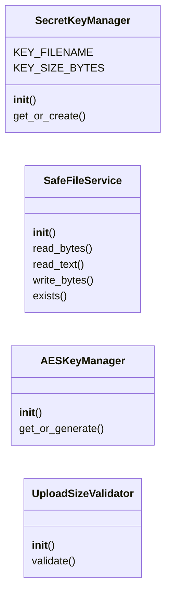

# `lazyc2.security.services`

> Source: [lazyc2/security/services.py:1](../../lazyc2/security/services.py#L1) | language `py` | coverage 75.0% | [API index](../index.md)

Security services for the LazyOwn C2 web layer.

Services encapsulate stateful security operations such as safe file
handling, secret generation, and content sanitization.

## Contents

- **Classes:** [`SecretKeyManager`](#secretkeymanager), [`SafeFileService`](#safefileservice), [`AESKeyManager`](#aeskeymanager), [`UploadSizeValidator`](#uploadsizevalidator)

## Type Diagram



## Call Graph

Solid arrows stay in this module, dashed arrows leave it.


## Classes

<a id="secretkeymanager"></a>

### `SecretKeyManager`

`class` | [lazyc2/security/services.py:19](../../lazyc2/security/services.py#L19)

```python
class SecretKeyManager
```

Manages the Flask secret key lifecycle.

Generates a cryptographically secure secret key on first boot and
persists it to disk with restrictive permissions. Subsequent boots
load the persisted key. No fallback secrets are permitted.

**Attributes**

| Name | Type | Default | Description |
|---|---|---|---|
| [`KEY_FILENAME`](#secretkeymanager-key_filename) |  | `'.secret_key'` |  |
| [`KEY_SIZE_BYTES`](#secretkeymanager-key_size_bytes) |  | `64` |  |

**Members**

| Member | Kind | Summary |
|---|---|---|
| [`__init__`](#secretkeymanager-__init__) | constructor |  |
| [`get_or_create`](#secretkeymanager-get_or_create) | method | Return an existing secret key or generate and persist a new one. |

<a id="secretkeymanager-__init__"></a>

#### `SecretKeyManager.__init__`

`constructor` | [lazyc2/security/services.py:30](../../lazyc2/security/services.py#L30)

```python
def __init__(self, sessions_dir: Path)
```

**Parameters**

| Name | Type | Default | Description |
|---|---|---|---|
| `sessions_dir` | `Path` |  |  |

<a id="secretkeymanager-get_or_create"></a>

#### `SecretKeyManager.get_or_create`

`method` | [lazyc2/security/services.py:33](../../lazyc2/security/services.py#L33)

```python
def get_or_create(self) -> str
```

Return an existing secret key or generate and persist a new one.

**Returns:** `str` - A hex-encoded secret key string.

**Raises**

- `RuntimeError`: If the key file exists but cannot be read.

---

<a id="safefileservice"></a>

### `SafeFileService`

`class` | [lazyc2/security/services.py:56](../../lazyc2/security/services.py#L56)

```python
class SafeFileService
```

Provides safe file read/write operations with path traversal protection.

All paths are resolved canonically and verified to be within the
configured base directory before any I/O occurs.

**Members**

| Member | Kind | Summary |
|---|---|---|
| [`__init__`](#safefileservice-__init__) | constructor |  |
| [`read_bytes`](#safefileservice-read_bytes) | method | Read a file as bytes after path validation. |
| [`read_text`](#safefileservice-read_text) | method | Read a file as text after path validation. |
| [`write_bytes`](#safefileservice-write_bytes) | method | Write bytes to a file after path validation. |
| [`exists`](#safefileservice-exists) | method | Check if a path exists after validation. |

<a id="safefileservice-__init__"></a>

#### `SafeFileService.__init__`

`constructor` | [lazyc2/security/services.py:63](../../lazyc2/security/services.py#L63)

```python
def __init__(self, base_dir: Path)
```

**Parameters**

| Name | Type | Default | Description |
|---|---|---|---|
| `base_dir` | `Path` |  |  |

**Raises**

- `ValueError`: (raised in the body, not documented)

<a id="safefileservice-read_bytes"></a>

#### `SafeFileService.read_bytes`

`method` | [lazyc2/security/services.py:86](../../lazyc2/security/services.py#L86)

```python
def read_bytes(self, relative_path: str) -> bytes
```

Read a file as bytes after path validation.

**Parameters**

| Name | Type | Default | Description |
|---|---|---|---|
| `relative_path` | `str` |  | Relative path within the base directory. |

**Returns:** `bytes` - File contents as bytes.

**Raises**

- [`PermissionError`](core.errors.py.md#permissionerror): If path traversal is detected.
- `FileNotFoundError`: If the file does not exist.

<a id="safefileservice-read_text"></a>

#### `SafeFileService.read_text`

`method` | [lazyc2/security/services.py:102](../../lazyc2/security/services.py#L102)

```python
def read_text(self, relative_path: str, encoding: str = 'utf-8') -> str
```

Read a file as text after path validation.

**Parameters**

| Name | Type | Default | Description |
|---|---|---|---|
| `relative_path` | `str` |  | Relative path within the base directory. |
| `encoding` | `str` | `'utf-8'` | Text encoding to use. |

**Returns:** `str` - File contents as string.

**Raises**

- [`PermissionError`](core.errors.py.md#permissionerror): If path traversal is detected.
- `FileNotFoundError`: If the file does not exist.

<a id="safefileservice-write_bytes"></a>

#### `SafeFileService.write_bytes`

`method` | [lazyc2/security/services.py:119](../../lazyc2/security/services.py#L119)

```python
def write_bytes(self, relative_path: str, data: bytes) -> None
```

Write bytes to a file after path validation.

Creates parent directories if needed.

**Parameters**

| Name | Type | Default | Description |
|---|---|---|---|
| `relative_path` | `str` |  | Relative path within the base directory. |
| `data` | `bytes` |  | Bytes to write. |

**Raises**

- [`PermissionError`](core.errors.py.md#permissionerror): If path traversal is detected.

<a id="safefileservice-exists"></a>

#### `SafeFileService.exists`

`method` | [lazyc2/security/services.py:136](../../lazyc2/security/services.py#L136)

```python
def exists(self, relative_path: str) -> bool
```

Check if a path exists after validation.

**Parameters**

| Name | Type | Default | Description |
|---|---|---|---|
| `relative_path` | `str` |  | Relative path within the base directory. |

**Returns:** `bool` - True if the path exists, False otherwise.

**Raises**

- [`PermissionError`](core.errors.py.md#permissionerror): If path traversal is detected.

---

<a id="aeskeymanager"></a>

### `AESKeyManager`

`class` | [lazyc2/security/services.py:152](../../lazyc2/security/services.py#L152)

```python
class AESKeyManager
```

Manages AES key generation and validation.

Ensures keys are exactly the required size for AES-256-CFB.

**Members**

| Member | Kind | Summary |
|---|---|---|
| [`__init__`](#aeskeymanager-__init__) | constructor |  |
| [`get_or_generate`](#aeskeymanager-get_or_generate) | method | Return an existing AES key or generate a new one. |

<a id="aeskeymanager-__init__"></a>

#### `AESKeyManager.__init__`

`constructor` | [lazyc2/security/services.py:158](../../lazyc2/security/services.py#L158)

```python
def __init__(self, key_file: Path)
```

**Parameters**

| Name | Type | Default | Description |
|---|---|---|---|
| `key_file` | `Path` |  |  |

*Called by:* [`deploy`](modules.c2_agent.py.md#deploy)

<a id="aeskeymanager-get_or_generate"></a>

#### `AESKeyManager.get_or_generate`

`method` | [lazyc2/security/services.py:161](../../lazyc2/security/services.py#L161)

```python
def get_or_generate(self) -> bytes
```

Return an existing AES key or generate a new one.

**Returns:** `bytes` - A 32-byte AES key.

**Raises**

- `ValueError`: If an existing key has an invalid length.

*Calls:* [`validate_aes_key`](lazyc2.security.validators.py.md#validate_aes_key)

*Called by:* [`deploy`](modules.c2_agent.py.md#deploy)

---

<a id="uploadsizevalidator"></a>

### `UploadSizeValidator`

`class` | [lazyc2/security/services.py:183](../../lazyc2/security/services.py#L183)

```python
class UploadSizeValidator
```

Validates upload size constraints.

Stateless service that checks content length against configured limits.

**Members**

| Member | Kind | Summary |
|---|---|---|
| [`__init__`](#uploadsizevalidator-__init__) | constructor |  |
| [`validate`](#uploadsizevalidator-validate) | method | Validate upload size. |

<a id="uploadsizevalidator-__init__"></a>

#### `UploadSizeValidator.__init__`

`constructor` | [lazyc2/security/services.py:189](../../lazyc2/security/services.py#L189)

```python
def __init__(self, max_size_bytes: int = MAX_UPLOAD_SIZE_BYTES)
```

**Parameters**

| Name | Type | Default | Description |
|---|---|---|---|
| `max_size_bytes` | `int` | `MAX_UPLOAD_SIZE_BYTES` |  |

<a id="uploadsizevalidator-validate"></a>

#### `UploadSizeValidator.validate`

`method` | [lazyc2/security/services.py:192](../../lazyc2/security/services.py#L192)

```python
def validate(self, content_length: int | None) -> None
```

Validate upload size.

**Parameters**

| Name | Type | Default | Description |
|---|---|---|---|
| `content_length` | `int \| None` |  | The content length header value. |

**Raises**

- `ValueError`: If the content length exceeds the maximum.

---
