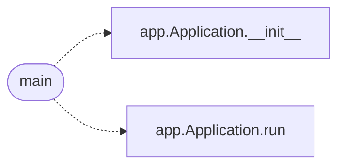

# `lazygui.__main__`

> Source: [lazygui/__main__.py:1](../../lazygui/__main__.py#L1) | language `py` | coverage 100.0% | [API index](../index.md)

Entry point for ``python -m lazygui``.

Delegates to [`lazygui.app.Application`](lazygui.app.py.md#application) so command-line invocation and
programmatic embedding share the same bootstrap path.

## Contents

- **Functions:** [`main`](#main)

## Call Graph

Solid arrows stay in this module, dashed arrows leave it.



## Functions

<a id="main"></a>

### `main`

`function` | [lazygui/__main__.py:14](../../lazygui/__main__.py#L14)

```python
def main() -> int
```

Bootstrap the GUI and run the Qt event loop.

Returns the exit status produced by Qt so it can propagate to the shell.

**Returns:** `int`

*Calls:* [`Application.__init__`](lazygui.app.py.md#application-__init__), [`Application.run`](lazygui.app.py.md#application-run)

---
