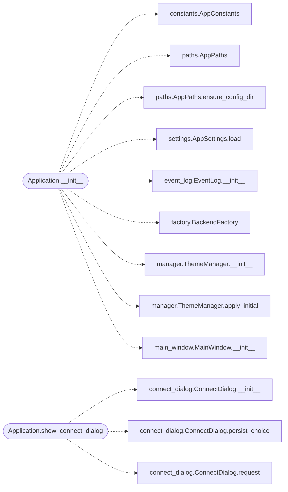

# `lazygui.app`

> Source: [lazygui/app.py:1](../../lazygui/app.py#L1) | language `py` | coverage 100.0% | [API index](../index.md)

Application bootstrap.

Wires the configuration, theme, services and main window together. The
[`Application`](#application) class is the only place that knows how to assemble
every subsystem; everything else accepts dependencies through its
constructor and stays testable in isolation.

## Contents

- **Classes:** [`Application`](#application)

## Call Graph

Solid arrows stay in this module, dashed arrows leave it.



## Classes

<a id="application"></a>

### `Application`

`class` | [lazygui/app.py:33](../../lazygui/app.py#L33)

```python
class Application
```

Owns the QApplication instance and the lifetime of every subsystem.

**Members**

| Member | Kind | Summary |
|---|---|---|
| [`__init__`](#application-__init__) | constructor | Build constants/settings/theme/backend/main-window. |
| [`run`](#application-run) | method | Show the main window, start the backend, and run the event loop. |
| [`show_connect_dialog`](#application-show_connect_dialog) | method | Open the connection dialog and swap backends if accepted. |

<a id="application-__init__"></a>

#### `Application.__init__`

`constructor` | [lazygui/app.py:36](../../lazygui/app.py#L36)

```python
def __init__(self, argv: Sequence[str] | None = None) -> None
```

Build constants/settings/theme/backend/main-window.

**Parameters**

| Name | Type | Default | Description |
|---|---|---|---|
| `argv` | `Sequence[str] \| None` | `None` |  |

*Calls:* [`AppConstants`](lazygui.config.constants.py.md#appconstants), [`AppPaths`](lazygui.config.paths.py.md#apppaths), [`AppPaths.ensure_config_dir`](lazygui.config.paths.py.md#apppaths-ensure_config_dir), [`AppSettings.load`](lazygui.config.settings.py.md#appsettings-load), [`EventLog.__init__`](lazygui.services.event_log.py.md#eventlog-__init__), [`BackendFactory`](lazygui.services.factory.py.md#backendfactory), [`ThemeManager.__init__`](lazygui.theme.manager.py.md#thememanager-__init__), [`ThemeManager.apply_initial`](lazygui.theme.manager.py.md#thememanager-apply_initial), [`MainWindow.__init__`](lazygui.windows.main_window.py.md#mainwindow-__init__)

*Called by:* [`main`](lazygui.__main__.py.md#main)

<a id="application-run"></a>

#### `Application.run`

`method` | [lazygui/app.py:65](../../lazygui/app.py#L65)

```python
def run(self) -> int
```

Show the main window, start the backend, and run the event loop.

**Returns:** `int`

*Called by:* [`main`](lazygui.__main__.py.md#main)

<a id="application-show_connect_dialog"></a>

#### `Application.show_connect_dialog`

`method` | [lazygui/app.py:100](../../lazygui/app.py#L100)

```python
def show_connect_dialog(self) -> None
```

Open the connection dialog and swap backends if accepted.

*Calls:* [`ConnectDialog.__init__`](lazygui.windows.connect_dialog.py.md#connectdialog-__init__), [`ConnectDialog.persist_choice`](lazygui.windows.connect_dialog.py.md#connectdialog-persist_choice), [`ConnectDialog.request`](lazygui.windows.connect_dialog.py.md#connectdialog-request)

---
