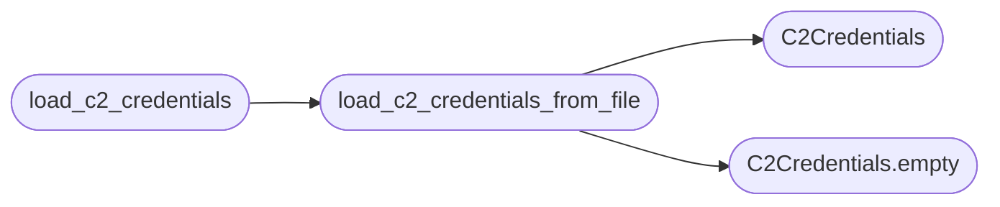

# `lazygui.config.c2_credentials`

> Source: [lazygui/config/c2_credentials.py:1](../../lazygui/config/c2_credentials.py#L1) | language `py` | coverage 100.0% | [API index](../index.md)

C2 auto-generated credentials discovery.

``lazyc2.py`` writes ``.c2_credentials.txt`` at startup containing the
auto-generated strong credentials. This module provides the parser that
reads that file and returns a ``(username, password)`` tuple so the GUI
can auto-connect without manual credential entry.

## Contents

- **Classes:** [`C2Credentials`](#c2credentials)
- **Functions:** [`load_c2_credentials_from_file`](#load_c2_credentials_from_file), [`load_c2_credentials`](#load_c2_credentials)

## Call Graph

Solid arrows stay in this module, dashed arrows leave it.



## Classes

<a id="c2credentials"></a>

### `C2Credentials`

`class` `dataclass` | [lazygui/config/c2_credentials.py:24](../../lazygui/config/c2_credentials.py#L24)

Decorators: `@dataclass(frozen=True, slots=True)`

```python
class C2Credentials
```

Parsed credentials from the auto-generated file.

**Attributes**

| Name | Type | Default | Description |
|---|---|---|---|
| [`username`](#c2credentials-username) | `str` |  |  |
| [`password`](#c2credentials-password) | `str` |  |  |
| [`source_path`](#c2credentials-source_path) | `Path` |  |  |
| [`loaded`](#c2credentials-loaded) | `bool` | `True` |  |

**Members**

| Member | Kind | Summary |
|---|---|---|
| [`empty`](#c2credentials-empty) | classmethod | Return a sentinel representing no credentials available. |

<a id="c2credentials-empty"></a>

#### `C2Credentials.empty`

`classmethod` | [lazygui/config/c2_credentials.py:33](../../lazygui/config/c2_credentials.py#L33)

Decorators: `@classmethod`

```python
def empty(cls) -> C2Credentials
```

Return a sentinel representing no credentials available.

**Returns:** `C2Credentials`

*Called by:* [`load_c2_credentials_from_file`](#load_c2_credentials_from_file)

---

## Functions

<a id="load_c2_credentials_from_file"></a>

### `load_c2_credentials_from_file`

`function` | [lazygui/config/c2_credentials.py:38](../../lazygui/config/c2_credentials.py#L38)

```python
def load_c2_credentials_from_file(file_path: Path) -> C2Credentials
```

Parse ``.c2_credentials.txt`` and return username + password.

**Parameters**

| Name | Type | Default | Description |
|---|---|---|---|
| `file_path` | `Path` |  | Absolute path to the credentials file. |

**Returns:** `C2Credentials` - A populated [`C2Credentials`](#c2credentials) if the file exists and contains
valid entries, or [`C2Credentials.empty`](#c2credentials-empty) otherwise.

*Calls:* [`C2Credentials`](#c2credentials), [`C2Credentials.empty`](#c2credentials-empty)

*Called by:* [`load_c2_credentials`](#load_c2_credentials)

---

<a id="load_c2_credentials"></a>

### `load_c2_credentials`

`function` | [lazygui/config/c2_credentials.py:71](../../lazygui/config/c2_credentials.py#L71)

```python
def load_c2_credentials(project_root: Path) -> C2Credentials
```

Resolve and parse the credentials file relative to ``project_root``.

**Parameters**

| Name | Type | Default | Description |
|---|---|---|---|
| `project_root` | `Path` |  | The LazyOwn repository root directory. |

**Returns:** `C2Credentials` - A [`C2Credentials`](#c2credentials) instance, found or empty.

*Calls:* [`load_c2_credentials_from_file`](#load_c2_credentials_from_file)

---
