# `lazygui.config.constants`

> Source: [lazygui/config/constants.py:1](../../lazygui/config/constants.py#L1) | language `py` | coverage 100.0% | [API index](../index.md)

Immutable application constants.

Every numeric or string literal that the GUI relies on lives here. If a value
ever needs tweaking it changes in this file only; nothing downstream should
ever embed a literal of its own.

The class is a frozen dataclass so attempts to mutate it at runtime fail
loudly. User-overridable values belong to [`AppSettings`](lazygui.config.settings.py.md#appsettings) instead.

## Contents

- **Classes:** [`WindowConstants`](#windowconstants), [`TimingConstants`](#timingconstants), [`NetworkConstants`](#networkconstants), [`PtyConstants`](#ptyconstants), [`FontConstants`](#fontconstants), [`KeybindingConstants`](#keybindingconstants), [`IdentifierConstants`](#identifierconstants), [`ThemeConstants`](#themeconstants), [`BackendConstants`](#backendconstants), [`PanelConstants`](#panelconstants), [`EventLogConstants`](#eventlogconstants), [`CommandPaletteConstants`](#commandpaletteconstants), [`AppConstants`](#appconstants)

## Type Diagram

```mermaid
classDiagram
    direction LR
    class WindowConstants
    WindowConstants : int main_default_width
    WindowConstants : int main_default_height
    WindowConstants : int main_min_width
    WindowConstants : int main_min_height
    WindowConstants : int connect_dialog_width
    WindowConstants : int connect_dialog_height
    WindowConstants : int command_palette_width
    WindowConstants : int command_palette_height
    WindowConstants : int dock_min_width
    WindowConstants : int dock_min_height
    class TimingConstants
    TimingConstants : int pty_poll_interval_ms
    TimingConstants : int teamserver_poll_interval_ms
    TimingConstants : int beacon_results_poll_interval_ms
    TimingConstants : int websocket_reconnect_delay_ms
    TimingConstants : int statusbar_clock_interval_ms
    TimingConstants : int toast_duration_ms
    TimingConstants : int fuzzy_debounce_ms
    TimingConstants : int panel_refresh_interval_ms
    class NetworkConstants
    NetworkConstants : str default_teamserver_scheme
    NetworkConstants : str default_teamserver_host
    NetworkConstants : int default_teamserver_port
    NetworkConstants : str default_teamserver_username
    NetworkConstants : float http_connect_timeout_seconds
    NetworkConstants : float http_read_timeout_seconds
    NetworkConstants : str http_user_agent
    NetworkConstants : str websocket_path
    NetworkConstants : str api_data_path
    NetworkConstants : str api_dashboard_path
    NetworkConstants : str api_killchain_path
    NetworkConstants : str api_beacon_results_path
    NetworkConstants : str api_issue_command_path
    NetworkConstants : str api_run_path
    NetworkConstants : str api_output_path
    NetworkConstants : str api_listeners_path
    NetworkConstants : str api_surface_live_path
    NetworkConstants : str api_palette_path
    NetworkConstants : str api_config_path
    NetworkConstants : str get_results_path
    NetworkConstants : str get_connected_clients_path
    NetworkConstants : str socketio_namespace_pty
    NetworkConstants : str socketio_namespace_terminal
    NetworkConstants : str socketio_namespace_listener
    class PtyConstants
    PtyConstants : int read_chunk_bytes
    PtyConstants : str spawn_executable
    PtyConstants : tuple[str, ] spawn_argv
    PtyConstants : str encoding
    PtyConstants : str encoding_errors
    PtyConstants : int initial_cols
    PtyConstants : int initial_rows
    class FontConstants
    FontConstants : tuple[str, ] monospace_stack
    FontConstants : tuple[str, ] sans_stack
    FontConstants : int base_pt
    FontConstants : int title_pt
    FontConstants : int monospace_pt
    class KeybindingConstants
    KeybindingConstants : str command_palette
    KeybindingConstants : str cycle_theme
    KeybindingConstants : str toggle_sessions_panel
    KeybindingConstants : str toggle_listeners_panel
    KeybindingConstants : str toggle_event_log_panel
    KeybindingConstants : str toggle_killchain_panel
    KeybindingConstants : str toggle_credentials_panel
    KeybindingConstants : str toggle_terminal_focus
    KeybindingConstants : str beacon_command
    KeybindingConstants : str quit_application
    KeybindingConstants : str refresh_data
    KeybindingConstants : str open_connect_dialog
    class IdentifierConstants
    IdentifierConstants : str organization_name
    IdentifierConstants : str organization_domain
    IdentifierConstants : str application_name
    IdentifierConstants : str settings_filename
    IdentifierConstants : str layout_filename
    IdentifierConstants : str theme_setting_key
    IdentifierConstants : str last_backend_setting_key
    IdentifierConstants : str last_teamserver_url_setting_key
    IdentifierConstants : str last_operator_name_setting_key
    IdentifierConstants : str last_teamserver_password_setting_key
    IdentifierConstants : str c2_credentials_loaded_key
    IdentifierConstants : str geometry_setting_key
    IdentifierConstants : str state_setting_key
    class ThemeConstants
    ThemeConstants : str default_palette_id
    ThemeConstants : tuple[str, ] palette_ids
    class BackendConstants
    BackendConstants : str local_id
    BackendConstants : str teamserver_id
    BackendConstants : tuple[str, ] available_ids
    class PanelConstants
    PanelConstants : str sessions_id
    PanelConstants : str listeners_id
    PanelConstants : str event_log_id
    PanelConstants : str terminal_id
    PanelConstants : str killchain_panel_id
    PanelConstants : str credentials_panel_id
    PanelConstants : str graph_panel_id
    PanelConstants : str sessions_label
    PanelConstants : str listeners_label
    PanelConstants : str event_log_label
    PanelConstants : str terminal_label
    PanelConstants : str killchain_label
    PanelConstants : str credentials_label
    PanelConstants : str graph_label
    class EventLogConstants
    EventLogConstants : int max_records
    EventLogConstants : str default_level_filter
    EventLogConstants : tuple[str, ] levels
    class CommandPaletteConstants
    CommandPaletteConstants : int max_results
    CommandPaletteConstants : int min_query_length
    CommandPaletteConstants : str placeholder_text
    class AppConstants
    AppConstants : WindowConstants window
    AppConstants : TimingConstants timing
    AppConstants : NetworkConstants network
    AppConstants : PtyConstants pty
    AppConstants : FontConstants font
    AppConstants : KeybindingConstants keys
    AppConstants : IdentifierConstants ids
    AppConstants : ThemeConstants theme
    AppConstants : BackendConstants backend
    AppConstants : PanelConstants panel
    AppConstants : EventLogConstants event_log
    AppConstants : CommandPaletteConstants palette
    AppConstants : panel_labels()
```



## Classes

<a id="windowconstants"></a>

### `WindowConstants`

`class` `dataclass` | [lazygui/config/constants.py:18](../../lazygui/config/constants.py#L18)

Decorators: `@dataclass(frozen=True, slots=True)`

```python
class WindowConstants
```

Geometry defaults for top-level windows.

**Attributes**

| Name | Type | Default | Description |
|---|---|---|---|
| [`main_default_width`](#windowconstants-main_default_width) | `int` | `1600` |  |
| [`main_default_height`](#windowconstants-main_default_height) | `int` | `980` |  |
| [`main_min_width`](#windowconstants-main_min_width) | `int` | `1100` |  |
| [`main_min_height`](#windowconstants-main_min_height) | `int` | `700` |  |
| [`connect_dialog_width`](#windowconstants-connect_dialog_width) | `int` | `520` |  |
| [`connect_dialog_height`](#windowconstants-connect_dialog_height) | `int` | `420` |  |
| [`command_palette_width`](#windowconstants-command_palette_width) | `int` | `720` |  |
| [`command_palette_height`](#windowconstants-command_palette_height) | `int` | `420` |  |
| [`dock_min_width`](#windowconstants-dock_min_width) | `int` | `240` |  |
| [`dock_min_height`](#windowconstants-dock_min_height) | `int` | `160` |  |

---

<a id="timingconstants"></a>

### `TimingConstants`

`class` `dataclass` | [lazygui/config/constants.py:34](../../lazygui/config/constants.py#L34)

Decorators: `@dataclass(frozen=True, slots=True)`

```python
class TimingConstants
```

Timer intervals expressed in milliseconds.

**Attributes**

| Name | Type | Default | Description |
|---|---|---|---|
| [`pty_poll_interval_ms`](#timingconstants-pty_poll_interval_ms) | `int` | `30` |  |
| [`teamserver_poll_interval_ms`](#timingconstants-teamserver_poll_interval_ms) | `int` | `5000` |  |
| [`beacon_results_poll_interval_ms`](#timingconstants-beacon_results_poll_interval_ms) | `int` | `3000` |  |
| [`websocket_reconnect_delay_ms`](#timingconstants-websocket_reconnect_delay_ms) | `int` | `3000` |  |
| [`statusbar_clock_interval_ms`](#timingconstants-statusbar_clock_interval_ms) | `int` | `1000` |  |
| [`toast_duration_ms`](#timingconstants-toast_duration_ms) | `int` | `4000` |  |
| [`fuzzy_debounce_ms`](#timingconstants-fuzzy_debounce_ms) | `int` | `60` |  |
| [`panel_refresh_interval_ms`](#timingconstants-panel_refresh_interval_ms) | `int` | `5000` |  |

---

<a id="networkconstants"></a>

### `NetworkConstants`

`class` `dataclass` | [lazygui/config/constants.py:48](../../lazygui/config/constants.py#L48)

Decorators: `@dataclass(frozen=True, slots=True)`

```python
class NetworkConstants
```

Defaults for HTTP and WebSocket clients.

**Attributes**

| Name | Type | Default | Description |
|---|---|---|---|
| [`default_teamserver_scheme`](#networkconstants-default_teamserver_scheme) | `str` | `'https'` |  |
| [`default_teamserver_host`](#networkconstants-default_teamserver_host) | `str` | `'127.0.0.1'` |  |
| [`default_teamserver_port`](#networkconstants-default_teamserver_port) | `int` | `4444` |  |
| [`default_teamserver_username`](#networkconstants-default_teamserver_username) | `str` | `'operator'` |  |
| [`http_connect_timeout_seconds`](#networkconstants-http_connect_timeout_seconds) | `float` | `5.0` |  |
| [`http_read_timeout_seconds`](#networkconstants-http_read_timeout_seconds) | `float` | `15.0` |  |
| [`http_user_agent`](#networkconstants-http_user_agent) | `str` | `'LazyOwnOperatorConsole/2.0'` |  |
| [`websocket_path`](#networkconstants-websocket_path) | `str` | `'/socket.io/'` |  |
| [`api_data_path`](#networkconstants-api_data_path) | `str` | `'/api/data'` |  |
| [`api_dashboard_path`](#networkconstants-api_dashboard_path) | `str` | `'/api/dashboard'` |  |
| [`api_killchain_path`](#networkconstants-api_killchain_path) | `str` | `'/api/killchain'` |  |
| [`api_beacon_results_path`](#networkconstants-api_beacon_results_path) | `str` | `'/api/beacon_results'` |  |
| [`api_issue_command_path`](#networkconstants-api_issue_command_path) | `str` | `'/issue_command'` |  |
| [`api_run_path`](#networkconstants-api_run_path) | `str` | `'/api/run'` |  |
| [`api_output_path`](#networkconstants-api_output_path) | `str` | `'/api/output'` |  |
| [`api_listeners_path`](#networkconstants-api_listeners_path) | `str` | `'/api/listeners'` |  |
| [`api_surface_live_path`](#networkconstants-api_surface_live_path) | `str` | `'/api/surface_live'` |  |
| [`api_palette_path`](#networkconstants-api_palette_path) | `str` | `'/api/palette'` |  |
| [`api_config_path`](#networkconstants-api_config_path) | `str` | `'/config.json'` |  |
| [`get_results_path`](#networkconstants-get_results_path) | `str` | `'/get_results'` |  |
| [`get_connected_clients_path`](#networkconstants-get_connected_clients_path) | `str` | `'/get_connected_clients'` |  |
| [`socketio_namespace_pty`](#networkconstants-socketio_namespace_pty) | `str` | `'/pty'` |  |
| [`socketio_namespace_terminal`](#networkconstants-socketio_namespace_terminal) | `str` | `'/terminal'` |  |
| [`socketio_namespace_listener`](#networkconstants-socketio_namespace_listener) | `str` | `'/listener'` |  |
| [`socketio_namespace_default`](#networkconstants-socketio_namespace_default) | `str` | `'/'` |  |
| [`socketio_reconnect_max_attempts`](#networkconstants-socketio_reconnect_max_attempts) | `int` | `100` |  |
| [`socketio_event_pty_output`](#networkconstants-socketio_event_pty_output) | `str` | `'pty-output'` |  |
| [`socketio_event_pty_input`](#networkconstants-socketio_event_pty_input) | `str` | `'pty-input'` |  |
| [`socketio_event_resize`](#networkconstants-socketio_event_resize) | `str` | `'resize'` |  |
| [`socketio_event_output`](#networkconstants-socketio_event_output) | `str` | `'output'` |  |
| [`socketio_event_response`](#networkconstants-socketio_event_response) | `str` | `'response'` |  |
| [`socketio_event_input`](#networkconstants-socketio_event_input) | `str` | `'input'` |  |

---

<a id="ptyconstants"></a>

### `PtyConstants`

`class` `dataclass` | [lazygui/config/constants.py:86](../../lazygui/config/constants.py#L86)

Decorators: `@dataclass(frozen=True, slots=True)`

```python
class PtyConstants
```

Tunables for the local PTY backend.

**Attributes**

| Name | Type | Default | Description |
|---|---|---|---|
| [`read_chunk_bytes`](#ptyconstants-read_chunk_bytes) | `int` | `4096` |  |
| [`spawn_executable`](#ptyconstants-spawn_executable) | `str` | `'/usr/bin/env'` |  |
| [`spawn_argv`](#ptyconstants-spawn_argv) | `tuple[str, ...]` | `('bash', 'run')` |  |
| [`encoding`](#ptyconstants-encoding) | `str` | `'utf-8'` |  |
| [`encoding_errors`](#ptyconstants-encoding_errors) | `str` | `'replace'` |  |
| [`initial_cols`](#ptyconstants-initial_cols) | `int` | `140` |  |
| [`initial_rows`](#ptyconstants-initial_rows) | `int` | `40` |  |

---

<a id="fontconstants"></a>

### `FontConstants`

`class` `dataclass` | [lazygui/config/constants.py:99](../../lazygui/config/constants.py#L99)

Decorators: `@dataclass(frozen=True, slots=True)`

```python
class FontConstants
```

Font family fallbacks (theme tokens decide colours and sizes).

**Attributes**

| Name | Type | Default | Description |
|---|---|---|---|
| [`monospace_stack`](#fontconstants-monospace_stack) | `tuple[str, ...]` | `('JetBrains Mono', 'Berkeley Mono', 'Fira Code', 'Hack', 'DejaVu Sans Mono', 'monospace')` |  |
| [`sans_stack`](#fontconstants-sans_stack) | `tuple[str, ...]` | `('Inter', 'SF Pro Text', 'Segoe UI', 'Cantarell', 'DejaVu Sans', 'sans-serif')` |  |
| [`base_pt`](#fontconstants-base_pt) | `int` | `10` |  |
| [`title_pt`](#fontconstants-title_pt) | `int` | `12` |  |
| [`monospace_pt`](#fontconstants-monospace_pt) | `int` | `11` |  |

---

<a id="keybindingconstants"></a>

### `KeybindingConstants`

`class` `dataclass` | [lazygui/config/constants.py:124](../../lazygui/config/constants.py#L124)

Decorators: `@dataclass(frozen=True, slots=True)`

```python
class KeybindingConstants
```

Application-wide keyboard shortcuts in Qt sequence notation.

**Attributes**

| Name | Type | Default | Description |
|---|---|---|---|
| [`command_palette`](#keybindingconstants-command_palette) | `str` | `'Ctrl+K'` |  |
| [`cycle_theme`](#keybindingconstants-cycle_theme) | `str` | `'Ctrl+Shift+T'` |  |
| [`toggle_sessions_panel`](#keybindingconstants-toggle_sessions_panel) | `str` | `'Ctrl+1'` |  |
| [`toggle_listeners_panel`](#keybindingconstants-toggle_listeners_panel) | `str` | `'Ctrl+2'` |  |
| [`toggle_event_log_panel`](#keybindingconstants-toggle_event_log_panel) | `str` | `'Ctrl+3'` |  |
| [`toggle_killchain_panel`](#keybindingconstants-toggle_killchain_panel) | `str` | `'Ctrl+4'` |  |
| [`toggle_credentials_panel`](#keybindingconstants-toggle_credentials_panel) | `str` | `'Ctrl+5'` |  |
| [`toggle_terminal_focus`](#keybindingconstants-toggle_terminal_focus) | `str` | `` 'Ctrl+`' `` |  |
| [`beacon_command`](#keybindingconstants-beacon_command) | `str` | `'Ctrl+J'` |  |
| [`quit_application`](#keybindingconstants-quit_application) | `str` | `'Ctrl+Q'` |  |
| [`refresh_data`](#keybindingconstants-refresh_data) | `str` | `'F5'` |  |
| [`open_connect_dialog`](#keybindingconstants-open_connect_dialog) | `str` | `'Ctrl+Shift+C'` |  |

---

<a id="identifierconstants"></a>

### `IdentifierConstants`

`class` `dataclass` | [lazygui/config/constants.py:142](../../lazygui/config/constants.py#L142)

Decorators: `@dataclass(frozen=True, slots=True)`

```python
class IdentifierConstants
```

Stable string identifiers for object names and settings keys.

**Attributes**

| Name | Type | Default | Description |
|---|---|---|---|
| [`organization_name`](#identifierconstants-organization_name) | `str` | `'LazyOwn'` |  |
| [`organization_domain`](#identifierconstants-organization_domain) | `str` | `'lazyown.local'` |  |
| [`application_name`](#identifierconstants-application_name) | `str` | `'OperatorConsole'` |  |
| [`settings_filename`](#identifierconstants-settings_filename) | `str` | `'settings.json'` |  |
| [`layout_filename`](#identifierconstants-layout_filename) | `str` | `'layout.bin'` |  |
| [`theme_setting_key`](#identifierconstants-theme_setting_key) | `str` | `'ui/theme'` |  |
| [`last_backend_setting_key`](#identifierconstants-last_backend_setting_key) | `str` | `'connection/last_backend'` |  |
| [`last_teamserver_url_setting_key`](#identifierconstants-last_teamserver_url_setting_key) | `str` | `'connection/last_teamserver_url'` |  |
| [`last_operator_name_setting_key`](#identifierconstants-last_operator_name_setting_key) | `str` | `'connection/last_operator_name'` |  |
| [`last_teamserver_password_setting_key`](#identifierconstants-last_teamserver_password_setting_key) | `str` | `'connection/last_teamserver_password'` |  |
| [`c2_credentials_loaded_key`](#identifierconstants-c2_credentials_loaded_key) | `str` | `'connection/c2_credentials_loaded'` |  |
| [`geometry_setting_key`](#identifierconstants-geometry_setting_key) | `str` | `'ui/geometry'` |  |
| [`state_setting_key`](#identifierconstants-state_setting_key) | `str` | `'ui/state'` |  |

---

<a id="themeconstants"></a>

### `ThemeConstants`

`class` `dataclass` | [lazygui/config/constants.py:161](../../lazygui/config/constants.py#L161)

Decorators: `@dataclass(frozen=True, slots=True)`

```python
class ThemeConstants
```

Constants relevant to theme registration.

**Attributes**

| Name | Type | Default | Description |
|---|---|---|---|
| [`default_palette_id`](#themeconstants-default_palette_id) | `str` | `'tactical_green'` |  |
| [`palette_ids`](#themeconstants-palette_ids) | `tuple[str, ...]` | `('tactical_green', 'tokyo_night', 'catppuccin_mocha', 'gruvbox_dark', 'cobalt_clone', 'solarized_light')` |  |

---

<a id="backendconstants"></a>

### `BackendConstants`

`class` `dataclass` | [lazygui/config/constants.py:176](../../lazygui/config/constants.py#L176)

Decorators: `@dataclass(frozen=True, slots=True)`

```python
class BackendConstants
```

Identifiers for the available backend implementations.

**Attributes**

| Name | Type | Default | Description |
|---|---|---|---|
| [`local_id`](#backendconstants-local_id) | `str` | `'local'` |  |
| [`teamserver_id`](#backendconstants-teamserver_id) | `str` | `'teamserver'` |  |
| [`available_ids`](#backendconstants-available_ids) | `tuple[str, ...]` | `('local', 'teamserver')` |  |

---

<a id="panelconstants"></a>

### `PanelConstants`

`class` `dataclass` | [lazygui/config/constants.py:185](../../lazygui/config/constants.py#L185)

Decorators: `@dataclass(frozen=True, slots=True)`

```python
class PanelConstants
```

Identifiers and labels for dockable panels.

**Attributes**

| Name | Type | Default | Description |
|---|---|---|---|
| [`sessions_id`](#panelconstants-sessions_id) | `str` | `'panel.sessions'` |  |
| [`listeners_id`](#panelconstants-listeners_id) | `str` | `'panel.listeners'` |  |
| [`event_log_id`](#panelconstants-event_log_id) | `str` | `'panel.event_log'` |  |
| [`terminal_id`](#panelconstants-terminal_id) | `str` | `'panel.terminal'` |  |
| [`killchain_panel_id`](#panelconstants-killchain_panel_id) | `str` | `'panel.killchain'` |  |
| [`credentials_panel_id`](#panelconstants-credentials_panel_id) | `str` | `'panel.credentials'` |  |
| [`graph_panel_id`](#panelconstants-graph_panel_id) | `str` | `'panel.graph'` |  |
| [`sessions_label`](#panelconstants-sessions_label) | `str` | `'Sessions'` |  |
| [`listeners_label`](#panelconstants-listeners_label) | `str` | `'Listeners'` |  |
| [`event_log_label`](#panelconstants-event_log_label) | `str` | `'Event Log'` |  |
| [`terminal_label`](#panelconstants-terminal_label) | `str` | `'Console'` |  |
| [`killchain_label`](#panelconstants-killchain_label) | `str` | `'Kill-Chain'` |  |
| [`credentials_label`](#panelconstants-credentials_label) | `str` | `'Credentials'` |  |
| [`graph_label`](#panelconstants-graph_label) | `str` | `'Topology'` |  |

---

<a id="eventlogconstants"></a>

### `EventLogConstants`

`class` `dataclass` | [lazygui/config/constants.py:205](../../lazygui/config/constants.py#L205)

Decorators: `@dataclass(frozen=True, slots=True)`

```python
class EventLogConstants
```

Bounds for the event-log ring buffer.

**Attributes**

| Name | Type | Default | Description |
|---|---|---|---|
| [`max_records`](#eventlogconstants-max_records) | `int` | `5000` |  |
| [`default_level_filter`](#eventlogconstants-default_level_filter) | `str` | `'info'` |  |
| [`levels`](#eventlogconstants-levels) | `tuple[str, ...]` | `('debug', 'info', 'warning', 'error', 'critical')` |  |

---

<a id="commandpaletteconstants"></a>

### `CommandPaletteConstants`

`class` `dataclass` | [lazygui/config/constants.py:214](../../lazygui/config/constants.py#L214)

Decorators: `@dataclass(frozen=True, slots=True)`

```python
class CommandPaletteConstants
```

Tunables for the fuzzy command palette.

**Attributes**

| Name | Type | Default | Description |
|---|---|---|---|
| [`max_results`](#commandpaletteconstants-max_results) | `int` | `12` |  |
| [`min_query_length`](#commandpaletteconstants-min_query_length) | `int` | `0` |  |
| [`placeholder_text`](#commandpaletteconstants-placeholder_text) | `str` | `'Type a command, session, listener or action...'` |  |

---

<a id="appconstants"></a>

### `AppConstants`

`class` `dataclass` | [lazygui/config/constants.py:223](../../lazygui/config/constants.py#L223)

Decorators: `@dataclass(frozen=True, slots=True)`

```python
class AppConstants
```

Aggregate view exposing every constant group as attributes.

**Attributes**

| Name | Type | Default | Description |
|---|---|---|---|
| [`window`](#appconstants-window) | `WindowConstants` | `field(default_factory=WindowConstants)` |  |
| [`timing`](#appconstants-timing) | `TimingConstants` | `field(default_factory=TimingConstants)` |  |
| [`network`](#appconstants-network) | `NetworkConstants` | `field(default_factory=NetworkConstants)` |  |
| [`pty`](#appconstants-pty) | `PtyConstants` | `field(default_factory=PtyConstants)` |  |
| [`font`](#appconstants-font) | `FontConstants` | `field(default_factory=FontConstants)` |  |
| [`keys`](#appconstants-keys) | `KeybindingConstants` | `field(default_factory=KeybindingConstants)` |  |
| [`ids`](#appconstants-ids) | `IdentifierConstants` | `field(default_factory=IdentifierConstants)` |  |
| [`theme`](#appconstants-theme) | `ThemeConstants` | `field(default_factory=ThemeConstants)` |  |
| [`backend`](#appconstants-backend) | `BackendConstants` | `field(default_factory=BackendConstants)` |  |
| [`panel`](#appconstants-panel) | `PanelConstants` | `field(default_factory=PanelConstants)` |  |
| [`event_log`](#appconstants-event_log) | `EventLogConstants` | `field(default_factory=EventLogConstants)` |  |
| [`palette`](#appconstants-palette) | `CommandPaletteConstants` | `field(default_factory=CommandPaletteConstants)` |  |

**Members**

| Member | Kind | Summary |
|---|---|---|
| [`panel_labels`](#appconstants-panel_labels) | method | Map panel identifier to human-readable label. |

<a id="appconstants-panel_labels"></a>

#### `AppConstants.panel_labels`

`method` | [lazygui/config/constants.py:239](../../lazygui/config/constants.py#L239)

```python
def panel_labels(self) -> Mapping[str, str]
```

Map panel identifier to human-readable label.

**Returns:** `Mapping[str, str]`

---
