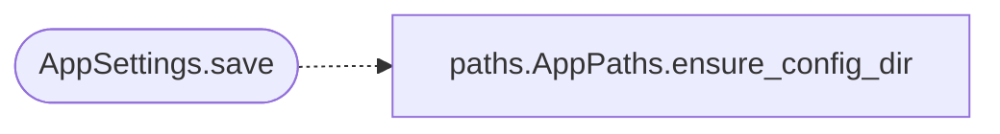

# `lazygui.config.settings`

> Source: [lazygui/config/settings.py:1](../../lazygui/config/settings.py#L1) | language `py` | coverage 53.8% | [API index](../index.md)

Persisted user settings.

Settings live in a JSON file under [`AppPaths.config_dir`](lazygui.config.paths.py.md#apppaths-config_dir). The class
exposes typed accessors on top of the JSON document so the rest of the code
never deals with raw dictionaries or string keys directly.

Anything stored here is user-tunable. Defaults always come from
[`AppConstants`](lazygui.config.constants.py.md#appconstants); this class is the only legitimate location for runtime
mutation of those defaults.

## Contents

- **Classes:** [`AppSettings`](#appsettings)

## Call Graph

Solid arrows stay in this module, dashed arrows leave it.



## Classes

<a id="appsettings"></a>

### `AppSettings`

`class` `dataclass` | [lazygui/config/settings.py:27](../../lazygui/config/settings.py#L27)

Decorators: `@dataclass(slots=True)`

```python
class AppSettings
```

Read/write wrapper around the persisted settings JSON document.

**Attributes**

| Name | Type | Default | Description |
|---|---|---|---|
| [`constants`](#appsettings-constants) | `AppConstants` |  |  |
| [`paths`](#appsettings-paths) | `AppPaths` |  |  |

**Members**

| Member | Kind | Summary |
|---|---|---|
| [`load`](#appsettings-load) | classmethod | Load settings from disk, returning empty defaults if absent. |
| [`save`](#appsettings-save) | method | Persist the current document to disk atomically. |
| [`get`](#appsettings-get) | method | Generic accessor for a slash-separated settings key. |
| [`set`](#appsettings-set) | method | Assign ``value`` to `[`key`](key.py.md)` without persisting; call [`save`](#appsettings-save). |
| [`theme_id`](#appsettings-theme_id) | property |  |
| [`theme_id`](#appsettings-theme_id) | property |  |
| [`last_backend_id`](#appsettings-last_backend_id) | property |  |
| [`last_backend_id`](#appsettings-last_backend_id) | property |  |
| [`last_teamserver_url`](#appsettings-last_teamserver_url) | property |  |
| [`last_teamserver_url`](#appsettings-last_teamserver_url) | property |  |
| [`last_operator_name`](#appsettings-last_operator_name) | property |  |
| [`last_operator_name`](#appsettings-last_operator_name) | property |  |
| [`last_teamserver_password`](#appsettings-last_teamserver_password) | property |  |
| [`last_teamserver_password`](#appsettings-last_teamserver_password) | property |  |
| [`c2_credentials_loaded`](#appsettings-c2_credentials_loaded) | property |  |
| [`c2_credentials_loaded`](#appsettings-c2_credentials_loaded) | property |  |
| [`snapshot`](#appsettings-snapshot) | method | Return a defensive read-only copy of the underlying document. |

<a id="appsettings-load"></a>

#### `AppSettings.load`

`classmethod` | [lazygui/config/settings.py:35](../../lazygui/config/settings.py#L35)

Decorators: `@classmethod`

```python
def load(cls, constants: AppConstants, paths: AppPaths) -> AppSettings
```

Load settings from disk, returning empty defaults if absent.

**Parameters**

| Name | Type | Default | Description |
|---|---|---|---|
| `constants` | `AppConstants` |  |  |
| `paths` | `AppPaths` |  |  |

**Returns:** `AppSettings`

*Called by:* [`Application.__init__`](lazygui.app.py.md#application-__init__)

<a id="appsettings-save"></a>

#### `AppSettings.save`

`method` | [lazygui/config/settings.py:47](../../lazygui/config/settings.py#L47)

```python
def save(self) -> None
```

Persist the current document to disk atomically.

*Calls:* [`AppPaths.ensure_config_dir`](lazygui.config.paths.py.md#apppaths-ensure_config_dir)

<a id="appsettings-get"></a>

#### `AppSettings.get`

`method` | [lazygui/config/settings.py:55](../../lazygui/config/settings.py#L55)

```python
def get(self, key: str, default: Any = None) -> Any
```

Generic accessor for a slash-separated settings key.

**Parameters**

| Name | Type | Default | Description |
|---|---|---|---|
| `key` | `str` |  |  |
| `default` | `Any` | `None` |  |

**Returns:** `Any`

<a id="appsettings-set"></a>

#### `AppSettings.set`

`method` | [lazygui/config/settings.py:59](../../lazygui/config/settings.py#L59)

```python
def set(self, key: str, value: Any) -> None
```

Assign ``value`` to `[`key`](key.py.md)` without persisting; call [`save`](#appsettings-save).

**Parameters**

| Name | Type | Default | Description |
|---|---|---|---|
| `key` | `str` |  |  |
| `value` | `Any` |  |  |

<a id="appsettings-theme_id"></a>

#### `AppSettings.theme_id`

`property` | [lazygui/config/settings.py:69](../../lazygui/config/settings.py#L69)

Decorators: `@theme_id.setter`

```python
def theme_id(self, value: str) -> None
```

**Parameters**

| Name | Type | Default | Description |
|---|---|---|---|
| `value` | `str` |  |  |

<a id="appsettings-theme_id"></a>

#### `AppSettings.theme_id`

`property` | [lazygui/config/settings.py:69](../../lazygui/config/settings.py#L69)

Decorators: `@theme_id.setter`

```python
def theme_id(self, value: str) -> None
```

**Parameters**

| Name | Type | Default | Description |
|---|---|---|---|
| `value` | `str` |  |  |

<a id="appsettings-last_backend_id"></a>

#### `AppSettings.last_backend_id`

`property` | [lazygui/config/settings.py:78](../../lazygui/config/settings.py#L78)

Decorators: `@last_backend_id.setter`

```python
def last_backend_id(self, value: str) -> None
```

**Parameters**

| Name | Type | Default | Description |
|---|---|---|---|
| `value` | `str` |  |  |

**Raises**

- `ValueError`: (raised in the body, not documented)

<a id="appsettings-last_backend_id"></a>

#### `AppSettings.last_backend_id`

`property` | [lazygui/config/settings.py:78](../../lazygui/config/settings.py#L78)

Decorators: `@last_backend_id.setter`

```python
def last_backend_id(self, value: str) -> None
```

**Parameters**

| Name | Type | Default | Description |
|---|---|---|---|
| `value` | `str` |  |  |

**Raises**

- `ValueError`: (raised in the body, not documented)

<a id="appsettings-last_teamserver_url"></a>

#### `AppSettings.last_teamserver_url`

`property` | [lazygui/config/settings.py:94](../../lazygui/config/settings.py#L94)

Decorators: `@last_teamserver_url.setter`

```python
def last_teamserver_url(self, value: str) -> None
```

**Parameters**

| Name | Type | Default | Description |
|---|---|---|---|
| `value` | `str` |  |  |

<a id="appsettings-last_teamserver_url"></a>

#### `AppSettings.last_teamserver_url`

`property` | [lazygui/config/settings.py:94](../../lazygui/config/settings.py#L94)

Decorators: `@last_teamserver_url.setter`

```python
def last_teamserver_url(self, value: str) -> None
```

**Parameters**

| Name | Type | Default | Description |
|---|---|---|---|
| `value` | `str` |  |  |

<a id="appsettings-last_operator_name"></a>

#### `AppSettings.last_operator_name`

`property` | [lazygui/config/settings.py:107](../../lazygui/config/settings.py#L107)

Decorators: `@last_operator_name.setter`

```python
def last_operator_name(self, value: str) -> None
```

**Parameters**

| Name | Type | Default | Description |
|---|---|---|---|
| `value` | `str` |  |  |

<a id="appsettings-last_operator_name"></a>

#### `AppSettings.last_operator_name`

`property` | [lazygui/config/settings.py:107](../../lazygui/config/settings.py#L107)

Decorators: `@last_operator_name.setter`

```python
def last_operator_name(self, value: str) -> None
```

**Parameters**

| Name | Type | Default | Description |
|---|---|---|---|
| `value` | `str` |  |  |

<a id="appsettings-last_teamserver_password"></a>

#### `AppSettings.last_teamserver_password`

`property` | [lazygui/config/settings.py:116](../../lazygui/config/settings.py#L116)

Decorators: `@last_teamserver_password.setter`

```python
def last_teamserver_password(self, value: str) -> None
```

**Parameters**

| Name | Type | Default | Description |
|---|---|---|---|
| `value` | `str` |  |  |

<a id="appsettings-last_teamserver_password"></a>

#### `AppSettings.last_teamserver_password`

`property` | [lazygui/config/settings.py:116](../../lazygui/config/settings.py#L116)

Decorators: `@last_teamserver_password.setter`

```python
def last_teamserver_password(self, value: str) -> None
```

**Parameters**

| Name | Type | Default | Description |
|---|---|---|---|
| `value` | `str` |  |  |

<a id="appsettings-c2_credentials_loaded"></a>

#### `AppSettings.c2_credentials_loaded`

`property` | [lazygui/config/settings.py:125](../../lazygui/config/settings.py#L125)

Decorators: `@c2_credentials_loaded.setter`

```python
def c2_credentials_loaded(self, value: bool) -> None
```

**Parameters**

| Name | Type | Default | Description |
|---|---|---|---|
| `value` | `bool` |  |  |

<a id="appsettings-c2_credentials_loaded"></a>

#### `AppSettings.c2_credentials_loaded`

`property` | [lazygui/config/settings.py:125](../../lazygui/config/settings.py#L125)

Decorators: `@c2_credentials_loaded.setter`

```python
def c2_credentials_loaded(self, value: bool) -> None
```

**Parameters**

| Name | Type | Default | Description |
|---|---|---|---|
| `value` | `bool` |  |  |

<a id="appsettings-snapshot"></a>

#### `AppSettings.snapshot`

`method` | [lazygui/config/settings.py:128](../../lazygui/config/settings.py#L128)

```python
def snapshot(self) -> Mapping[str, Any]
```

Return a defensive read-only copy of the underlying document.

**Returns:** `Mapping[str, Any]`

---
