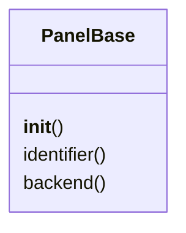

# `lazygui.panels.base`

> Source: [lazygui/panels/base.py:1](../../lazygui/panels/base.py#L1) | language `py` | coverage 100.0% | [API index](../index.md)

Common `QDockWidget` base for every panel.

Centralises ``objectName`` assignment (required for ``QMainWindow.saveState``
to round-trip) and exposes a hook so subclasses can perform backend wiring
in a uniform way.

## Contents

- **Classes:** [`PanelBase`](#panelbase)

## Type Diagram



## Classes

<a id="panelbase"></a>

### `PanelBase`

`class` | [lazygui/panels/base.py:17](../../lazygui/panels/base.py#L17)

```python
class PanelBase(QDockWidget)
```

Bases: `QDockWidget`

Subclasses: [`CampaignPanel`](lazygui.panels.campaign_panel.py.md#campaignpanel), [`CredentialsPanel`](lazygui.panels.credentials_panel.py.md#credentialspanel), [`CVEPanel`](lazygui.panels.cve_panel.py.md#cvepanel), [`EventLogPanel`](lazygui.panels.event_log_panel.py.md#eventlogpanel), [`GraphPanel`](lazygui.panels.graph_panel.py.md#graphpanel), [`HistoryPanel`](lazygui.panels.history_panel.py.md#historypanel), [`KillChainPanel`](lazygui.panels.killchain_panel.py.md#killchainpanel), [`ListenersPanel`](lazygui.panels.listeners_panel.py.md#listenerspanel), [`MarketplacePanel`](lazygui.panels.marketplace_panel.py.md#marketplacepanel), [`SessionsPanel`](lazygui.panels.sessions_panel.py.md#sessionspanel), [`TerminalPanel`](lazygui.panels.terminal_panel.py.md#terminalpanel)

Base class enforcing object-name discipline and backend wiring.

**Members**

| Member | Kind | Summary |
|---|---|---|
| [`__init__`](#panelbase-__init__) | constructor | Initialise the dock widget with stable identifier and title. |
| [`identifier`](#panelbase-identifier) | property | Stable identifier matching [`PanelConstants`](lazygui.config.constants.py.md#panelconstants). |
| [`backend`](#panelbase-backend) | property | The currently connected backend instance. |

<a id="panelbase-__init__"></a>

#### `PanelBase.__init__`

`constructor` | [lazygui/panels/base.py:20](../../lazygui/panels/base.py#L20)

```python
def __init__(self, constants: AppConstants, backend: Backend, identifier: str, title: str, parent: QWidget | None = None) -> None
```

Initialise the dock widget with stable identifier and title.

**Parameters**

| Name | Type | Default | Description |
|---|---|---|---|
| `constants` | `AppConstants` |  |  |
| `backend` | `Backend` |  |  |
| `identifier` | `str` |  |  |
| `title` | `str` |  |  |
| `parent` | `QWidget \| None` | `None` |  |

<a id="panelbase-identifier"></a>

#### `PanelBase.identifier`

`property` | [lazygui/panels/base.py:43](../../lazygui/panels/base.py#L43)

Decorators: `@property`

```python
def identifier(self) -> str
```

Stable identifier matching [`PanelConstants`](lazygui.config.constants.py.md#panelconstants).

**Returns:** `str`

<a id="panelbase-backend"></a>

#### `PanelBase.backend`

`property` | [lazygui/panels/base.py:48](../../lazygui/panels/base.py#L48)

Decorators: `@property`

```python
def backend(self) -> Backend
```

The currently connected backend instance.

**Returns:** `Backend`

---
