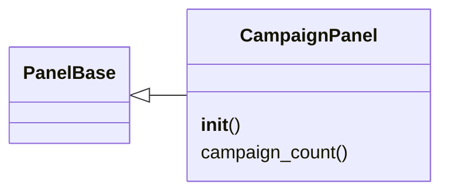

# `lazygui.panels.campaign_panel`

> Source: [lazygui/panels/campaign_panel.py:1](../../lazygui/panels/campaign_panel.py#L1) | language `py` | coverage 100.0% | [API index](../index.md)

Campaign management panel for the operator console.

Displays active campaigns, objectives and playbook execution status from
the teamserver. Supports filtering and detail view.

## Contents

- **Classes:** [`CampaignPanel`](#campaignpanel)

## Type Diagram



## Classes

<a id="campaignpanel"></a>

### `CampaignPanel`

`class` | [lazygui/panels/campaign_panel.py:28](../../lazygui/panels/campaign_panel.py#L28)

```python
class CampaignPanel(PanelBase)
```

Bases: [`PanelBase`](lazygui.panels.base.py.md#panelbase)

Dock panel displaying active campaign status.

**Members**

| Member | Kind | Summary |
|---|---|---|
| [`__init__`](#campaignpanel-__init__) | constructor | Build the campaign list UI. |
| [`campaign_count`](#campaignpanel-campaign_count) | property | Return the number of active campaigns. |

<a id="campaignpanel-__init__"></a>

#### `CampaignPanel.__init__`

`constructor` | [lazygui/panels/campaign_panel.py:31](../../lazygui/panels/campaign_panel.py#L31)

```python
def __init__(self, constants: AppConstants, backend: Backend, parent: QWidget | None = None) -> None
```

Build the campaign list UI.

**Parameters**

| Name | Type | Default | Description |
|---|---|---|---|
| `constants` | `AppConstants` |  |  |
| `backend` | `Backend` |  |  |
| `parent` | `QWidget \| None` | `None` |  |

*Called by:* [`PanelRegistry.build`](lazygui.panels.registry.py.md#panelregistry-build)

<a id="campaignpanel-campaign_count"></a>

#### `CampaignPanel.campaign_count`

`property` | [lazygui/panels/campaign_panel.py:133](../../lazygui/panels/campaign_panel.py#L133)

Decorators: `@property`

```python
def campaign_count(self) -> int
```

Return the number of active campaigns.

**Returns:** `int`

---
