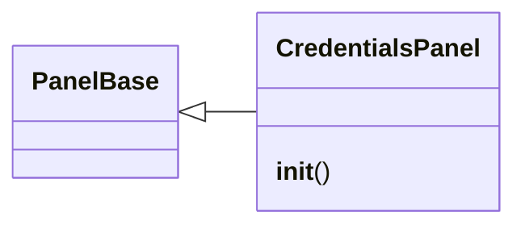

# `lazygui.panels.credentials_panel`

> Source: [lazygui/panels/credentials_panel.py:1](../../lazygui/panels/credentials_panel.py#L1) | language `py` | coverage 100.0% | [API index](../index.md)

Credentials and loot panel for the operator console.

Displays captured credentials, hashes, and exfiltrated artefacts
from the active backend's session data. Supports filtering and
copy-on-click for credential reuse.

## Contents

- **Classes:** [`CredentialsPanel`](#credentialspanel)

## Type Diagram



## Classes

<a id="credentialspanel"></a>

### `CredentialsPanel`

`class` | [lazygui/panels/credentials_panel.py:27](../../lazygui/panels/credentials_panel.py#L27)

```python
class CredentialsPanel(PanelBase)
```

Bases: [`PanelBase`](lazygui.panels.base.py.md#panelbase)

Dock widget displaying captured credentials and loot.

**Members**

| Member | Kind | Summary |
|---|---|---|
| [`__init__`](#credentialspanel-__init__) | constructor | Initialise the dock widget with stable identifier and title. |

<a id="credentialspanel-__init__"></a>

#### `CredentialsPanel.__init__`

`constructor` | [lazygui/panels/credentials_panel.py:30](../../lazygui/panels/credentials_panel.py#L30)

```python
def __init__(self, constants: AppConstants, backend: Backend, parent: QWidget | None = None) -> None
```

Initialise the dock widget with stable identifier and title.

**Parameters**

| Name | Type | Default | Description |
|---|---|---|---|
| `constants` | `AppConstants` |  |  |
| `backend` | `Backend` |  |  |
| `parent` | `QWidget \| None` | `None` |  |

> **Inherited:** Documentation from [`PanelBase.__init__`](lazygui.panels.base.py.md#panelbase-__init__) (lazygui/panels/base.py:20).

*Called by:* [`PanelRegistry.build`](lazygui.panels.registry.py.md#panelregistry-build)

---
