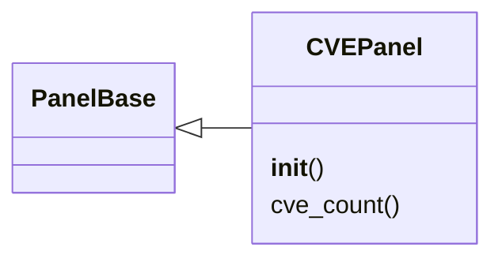

# `lazygui.panels.cve_panel`

> Source: [lazygui/panels/cve_panel.py:1](../../lazygui/panels/cve_panel.py#L1) | language `py` | coverage 100.0% | [API index](../index.md)

CVE tracker panel for the operator console.

Displays known CVEs from the knowledge base with severity filtering and
search. Supports lookup and exploitation suggestions.

## Contents

- **Classes:** [`CVEPanel`](#cvepanel)

## Type Diagram



## Classes

<a id="cvepanel"></a>

### `CVEPanel`

`class` | [lazygui/panels/cve_panel.py:28](../../lazygui/panels/cve_panel.py#L28)

```python
class CVEPanel(PanelBase)
```

Bases: [`PanelBase`](lazygui.panels.base.py.md#panelbase)

Dock panel listing CVEs from the knowledge base.

**Members**

| Member | Kind | Summary |
|---|---|---|
| [`__init__`](#cvepanel-__init__) | constructor | Build the CVE list UI with severity filter. |
| [`cve_count`](#cvepanel-cve_count) | property | Return the number of loaded CVEs. |

<a id="cvepanel-__init__"></a>

#### `CVEPanel.__init__`

`constructor` | [lazygui/panels/cve_panel.py:31](../../lazygui/panels/cve_panel.py#L31)

```python
def __init__(self, constants: AppConstants, backend: Backend, parent: QWidget | None = None) -> None
```

Build the CVE list UI with severity filter.

**Parameters**

| Name | Type | Default | Description |
|---|---|---|---|
| `constants` | `AppConstants` |  |  |
| `backend` | `Backend` |  |  |
| `parent` | `QWidget \| None` | `None` |  |

*Called by:* [`PanelRegistry.build`](lazygui.panels.registry.py.md#panelregistry-build)

<a id="cvepanel-cve_count"></a>

#### `CVEPanel.cve_count`

`property` | [lazygui/panels/cve_panel.py:178](../../lazygui/panels/cve_panel.py#L178)

Decorators: `@property`

```python
def cve_count(self) -> int
```

Return the number of loaded CVEs.

**Returns:** `int`

---
