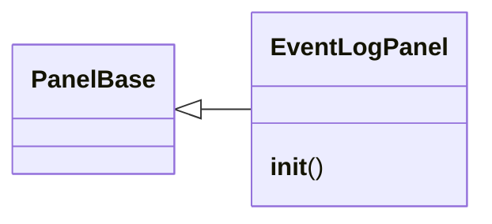
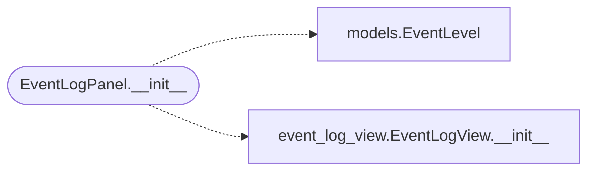

# `lazygui.panels.event_log_panel`

> Source: [lazygui/panels/event_log_panel.py:1](../../lazygui/panels/event_log_panel.py#L1) | language `py` | coverage 100.0% | [API index](../index.md)

Panel hosting the application-wide event log.

## Contents

- **Classes:** [`EventLogPanel`](#eventlogpanel)

## Type Diagram



## Call Graph

Solid arrows stay in this module, dashed arrows leave it.



## Classes

<a id="eventlogpanel"></a>

### `EventLogPanel`

`class` | [lazygui/panels/event_log_panel.py:24](../../lazygui/panels/event_log_panel.py#L24)

```python
class EventLogPanel(PanelBase)
```

Bases: [`PanelBase`](lazygui.panels.base.py.md#panelbase)

Dock panel wrapping [`EventLogView`](lazygui.widgets.event_log_view.py.md#eventlogview) plus a level filter.

**Members**

| Member | Kind | Summary |
|---|---|---|
| [`__init__`](#eventlogpanel-__init__) | constructor | Compose the toolbar (level filter + clear) and the log view. |

<a id="eventlogpanel-__init__"></a>

#### `EventLogPanel.__init__`

`constructor` | [lazygui/panels/event_log_panel.py:27](../../lazygui/panels/event_log_panel.py#L27)

```python
def __init__(self, constants: AppConstants, backend: Backend, event_log: EventLog, parent: QWidget | None = None) -> None
```

Compose the toolbar (level filter + clear) and the log view.

**Parameters**

| Name | Type | Default | Description |
|---|---|---|---|
| `constants` | `AppConstants` |  |  |
| `backend` | `Backend` |  |  |
| `event_log` | `EventLog` |  |  |
| `parent` | `QWidget \| None` | `None` |  |

*Calls:* [`EventLevel`](lazygui.services.models.py.md#eventlevel), [`EventLogView.__init__`](lazygui.widgets.event_log_view.py.md#eventlogview-__init__)

*Called by:* [`PanelRegistry.build`](lazygui.panels.registry.py.md#panelregistry-build)

---
