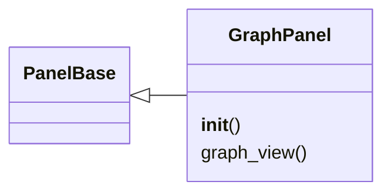
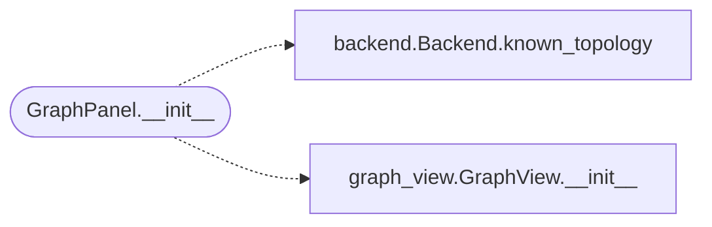

# `lazygui.panels.graph_panel`

> Source: [lazygui/panels/graph_panel.py:1](../../lazygui/panels/graph_panel.py#L1) | language `py` | coverage 100.0% | [API index](../index.md)

Graph panel for Cobalt Strike-style attack topography visualization.

Renders the C2 beacon graph with interactive nodes, force-directed layout
and context menus for beacon interaction: spawn shell, port scan,
screenshot, keylog, migrate, download/upload.

## Contents

- **Classes:** [`GraphPanel`](#graphpanel)

## Type Diagram



## Call Graph

Solid arrows stay in this module, dashed arrows leave it.



## Classes

<a id="graphpanel"></a>

### `GraphPanel`

`class` | [lazygui/panels/graph_panel.py:20](../../lazygui/panels/graph_panel.py#L20)

```python
class GraphPanel(PanelBase)
```

Bases: [`PanelBase`](lazygui.panels.base.py.md#panelbase)

Dock panel wrapping the interactive graph view.

**Members**

| Member | Kind | Summary |
|---|---|---|
| [`__init__`](#graphpanel-__init__) | constructor | Build the graph view and connect to backend topology updates. |
| [`graph_view`](#graphpanel-graph_view) | property | Return the underlying graph view for layout management. |

<a id="graphpanel-__init__"></a>

#### `GraphPanel.__init__`

`constructor` | [lazygui/panels/graph_panel.py:23](../../lazygui/panels/graph_panel.py#L23)

```python
def __init__(self, constants: AppConstants, backend: Backend, parent: QWidget | None = None) -> None
```

Build the graph view and connect to backend topology updates.

**Parameters**

| Name | Type | Default | Description |
|---|---|---|---|
| `constants` | `AppConstants` |  |  |
| `backend` | `Backend` |  |  |
| `parent` | `QWidget \| None` | `None` |  |

*Calls:* [`Backend.known_topology`](lazygui.services.backend.py.md#backend-known_topology), [`GraphView.__init__`](lazygui.widgets.graph_view.py.md#graphview-__init__)

*Called by:* [`PanelRegistry.build`](lazygui.panels.registry.py.md#panelregistry-build)

<a id="graphpanel-graph_view"></a>

#### `GraphPanel.graph_view`

`property` | [lazygui/panels/graph_panel.py:118](../../lazygui/panels/graph_panel.py#L118)

Decorators: `@property`

```python
def graph_view(self) -> GraphView
```

Return the underlying graph view for layout management.

**Returns:** `GraphView`

---
