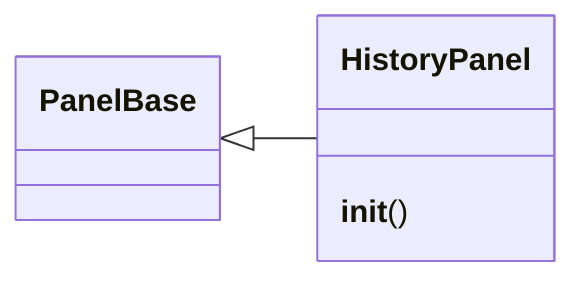

# `lazygui.panels.history_panel`

> Source: [lazygui/panels/history_panel.py:1](../../lazygui/panels/history_panel.py#L1) | language `py` | coverage 100.0% | [API index](../index.md)

Command history panel showing beacon command logs.

Reads ``sessions/<client_id>.log`` CSV files and displays command entries
with output. Supports filtering by client and auto-refresh.

## Contents

- **Classes:** [`HistoryPanel`](#historypanel)

## Type Diagram



## Classes

<a id="historypanel"></a>

### `HistoryPanel`

`class` | [lazygui/panels/history_panel.py:30](../../lazygui/panels/history_panel.py#L30)

```python
class HistoryPanel(PanelBase)
```

Bases: [`PanelBase`](lazygui.panels.base.py.md#panelbase)

Dock panel showing beacon command history from CSV log files.

**Members**

| Member | Kind | Summary |
|---|---|---|
| [`__init__`](#historypanel-__init__) | constructor | Build the history viewer UI. |

<a id="historypanel-__init__"></a>

#### `HistoryPanel.__init__`

`constructor` | [lazygui/panels/history_panel.py:33](../../lazygui/panels/history_panel.py#L33)

```python
def __init__(self, constants: AppConstants, backend: Backend, parent: QWidget | None = None) -> None
```

Build the history viewer UI.

**Parameters**

| Name | Type | Default | Description |
|---|---|---|---|
| `constants` | `AppConstants` |  |  |
| `backend` | `Backend` |  |  |
| `parent` | `QWidget \| None` | `None` |  |

*Called by:* [`PanelRegistry.build`](lazygui.panels.registry.py.md#panelregistry-build)

---
