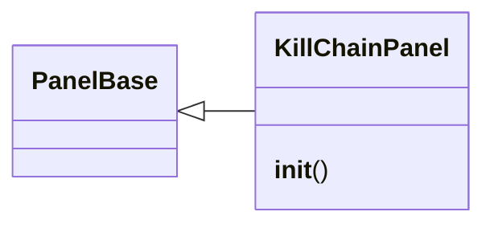
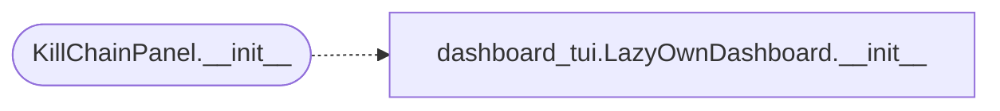

# `lazygui.panels.killchain_panel`

> Source: [lazygui/panels/killchain_panel.py:1](../../lazygui/panels/killchain_panel.py#L1) | language `py` | coverage 100.0% | [API index](../index.md)

Kill-chain visualization panel for the operator console.

Displays the current engagement phase and completed phases as a
horizontal progress bar. Reads from `[`modules.killchain.KillChain`](modules.killchain.py.md#killchain)`
as the single source of truth.

## Contents

- **Classes:** [`KillChainPanel`](#killchainpanel)

## Type Diagram



## Call Graph

Solid arrows stay in this module, dashed arrows leave it.



## Classes

<a id="killchainpanel"></a>

### `KillChainPanel`

`class` | [lazygui/panels/killchain_panel.py:35](../../lazygui/panels/killchain_panel.py#L35)

```python
class KillChainPanel(PanelBase)
```

Bases: [`PanelBase`](lazygui.panels.base.py.md#panelbase)

Dock widget displaying the engagement kill-chain progress.

**Members**

| Member | Kind | Summary |
|---|---|---|
| [`__init__`](#killchainpanel-__init__) | constructor | Initialise the dock widget with stable identifier and title. |

<a id="killchainpanel-__init__"></a>

#### `KillChainPanel.__init__`

`constructor` | [lazygui/panels/killchain_panel.py:38](../../lazygui/panels/killchain_panel.py#L38)

```python
def __init__(self, constants: AppConstants, backend: Backend, parent: QWidget | None = None) -> None
```

Initialise the dock widget with stable identifier and title.

**Parameters**

| Name | Type | Default | Description |
|---|---|---|---|
| `constants` | `AppConstants` |  |  |
| `backend` | `Backend` |  |  |
| `parent` | `QWidget \| None` | `None` |  |

> **Inherited:** Documentation from [`PanelBase.__init__`](lazygui.panels.base.py.md#panelbase-__init__) (lazygui/panels/base.py:20).

*Calls:* [`LazyOwnDashboard.__init__`](cli.dashboard_tui.py.md#lazyowndashboard-__init__)

*Called by:* [`LazyOwnDashboard.compose`](cli.dashboard_tui.py.md#lazyowndashboard-compose), [`PanelRegistry.build`](lazygui.panels.registry.py.md#panelregistry-build)

---
