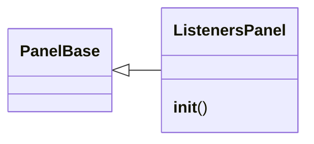
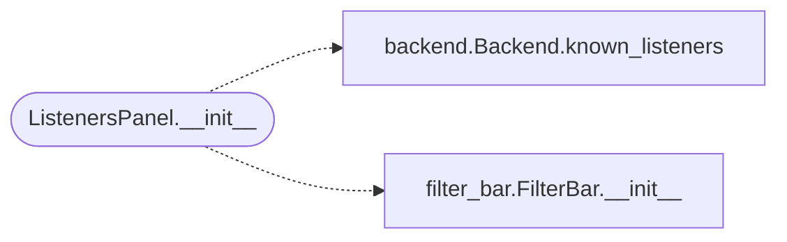

# `lazygui.panels.listeners_panel`

> Source: [lazygui/panels/listeners_panel.py:1](../../lazygui/panels/listeners_panel.py#L1) | language `py` | coverage 100.0% | [API index](../index.md)

Panel that lists the listeners advertised by the backend.

## Contents

- **Classes:** [`ListenersPanel`](#listenerspanel)

## Type Diagram



## Call Graph

Solid arrows stay in this module, dashed arrows leave it.



## Classes

<a id="listenerspanel"></a>

### `ListenersPanel`

`class` | [lazygui/panels/listeners_panel.py:21](../../lazygui/panels/listeners_panel.py#L21)

```python
class ListenersPanel(PanelBase)
```

Bases: [`PanelBase`](lazygui.panels.base.py.md#panelbase)

Reactive list of `Listener` rows.

**Members**

| Member | Kind | Summary |
|---|---|---|
| [`__init__`](#listenerspanel-__init__) | constructor | Build the layout and subscribe to backend listener updates. |

<a id="listenerspanel-__init__"></a>

#### `ListenersPanel.__init__`

`constructor` | [lazygui/panels/listeners_panel.py:24](../../lazygui/panels/listeners_panel.py#L24)

```python
def __init__(self, constants: AppConstants, backend: Backend, parent: QWidget | None = None) -> None
```

Build the layout and subscribe to backend listener updates.

**Parameters**

| Name | Type | Default | Description |
|---|---|---|---|
| `constants` | `AppConstants` |  |  |
| `backend` | `Backend` |  |  |
| `parent` | `QWidget \| None` | `None` |  |

*Calls:* [`Backend.known_listeners`](lazygui.services.backend.py.md#backend-known_listeners), [`FilterBar.__init__`](lazygui.widgets.filter_bar.py.md#filterbar-__init__)

*Called by:* [`PanelRegistry.build`](lazygui.panels.registry.py.md#panelregistry-build)

---
