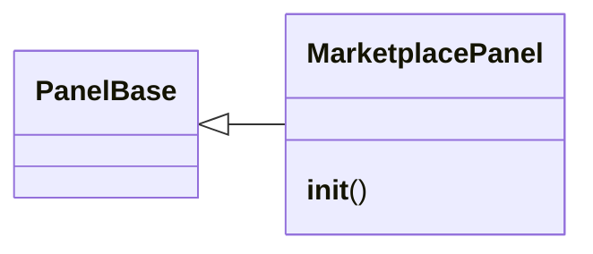

# `lazygui.panels.marketplace_panel`

> Source: [lazygui/panels/marketplace_panel.py:1](../../lazygui/panels/marketplace_panel.py#L1) | language `py` | coverage 100.0% | [API index](../index.md)

Marketplace panel for YARA rules, Nuclei templates, YAML addons and Lua plugins.

Lists installed items from lazyaddons/*.yaml, plugins/*.lua, yara_rules/*.yar,
and nuclei-templates/*.yaml. Supports search, filter, and run actions.

## Contents

- **Classes:** [`MarketplacePanel`](#marketplacepanel)

## Type Diagram



## Classes

<a id="marketplacepanel"></a>

### `MarketplacePanel`

`class` | [lazygui/panels/marketplace_panel.py:29](../../lazygui/panels/marketplace_panel.py#L29)

```python
class MarketplacePanel(PanelBase)
```

Bases: [`PanelBase`](lazygui.panels.base.py.md#panelbase)

Dock panel listing YARA rules, Nuclei templates, Addons and Plugins.

**Members**

| Member | Kind | Summary |
|---|---|---|
| [`__init__`](#marketplacepanel-__init__) | constructor | Build the tabbed marketplace UI. |

<a id="marketplacepanel-__init__"></a>

#### `MarketplacePanel.__init__`

`constructor` | [lazygui/panels/marketplace_panel.py:32](../../lazygui/panels/marketplace_panel.py#L32)

```python
def __init__(self, constants: AppConstants, backend: Backend, parent: QWidget | None = None) -> None
```

Build the tabbed marketplace UI.

**Parameters**

| Name | Type | Default | Description |
|---|---|---|---|
| `constants` | `AppConstants` |  |  |
| `backend` | `Backend` |  |  |
| `parent` | `QWidget \| None` | `None` |  |

*Called by:* [`PanelRegistry.build`](lazygui.panels.registry.py.md#panelregistry-build)

---
