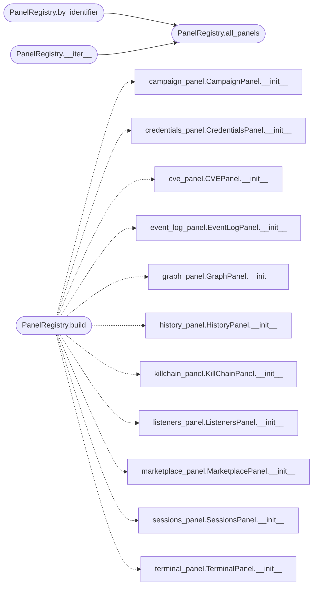

# `lazygui.panels.registry`

> Source: [lazygui/panels/registry.py:1](../../lazygui/panels/registry.py#L1) | language `py` | coverage 100.0% | [API index](../index.md)

Registry that owns all dock panels.

Centralising panel instances makes the main window straightforward: it
asks the registry for an iterable to attach as docks, looks panels up by
identifier when wiring shortcuts, and forwards visibility toggles
polymorphically.

## Contents

- **Classes:** [`PanelRegistry`](#panelregistry)

## Call Graph

Solid arrows stay in this module, dashed arrows leave it.



## Classes

<a id="panelregistry"></a>

### `PanelRegistry`

`class` `dataclass` | [lazygui/panels/registry.py:34](../../lazygui/panels/registry.py#L34)

Decorators: `@dataclass(slots=True)`

```python
class PanelRegistry
```

Holds the canonical panel instances bound to the active backend.

**Attributes**

| Name | Type | Default | Description |
|---|---|---|---|
| [`constants`](#panelregistry-constants) | `AppConstants` |  |  |
| [`backend`](#panelregistry-backend) | `Backend` |  |  |
| [`event_log`](#panelregistry-event_log) | `EventLog` |  |  |
| [`sessions`](#panelregistry-sessions) | `SessionsPanel` |  |  |
| [`listeners`](#panelregistry-listeners) | `ListenersPanel` |  |  |
| [`event_log_panel`](#panelregistry-event_log_panel) | `EventLogPanel` |  |  |
| [`terminal`](#panelregistry-terminal) | `TerminalPanel` |  |  |
| [`killchain`](#panelregistry-killchain) | `KillChainPanel` |  |  |
| [`credentials`](#panelregistry-credentials) | `CredentialsPanel` |  |  |
| [`marketplace`](#panelregistry-marketplace) | `MarketplacePanel` |  |  |
| [`campaign`](#panelregistry-campaign) | `CampaignPanel` |  |  |
| [`cve`](#panelregistry-cve) | `CVEPanel` |  |  |
| [`history`](#panelregistry-history) | `HistoryPanel` |  |  |
| [`graph`](#panelregistry-graph) | `GraphPanel` |  |  |

**Members**

| Member | Kind | Summary |
|---|---|---|
| [`build`](#panelregistry-build) | classmethod | Construct every dock panel and return them as a registry. |
| [`all_panels`](#panelregistry-all_panels) | method | Return panels in canonical layout order. |
| [`by_identifier`](#panelregistry-by_identifier) | method | Look up a panel by its stable identifier. |
| [`__iter__`](#panelregistry-__iter__) | method | Iterate over panels in canonical order. |

<a id="panelregistry-build"></a>

#### `PanelRegistry.build`

`classmethod` | [lazygui/panels/registry.py:53](../../lazygui/panels/registry.py#L53)

Decorators: `@classmethod`

```python
def build(cls, constants: AppConstants, backend: Backend, event_log: EventLog, parent: QWidget | None = None) -> PanelRegistry
```

Construct every dock panel and return them as a registry.

**Parameters**

| Name | Type | Default | Description |
|---|---|---|---|
| `constants` | `AppConstants` |  |  |
| `backend` | `Backend` |  |  |
| `event_log` | `EventLog` |  |  |
| `parent` | `QWidget \| None` | `None` |  |

**Returns:** `PanelRegistry`

*Calls:* [`CampaignPanel.__init__`](lazygui.panels.campaign_panel.py.md#campaignpanel-__init__), [`CredentialsPanel.__init__`](lazygui.panels.credentials_panel.py.md#credentialspanel-__init__), [`CVEPanel.__init__`](lazygui.panels.cve_panel.py.md#cvepanel-__init__), [`EventLogPanel.__init__`](lazygui.panels.event_log_panel.py.md#eventlogpanel-__init__), [`GraphPanel.__init__`](lazygui.panels.graph_panel.py.md#graphpanel-__init__), [`HistoryPanel.__init__`](lazygui.panels.history_panel.py.md#historypanel-__init__), [`KillChainPanel.__init__`](lazygui.panels.killchain_panel.py.md#killchainpanel-__init__), [`ListenersPanel.__init__`](lazygui.panels.listeners_panel.py.md#listenerspanel-__init__), [`MarketplacePanel.__init__`](lazygui.panels.marketplace_panel.py.md#marketplacepanel-__init__), [`SessionsPanel.__init__`](lazygui.panels.sessions_panel.py.md#sessionspanel-__init__), [`TerminalPanel.__init__`](lazygui.panels.terminal_panel.py.md#terminalpanel-__init__)

*Called by:* [`MainWindow.__init__`](lazygui.windows.main_window.py.md#mainwindow-__init__)

<a id="panelregistry-all_panels"></a>

#### `PanelRegistry.all_panels`

`method` | [lazygui/panels/registry.py:83](../../lazygui/panels/registry.py#L83)

```python
def all_panels(self) -> tuple[PanelBase, ...]
```

Return panels in canonical layout order.

**Returns:** `tuple[PanelBase, ...]`

*Called by:* [`PanelRegistry.__iter__`](#panelregistry-__iter__), [`PanelRegistry.by_identifier`](#panelregistry-by_identifier)

<a id="panelregistry-by_identifier"></a>

#### `PanelRegistry.by_identifier`

`method` | [lazygui/panels/registry.py:99](../../lazygui/panels/registry.py#L99)

```python
def by_identifier(self, identifier: str) -> PanelBase
```

Look up a panel by its stable identifier.

**Parameters**

| Name | Type | Default | Description |
|---|---|---|---|
| `identifier` | `str` |  |  |

**Returns:** `PanelBase`

**Raises**

- `KeyError`: (raised in the body, not documented)

*Calls:* [`PanelRegistry.all_panels`](#panelregistry-all_panels)

<a id="panelregistry-__iter__"></a>

#### `PanelRegistry.__iter__`

`method` | [lazygui/panels/registry.py:106](../../lazygui/panels/registry.py#L106)

```python
def __iter__(self) -> Iterator[PanelBase]
```

Iterate over panels in canonical order.

**Returns:** `Iterator[PanelBase]`

*Calls:* [`PanelRegistry.all_panels`](#panelregistry-all_panels)

---
