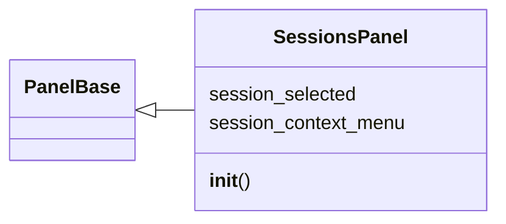
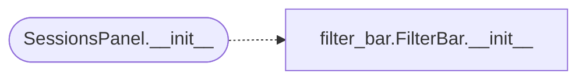

# `lazygui.panels.sessions_panel`

> Source: [lazygui/panels/sessions_panel.py:1](../../lazygui/panels/sessions_panel.py#L1) | language `py` | coverage 100.0% | [API index](../index.md)

Panel that lists active sessions reported by the backend.

Supports right-click context menus for beacon interaction: spawn shell,
port scan, screenshot, keylog, migrate, upload/download.

## Contents

- **Classes:** [`SessionsPanel`](#sessionspanel)

## Type Diagram



## Call Graph

Solid arrows stay in this module, dashed arrows leave it.



## Classes

<a id="sessionspanel"></a>

### `SessionsPanel`

`class` | [lazygui/panels/sessions_panel.py:39](../../lazygui/panels/sessions_panel.py#L39)

```python
class SessionsPanel(PanelBase)
```

Bases: [`PanelBase`](lazygui.panels.base.py.md#panelbase)

Reactive list of [`Session`](lazygui.services.models.py.md#session) rows with context menus.

**Attributes**

| Name | Type | Default | Description |
|---|---|---|---|
| [`session_selected`](#sessionspanel-session_selected) |  | `Signal(Session)` |  |
| [`session_context_menu`](#sessionspanel-session_context_menu) |  | `Signal(Session, str)` |  |

**Members**

| Member | Kind | Summary |
|---|---|---|
| [`__init__`](#sessionspanel-__init__) | constructor | Build the layout and subscribe to backend session updates. |

<a id="sessionspanel-__init__"></a>

#### `SessionsPanel.__init__`

`constructor` | [lazygui/panels/sessions_panel.py:45](../../lazygui/panels/sessions_panel.py#L45)

```python
def __init__(self, constants: AppConstants, backend: Backend, parent: QWidget | None = None) -> None
```

Build the layout and subscribe to backend session updates.

**Parameters**

| Name | Type | Default | Description |
|---|---|---|---|
| `constants` | `AppConstants` |  |  |
| `backend` | `Backend` |  |  |
| `parent` | `QWidget \| None` | `None` |  |

*Calls:* [`FilterBar.__init__`](lazygui.widgets.filter_bar.py.md#filterbar-__init__)

*Called by:* [`PanelRegistry.build`](lazygui.panels.registry.py.md#panelregistry-build)

---
