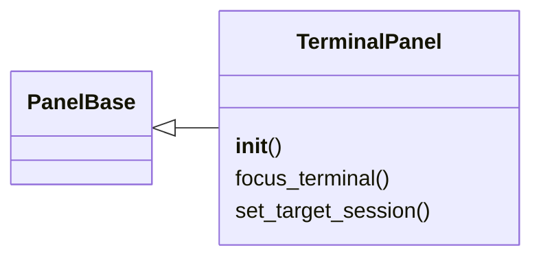
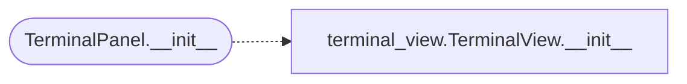

# `lazygui.panels.terminal_panel`

> Source: [lazygui/panels/terminal_panel.py:1](../../lazygui/panels/terminal_panel.py#L1) | language `py` | coverage 100.0% | [API index](../index.md)

Console panel hosting the [`TerminalView`](lazygui.widgets.terminal_view.py.md#terminalview) with beacon command support.

## Contents

- **Classes:** [`TerminalPanel`](#terminalpanel)

## Type Diagram



## Call Graph

Solid arrows stay in this module, dashed arrows leave it.



## Classes

<a id="terminalpanel"></a>

### `TerminalPanel`

`class` | [lazygui/panels/terminal_panel.py:22](../../lazygui/panels/terminal_panel.py#L22)

```python
class TerminalPanel(PanelBase)
```

Bases: [`PanelBase`](lazygui.panels.base.py.md#panelbase)

Dock panel wiring [`TerminalView`](lazygui.widgets.terminal_view.py.md#terminalview) to the active backend with beacon command support.

**Members**

| Member | Kind | Summary |
|---|---|---|
| [`__init__`](#terminalpanel-__init__) | constructor | Compose the terminal view, session selector and command bar. |
| [`focus_terminal`](#terminalpanel-focus_terminal) | method | Move keyboard focus into the terminal text area. |
| [`set_target_session`](#terminalpanel-set_target_session) | method | Select a specific beacon in the dropdown. |

<a id="terminalpanel-__init__"></a>

#### `TerminalPanel.__init__`

`constructor` | [lazygui/panels/terminal_panel.py:25](../../lazygui/panels/terminal_panel.py#L25)

```python
def __init__(self, constants: AppConstants, backend: Backend, parent: QWidget | None = None) -> None
```

Compose the terminal view, session selector and command bar.

**Parameters**

| Name | Type | Default | Description |
|---|---|---|---|
| `constants` | `AppConstants` |  |  |
| `backend` | `Backend` |  |  |
| `parent` | `QWidget \| None` | `None` |  |

*Calls:* [`TerminalView.__init__`](lazygui.widgets.terminal_view.py.md#terminalview-__init__)

*Called by:* [`PanelRegistry.build`](lazygui.panels.registry.py.md#panelregistry-build)

<a id="terminalpanel-focus_terminal"></a>

#### `TerminalPanel.focus_terminal`

`method` | [lazygui/panels/terminal_panel.py:78](../../lazygui/panels/terminal_panel.py#L78)

```python
def focus_terminal(self) -> None
```

Move keyboard focus into the terminal text area.

<a id="terminalpanel-set_target_session"></a>

#### `TerminalPanel.set_target_session`

`method` | [lazygui/panels/terminal_panel.py:82](../../lazygui/panels/terminal_panel.py#L82)

```python
def set_target_session(self, session_id: str) -> None
```

Select a specific beacon in the dropdown.

**Parameters**

| Name | Type | Default | Description |
|---|---|---|---|
| `session_id` | `str` |  |  |

---
