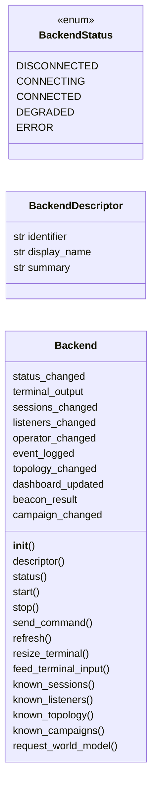
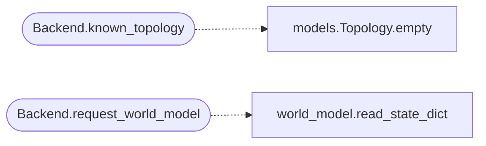

# `lazygui.services.backend`

> Source: [lazygui/services/backend.py:1](../../lazygui/services/backend.py#L1) | language `py` | coverage 100.0% | [API index](../index.md)

Backend abstraction.

Implements the Dependency-Inversion principle for the GUI: panels and windows
only depend on [`Backend`](#backend), never on a concrete client. Concrete
backends (`[`LocalPtyBackend`](lazygui.services.local_backend.py.md#localptybackend)`, `[`TeamserverBackend`](lazygui.services.teamserver_backend.py.md#teamserverbackend)`) translate between the
abstract contract and their respective transport.

Backends inherit from `QObject` so they can emit Qt signals that
panels subscribe to. The signals always carry framework-agnostic dataclasses
from [`lazygui.services.models`](lazygui.services.models.py.md).

## Contents

- **Classes:** [`BackendDescriptor`](#backenddescriptor), [`Backend`](#backend)
- **Enums:** [`BackendStatus`](#backendstatus)

## Type Diagram



## Call Graph

Solid arrows stay in this module, dashed arrows leave it.



## Classes

<a id="backenddescriptor"></a>

### `BackendDescriptor`

`class` `dataclass` | [lazygui/services/backend.py:44](../../lazygui/services/backend.py#L44)

Decorators: `@dataclass(frozen=True, slots=True)`

```python
class BackendDescriptor
```

Read-only description shown in connection dialogs.

**Attributes**

| Name | Type | Default | Description |
|---|---|---|---|
| [`identifier`](#backenddescriptor-identifier) | `str` |  |  |
| [`display_name`](#backenddescriptor-display_name) | `str` |  |  |
| [`summary`](#backenddescriptor-summary) | `str` |  |  |

---

<a id="backend"></a>

### `Backend`

`class` | [lazygui/services/backend.py:52](../../lazygui/services/backend.py#L52)

```python
class Backend(QObject)
```

Bases: `QObject`

Subclasses: [`LocalPtyBackend`](lazygui.services.local_backend.py.md#localptybackend), [`TeamserverBackend`](lazygui.services.teamserver_backend.py.md#teamserverbackend)

Abstract interface every backend implementation must satisfy.

Subclasses must:

* implement `start`, [`stop`](modules.lab_runtime.py.md#stop), `send_command`,
  [`refresh`](modules.session_state.py.md#refresh), [`resize_terminal`](#backend-resize_terminal), [`feed_terminal_input`](#backend-feed_terminal_input);
* emit `[`status_changed`](#backend-status_changed)` whenever their connection lifecycle moves;
* emit `[`terminal_output`](#backend-terminal_output)` whenever new bytes are available for the
  terminal widget;
* emit `[`sessions_changed`](#backend-sessions_changed)` / `[`listeners_changed`](#backend-listeners_changed)` / `[`operator_changed`](#backend-operator_changed)`
  when their snapshot of those collections changes;
* emit `[`event_logged`](#backend-event_logged)` to surface log lines in the GUI.

Signals only carry plain Python dataclasses so the receiving widgets can
be tested without booting the backend.

**Attributes**

| Name | Type | Default | Description |
|---|---|---|---|
| [`status_changed`](#backend-status_changed) |  | `Signal(BackendStatus)` |  |
| [`terminal_output`](#backend-terminal_output) |  | `Signal(str)` |  |
| [`sessions_changed`](#backend-sessions_changed) |  | `Signal(list)` |  |
| [`listeners_changed`](#backend-listeners_changed) |  | `Signal(list)` |  |
| [`operator_changed`](#backend-operator_changed) |  | `Signal(Operator)` |  |
| [`event_logged`](#backend-event_logged) |  | `Signal(EventRecord)` |  |
| [`topology_changed`](#backend-topology_changed) |  | `Signal(Topology)` |  |
| [`dashboard_updated`](#backend-dashboard_updated) |  | `Signal(DashboardPayload)` |  |
| [`beacon_result`](#backend-beacon_result) |  | `Signal(BeaconResult)` |  |
| [`campaign_changed`](#backend-campaign_changed) |  | `Signal(list)` |  |

**Members**

| Member | Kind | Summary |
|---|---|---|
| [`__init__`](#backend-__init__) | constructor | Store the descriptor that uniquely identifies this backend. |
| [`descriptor`](#backend-descriptor) | property | Read-only identification for connection dialogs. |
| [`status`](#backend-status) | property | Current connection lifecycle state. |
| [`start`](#backend-start) | method | Establish whatever underlying transport this backend uses. |
| [`stop`](#backend-stop) | method | Tear the underlying transport down cleanly. |
| [`send_command`](#backend-send_command) | method | Submit ``command``, optionally scoped to ``target_session``. |
| [`refresh`](#backend-refresh) | method | Force a re-fetch of sessions, listeners and operator info. |
| [`resize_terminal`](#backend-resize_terminal) | method | Inform the backend the terminal area was resized. |
| [`feed_terminal_input`](#backend-feed_terminal_input) | method | Feed raw keystrokes typed by the operator into the terminal. |
| [`known_sessions`](#backend-known_sessions) | method | Return the most recent snapshot of sessions, never ``None``. |
| [`known_listeners`](#backend-known_listeners) | method | Return the most recent snapshot of listeners, never ``None``. |
| [`known_topology`](#backend-known_topology) | method | Return the most recent graph topology. |
| [`known_campaigns`](#backend-known_campaigns) | method | Return the most recent snapshot of campaigns. |
| [`request_world_model`](#backend-request_world_model) | method | Request the current world model state as a dict. |
| [`request_beacon_history`](#backend-request_beacon_history) | method | Return the persistent command/result history for a beacon. |
| [`request_session_state`](#backend-request_session_state) | method | Request the current session state (creds, hashes, loot) as a dict. |

<a id="backend-__init__"></a>

#### `Backend.__init__`

`constructor` | [lazygui/services/backend.py:81](../../lazygui/services/backend.py#L81)

```python
def __init__(self, descriptor: BackendDescriptor, parent: QObject | None = None) -> None
```

Store the descriptor that uniquely identifies this backend.

**Parameters**

| Name | Type | Default | Description |
|---|---|---|---|
| `descriptor` | `BackendDescriptor` |  |  |
| `parent` | `QObject \| None` | `None` |  |

<a id="backend-descriptor"></a>

#### `Backend.descriptor`

`property` | [lazygui/services/backend.py:88](../../lazygui/services/backend.py#L88)

Decorators: `@property`

```python
def descriptor(self) -> BackendDescriptor
```

Read-only identification for connection dialogs.

**Returns:** `BackendDescriptor`

<a id="backend-status"></a>

#### `Backend.status`

`property` | [lazygui/services/backend.py:93](../../lazygui/services/backend.py#L93)

Decorators: `@property`

```python
def status(self) -> BackendStatus
```

Current connection lifecycle state.

**Returns:** `BackendStatus`

<a id="backend-start"></a>

#### `Backend.start`

`method` | [lazygui/services/backend.py:104](../../lazygui/services/backend.py#L104)

```python
def start(self) -> None
```

Establish whatever underlying transport this backend uses.

**Raises**

- `NotImplementedError`: (raised in the body, not documented)

<a id="backend-stop"></a>

#### `Backend.stop`

`method` | [lazygui/services/backend.py:108](../../lazygui/services/backend.py#L108)

```python
def stop(self) -> None
```

Tear the underlying transport down cleanly.

**Raises**

- `NotImplementedError`: (raised in the body, not documented)

<a id="backend-send_command"></a>

#### `Backend.send_command`

`method` | [lazygui/services/backend.py:112](../../lazygui/services/backend.py#L112)

```python
def send_command(self, command: str, target_session: str | None = None) -> None
```

Submit ``command``, optionally scoped to ``target_session``.

**Parameters**

| Name | Type | Default | Description |
|---|---|---|---|
| `command` | `str` |  |  |
| `target_session` | `str \| None` | `None` |  |

**Raises**

- `NotImplementedError`: (raised in the body, not documented)

<a id="backend-refresh"></a>

#### `Backend.refresh`

`method` | [lazygui/services/backend.py:116](../../lazygui/services/backend.py#L116)

```python
def refresh(self) -> None
```

Force a re-fetch of sessions, listeners and operator info.

**Raises**

- `NotImplementedError`: (raised in the body, not documented)

<a id="backend-resize_terminal"></a>

#### `Backend.resize_terminal`

`method` | [lazygui/services/backend.py:120](../../lazygui/services/backend.py#L120)

```python
def resize_terminal(self, columns: int, rows: int) -> None
```

Inform the backend the terminal area was resized.

**Parameters**

| Name | Type | Default | Description |
|---|---|---|---|
| `columns` | `int` |  |  |
| `rows` | `int` |  |  |

**Raises**

- `NotImplementedError`: (raised in the body, not documented)

<a id="backend-feed_terminal_input"></a>

#### `Backend.feed_terminal_input`

`method` | [lazygui/services/backend.py:124](../../lazygui/services/backend.py#L124)

```python
def feed_terminal_input(self, data: str) -> None
```

Feed raw keystrokes typed by the operator into the terminal.

**Parameters**

| Name | Type | Default | Description |
|---|---|---|---|
| `data` | `str` |  |  |

**Raises**

- `NotImplementedError`: (raised in the body, not documented)

<a id="backend-known_sessions"></a>

#### `Backend.known_sessions`

`method` | [lazygui/services/backend.py:128](../../lazygui/services/backend.py#L128)

```python
def known_sessions(self) -> Sequence[Session]
```

Return the most recent snapshot of sessions, never ``None``.

**Returns:** `Sequence[Session]`

<a id="backend-known_listeners"></a>

#### `Backend.known_listeners`

`method` | [lazygui/services/backend.py:132](../../lazygui/services/backend.py#L132)

```python
def known_listeners(self) -> Sequence[Listener]
```

Return the most recent snapshot of listeners, never ``None``.

**Returns:** `Sequence[Listener]`

*Called by:* [`ListenersPanel.__init__`](lazygui.panels.listeners_panel.py.md#listenerspanel-__init__)

<a id="backend-known_topology"></a>

#### `Backend.known_topology`

`method` | [lazygui/services/backend.py:136](../../lazygui/services/backend.py#L136)

```python
def known_topology(self) -> Topology
```

Return the most recent graph topology.

**Returns:** `Topology`

*Calls:* [`Topology.empty`](lazygui.services.models.py.md#topology-empty)

*Called by:* [`GraphPanel.__init__`](lazygui.panels.graph_panel.py.md#graphpanel-__init__)

<a id="backend-known_campaigns"></a>

#### `Backend.known_campaigns`

`method` | [lazygui/services/backend.py:140](../../lazygui/services/backend.py#L140)

```python
def known_campaigns(self) -> Sequence[CampaignSummary]
```

Return the most recent snapshot of campaigns.

**Returns:** `Sequence[CampaignSummary]`

<a id="backend-request_world_model"></a>

#### `Backend.request_world_model`

`method` | [lazygui/services/backend.py:144](../../lazygui/services/backend.py#L144)

```python
def request_world_model(self) -> dict
```

Request the current world model state as a dict.

Returns empty dict on failure.

**Returns:** `dict`

*Calls:* [`read_state_dict`](modules.world_model.py.md#read_state_dict)

<a id="backend-request_beacon_history"></a>

#### `Backend.request_beacon_history`

`method` | [lazygui/services/backend.py:154](../../lazygui/services/backend.py#L154)

```python
def request_beacon_history(self, client_id: str) -> list[dict]
```

Return the persistent command/result history for a beacon.

Default implementation returns an empty list; backends that can reach
the teamserver override this to fetch from the REST API.

**Parameters**

| Name | Type | Default | Description |
|---|---|---|---|
| `client_id` | `str` |  | The beacon id whose history is requested. |

**Returns:** `list[dict]` - An ordered list of record dicts (oldest first).

<a id="backend-request_session_state"></a>

#### `Backend.request_session_state`

`method` | [lazygui/services/backend.py:168](../../lazygui/services/backend.py#L168)

```python
def request_session_state(self) -> dict
```

Request the current session state (creds, hashes, loot) as a dict.

**Returns:** `dict`

---

## Enums

<a id="backendstatus"></a>

### `BackendStatus`

`enum` | [lazygui/services/backend.py:33](../../lazygui/services/backend.py#L33)

```python
class BackendStatus(StrEnum)
```

Bases: `StrEnum`

Lifecycle state of a backend connection.

**Attributes**

| Name | Type | Default | Description |
|---|---|---|---|
| [`DISCONNECTED`](#backendstatus-disconnected) |  | `'disconnected'` |  |
| [`CONNECTING`](#backendstatus-connecting) |  | `'connecting'` |  |
| [`CONNECTED`](#backendstatus-connected) |  | `'connected'` |  |
| [`DEGRADED`](#backendstatus-degraded) |  | `'degraded'` |  |
| [`ERROR`](#backendstatus-error) |  | `'error'` |  |

---
