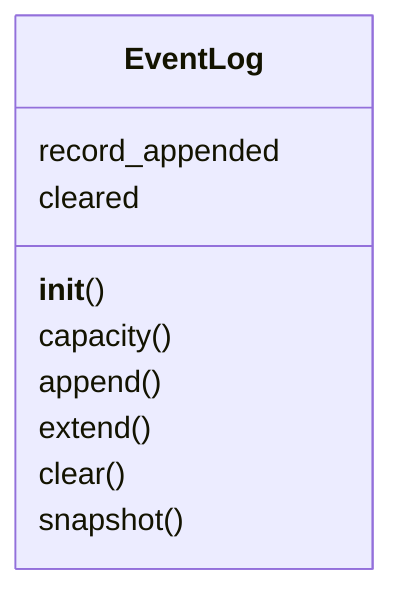
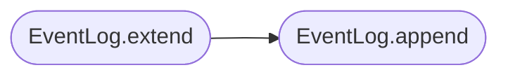

# `lazygui.services.event_log`

> Source: [lazygui/services/event_log.py:1](../../lazygui/services/event_log.py#L1) | language `py` | coverage 100.0% | [API index](../index.md)

In-memory ring buffer for `EventRecord`.

Centralising log retention here lets every backend feed events in and every
panel observe them without coupling the two sides directly. The buffer
imposes a hard cap (configured via [`EventLogConstants`](lazygui.config.constants.py.md#eventlogconstants)) so a chatty
backend can never starve memory.

## Contents

- **Classes:** [`EventLog`](#eventlog)

## Type Diagram



## Call Graph

Solid arrows stay in this module, dashed arrows leave it.



## Classes

<a id="eventlog"></a>

### `EventLog`

`class` | [lazygui/services/event_log.py:20](../../lazygui/services/event_log.py#L20)

```python
class EventLog(QObject)
```

Bases: `QObject`

Bounded, thread-safe-ish ring buffer of events with Qt signalling.

**Attributes**

| Name | Type | Default | Description |
|---|---|---|---|
| [`record_appended`](#eventlog-record_appended) |  | `Signal(EventRecord)` |  |
| [`cleared`](#eventlog-cleared) |  | `Signal()` |  |

**Members**

| Member | Kind | Summary |
|---|---|---|
| [`__init__`](#eventlog-__init__) | constructor | Initialise the buffer using ``constants.event_log.max_records``. |
| [`capacity`](#eventlog-capacity) | property | Maximum number of records retained before the oldest is dropped. |
| [`append`](#eventlog-append) | method | Append ``record`` and emit `[`record_appended`](#eventlog-record_appended)`. |
| [`extend`](#eventlog-extend) | method | Append every entry in ``records`` in iteration order. |
| [`clear`](#eventlog-clear) | method | Drop all stored records and emit `[`cleared`](#eventlog-cleared)`. |
| [`snapshot`](#eventlog-snapshot) | method | Return a defensive tuple, optionally filtered by `[`minimum_level`](lazygui.widgets.event_log_view.py.md#eventlogview-minimum_level)`. |

<a id="eventlog-__init__"></a>

#### `EventLog.__init__`

`constructor` | [lazygui/services/event_log.py:26](../../lazygui/services/event_log.py#L26)

```python
def __init__(self, constants: AppConstants, parent: QObject | None = None) -> None
```

Initialise the buffer using ``constants.event_log.max_records``.

**Parameters**

| Name | Type | Default | Description |
|---|---|---|---|
| `constants` | `AppConstants` |  |  |
| `parent` | `QObject \| None` | `None` |  |

*Called by:* [`Application.__init__`](lazygui.app.py.md#application-__init__)

<a id="eventlog-capacity"></a>

#### `EventLog.capacity`

`property` | [lazygui/services/event_log.py:33](../../lazygui/services/event_log.py#L33)

Decorators: `@property`

```python
def capacity(self) -> int
```

Maximum number of records retained before the oldest is dropped.

**Returns:** `int`

<a id="eventlog-append"></a>

#### `EventLog.append`

`method` | [lazygui/services/event_log.py:37](../../lazygui/services/event_log.py#L37)

```python
def append(self, record: EventRecord) -> None
```

Append ``record`` and emit `[`record_appended`](#eventlog-record_appended)`.

**Parameters**

| Name | Type | Default | Description |
|---|---|---|---|
| `record` | `EventRecord` |  |  |

*Called by:* [`EventLog.extend`](#eventlog-extend)

<a id="eventlog-extend"></a>

#### `EventLog.extend`

`method` | [lazygui/services/event_log.py:42](../../lazygui/services/event_log.py#L42)

```python
def extend(self, records: Iterable[EventRecord]) -> None
```

Append every entry in ``records`` in iteration order.

**Parameters**

| Name | Type | Default | Description |
|---|---|---|---|
| `records` | `Iterable[EventRecord]` |  |  |

*Calls:* [`EventLog.append`](#eventlog-append)

<a id="eventlog-clear"></a>

#### `EventLog.clear`

`method` | [lazygui/services/event_log.py:47](../../lazygui/services/event_log.py#L47)

```python
def clear(self) -> None
```

Drop all stored records and emit `[`cleared`](#eventlog-cleared)`.

<a id="eventlog-snapshot"></a>

#### `EventLog.snapshot`

`method` | [lazygui/services/event_log.py:52](../../lazygui/services/event_log.py#L52)

```python
def snapshot(self, minimum_level: EventLevel | None = None) -> tuple[EventRecord, ...]
```

Return a defensive tuple, optionally filtered by `[`minimum_level`](lazygui.widgets.event_log_view.py.md#eventlogview-minimum_level)`.

**Parameters**

| Name | Type | Default | Description |
|---|---|---|---|
| `minimum_level` | `EventLevel \| None` | `None` |  |

**Returns:** `tuple[EventRecord, ...]`

*Called by:* [`EventLogView.__init__`](lazygui.widgets.event_log_view.py.md#eventlogview-__init__)

---
