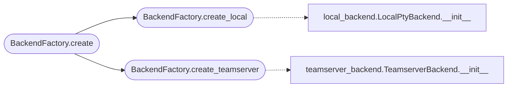

# `lazygui.services.factory`

> Source: [lazygui/services/factory.py:1](../../lazygui/services/factory.py#L1) | language `py` | coverage 100.0% | [API index](../index.md)

Factory for backend instances.

Encapsulates the construction logic so the rest of the GUI never imports a
concrete backend class. The factory keeps the GUI honoring the
Open/Closed principle: adding a new backend means writing a new class and
registering it here, not editing the windows or panels.

## Contents

- **Classes:** [`BackendFactory`](#backendfactory)

## Call Graph

Solid arrows stay in this module, dashed arrows leave it.



## Classes

<a id="backendfactory"></a>

### `BackendFactory`

`class` `dataclass` | [lazygui/services/factory.py:24](../../lazygui/services/factory.py#L24)

Decorators: `@dataclass(frozen=True, slots=True)`

```python
class BackendFactory
```

Build [`Backend`](lazygui.services.backend.py.md#backend) instances from runtime parameters.

**Attributes**

| Name | Type | Default | Description |
|---|---|---|---|
| [`constants`](#backendfactory-constants) | `AppConstants` |  |  |
| [`paths`](#backendfactory-paths) | `AppPaths` |  |  |

**Members**

| Member | Kind | Summary |
|---|---|---|
| [`create_local`](#backendfactory-create_local) | method | Construct a local PTY-based backend. |
| [`create_teamserver`](#backendfactory-create_teamserver) | method | Construct a teamserver-based backend with the given credentials. |
| [`create`](#backendfactory-create) | method | Convenience dispatch by [`BackendKind`](lazygui.services.models.py.md#backendkind). |

<a id="backendfactory-create_local"></a>

#### `BackendFactory.create_local`

`method` | [lazygui/services/factory.py:30](../../lazygui/services/factory.py#L30)

```python
def create_local(self, parent: QObject | None = None) -> LocalPtyBackend
```

Construct a local PTY-based backend.

**Parameters**

| Name | Type | Default | Description |
|---|---|---|---|
| `parent` | `QObject \| None` | `None` |  |

**Returns:** `LocalPtyBackend`

*Calls:* [`LocalPtyBackend.__init__`](lazygui.services.local_backend.py.md#localptybackend-__init__)

*Called by:* [`BackendFactory.create`](#backendfactory-create)

<a id="backendfactory-create_teamserver"></a>

#### `BackendFactory.create_teamserver`

`method` | [lazygui/services/factory.py:34](../../lazygui/services/factory.py#L34)

```python
def create_teamserver(self, credentials: TeamserverCredentials, parent: QObject | None = None) -> TeamserverBackend
```

Construct a teamserver-based backend with the given credentials.

**Parameters**

| Name | Type | Default | Description |
|---|---|---|---|
| `credentials` | `TeamserverCredentials` |  |  |
| `parent` | `QObject \| None` | `None` |  |

**Returns:** `TeamserverBackend`

*Calls:* [`TeamserverBackend.__init__`](lazygui.services.teamserver_backend.py.md#teamserverbackend-__init__)

*Called by:* [`BackendFactory.create`](#backendfactory-create)

<a id="backendfactory-create"></a>

#### `BackendFactory.create`

`method` | [lazygui/services/factory.py:42](../../lazygui/services/factory.py#L42)

```python
def create(self, kind: BackendKind, parent: QObject | None = None, credentials: TeamserverCredentials | None = None) -> Backend
```

Convenience dispatch by [`BackendKind`](lazygui.services.models.py.md#backendkind).

**Parameters**

| Name | Type | Default | Description |
|---|---|---|---|
| `kind` | `BackendKind` |  |  |
| `parent` | `QObject \| None` | `None` |  |
| `credentials` | `TeamserverCredentials \| None` | `None` |  |

**Returns:** `Backend`

**Raises**

- `ValueError`: (raised in the body, not documented)

*Calls:* [`BackendFactory.create_local`](#backendfactory-create_local), [`BackendFactory.create_teamserver`](#backendfactory-create_teamserver)

---
