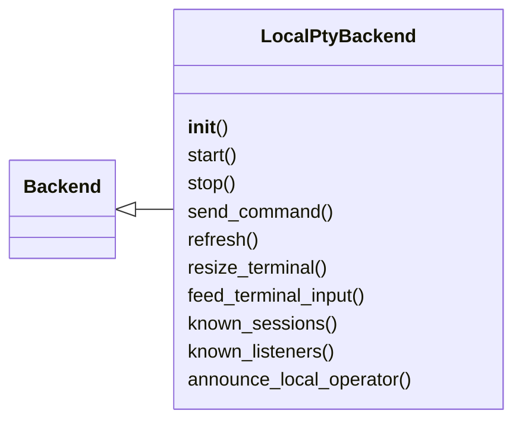
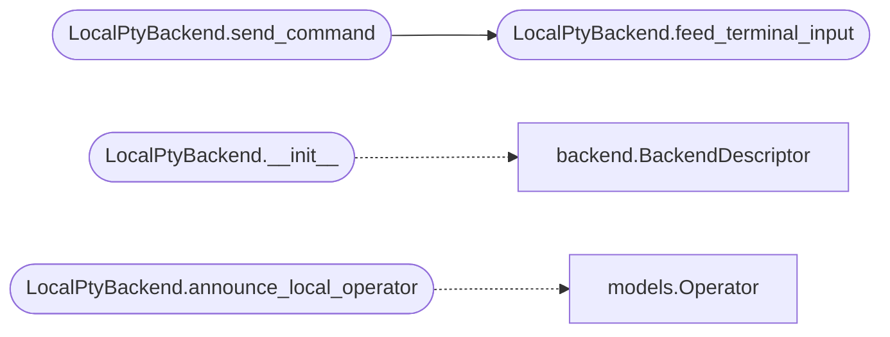

# `lazygui.services.local_backend`

> Source: [lazygui/services/local_backend.py:1](../../lazygui/services/local_backend.py#L1) | language `py` | coverage 100.0% | [API index](../index.md)

Local backend that runs the LazyOwn cmd2 console on a PTY.

This backend fork-execs a shell process inside a PTY so the GUI can render
the cmd2 prompt with full ANSI semantics. It exposes the same interface as
the teamserver backend so panels can switch between the two transparently.

## Contents

- **Classes:** [`LocalPtyBackend`](#localptybackend)

## Type Diagram



## Call Graph

Solid arrows stay in this module, dashed arrows leave it.



## Classes

<a id="localptybackend"></a>

### `LocalPtyBackend`

`class` | [lazygui/services/local_backend.py:30](../../lazygui/services/local_backend.py#L30)

```python
class LocalPtyBackend(Backend)
```

Bases: [`Backend`](lazygui.services.backend.py.md#backend)

Spawn a shell on a PTY and stream its output to the UI.

The backend cannot enumerate sessions or listeners on its own — the cmd2
console prints them to the terminal and the operator parses them
visually. `[`known_sessions`](#localptybackend-known_sessions)` / `[`known_listeners`](#localptybackend-known_listeners)` therefore stay empty.

**Members**

| Member | Kind | Summary |
|---|---|---|
| [`__init__`](#localptybackend-__init__) | constructor | Initialise the backend with the shared constants and paths. |
| [`start`](#localptybackend-start) | method | Fork-exec the cmd2 console behind a PTY. |
| [`stop`](#localptybackend-stop) | method | Send ``SIGTERM`` to the child and tear down notifiers. |
| [`send_command`](#localptybackend-send_command) | method | Write ``command`` followed by a newline to the PTY. |
| [`refresh`](#localptybackend-refresh) | method | No-op for the local backend; the operator drives data from cmd2. |
| [`resize_terminal`](#localptybackend-resize_terminal) | method | Propagate the new size to the PTY using ``TIOCSWINSZ``. |
| [`feed_terminal_input`](#localptybackend-feed_terminal_input) | method | Encode ``data`` and write it to the master end of the PTY. |
| [`known_sessions`](#localptybackend-known_sessions) | method | Local backend does not enumerate sessions. |
| [`known_listeners`](#localptybackend-known_listeners) | method | Local backend does not enumerate listeners. |
| [`announce_local_operator`](#localptybackend-announce_local_operator) | method | Emit a synthetic [`Operator`](lazygui.services.models.py.md#operator) describing the local user. |

<a id="localptybackend-__init__"></a>

#### `LocalPtyBackend.__init__`

`constructor` | [lazygui/services/local_backend.py:38](../../lazygui/services/local_backend.py#L38)

```python
def __init__(self, constants: AppConstants, paths: AppPaths, parent: QObject | None = None) -> None
```

Initialise the backend with the shared constants and paths.

**Parameters**

| Name | Type | Default | Description |
|---|---|---|---|
| `constants` | `AppConstants` |  |  |
| `paths` | `AppPaths` |  |  |
| `parent` | `QObject \| None` | `None` |  |

*Calls:* [`BackendDescriptor`](lazygui.services.backend.py.md#backenddescriptor)

*Called by:* [`BackendFactory.create_local`](lazygui.services.factory.py.md#backendfactory-create_local)

<a id="localptybackend-start"></a>

#### `LocalPtyBackend.start`

`method` | [lazygui/services/local_backend.py:62](../../lazygui/services/local_backend.py#L62)

```python
def start(self) -> None
```

Fork-exec the cmd2 console behind a PTY.

<a id="localptybackend-stop"></a>

#### `LocalPtyBackend.stop`

`method` | [lazygui/services/local_backend.py:87](../../lazygui/services/local_backend.py#L87)

```python
def stop(self) -> None
```

Send ``SIGTERM`` to the child and tear down notifiers.

<a id="localptybackend-send_command"></a>

#### `LocalPtyBackend.send_command`

`method` | [lazygui/services/local_backend.py:112](../../lazygui/services/local_backend.py#L112)

```python
def send_command(self, command: str, target_session: str | None = None) -> None
```

Write ``command`` followed by a newline to the PTY.

**Parameters**

| Name | Type | Default | Description |
|---|---|---|---|
| `command` | `str` |  |  |
| `target_session` | `str \| None` | `None` |  |

*Calls:* [`LocalPtyBackend.feed_terminal_input`](#localptybackend-feed_terminal_input)

<a id="localptybackend-refresh"></a>

#### `LocalPtyBackend.refresh`

`method` | [lazygui/services/local_backend.py:117](../../lazygui/services/local_backend.py#L117)

```python
def refresh(self) -> None
```

No-op for the local backend; the operator drives data from cmd2.

<a id="localptybackend-resize_terminal"></a>

#### `LocalPtyBackend.resize_terminal`

`method` | [lazygui/services/local_backend.py:121](../../lazygui/services/local_backend.py#L121)

```python
def resize_terminal(self, columns: int, rows: int) -> None
```

Propagate the new size to the PTY using ``TIOCSWINSZ``.

**Parameters**

| Name | Type | Default | Description |
|---|---|---|---|
| `columns` | `int` |  |  |
| `rows` | `int` |  |  |

<a id="localptybackend-feed_terminal_input"></a>

#### `LocalPtyBackend.feed_terminal_input`

`method` | [lazygui/services/local_backend.py:127](../../lazygui/services/local_backend.py#L127)

```python
def feed_terminal_input(self, data: str) -> None
```

Encode ``data`` and write it to the master end of the PTY.

**Parameters**

| Name | Type | Default | Description |
|---|---|---|---|
| `data` | `str` |  |  |

*Called by:* [`LocalPtyBackend.send_command`](#localptybackend-send_command)

<a id="localptybackend-known_sessions"></a>

#### `LocalPtyBackend.known_sessions`

`method` | [lazygui/services/local_backend.py:137](../../lazygui/services/local_backend.py#L137)

```python
def known_sessions(self) -> Sequence[Session]
```

Local backend does not enumerate sessions.

**Returns:** `Sequence[Session]`

<a id="localptybackend-known_listeners"></a>

#### `LocalPtyBackend.known_listeners`

`method` | [lazygui/services/local_backend.py:141](../../lazygui/services/local_backend.py#L141)

```python
def known_listeners(self) -> Sequence[Listener]
```

Local backend does not enumerate listeners.

**Returns:** `Sequence[Listener]`

<a id="localptybackend-announce_local_operator"></a>

#### `LocalPtyBackend.announce_local_operator`

`method` | [lazygui/services/local_backend.py:249](../../lazygui/services/local_backend.py#L249)

```python
def announce_local_operator(self) -> None
```

Emit a synthetic [`Operator`](lazygui.services.models.py.md#operator) describing the local user.

*Calls:* [`Operator`](lazygui.services.models.py.md#operator)

---
