# `lazygui.services.models`

> Source: [lazygui/services/models.py:1](../../lazygui/services/models.py#L1) | language `py` | coverage 100.0% | [API index](../index.md)

Immutable domain types consumed by the UI.

These dataclasses are deliberately framework-agnostic. They never carry Qt
references so they can be created from threads or background workers without
touching the GUI loop. Widgets adapt them at the edge.

## Contents

- **Classes:** [`Session`](#session), [`Listener`](#listener), [`Operator`](#operator), [`EventRecord`](#eventrecord), [`GraphNode`](#graphnode), [`GraphEdge`](#graphedge), [`Topology`](#topology), [`DashboardPayload`](#dashboardpayload), [`CampaignSummary`](#campaignsummary), [`BeaconResult`](#beaconresult)
- **Enums:** [`BackendKind`](#backendkind), [`EventLevel`](#eventlevel)

## Type Diagram

```mermaid
classDiagram
    direction LR
    class BackendKind
    <<enum>> BackendKind
    BackendKind : LOCAL
    BackendKind : TEAMSERVER
    class EventLevel
    <<enum>> EventLevel
    EventLevel : DEBUG
    EventLevel : INFO
    EventLevel : WARNING
    EventLevel : ERROR
    EventLevel : CRITICAL
    EventLevel : numeric()
    class Session
    Session : str identifier
    Session : str hostname
    Session : str operating_system
    Session : str process_id
    Session : str user
    Session : str ip_addresses
    Session : str discovered_ips
    Session : str last_command
    Session : Mapping[str, str] metadata
    class Listener
    Listener : str identifier
    Listener : str kind
    Listener : str address
    Listener : int port
    Listener : bool is_secure
    Listener : str description
    class Operator
    Operator : str name
    Operator : str role
    Operator : bool is_authenticated
    Operator : str karma_name
    Operator : int elo
    class EventRecord
    EventRecord : datetime timestamp
    EventRecord : EventLevel level
    EventRecord : str source
    EventRecord : str message
    EventRecord : now()
    class GraphNode
    GraphNode : str identifier
    GraphNode : str label
    GraphNode : str node_type
    GraphNode : str shape
    GraphNode : str color
    GraphNode : Mapping[str, str] metadata
    GraphNode : str icon
    class GraphEdge
    GraphEdge : str source_id
    GraphEdge : str target_id
    GraphEdge : str label
    GraphEdge : str edge_type
    GraphEdge : str color
    class Topology
    Topology : Sequence[GraphNode] nodes
    Topology : Sequence[GraphEdge] edges
    Topology : empty()
    class DashboardPayload
    DashboardPayload : Sequence[str] connected_clients
    DashboardPayload : int beacon_count
    DashboardPayload : Sequence[EventRecord] events
    DashboardPayload : Mapping[str, Any] campaign_state
    DashboardPayload : int facts_count
    DashboardPayload : str last_update
    class CampaignSummary
    CampaignSummary : str identifier
    CampaignSummary : str name
    CampaignSummary : str status
    CampaignSummary : str playbook
    CampaignSummary : int objectives_total
    CampaignSummary : int objectives_completed
    CampaignSummary : int target_count
    class BeaconResult
    BeaconResult : str client_id
    BeaconResult : str output
    BeaconResult : str command
    BeaconResult : str operating_system
    BeaconResult : str hostname
    BeaconResult : str user
    BeaconResult : str ips
    BeaconResult : str pid
    BeaconResult : str discovered_ips
    BeaconResult : str result_portscan
    BeaconResult : str result_pwd
```



## Classes

<a id="session"></a>

### `Session`

`class` `dataclass` | [lazygui/services/models.py:49](../../lazygui/services/models.py#L49)

Decorators: `@dataclass(frozen=True, slots=True)`

```python
class Session
```

A connected implant/session as reported by the backend.

**Attributes**

| Name | Type | Default | Description |
|---|---|---|---|
| [`identifier`](#session-identifier) | `str` |  |  |
| [`hostname`](#session-hostname) | `str` |  |  |
| [`operating_system`](#session-operating_system) | `str` |  |  |
| [`process_id`](#session-process_id) | `str` |  |  |
| [`user`](#session-user) | `str` |  |  |
| [`ip_addresses`](#session-ip_addresses) | `str` |  |  |
| [`discovered_ips`](#session-discovered_ips) | `str` |  |  |
| [`last_command`](#session-last_command) | `str` |  |  |
| [`metadata`](#session-metadata) | `Mapping[str, str]` | `field(default_factory=dict)` |  |

---

<a id="listener"></a>

### `Listener`

`class` `dataclass` | [lazygui/services/models.py:64](../../lazygui/services/models.py#L64)

Decorators: `@dataclass(frozen=True, slots=True)`

```python
class Listener
```

A C2 listener (HTTP/HTTPS/DNS/TCP) advertised by the backend.

**Attributes**

| Name | Type | Default | Description |
|---|---|---|---|
| [`identifier`](#listener-identifier) | `str` |  |  |
| [`kind`](#listener-kind) | `str` |  |  |
| [`address`](#listener-address) | `str` |  |  |
| [`port`](#listener-port) | `int` |  |  |
| [`is_secure`](#listener-is_secure) | `bool` |  |  |
| [`description`](#listener-description) | `str` | `''` |  |

---

<a id="operator"></a>

### `Operator`

`class` `dataclass` | [lazygui/services/models.py:76](../../lazygui/services/models.py#L76)

Decorators: `@dataclass(frozen=True, slots=True)`

```python
class Operator
```

An operator account known to the teamserver.

**Attributes**

| Name | Type | Default | Description |
|---|---|---|---|
| [`name`](#operator-name) | `str` |  |  |
| [`role`](#operator-role) | `str` |  |  |
| [`is_authenticated`](#operator-is_authenticated) | `bool` |  |  |
| [`karma_name`](#operator-karma_name) | `str` | `''` |  |
| [`elo`](#operator-elo) | `int` | `0` |  |

---

<a id="eventrecord"></a>

### `EventRecord`

`class` `dataclass` | [lazygui/services/models.py:87](../../lazygui/services/models.py#L87)

Decorators: `@dataclass(frozen=True, slots=True)`

```python
class EventRecord
```

A single line in the event log.

**Attributes**

| Name | Type | Default | Description |
|---|---|---|---|
| [`timestamp`](#eventrecord-timestamp) | `datetime` |  |  |
| [`level`](#eventrecord-level) | `EventLevel` |  |  |
| [`source`](#eventrecord-source) | `str` |  |  |
| [`message`](#eventrecord-message) | `str` |  |  |

**Members**

| Member | Kind | Summary |
|---|---|---|
| [`now`](#eventrecord-now) | classmethod | Construct a record stamped with the current UTC time. |

<a id="eventrecord-now"></a>

#### `EventRecord.now`

`classmethod` | [lazygui/services/models.py:96](../../lazygui/services/models.py#L96)

Decorators: `@classmethod`

```python
def now(cls, level: EventLevel, source: str, message: str) -> EventRecord
```

Construct a record stamped with the current UTC time.

**Parameters**

| Name | Type | Default | Description |
|---|---|---|---|
| `level` | `EventLevel` |  |  |
| `source` | `str` |  |  |
| `message` | `str` |  |  |

**Returns:** `EventRecord`

*Called by:* [`MainWindow.window_requests_connect`](lazygui.windows.main_window.py.md#mainwindow-window_requests_connect)

---

<a id="graphnode"></a>

### `GraphNode`

`class` `dataclass` | [lazygui/services/models.py:102](../../lazygui/services/models.py#L102)

Decorators: `@dataclass(frozen=True, slots=True)`

```python
class GraphNode
```

A node in the attack topography graph.

**Attributes**

| Name | Type | Default | Description |
|---|---|---|---|
| [`identifier`](#graphnode-identifier) | `str` |  |  |
| [`label`](#graphnode-label) | `str` |  |  |
| [`node_type`](#graphnode-node_type) | `str` |  |  |
| [`shape`](#graphnode-shape) | `str` | `'dot'` |  |
| [`color`](#graphnode-color) | `str` | `'#58a6ff'` |  |
| [`metadata`](#graphnode-metadata) | `Mapping[str, str]` | `field(default_factory=dict)` |  |
| [`icon`](#graphnode-icon) | `str` | `''` |  |

---

<a id="graphedge"></a>

### `GraphEdge`

`class` `dataclass` | [lazygui/services/models.py:115](../../lazygui/services/models.py#L115)

Decorators: `@dataclass(frozen=True, slots=True)`

```python
class GraphEdge
```

An edge connecting two graph nodes.

**Attributes**

| Name | Type | Default | Description |
|---|---|---|---|
| [`source_id`](#graphedge-source_id) | `str` |  |  |
| [`target_id`](#graphedge-target_id) | `str` |  |  |
| [`label`](#graphedge-label) | `str` | `''` |  |
| [`edge_type`](#graphedge-edge_type) | `str` | `'default'` |  |
| [`color`](#graphedge-color) | `str` | `'#30363d'` |  |

---

<a id="topology"></a>

### `Topology`

`class` `dataclass` | [lazygui/services/models.py:126](../../lazygui/services/models.py#L126)

Decorators: `@dataclass(frozen=True, slots=True)`

```python
class Topology
```

Complete graph topology from the teamserver.

**Attributes**

| Name | Type | Default | Description |
|---|---|---|---|
| [`nodes`](#topology-nodes) | `Sequence[GraphNode]` | `()` |  |
| [`edges`](#topology-edges) | `Sequence[GraphEdge]` | `()` |  |

**Members**

| Member | Kind | Summary |
|---|---|---|
| [`empty`](#topology-empty) | classmethod | Return an empty topology. |

<a id="topology-empty"></a>

#### `Topology.empty`

`classmethod` | [lazygui/services/models.py:133](../../lazygui/services/models.py#L133)

Decorators: `@classmethod`

```python
def empty(cls) -> Topology
```

Return an empty topology.

**Returns:** `Topology`

*Called by:* [`Backend.known_topology`](lazygui.services.backend.py.md#backend-known_topology), [`TeamserverBackend.__init__`](lazygui.services.teamserver_backend.py.md#teamserverbackend-__init__), [`TeamserverBackend.stop`](lazygui.services.teamserver_backend.py.md#teamserverbackend-stop)

---

<a id="dashboardpayload"></a>

### `DashboardPayload`

`class` `dataclass` | [lazygui/services/models.py:139](../../lazygui/services/models.py#L139)

Decorators: `@dataclass(frozen=True, slots=True)`

```python
class DashboardPayload
```

Aggregated dashboard data from ``/api/dashboard``.

**Attributes**

| Name | Type | Default | Description |
|---|---|---|---|
| [`connected_clients`](#dashboardpayload-connected_clients) | `Sequence[str]` | `()` |  |
| [`beacon_count`](#dashboardpayload-beacon_count) | `int` | `0` |  |
| [`events`](#dashboardpayload-events) | `Sequence[EventRecord]` | `()` |  |
| [`campaign_state`](#dashboardpayload-campaign_state) | `Mapping[str, Any]` | `field(default_factory=dict)` |  |
| [`facts_count`](#dashboardpayload-facts_count) | `int` | `0` |  |
| [`last_update`](#dashboardpayload-last_update) | `str` | `''` |  |

---

<a id="campaignsummary"></a>

### `CampaignSummary`

`class` `dataclass` | [lazygui/services/models.py:151](../../lazygui/services/models.py#L151)

Decorators: `@dataclass(frozen=True, slots=True)`

```python
class CampaignSummary
```

Campaign status from the backend.

**Attributes**

| Name | Type | Default | Description |
|---|---|---|---|
| [`identifier`](#campaignsummary-identifier) | `str` |  |  |
| [`name`](#campaignsummary-name) | `str` |  |  |
| [`status`](#campaignsummary-status) | `str` |  |  |
| [`playbook`](#campaignsummary-playbook) | `str` |  |  |
| [`objectives_total`](#campaignsummary-objectives_total) | `int` | `0` |  |
| [`objectives_completed`](#campaignsummary-objectives_completed) | `int` | `0` |  |
| [`target_count`](#campaignsummary-target_count) | `int` | `0` |  |

---

<a id="beaconresult"></a>

### `BeaconResult`

`class` `dataclass` | [lazygui/services/models.py:164](../../lazygui/services/models.py#L164)

Decorators: `@dataclass(frozen=True, slots=True)`

```python
class BeaconResult
```

Command result returned by a beacon.

**Attributes**

| Name | Type | Default | Description |
|---|---|---|---|
| [`client_id`](#beaconresult-client_id) | `str` |  |  |
| [`output`](#beaconresult-output) | `str` |  |  |
| [`command`](#beaconresult-command) | `str` |  |  |
| [`operating_system`](#beaconresult-operating_system) | `str` | `''` |  |
| [`hostname`](#beaconresult-hostname) | `str` | `''` |  |
| [`user`](#beaconresult-user) | `str` | `''` |  |
| [`ips`](#beaconresult-ips) | `str` | `''` |  |
| [`pid`](#beaconresult-pid) | `str` | `''` |  |
| [`discovered_ips`](#beaconresult-discovered_ips) | `str` | `''` |  |
| [`result_portscan`](#beaconresult-result_portscan) | `str` | `''` |  |
| [`result_pwd`](#beaconresult-result_pwd) | `str` | `''` |  |

---

## Enums

<a id="backendkind"></a>

### `BackendKind`

`enum` | [lazygui/services/models.py:17](../../lazygui/services/models.py#L17)

```python
class BackendKind(StrEnum)
```

Bases: `StrEnum`

Stable identifiers for the backend implementations.

**Attributes**

| Name | Type | Default | Description |
|---|---|---|---|
| [`LOCAL`](#backendkind-local) |  | `'local'` |  |
| [`TEAMSERVER`](#backendkind-teamserver) |  | `'teamserver'` |  |

---

<a id="eventlevel"></a>

### `EventLevel`

`enum` | [lazygui/services/models.py:24](../../lazygui/services/models.py#L24)

```python
class EventLevel(StrEnum)
```

Bases: `StrEnum`

Severity levels for [`EventRecord`](#eventrecord).

Order matters for filtering.

**Attributes**

| Name | Type | Default | Description |
|---|---|---|---|
| [`DEBUG`](#eventlevel-debug) |  | `'debug'` |  |
| [`INFO`](#eventlevel-info) |  | `'info'` |  |
| [`WARNING`](#eventlevel-warning) |  | `'warning'` |  |
| [`ERROR`](#eventlevel-error) |  | `'error'` |  |
| [`CRITICAL`](#eventlevel-critical) |  | `'critical'` |  |

**Members**

| Member | Kind | Summary |
|---|---|---|
| [`numeric`](#eventlevel-numeric) | property | Numeric rank used to compare severity. |

<a id="eventlevel-numeric"></a>

#### `EventLevel.numeric`

`property` | [lazygui/services/models.py:34](../../lazygui/services/models.py#L34)

Decorators: `@property`

```python
def numeric(self) -> int
```

Numeric rank used to compare severity.

**Returns:** `int`

---
