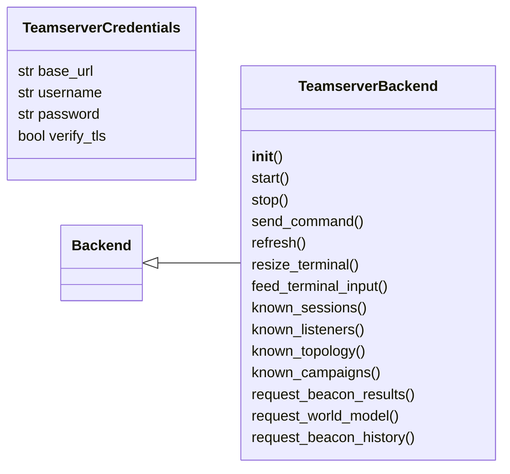
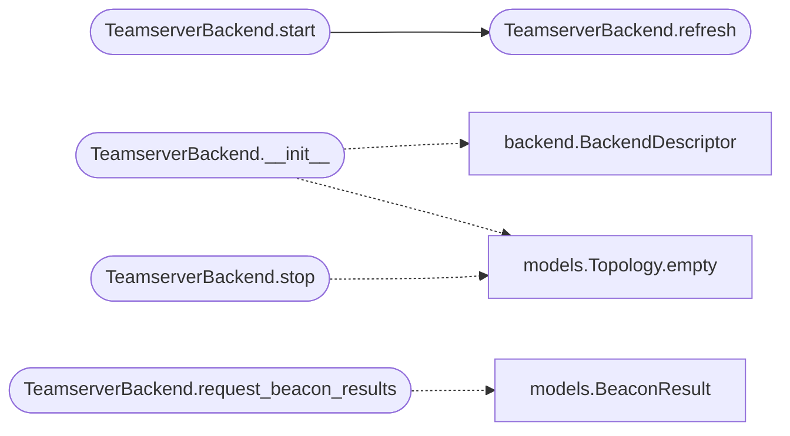

# `lazygui.services.teamserver_backend`

> Source: [lazygui/services/teamserver_backend.py:1](../../lazygui/services/teamserver_backend.py#L1) | language `py` | coverage 100.0% | [API index](../index.md)

Teamserver backend with Socket.IO real-time and full HTTP API coverage.

Connects to ``lazyc2.py`` via HTTP REST + Socket.IO WebSocket. The backend
provides bidirectional terminal access, beacon command/result flow, graph
topology streaming, dashboard aggregation, listener management and campaign
tracking. Fault-tolerant with automatic reconnection and graceful degradation.

## Contents

- **Classes:** [`TeamserverCredentials`](#teamservercredentials), [`TeamserverBackend`](#teamserverbackend)

## Type Diagram



## Call Graph

Solid arrows stay in this module, dashed arrows leave it.



## Classes

<a id="teamservercredentials"></a>

### `TeamserverCredentials`

`class` `dataclass` | [lazygui/services/teamserver_backend.py:39](../../lazygui/services/teamserver_backend.py#L39)

Decorators: `@dataclass(frozen=True, slots=True)`

```python
class TeamserverCredentials
```

Connection parameters for [`TeamserverBackend`](#teamserverbackend).

**Attributes**

| Name | Type | Default | Description |
|---|---|---|---|
| [`base_url`](#teamservercredentials-base_url) | `str` |  |  |
| [`username`](#teamservercredentials-username) | `str` |  |  |
| [`password`](#teamservercredentials-password) | `str` |  |  |
| [`verify_tls`](#teamservercredentials-verify_tls) | `bool` | `False` |  |

---

<a id="teamserverbackend"></a>

### `TeamserverBackend`

`class` | [lazygui/services/teamserver_backend.py:48](../../lazygui/services/teamserver_backend.py#L48)

```python
class TeamserverBackend(Backend)
```

Bases: [`Backend`](lazygui.services.backend.py.md#backend)

Real-time backend communicating with ``lazyc2.py`` over HTTP + Socket.IO.

**Members**

| Member | Kind | Summary |
|---|---|---|
| [`__init__`](#teamserverbackend-__init__) | constructor | Store ``credentials`` and prepare polling timers and Socket.IO client. |
| [`start`](#teamserverbackend-start) | method | Begin polling and establish Socket.IO connection. |
| [`stop`](#teamserverbackend-stop) | method | Tear down all timers and Socket.IO connection. |
| [`send_command`](#teamserverbackend-send_command) | method | Submit ``command`` via Socket.IO PTY (global) or ``/issue_command`` (beacon). |
| [`refresh`](#teamserverbackend-refresh) | method | Pull consolidated state JSON and emit derived signals. |
| [`resize_terminal`](#teamserverbackend-resize_terminal) | method | Forward resize to Socket.IO PTY namespace when connected. |
| [`feed_terminal_input`](#teamserverbackend-feed_terminal_input) | method | Feed keystrokes to the PTY via Socket.IO, falling back to HTTP commands. |
| [`known_sessions`](#teamserverbackend-known_sessions) | method | Most recent snapshot delivered by the last poll. |
| [`known_listeners`](#teamserverbackend-known_listeners) | method | Most recent snapshot delivered by the last poll. |
| [`known_topology`](#teamserverbackend-known_topology) | method | Most recent graph topology snapshot. |
| [`known_campaigns`](#teamserverbackend-known_campaigns) | method | Most recent campaign snapshot. |
| [`request_beacon_results`](#teamserverbackend-request_beacon_results) | method | Fetch stored command results for a specific beacon. |
| [`request_world_model`](#teamserverbackend-request_world_model) | method | Fetch the unified kill-chain snapshot from the teamserver REST API. |
| [`request_beacon_history`](#teamserverbackend-request_beacon_history) | method | Fetch the persistent ordered command/result history for a beacon. |

<a id="teamserverbackend-__init__"></a>

#### `TeamserverBackend.__init__`

`constructor` | [lazygui/services/teamserver_backend.py:51](../../lazygui/services/teamserver_backend.py#L51)

```python
def __init__(self, constants: AppConstants, credentials: TeamserverCredentials, parent: QObject | None = None) -> None
```

Store ``credentials`` and prepare polling timers and Socket.IO client.

**Parameters**

| Name | Type | Default | Description |
|---|---|---|---|
| `constants` | `AppConstants` |  |  |
| `credentials` | `TeamserverCredentials` |  |  |
| `parent` | `QObject \| None` | `None` |  |

*Calls:* [`BackendDescriptor`](lazygui.services.backend.py.md#backenddescriptor), [`Topology.empty`](lazygui.services.models.py.md#topology-empty)

*Called by:* [`BackendFactory.create_teamserver`](lazygui.services.factory.py.md#backendfactory-create_teamserver)

<a id="teamserverbackend-start"></a>

#### `TeamserverBackend.start`

`method` | [lazygui/services/teamserver_backend.py:80](../../lazygui/services/teamserver_backend.py#L80)

```python
def start(self) -> None
```

Begin polling and establish Socket.IO connection.

First authenticates via the C2 login form to obtain a Flask session
cookie. Then starts HTTP polling and Socket.IO after authentication
completes, so the WebSocket upgrade carries the session cookie.

*Calls:* [`TeamserverBackend.refresh`](#teamserverbackend-refresh)

<a id="teamserverbackend-stop"></a>

#### `TeamserverBackend.stop`

`method` | [lazygui/services/teamserver_backend.py:97](../../lazygui/services/teamserver_backend.py#L97)

```python
def stop(self) -> None
```

Tear down all timers and Socket.IO connection.

*Calls:* [`Topology.empty`](lazygui.services.models.py.md#topology-empty)

<a id="teamserverbackend-send_command"></a>

#### `TeamserverBackend.send_command`

`method` | [lazygui/services/teamserver_backend.py:112](../../lazygui/services/teamserver_backend.py#L112)

```python
def send_command(self, command: str, target_session: str | None = None) -> None
```

Submit ``command`` via Socket.IO PTY (global) or ``/issue_command`` (beacon).

Global commands go through Socket.IO ``/pty`` to reach the PTY
directly and bypass CSRF. Beacon commands POST to ``/issue_command``
which the implant polls.

**Parameters**

| Name | Type | Default | Description |
|---|---|---|---|
| `command` | `str` |  |  |
| `target_session` | `str \| None` | `None` |  |

<a id="teamserverbackend-refresh"></a>

#### `TeamserverBackend.refresh`

`method` | [lazygui/services/teamserver_backend.py:124](../../lazygui/services/teamserver_backend.py#L124)

```python
def refresh(self) -> None
```

Pull consolidated state JSON and emit derived signals.

*Called by:* [`TeamserverBackend.start`](#teamserverbackend-start)

<a id="teamserverbackend-resize_terminal"></a>

#### `TeamserverBackend.resize_terminal`

`method` | [lazygui/services/teamserver_backend.py:139](../../lazygui/services/teamserver_backend.py#L139)

```python
def resize_terminal(self, columns: int, rows: int) -> None
```

Forward resize to Socket.IO PTY namespace when connected.

**Parameters**

| Name | Type | Default | Description |
|---|---|---|---|
| `columns` | `int` |  |  |
| `rows` | `int` |  |  |

<a id="teamserverbackend-feed_terminal_input"></a>

#### `TeamserverBackend.feed_terminal_input`

`method` | [lazygui/services/teamserver_backend.py:151](../../lazygui/services/teamserver_backend.py#L151)

```python
def feed_terminal_input(self, data: str) -> None
```

Feed keystrokes to the PTY via Socket.IO, falling back to HTTP commands.

Socket.IO ``/pty`` namespace sends raw input directly to the PTY
and bypasses CSRF checks, so it is preferred when available.

**Parameters**

| Name | Type | Default | Description |
|---|---|---|---|
| `data` | `str` |  |  |

<a id="teamserverbackend-known_sessions"></a>

#### `TeamserverBackend.known_sessions`

`method` | [lazygui/services/teamserver_backend.py:169](../../lazygui/services/teamserver_backend.py#L169)

```python
def known_sessions(self) -> Sequence[Session]
```

Most recent snapshot delivered by the last poll.

**Returns:** `Sequence[Session]`

<a id="teamserverbackend-known_listeners"></a>

#### `TeamserverBackend.known_listeners`

`method` | [lazygui/services/teamserver_backend.py:173](../../lazygui/services/teamserver_backend.py#L173)

```python
def known_listeners(self) -> Sequence[Listener]
```

Most recent snapshot delivered by the last poll.

**Returns:** `Sequence[Listener]`

<a id="teamserverbackend-known_topology"></a>

#### `TeamserverBackend.known_topology`

`method` | [lazygui/services/teamserver_backend.py:177](../../lazygui/services/teamserver_backend.py#L177)

```python
def known_topology(self) -> Topology
```

Most recent graph topology snapshot.

**Returns:** `Topology`

<a id="teamserverbackend-known_campaigns"></a>

#### `TeamserverBackend.known_campaigns`

`method` | [lazygui/services/teamserver_backend.py:181](../../lazygui/services/teamserver_backend.py#L181)

```python
def known_campaigns(self) -> Sequence[CampaignSummary]
```

Most recent campaign snapshot.

**Returns:** `Sequence[CampaignSummary]`

<a id="teamserverbackend-request_beacon_results"></a>

#### `TeamserverBackend.request_beacon_results`

`method` | [lazygui/services/teamserver_backend.py:185](../../lazygui/services/teamserver_backend.py#L185)

```python
def request_beacon_results(self, client_id: str) -> None
```

Fetch stored command results for a specific beacon.

**Parameters**

| Name | Type | Default | Description |
|---|---|---|---|
| `client_id` | `str` |  |  |

*Calls:* [`BeaconResult`](lazygui.services.models.py.md#beaconresult)

<a id="teamserverbackend-request_world_model"></a>

#### `TeamserverBackend.request_world_model`

`method` | [lazygui/services/teamserver_backend.py:210](../../lazygui/services/teamserver_backend.py#L210)

```python
def request_world_model(self) -> dict
```

Fetch the unified kill-chain snapshot from the teamserver REST API.

Overrides the base local-file implementation so the remote state is
the single source of truth for the GUI kill-chain panel.

**Returns:** `dict`

<a id="teamserverbackend-request_beacon_history"></a>

#### `TeamserverBackend.request_beacon_history`

`method` | [lazygui/services/teamserver_backend.py:224](../../lazygui/services/teamserver_backend.py#L224)

```python
def request_beacon_history(self, client_id: str) -> list[dict]
```

Fetch the persistent ordered command/result history for a beacon.

**Parameters**

| Name | Type | Default | Description |
|---|---|---|---|
| `client_id` | `str` |  | The beacon id whose history is requested. |

**Returns:** `list[dict]` - A list of record dicts (oldest first), or [] on failure.

---
