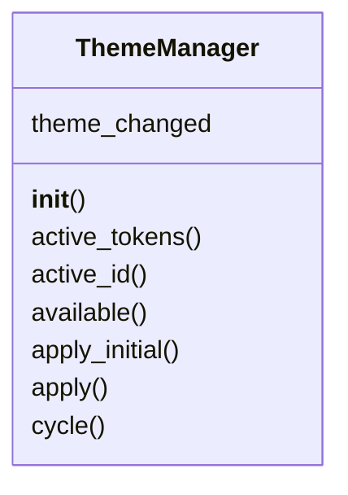
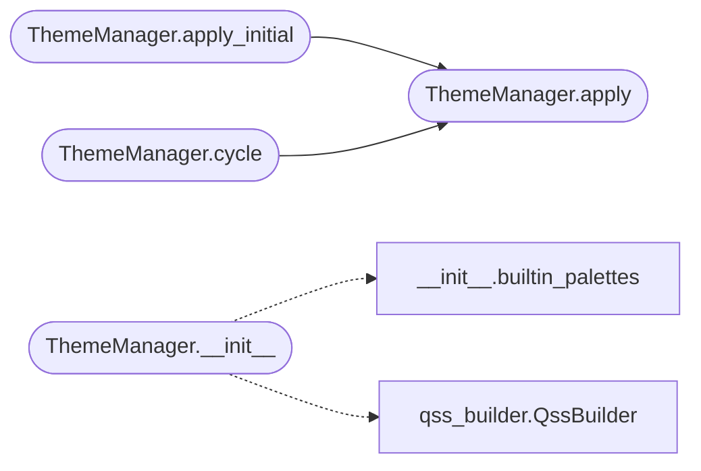

# `lazygui.theme.manager`

> Source: [lazygui/theme/manager.py:1](../../lazygui/theme/manager.py#L1) | language `py` | coverage 100.0% | [API index](../index.md)

Theme registry and runtime application of stylesheets.

The [`ThemeManager`](#thememanager) holds the available palettes, applies the active
one onto the running `QApplication`, and emits `[`theme_changed`](#thememanager-theme_changed)` so
widgets that draw with custom painters can refresh their cached colours.

## Contents

- **Classes:** [`ThemeManager`](#thememanager)

## Type Diagram



## Call Graph

Solid arrows stay in this module, dashed arrows leave it.



## Classes

<a id="thememanager"></a>

### `ThemeManager`

`class` | [lazygui/theme/manager.py:26](../../lazygui/theme/manager.py#L26)

```python
class ThemeManager(QObject)
```

Bases: `QObject`

Owns palettes and applies them to the application instance.

**Attributes**

| Name | Type | Default | Description |
|---|---|---|---|
| [`theme_changed`](#thememanager-theme_changed) |  | `Signal(ThemeTokens)` |  |

**Members**

| Member | Kind | Summary |
|---|---|---|
| [`__init__`](#thememanager-__init__) | constructor | Initialise the manager. |
| [`active_tokens`](#thememanager-active_tokens) | property | Currently active [`ThemeTokens`](lazygui.theme.tokens.py.md#themetokens). |
| [`active_id`](#thememanager-active_id) | property | Identifier of the active palette. |
| [`available`](#thememanager-available) | method | Yield all registered palettes in registration order. |
| [`apply_initial`](#thememanager-apply_initial) | method | Load the saved theme identifier and apply it. |
| [`apply`](#thememanager-apply) | method | Activate the palette with ``identifier`` and persist the choice. |
| [`cycle`](#thememanager-cycle) | method | Switch to the next palette, wrapping at the end of the registry. |

<a id="thememanager-__init__"></a>

#### `ThemeManager.__init__`

`constructor` | [lazygui/theme/manager.py:31](../../lazygui/theme/manager.py#L31)

```python
def __init__(self, constants: AppConstants, settings: AppSettings, application: QApplication, palettes: Mapping[str, ThemeTokens] | None = None, parent: QObject | None = None) -> None
```

Initialise the manager.

**Parameters**

| Name | Type | Default | Description |
|---|---|---|---|
| `constants` | `AppConstants` |  | shared [`AppConstants`](lazygui.config.constants.py.md#appconstants) instance. |
| `settings` | `AppSettings` |  | persisted [`AppSettings`](lazygui.config.settings.py.md#appsettings) for read/write of the active theme identifier. |
| `application` | `QApplication` |  | the running ``QApplication`` instance. |
| `palettes` | `Mapping[str, ThemeTokens] \| None` | `None` | optional override registry; defaults to the built-in palettes returned by [`builtin_palettes`](lazygui.theme.palettes.__init__.py.md#builtin_palettes). |
| `parent` | `QObject \| None` | `None` |  |

*Calls:* [`builtin_palettes`](lazygui.theme.palettes.__init__.py.md#builtin_palettes), [`QssBuilder`](lazygui.theme.qss_builder.py.md#qssbuilder)

*Called by:* [`Application.__init__`](lazygui.app.py.md#application-__init__)

<a id="thememanager-active_tokens"></a>

#### `ThemeManager.active_tokens`

`property` | [lazygui/theme/manager.py:57](../../lazygui/theme/manager.py#L57)

Decorators: `@property`

```python
def active_tokens(self) -> ThemeTokens
```

Currently active [`ThemeTokens`](lazygui.theme.tokens.py.md#themetokens).

Defaults if none set yet.

**Returns:** `ThemeTokens`

<a id="thememanager-active_id"></a>

#### `ThemeManager.active_id`

`property` | [lazygui/theme/manager.py:64](../../lazygui/theme/manager.py#L64)

Decorators: `@property`

```python
def active_id(self) -> str
```

Identifier of the active palette.

**Returns:** `str`

<a id="thememanager-available"></a>

#### `ThemeManager.available`

`method` | [lazygui/theme/manager.py:68](../../lazygui/theme/manager.py#L68)

```python
def available(self) -> Iterable[ThemeTokens]
```

Yield all registered palettes in registration order.

**Returns:** `Iterable[ThemeTokens]`

<a id="thememanager-apply_initial"></a>

#### `ThemeManager.apply_initial`

`method` | [lazygui/theme/manager.py:72](../../lazygui/theme/manager.py#L72)

```python
def apply_initial(self) -> None
```

Load the saved theme identifier and apply it.

*Calls:* [`ThemeManager.apply`](#thememanager-apply)

*Called by:* [`Application.__init__`](lazygui.app.py.md#application-__init__)

<a id="thememanager-apply"></a>

#### `ThemeManager.apply`

`method` | [lazygui/theme/manager.py:80](../../lazygui/theme/manager.py#L80)

```python
def apply(self, identifier: str) -> None
```

Activate the palette with ``identifier`` and persist the choice.

**Parameters**

| Name | Type | Default | Description |
|---|---|---|---|
| `identifier` | `str` |  |  |

**Raises**

- `KeyError`: (raised in the body, not documented)

*Called by:* [`ThemeManager.apply_initial`](#thememanager-apply_initial), [`ThemeManager.cycle`](#thememanager-cycle)

<a id="thememanager-cycle"></a>

#### `ThemeManager.cycle`

`method` | [lazygui/theme/manager.py:93](../../lazygui/theme/manager.py#L93)

```python
def cycle(self) -> None
```

Switch to the next palette, wrapping at the end of the registry.

*Calls:* [`ThemeManager.apply`](#thememanager-apply)

---
