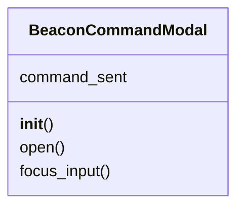

# `lazygui.widgets.beacon_command_modal`

> Source: [lazygui/widgets/beacon_command_modal.py:1](../../lazygui/widgets/beacon_command_modal.py#L1) | language `py` | coverage 100.0% | [API index](../index.md)

Beacon command modal — send commands to beacons and inspect full history.

The modal is the primary operator surface for issuing commands to a beacon
implant and reviewing both real-time results and the persisted command
history served by the teamserver. History is loaded from the backend
(request_beacon_history) so prior engagements survive restarts; live results
stream in through the `[`beacon_result`](lazygui.services.backend.py.md#backend-beacon_result)` signal.

## Contents

- **Classes:** [`BeaconCommandModal`](#beaconcommandmodal)

## Type Diagram



## Classes

<a id="beaconcommandmodal"></a>

### `BeaconCommandModal`

`class` | [lazygui/widgets/beacon_command_modal.py:44](../../lazygui/widgets/beacon_command_modal.py#L44)

```python
class BeaconCommandModal(QDialog)
```

Bases: `QDialog`

Modal dialog for executing commands on a beacon and viewing results.

Signals:
    command_sent: Emitted with the target and command when dispatched.

**Attributes**

| Name | Type | Default | Description |
|---|---|---|---|
| [`command_sent`](#beaconcommandmodal-command_sent) |  | `Signal(str, str)` |  |

**Members**

| Member | Kind | Summary |
|---|---|---|
| [`__init__`](#beaconcommandmodal-__init__) | constructor | Initialise the modal with a backend reference. |
| [`open`](#beaconcommandmodal-open) | method | Populate sessions before showing. |
| [`focus_input`](#beaconcommandmodal-focus_input) | method | Move keyboard focus to the command input. |

<a id="beaconcommandmodal-__init__"></a>

#### `BeaconCommandModal.__init__`

`constructor` | [lazygui/widgets/beacon_command_modal.py:53](../../lazygui/widgets/beacon_command_modal.py#L53)

```python
def __init__(self, backend: Backend, parent: QWidget | None = None) -> None
```

Initialise the modal with a backend reference.

**Parameters**

| Name | Type | Default | Description |
|---|---|---|---|
| `backend` | `Backend` |  | The active backend for dispatching commands. |
| `parent` | `QWidget \| None` | `None` | Optional parent widget. |

*Called by:* [`MainWindow.__init__`](lazygui.windows.main_window.py.md#mainwindow-__init__)

<a id="beaconcommandmodal-open"></a>

#### `BeaconCommandModal.open`

`method` | [lazygui/widgets/beacon_command_modal.py:216](../../lazygui/widgets/beacon_command_modal.py#L216)

```python
def open(self) -> None
```

Populate sessions before showing.

<a id="beaconcommandmodal-focus_input"></a>

#### `BeaconCommandModal.focus_input`

`method` | [lazygui/widgets/beacon_command_modal.py:227](../../lazygui/widgets/beacon_command_modal.py#L227)

```python
def focus_input(self) -> None
```

Move keyboard focus to the command input.

---
