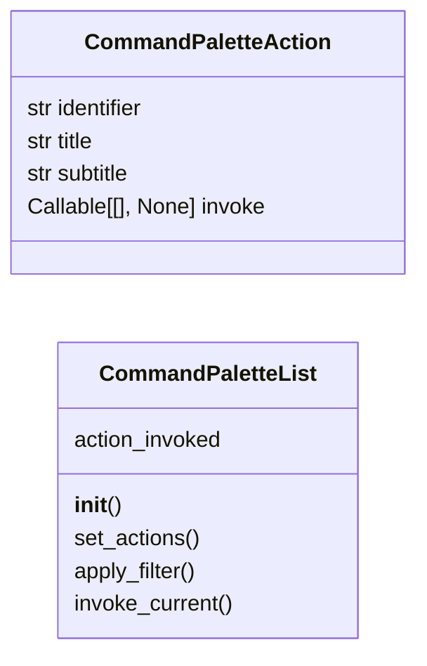
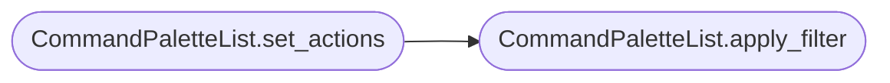

# `lazygui.widgets.command_palette_list`

> Source: [lazygui/widgets/command_palette_list.py:1](../../lazygui/widgets/command_palette_list.py#L1) | language `py` | coverage 100.0% | [API index](../index.md)

Result list and action model for the command palette.

## Contents

- **Classes:** [`CommandPaletteAction`](#commandpaletteaction), [`CommandPaletteList`](#commandpalettelist)

## Type Diagram



## Call Graph

Solid arrows stay in this module, dashed arrows leave it.



## Classes

<a id="commandpaletteaction"></a>

### `CommandPaletteAction`

`class` `dataclass` | [lazygui/widgets/command_palette_list.py:16](../../lazygui/widgets/command_palette_list.py#L16)

Decorators: `@dataclass(frozen=True, slots=True)`

```python
class CommandPaletteAction
```

A user-visible entry inside the command palette.

**Attributes**

| Name | Type | Default | Description |
|---|---|---|---|
| [`identifier`](#commandpaletteaction-identifier) | `str` |  |  |
| [`title`](#commandpaletteaction-title) | `str` |  |  |
| [`subtitle`](#commandpaletteaction-subtitle) | `str` |  |  |
| [`invoke`](#commandpaletteaction-invoke) | `Callable[[], None]` |  |  |

---

<a id="commandpalettelist"></a>

### `CommandPaletteList`

`class` | [lazygui/widgets/command_palette_list.py:28](../../lazygui/widgets/command_palette_list.py#L28)

```python
class CommandPaletteList(QListView)
```

Bases: `QListView`

List view backed by a fuzzy-filtered [`CommandPaletteAction`](#commandpaletteaction) set.

**Attributes**

| Name | Type | Default | Description |
|---|---|---|---|
| [`action_invoked`](#commandpalettelist-action_invoked) |  | `Signal(CommandPaletteAction)` |  |

**Members**

| Member | Kind | Summary |
|---|---|---|
| [`__init__`](#commandpalettelist-__init__) | constructor | Store the action set and prepare the underlying model. |
| [`set_actions`](#commandpalettelist-set_actions) | method | Replace the entire action registry and reset the filter. |
| [`apply_filter`](#commandpalettelist-apply_filter) | method | Filter the action set using a substring + token-order heuristic. |
| [`invoke_current`](#commandpalettelist-invoke_current) | method | Invoke whichever action is currently highlighted, if any. |

<a id="commandpalettelist-__init__"></a>

#### `CommandPaletteList.__init__`

`constructor` | [lazygui/widgets/command_palette_list.py:33](../../lazygui/widgets/command_palette_list.py#L33)

```python
def __init__(self, constants: AppConstants, actions: Iterable[CommandPaletteAction], parent: QWidget | None = None) -> None
```

Store the action set and prepare the underlying model.

**Parameters**

| Name | Type | Default | Description |
|---|---|---|---|
| `constants` | `AppConstants` |  |  |
| `actions` | `Iterable[CommandPaletteAction]` |  |  |
| `parent` | `QWidget \| None` | `None` |  |

*Called by:* [`CommandPaletteWindow.__init__`](lazygui.windows.command_palette_window.py.md#commandpalettewindow-__init__)

<a id="commandpalettelist-set_actions"></a>

#### `CommandPaletteList.set_actions`

`method` | [lazygui/widgets/command_palette_list.py:53](../../lazygui/widgets/command_palette_list.py#L53)

```python
def set_actions(self, actions: Iterable[CommandPaletteAction]) -> None
```

Replace the entire action registry and reset the filter.

**Parameters**

| Name | Type | Default | Description |
|---|---|---|---|
| `actions` | `Iterable[CommandPaletteAction]` |  |  |

*Calls:* [`CommandPaletteList.apply_filter`](#commandpalettelist-apply_filter)

*Called by:* [`CommandPaletteWindow.set_actions`](lazygui.windows.command_palette_window.py.md#commandpalettewindow-set_actions)

<a id="commandpalettelist-apply_filter"></a>

#### `CommandPaletteList.apply_filter`

`method` | [lazygui/widgets/command_palette_list.py:58](../../lazygui/widgets/command_palette_list.py#L58)

```python
def apply_filter(self, query: str) -> None
```

Filter the action set using a substring + token-order heuristic.

**Parameters**

| Name | Type | Default | Description |
|---|---|---|---|
| `query` | `str` |  |  |

*Called by:* [`CommandPaletteList.set_actions`](#commandpalettelist-set_actions), [`CommandPaletteWindow.set_actions`](lazygui.windows.command_palette_window.py.md#commandpalettewindow-set_actions)

<a id="commandpalettelist-invoke_current"></a>

#### `CommandPaletteList.invoke_current`

`method` | [lazygui/widgets/command_palette_list.py:76](../../lazygui/widgets/command_palette_list.py#L76)

```python
def invoke_current(self) -> None
```

Invoke whichever action is currently highlighted, if any.

*Called by:* [`CommandPaletteWindow.keyPressEvent`](lazygui.windows.command_palette_window.py.md#commandpalettewindow-keypressevent)

---
