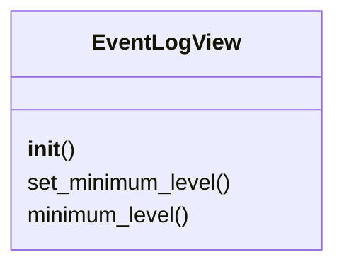
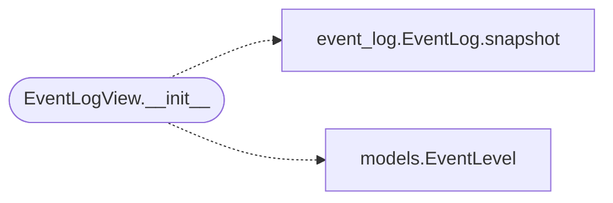

# `lazygui.widgets.event_log_view`

> Source: [lazygui/widgets/event_log_view.py:1](../../lazygui/widgets/event_log_view.py#L1) | language `py` | coverage 100.0% | [API index](../index.md)

Read-only viewer for [`EventLog`](lazygui.services.event_log.py.md#eventlog) records.

## Contents

- **Classes:** [`EventLogView`](#eventlogview)

## Type Diagram



## Call Graph

Solid arrows stay in this module, dashed arrows leave it.



## Classes

<a id="eventlogview"></a>

### `EventLogView`

`class` | [lazygui/widgets/event_log_view.py:20](../../lazygui/widgets/event_log_view.py#L20)

```python
class EventLogView(QTreeWidget)
```

Bases: `QTreeWidget`

Tree-style log viewer wired to an [`EventLog`](lazygui.services.event_log.py.md#eventlog) instance.

**Members**

| Member | Kind | Summary |
|---|---|---|
| [`__init__`](#eventlogview-__init__) | constructor | Bind the view to ``event_log`` and configure columns/headers. |
| [`set_minimum_level`](#eventlogview-set_minimum_level) | method | Filter view to records of severity >= ``level`` and reload. |
| [`minimum_level`](#eventlogview-minimum_level) | property | Currently active severity filter. |

<a id="eventlogview-__init__"></a>

#### `EventLogView.__init__`

`constructor` | [lazygui/widgets/event_log_view.py:23](../../lazygui/widgets/event_log_view.py#L23)

```python
def __init__(self, constants: AppConstants, event_log: EventLog, parent: QWidget | None = None) -> None
```

Bind the view to ``event_log`` and configure columns/headers.

**Parameters**

| Name | Type | Default | Description |
|---|---|---|---|
| `constants` | `AppConstants` |  |  |
| `event_log` | `EventLog` |  |  |
| `parent` | `QWidget \| None` | `None` |  |

*Calls:* [`EventLog.snapshot`](lazygui.services.event_log.py.md#eventlog-snapshot), [`EventLevel`](lazygui.services.models.py.md#eventlevel)

*Called by:* [`EventLogPanel.__init__`](lazygui.panels.event_log_panel.py.md#eventlogpanel-__init__)

<a id="eventlogview-set_minimum_level"></a>

#### `EventLogView.set_minimum_level`

`method` | [lazygui/widgets/event_log_view.py:51](../../lazygui/widgets/event_log_view.py#L51)

```python
def set_minimum_level(self, level: EventLevel) -> None
```

Filter view to records of severity >= ``level`` and reload.

**Parameters**

| Name | Type | Default | Description |
|---|---|---|---|
| `level` | `EventLevel` |  |  |

<a id="eventlogview-minimum_level"></a>

#### `EventLogView.minimum_level`

`property` | [lazygui/widgets/event_log_view.py:61](../../lazygui/widgets/event_log_view.py#L61)

Decorators: `@property`

```python
def minimum_level(self) -> EventLevel
```

Currently active severity filter.

**Returns:** `EventLevel`

---
