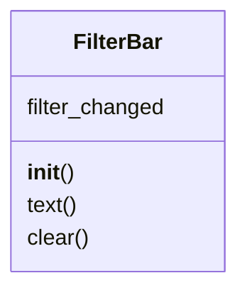

# `lazygui.widgets.filter_bar`

> Source: [lazygui/widgets/filter_bar.py:1](../../lazygui/widgets/filter_bar.py#L1) | language `py` | coverage 100.0% | [API index](../index.md)

Reusable text-filter bar with debounced `[`filter_changed`](#filterbar-filter_changed)` signal.

## Contents

- **Classes:** [`FilterBar`](#filterbar)

## Type Diagram



## Classes

<a id="filterbar"></a>

### `FilterBar`

`class` | [lazygui/widgets/filter_bar.py:11](../../lazygui/widgets/filter_bar.py#L11)

```python
class FilterBar(QWidget)
```

Bases: `QWidget`

Single-line text filter that debounces emissions for table views.

**Attributes**

| Name | Type | Default | Description |
|---|---|---|---|
| [`filter_changed`](#filterbar-filter_changed) |  | `Signal(str)` |  |

**Members**

| Member | Kind | Summary |
|---|---|---|
| [`__init__`](#filterbar-__init__) | constructor | Lay out a label + line edit and wire up debounce timing. |
| [`text`](#filterbar-text) | method | Current filter text. |
| [`clear`](#filterbar-clear) | method | Reset the filter to an empty string. |

<a id="filterbar-__init__"></a>

#### `FilterBar.__init__`

`constructor` | [lazygui/widgets/filter_bar.py:16](../../lazygui/widgets/filter_bar.py#L16)

```python
def __init__(self, constants: AppConstants, placeholder_text: str, label_text: str = 'Filter', parent: QWidget | None = None) -> None
```

Lay out a label + line edit and wire up debounce timing.

**Parameters**

| Name | Type | Default | Description |
|---|---|---|---|
| `constants` | `AppConstants` |  |  |
| `placeholder_text` | `str` |  |  |
| `label_text` | `str` | `'Filter'` |  |
| `parent` | `QWidget \| None` | `None` |  |

*Called by:* [`ListenersPanel.__init__`](lazygui.panels.listeners_panel.py.md#listenerspanel-__init__), [`SessionsPanel.__init__`](lazygui.panels.sessions_panel.py.md#sessionspanel-__init__)

<a id="filterbar-text"></a>

#### `FilterBar.text`

`method` | [lazygui/widgets/filter_bar.py:42](../../lazygui/widgets/filter_bar.py#L42)

```python
def text(self) -> str
```

Current filter text.

**Returns:** `str`

*Called by:* [`call_tool`](skills.lazyown_mcp.py.md#call_tool)

<a id="filterbar-clear"></a>

#### `FilterBar.clear`

`method` | [lazygui/widgets/filter_bar.py:46](../../lazygui/widgets/filter_bar.py#L46)

```python
def clear(self) -> None
```

Reset the filter to an empty string.

---
