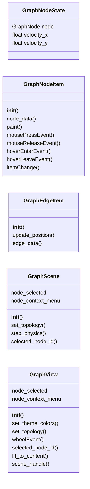
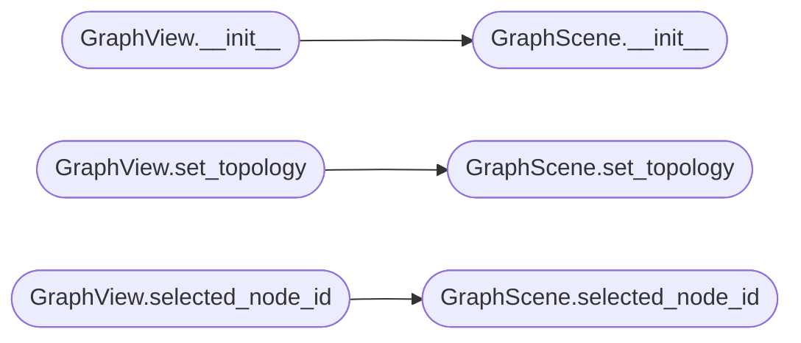

# `lazygui.widgets.graph_view`

> Source: [lazygui/widgets/graph_view.py:1](../../lazygui/widgets/graph_view.py#L1) | language `py` | coverage 60.7% | [API index](../index.md)

Interactive attack topography graph widget.

Renders the C2 beacon graph using Qt Graphics Framework (QGraphicsView).
Nodes represent servers, beacons and hosts. Edges represent connections.
Supports drag, zoom, selection highlighting and context menus.

## Contents

- **Classes:** [`GraphNodeState`](#graphnodestate), [`GraphNodeItem`](#graphnodeitem), [`GraphEdgeItem`](#graphedgeitem), [`GraphScene`](#graphscene), [`GraphView`](#graphview)

## Type Diagram



## Call Graph

Solid arrows stay in this module, dashed arrows leave it.



## Classes

<a id="graphnodestate"></a>

### `GraphNodeState`

`class` `dataclass` | [lazygui/widgets/graph_view.py:132](../../lazygui/widgets/graph_view.py#L132)

Decorators: `@dataclass(slots=True)`

```python
class GraphNodeState
```

Internal state for a graph node being laid out.

**Attributes**

| Name | Type | Default | Description |
|---|---|---|---|
| [`node`](#graphnodestate-node) | `GraphNode` |  |  |
| [`velocity_x`](#graphnodestate-velocity_x) | `float` | `0.0` |  |
| [`velocity_y`](#graphnodestate-velocity_y) | `float` | `0.0` |  |

---

<a id="graphnodeitem"></a>

### `GraphNodeItem`

`class` | [lazygui/widgets/graph_view.py:140](../../lazygui/widgets/graph_view.py#L140)

```python
class GraphNodeItem(QGraphicsEllipseItem)
```

Bases: `QGraphicsEllipseItem`

A single node in the graph with label and selection support.

**Members**

| Member | Kind | Summary |
|---|---|---|
| [`__init__`](#graphnodeitem-__init__) | constructor |  |
| [`node_data`](#graphnodeitem-node_data) | property | Return the immutable node data associated with this item. |
| [`paint`](#graphnodeitem-paint) | method |  |
| [`mousePressEvent`](#graphnodeitem-mousepressevent) | method |  |
| [`mouseReleaseEvent`](#graphnodeitem-mousereleaseevent) | method |  |
| [`hoverEnterEvent`](#graphnodeitem-hoverenterevent) | method |  |
| [`hoverLeaveEvent`](#graphnodeitem-hoverleaveevent) | method |  |
| [`itemChange`](#graphnodeitem-itemchange) | method |  |

<a id="graphnodeitem-__init__"></a>

#### `GraphNodeItem.__init__`

`constructor` | [lazygui/widgets/graph_view.py:143](../../lazygui/widgets/graph_view.py#L143)

```python
def __init__(self, node: GraphNode, radius: float, color: QColor, pixmap: QPixmap | None = None, on_selected: NodeCallback | None = None, on_context_menu: ContextMenuCallback | None = None, label_visible: bool = True, parent: QGraphicsItem | None = None) -> None
```

**Parameters**

| Name | Type | Default | Description |
|---|---|---|---|
| `node` | `GraphNode` |  |  |
| `radius` | `float` |  |  |
| `color` | `QColor` |  |  |
| `pixmap` | `QPixmap \| None` | `None` |  |
| `on_selected` | `NodeCallback \| None` | `None` |  |
| `on_context_menu` | `ContextMenuCallback \| None` | `None` |  |
| `label_visible` | `bool` | `True` |  |
| `parent` | `QGraphicsItem \| None` | `None` |  |

<a id="graphnodeitem-node_data"></a>

#### `GraphNodeItem.node_data`

`property` | [lazygui/widgets/graph_view.py:186](../../lazygui/widgets/graph_view.py#L186)

Decorators: `@property`

```python
def node_data(self) -> GraphNode
```

Return the immutable node data associated with this item.

**Returns:** `GraphNode`

<a id="graphnodeitem-paint"></a>

#### `GraphNodeItem.paint`

`method` | [lazygui/widgets/graph_view.py:190](../../lazygui/widgets/graph_view.py#L190)

```python
def paint(self, painter: QPainter, option: Any, widget: Any = None) -> None
```

**Parameters**

| Name | Type | Default | Description |
|---|---|---|---|
| `painter` | `QPainter` |  |  |
| `option` | `Any` |  |  |
| `widget` | `Any` | `None` |  |

<a id="graphnodeitem-mousepressevent"></a>

#### `GraphNodeItem.mousePressEvent`

`method` | [lazygui/widgets/graph_view.py:248](../../lazygui/widgets/graph_view.py#L248)

```python
def mousePressEvent(self, event: Any) -> None
```

**Parameters**

| Name | Type | Default | Description |
|---|---|---|---|
| `event` | `Any` |  |  |

<a id="graphnodeitem-mousereleaseevent"></a>

#### `GraphNodeItem.mouseReleaseEvent`

`method` | [lazygui/widgets/graph_view.py:259](../../lazygui/widgets/graph_view.py#L259)

```python
def mouseReleaseEvent(self, event: Any) -> None
```

**Parameters**

| Name | Type | Default | Description |
|---|---|---|---|
| `event` | `Any` |  |  |

<a id="graphnodeitem-hoverenterevent"></a>

#### `GraphNodeItem.hoverEnterEvent`

`method` | [lazygui/widgets/graph_view.py:266](../../lazygui/widgets/graph_view.py#L266)

```python
def hoverEnterEvent(self, event: Any) -> None
```

**Parameters**

| Name | Type | Default | Description |
|---|---|---|---|
| `event` | `Any` |  |  |

<a id="graphnodeitem-hoverleaveevent"></a>

#### `GraphNodeItem.hoverLeaveEvent`

`method` | [lazygui/widgets/graph_view.py:273](../../lazygui/widgets/graph_view.py#L273)

```python
def hoverLeaveEvent(self, event: Any) -> None
```

**Parameters**

| Name | Type | Default | Description |
|---|---|---|---|
| `event` | `Any` |  |  |

<a id="graphnodeitem-itemchange"></a>

#### `GraphNodeItem.itemChange`

`method` | [lazygui/widgets/graph_view.py:279](../../lazygui/widgets/graph_view.py#L279)

```python
def itemChange(self, change: Any, value: Any) -> Any
```

**Parameters**

| Name | Type | Default | Description |
|---|---|---|---|
| `change` | `Any` |  |  |
| `value` | `Any` |  |  |

**Returns:** `Any`

---

<a id="graphedgeitem"></a>

### `GraphEdgeItem`

`class` | [lazygui/widgets/graph_view.py:285](../../lazygui/widgets/graph_view.py#L285)

```python
class GraphEdgeItem(QGraphicsLineItem)
```

Bases: `QGraphicsLineItem`

A line connecting two graph nodes with optional label.

**Members**

| Member | Kind | Summary |
|---|---|---|
| [`__init__`](#graphedgeitem-__init__) | constructor |  |
| [`update_position`](#graphedgeitem-update_position) | method | Recalculate the line endpoints from source and target positions. |
| [`edge_data`](#graphedgeitem-edge_data) | property | Return the immutable edge data. |

<a id="graphedgeitem-__init__"></a>

#### `GraphEdgeItem.__init__`

`constructor` | [lazygui/widgets/graph_view.py:288](../../lazygui/widgets/graph_view.py#L288)

```python
def __init__(self, edge: GraphEdge, source_item: QGraphicsItem, target_item: QGraphicsItem, parent: QGraphicsItem | None = None) -> None
```

**Parameters**

| Name | Type | Default | Description |
|---|---|---|---|
| `edge` | `GraphEdge` |  |  |
| `source_item` | `QGraphicsItem` |  |  |
| `target_item` | `QGraphicsItem` |  |  |
| `parent` | `QGraphicsItem \| None` | `None` |  |

<a id="graphedgeitem-update_position"></a>

#### `GraphEdgeItem.update_position`

`method` | [lazygui/widgets/graph_view.py:324](../../lazygui/widgets/graph_view.py#L324)

```python
def update_position(self) -> None
```

Recalculate the line endpoints from source and target positions.

<a id="graphedgeitem-edge_data"></a>

#### `GraphEdgeItem.edge_data`

`property` | [lazygui/widgets/graph_view.py:329](../../lazygui/widgets/graph_view.py#L329)

Decorators: `@property`

```python
def edge_data(self) -> GraphEdge
```

Return the immutable edge data.

**Returns:** `GraphEdge`

---

<a id="graphscene"></a>

### `GraphScene`

`class` | [lazygui/widgets/graph_view.py:334](../../lazygui/widgets/graph_view.py#L334)

```python
class GraphScene(QGraphicsScene)
```

Bases: `QGraphicsScene`

Scene managing all graph nodes and edges with physics layout.

**Attributes**

| Name | Type | Default | Description |
|---|---|---|---|
| [`node_selected`](#graphscene-node_selected) |  | `Signal(str)` |  |
| [`node_context_menu`](#graphscene-node_context_menu) |  | `Signal(str, QPointF)` |  |

**Members**

| Member | Kind | Summary |
|---|---|---|
| [`__init__`](#graphscene-__init__) | constructor |  |
| [`set_topology`](#graphscene-set_topology) | method | Replace the current graph with a new topology using force layout. |
| [`step_physics`](#graphscene-step_physics) | method | Run one iteration of force-directed layout. |
| [`selected_node_id`](#graphscene-selected_node_id) | method | Return the identifier of the first selected node, or None. |

<a id="graphscene-__init__"></a>

#### `GraphScene.__init__`

`constructor` | [lazygui/widgets/graph_view.py:340](../../lazygui/widgets/graph_view.py#L340)

```python
def __init__(self, constants: AppConstants, parent: QObject | None = None) -> None
```

**Parameters**

| Name | Type | Default | Description |
|---|---|---|---|
| `constants` | `AppConstants` |  |  |
| `parent` | `QObject \| None` | `None` |  |

*Called by:* [`GraphView.__init__`](#graphview-__init__)

<a id="graphscene-set_topology"></a>

#### `GraphScene.set_topology`

`method` | [lazygui/widgets/graph_view.py:349](../../lazygui/widgets/graph_view.py#L349)

```python
def set_topology(self, topology: Topology) -> None
```

Replace the current graph with a new topology using force layout.

**Parameters**

| Name | Type | Default | Description |
|---|---|---|---|
| `topology` | `Topology` |  |  |

*Called by:* [`GraphView.set_topology`](#graphview-set_topology)

<a id="graphscene-step_physics"></a>

#### `GraphScene.step_physics`

`method` | [lazygui/widgets/graph_view.py:419](../../lazygui/widgets/graph_view.py#L419)

```python
def step_physics(self) -> bool
```

Run one iteration of force-directed layout.

Returns False when stable.

**Returns:** `bool`

<a id="graphscene-selected_node_id"></a>

#### `GraphScene.selected_node_id`

`method` | [lazygui/widgets/graph_view.py:491](../../lazygui/widgets/graph_view.py#L491)

```python
def selected_node_id(self) -> str | None
```

Return the identifier of the first selected node, or None.

**Returns:** `str | None`

*Called by:* [`GraphView.selected_node_id`](#graphview-selected_node_id)

---

<a id="graphview"></a>

### `GraphView`

`class` | [lazygui/widgets/graph_view.py:499](../../lazygui/widgets/graph_view.py#L499)

```python
class GraphView(QGraphicsView)
```

Bases: `QGraphicsView`

Interactive graph view with zoom, pan and physics animation.

**Attributes**

| Name | Type | Default | Description |
|---|---|---|---|
| [`node_selected`](#graphview-node_selected) |  | `Signal(str)` |  |
| [`node_context_menu`](#graphview-node_context_menu) |  | `Signal(str, QPointF)` |  |

**Members**

| Member | Kind | Summary |
|---|---|---|
| [`__init__`](#graphview-__init__) | constructor |  |
| [`set_theme_colors`](#graphview-set_theme_colors) | method | Update graph background and default edge colour from theme tokens. |
| [`set_topology`](#graphview-set_topology) | method | Render a new graph topology. |
| [`wheelEvent`](#graphview-wheelevent) | method |  |
| [`selected_node_id`](#graphview-selected_node_id) | method | Return the identifier of the currently selected node. |
| [`fit_to_content`](#graphview-fit_to_content) | method | Zoom to fit all graph content. |
| [`scene_handle`](#graphview-scene_handle) | property | Return the underlying graph scene. |

<a id="graphview-__init__"></a>

#### `GraphView.__init__`

`constructor` | [lazygui/widgets/graph_view.py:509](../../lazygui/widgets/graph_view.py#L509)

```python
def __init__(self, constants: AppConstants, parent: QWidget | None = None) -> None
```

**Parameters**

| Name | Type | Default | Description |
|---|---|---|---|
| `constants` | `AppConstants` |  |  |
| `parent` | `QWidget \| None` | `None` |  |

*Calls:* [`GraphScene.__init__`](#graphscene-__init__)

*Called by:* [`GraphPanel.__init__`](lazygui.panels.graph_panel.py.md#graphpanel-__init__)

<a id="graphview-set_theme_colors"></a>

#### `GraphView.set_theme_colors`

`method` | [lazygui/widgets/graph_view.py:527](../../lazygui/widgets/graph_view.py#L527)

```python
def set_theme_colors(self, bg_color: str, edge_color: str) -> None
```

Update graph background and default edge colour from theme tokens.

**Parameters**

| Name | Type | Default | Description |
|---|---|---|---|
| `bg_color` | `str` |  |  |
| `edge_color` | `str` |  |  |

<a id="graphview-set_topology"></a>

#### `GraphView.set_topology`

`method` | [lazygui/widgets/graph_view.py:535](../../lazygui/widgets/graph_view.py#L535)

```python
def set_topology(self, topology: Topology) -> None
```

Render a new graph topology.

**Parameters**

| Name | Type | Default | Description |
|---|---|---|---|
| `topology` | `Topology` |  |  |

*Calls:* [`GraphScene.set_topology`](#graphscene-set_topology)

<a id="graphview-wheelevent"></a>

#### `GraphView.wheelEvent`

`method` | [lazygui/widgets/graph_view.py:551](../../lazygui/widgets/graph_view.py#L551)

```python
def wheelEvent(self, event: Any) -> None
```

**Parameters**

| Name | Type | Default | Description |
|---|---|---|---|
| `event` | `Any` |  |  |

<a id="graphview-selected_node_id"></a>

#### `GraphView.selected_node_id`

`method` | [lazygui/widgets/graph_view.py:561](../../lazygui/widgets/graph_view.py#L561)

```python
def selected_node_id(self) -> str | None
```

Return the identifier of the currently selected node.

**Returns:** `str | None`

*Calls:* [`GraphScene.selected_node_id`](#graphscene-selected_node_id)

<a id="graphview-fit_to_content"></a>

#### `GraphView.fit_to_content`

`method` | [lazygui/widgets/graph_view.py:565](../../lazygui/widgets/graph_view.py#L565)

```python
def fit_to_content(self) -> None
```

Zoom to fit all graph content.

<a id="graphview-scene_handle"></a>

#### `GraphView.scene_handle`

`property` | [lazygui/widgets/graph_view.py:570](../../lazygui/widgets/graph_view.py#L570)

Decorators: `@property`

```python
def scene_handle(self) -> GraphScene
```

Return the underlying graph scene.

**Returns:** `GraphScene`

---
