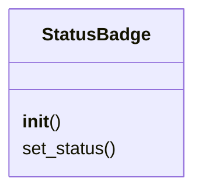
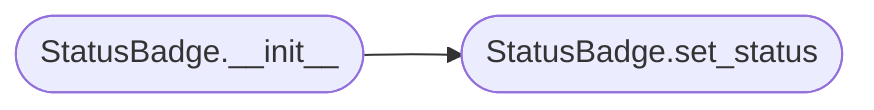

# `lazygui.widgets.status_badge`

> Source: [lazygui/widgets/status_badge.py:1](../../lazygui/widgets/status_badge.py#L1) | language `py` | coverage 100.0% | [API index](../index.md)

Compact label that reflects a [`BackendStatus`](lazygui.services.backend.py.md#backendstatus) value.

## Contents

- **Classes:** [`StatusBadge`](#statusbadge)

## Type Diagram



## Call Graph

Solid arrows stay in this module, dashed arrows leave it.



## Classes

<a id="statusbadge"></a>

### `StatusBadge`

`class` | [lazygui/widgets/status_badge.py:18](../../lazygui/widgets/status_badge.py#L18)

```python
class StatusBadge(QLabel)
```

Bases: `QLabel`

Status label whose ``objectName`` reflects severity for QSS styling.

**Members**

| Member | Kind | Summary |
|---|---|---|
| [`__init__`](#statusbadge-__init__) | constructor | Create the badge in the disconnected state. |
| [`set_status`](#statusbadge-set_status) | method | Update label text and the object name driving QSS colour. |

<a id="statusbadge-__init__"></a>

#### `StatusBadge.__init__`

`constructor` | [lazygui/widgets/status_badge.py:21](../../lazygui/widgets/status_badge.py#L21)

```python
def __init__(self, parent: QWidget | None = None) -> None
```

Create the badge in the disconnected state.

**Parameters**

| Name | Type | Default | Description |
|---|---|---|---|
| `parent` | `QWidget \| None` | `None` |  |

*Calls:* [`StatusBadge.set_status`](#statusbadge-set_status)

<a id="statusbadge-set_status"></a>

#### `StatusBadge.set_status`

`method` | [lazygui/widgets/status_badge.py:27](../../lazygui/widgets/status_badge.py#L27)

```python
def set_status(self, status: BackendStatus) -> None
```

Update label text and the object name driving QSS colour.

**Parameters**

| Name | Type | Default | Description |
|---|---|---|---|
| `status` | `BackendStatus` |  |  |

*Called by:* [`StatusBadge.__init__`](#statusbadge-__init__), [`MainWindow.__init__`](lazygui.windows.main_window.py.md#mainwindow-__init__)

---
