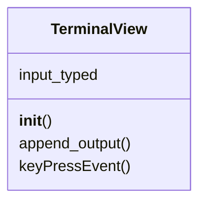

# `lazygui.widgets.terminal_view`

> Source: [lazygui/widgets/terminal_view.py:1](../../lazygui/widgets/terminal_view.py#L1) | language `py` | coverage 100.0% | [API index](../index.md)

ANSI-aware terminal viewer.

Strips ANSI escape codes and control characters before appending text.
Handles cmd2 prompt rendering, colour codes, cursor positioning, and
carriage-return semantics.

## Contents

- **Classes:** [`TerminalView`](#terminalview)

## Type Diagram



## Classes

<a id="terminalview"></a>

### `TerminalView`

`class` | [lazygui/widgets/terminal_view.py:33](../../lazygui/widgets/terminal_view.py#L33)

```python
class TerminalView(QPlainTextEdit)
```

Bases: `QPlainTextEdit`

Plain-text view that consumes backend output and emits keystrokes.

**Attributes**

| Name | Type | Default | Description |
|---|---|---|---|
| [`input_typed`](#terminalview-input_typed) |  | `Signal(str)` |  |

**Members**

| Member | Kind | Summary |
|---|---|---|
| [`__init__`](#terminalview-__init__) | constructor | Configure the widget for log-style append-only behaviour. |
| [`append_output`](#terminalview-append_output) | method | Append ``text`` after stripping ANSI control codes and control chars. |
| [`keyPressEvent`](#terminalview-keypressevent) | method | Forward keystrokes to listeners instead of mutating the buffer. |

<a id="terminalview-__init__"></a>

#### `TerminalView.__init__`

`constructor` | [lazygui/widgets/terminal_view.py:38](../../lazygui/widgets/terminal_view.py#L38)

```python
def __init__(self, constants: AppConstants, parent: QWidget | None = None) -> None
```

Configure the widget for log-style append-only behaviour.

**Parameters**

| Name | Type | Default | Description |
|---|---|---|---|
| `constants` | `AppConstants` |  |  |
| `parent` | `QWidget \| None` | `None` |  |

*Called by:* [`TerminalPanel.__init__`](lazygui.panels.terminal_panel.py.md#terminalpanel-__init__)

<a id="terminalview-append_output"></a>

#### `TerminalView.append_output`

`method` | [lazygui/widgets/terminal_view.py:54](../../lazygui/widgets/terminal_view.py#L54)

```python
def append_output(self, text: str) -> None
```

Append ``text`` after stripping ANSI control codes and control chars.

**Parameters**

| Name | Type | Default | Description |
|---|---|---|---|
| `text` | `str` |  |  |

<a id="terminalview-keypressevent"></a>

#### `TerminalView.keyPressEvent`

`method` | [lazygui/widgets/terminal_view.py:75](../../lazygui/widgets/terminal_view.py#L75)

```python
def keyPressEvent(self, event: QKeyEvent) -> None
```

Forward keystrokes to listeners instead of mutating the buffer.

**Parameters**

| Name | Type | Default | Description |
|---|---|---|---|
| `event` | `QKeyEvent` |  |  |

---
