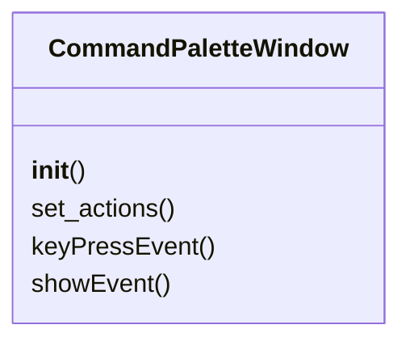
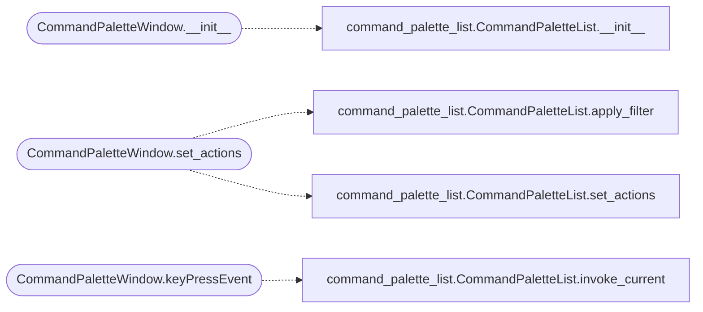

# `lazygui.windows.command_palette_window`

> Source: [lazygui/windows/command_palette_window.py:1](../../lazygui/windows/command_palette_window.py#L1) | language `py` | coverage 100.0% | [API index](../index.md)

Frameless palette window invoked by ``Ctrl+K``.

## Contents

- **Classes:** [`CommandPaletteWindow`](#commandpalettewindow)

## Type Diagram



## Call Graph

Solid arrows stay in this module, dashed arrows leave it.



## Classes

<a id="commandpalettewindow"></a>

### `CommandPaletteWindow`

`class` | [lazygui/windows/command_palette_window.py:15](../../lazygui/windows/command_palette_window.py#L15)

```python
class CommandPaletteWindow(QWidget)
```

Bases: `QWidget`

Frameless overlay that fuzzy-filters and dispatches actions.

**Members**

| Member | Kind | Summary |
|---|---|---|
| [`__init__`](#commandpalettewindow-__init__) | constructor | Build the search input plus the result list. |
| [`set_actions`](#commandpalettewindow-set_actions) | method | Replace the action set on the underlying list. |
| [`keyPressEvent`](#commandpalettewindow-keypressevent) | method | Intercept Enter and Esc, otherwise delegate to the search box. |
| [`showEvent`](#commandpalettewindow-showevent) | method | Move keyboard focus into the search box on every open. |

<a id="commandpalettewindow-__init__"></a>

#### `CommandPaletteWindow.__init__`

`constructor` | [lazygui/windows/command_palette_window.py:18](../../lazygui/windows/command_palette_window.py#L18)

```python
def __init__(self, constants: AppConstants, actions: Iterable[CommandPaletteAction], parent: QWidget | None = None) -> None
```

Build the search input plus the result list.

**Parameters**

| Name | Type | Default | Description |
|---|---|---|---|
| `constants` | `AppConstants` |  |  |
| `actions` | `Iterable[CommandPaletteAction]` |  |  |
| `parent` | `QWidget \| None` | `None` |  |

*Calls:* [`CommandPaletteList.__init__`](lazygui.widgets.command_palette_list.py.md#commandpalettelist-__init__)

*Called by:* [`MainWindow.__init__`](lazygui.windows.main_window.py.md#mainwindow-__init__)

<a id="commandpalettewindow-set_actions"></a>

#### `CommandPaletteWindow.set_actions`

`method` | [lazygui/windows/command_palette_window.py:43](../../lazygui/windows/command_palette_window.py#L43)

```python
def set_actions(self, actions: Iterable[CommandPaletteAction]) -> None
```

Replace the action set on the underlying list.

**Parameters**

| Name | Type | Default | Description |
|---|---|---|---|
| `actions` | `Iterable[CommandPaletteAction]` |  |  |

*Calls:* [`CommandPaletteList.apply_filter`](lazygui.widgets.command_palette_list.py.md#commandpalettelist-apply_filter), [`CommandPaletteList.set_actions`](lazygui.widgets.command_palette_list.py.md#commandpalettelist-set_actions)

<a id="commandpalettewindow-keypressevent"></a>

#### `CommandPaletteWindow.keyPressEvent`

`method` | [lazygui/windows/command_palette_window.py:48](../../lazygui/windows/command_palette_window.py#L48)

```python
def keyPressEvent(self, event: QKeyEvent) -> None
```

Intercept Enter and Esc, otherwise delegate to the search box.

**Parameters**

| Name | Type | Default | Description |
|---|---|---|---|
| `event` | `QKeyEvent` |  |  |

*Calls:* [`CommandPaletteList.invoke_current`](lazygui.widgets.command_palette_list.py.md#commandpalettelist-invoke_current)

<a id="commandpalettewindow-showevent"></a>

#### `CommandPaletteWindow.showEvent`

`method` | [lazygui/windows/command_palette_window.py:71](../../lazygui/windows/command_palette_window.py#L71)

```python
def showEvent(self, event) -> None
```

Move keyboard focus into the search box on every open.

**Parameters**

| Name | Type | Default | Description |
|---|---|---|---|
| `event` |  |  |  |

---
