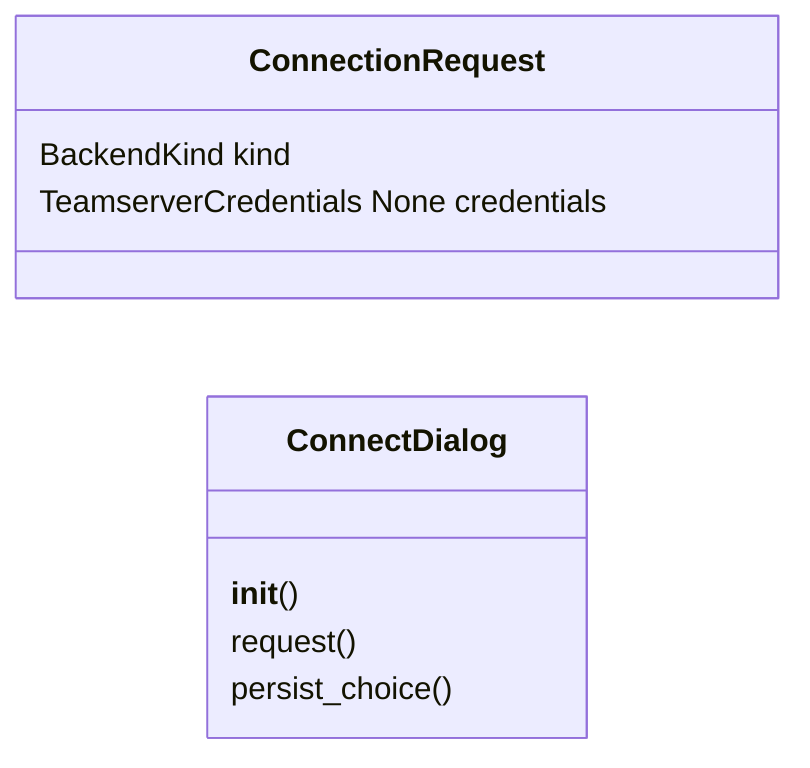
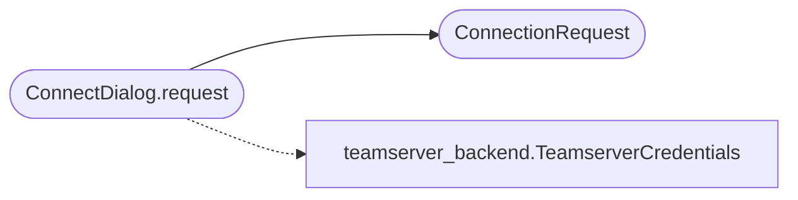

# `lazygui.windows.connect_dialog`

> Source: [lazygui/windows/connect_dialog.py:1](../../lazygui/windows/connect_dialog.py#L1) | language `py` | coverage 100.0% | [API index](../index.md)

Connection dialog for picking a backend.

The dialog lets the operator choose between the local console and a remote
teamserver. Picked values are returned as [`ConnectionRequest`](#connectionrequest) so the
caller decides what to do (e.g. instantiate a backend, persist last
selection, hand it off to the main window).

Auto-discovered credentials from ``.c2_credentials.txt`` are pre-filled
when available so the operator doesn't need to type them manually.

## Contents

- **Classes:** [`ConnectionRequest`](#connectionrequest), [`ConnectDialog`](#connectdialog)

## Type Diagram



## Call Graph

Solid arrows stay in this module, dashed arrows leave it.



## Classes

<a id="connectionrequest"></a>

### `ConnectionRequest`

`class` `dataclass` | [lazygui/windows/connect_dialog.py:39](../../lazygui/windows/connect_dialog.py#L39)

Decorators: `@dataclass(frozen=True, slots=True)`

```python
class ConnectionRequest
```

Result of a successful [`ConnectDialog`](#connectdialog) interaction.

**Attributes**

| Name | Type | Default | Description |
|---|---|---|---|
| [`kind`](#connectionrequest-kind) | `BackendKind` |  |  |
| [`credentials`](#connectionrequest-credentials) | `TeamserverCredentials \| None` |  |  |

---

<a id="connectdialog"></a>

### `ConnectDialog`

`class` | [lazygui/windows/connect_dialog.py:50](../../lazygui/windows/connect_dialog.py#L50)

```python
class ConnectDialog(QDialog)
```

Bases: `QDialog`

Modal dialog returning a [`ConnectionRequest`](#connectionrequest) on accept.

**Members**

| Member | Kind | Summary |
|---|---|---|
| [`__init__`](#connectdialog-__init__) | constructor | Build the form and pre-fill from persisted settings + credentials file. |
| [`request`](#connectdialog-request) | method | Translate current widget state into a [`ConnectionRequest`](#connectionrequest). |
| [`persist_choice`](#connectdialog-persist_choice) | method | Save the picked values back into [`AppSettings`](lazygui.config.settings.py.md#appsettings). |

<a id="connectdialog-__init__"></a>

#### `ConnectDialog.__init__`

`constructor` | [lazygui/windows/connect_dialog.py:53](../../lazygui/windows/connect_dialog.py#L53)

```python
def __init__(self, constants: AppConstants, settings: AppSettings, paths: AppPaths, parent: QWidget | None = None) -> None
```

Build the form and pre-fill from persisted settings + credentials file.

**Parameters**

| Name | Type | Default | Description |
|---|---|---|---|
| `constants` | `AppConstants` |  |  |
| `settings` | `AppSettings` |  |  |
| `paths` | `AppPaths` |  |  |
| `parent` | `QWidget \| None` | `None` |  |

*Called by:* [`Application.show_connect_dialog`](lazygui.app.py.md#application-show_connect_dialog)

<a id="connectdialog-request"></a>

#### `ConnectDialog.request`

`method` | [lazygui/windows/connect_dialog.py:105](../../lazygui/windows/connect_dialog.py#L105)

```python
def request(self) -> ConnectionRequest
```

Translate current widget state into a [`ConnectionRequest`](#connectionrequest).

**Returns:** `ConnectionRequest`

*Calls:* [`TeamserverCredentials`](lazygui.services.teamserver_backend.py.md#teamservercredentials), [`ConnectionRequest`](#connectionrequest)

*Called by:* [`Application.show_connect_dialog`](lazygui.app.py.md#application-show_connect_dialog)

<a id="connectdialog-persist_choice"></a>

#### `ConnectDialog.persist_choice`

`method` | [lazygui/windows/connect_dialog.py:120](../../lazygui/windows/connect_dialog.py#L120)

```python
def persist_choice(self) -> None
```

Save the picked values back into [`AppSettings`](lazygui.config.settings.py.md#appsettings).

*Called by:* [`Application.show_connect_dialog`](lazygui.app.py.md#application-show_connect_dialog)

---
