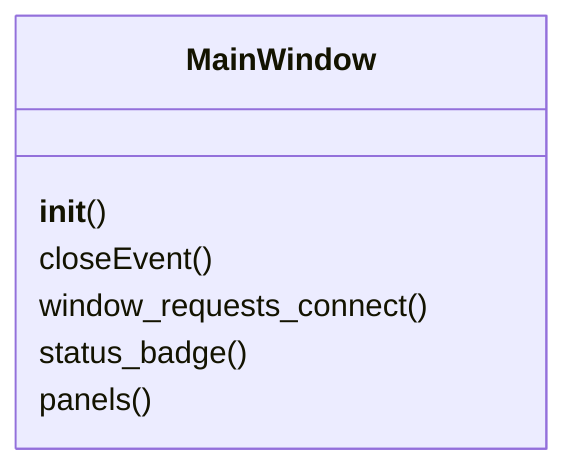
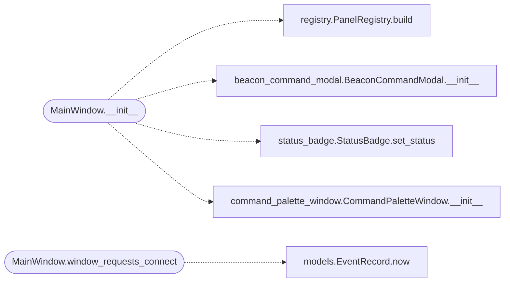

# `lazygui.windows.main_window`

> Source: [lazygui/windows/main_window.py:1](../../lazygui/windows/main_window.py#L1) | language `py` | coverage 100.0% | [API index](../index.md)

Operator console main window.

Composes panels, menus, toolbar, status bar and shortcuts. Owns no
business logic of its own — every interaction either mutates the active
[`Backend`](lazygui.services.backend.py.md#backend) (issuing a command, refreshing) or the persisted
[`AppSettings`](lazygui.config.settings.py.md#appsettings) (theme, layout).

## Contents

- **Classes:** [`MainWindow`](#mainwindow)

## Type Diagram



## Call Graph

Solid arrows stay in this module, dashed arrows leave it.



## Classes

<a id="mainwindow"></a>

### `MainWindow`

`class` | [lazygui/windows/main_window.py:37](../../lazygui/windows/main_window.py#L37)

```python
class MainWindow(QMainWindow)
```

Bases: `QMainWindow`

Top-level operator window with Cobalt Strike-inspired layout.

**Members**

| Member | Kind | Summary |
|---|---|---|
| [`__init__`](#mainwindow-__init__) | constructor | Wire the dependencies and build the full layout. |
| [`closeEvent`](#mainwindow-closeevent) | method | Persist geometry, layout and theme before closing. |
| [`window_requests_connect`](#mainwindow-window_requests_connect) | method | Hook overridden by [`Application`](lazygui.app.py.md#application) to swap backend at runtime. |
| [`status_badge`](#mainwindow-status_badge) | property | Expose the badge so the application can update it on backend swaps. |
| [`panels`](#mainwindow-panels) | property | Expose the panel registry for backend swaps. |

<a id="mainwindow-__init__"></a>

#### `MainWindow.__init__`

`constructor` | [lazygui/windows/main_window.py:40](../../lazygui/windows/main_window.py#L40)

```python
def __init__(self, constants: AppConstants, settings: AppSettings, theme_manager: ThemeManager, backend: Backend, event_log: EventLog, parent: QWidget | None = None) -> None
```

Wire the dependencies and build the full layout.

**Parameters**

| Name | Type | Default | Description |
|---|---|---|---|
| `constants` | `AppConstants` |  |  |
| `settings` | `AppSettings` |  |  |
| `theme_manager` | `ThemeManager` |  |  |
| `backend` | `Backend` |  |  |
| `event_log` | `EventLog` |  |  |
| `parent` | `QWidget \| None` | `None` |  |

*Calls:* [`PanelRegistry.build`](lazygui.panels.registry.py.md#panelregistry-build), [`BeaconCommandModal.__init__`](lazygui.widgets.beacon_command_modal.py.md#beaconcommandmodal-__init__), [`StatusBadge.set_status`](lazygui.widgets.status_badge.py.md#statusbadge-set_status), [`CommandPaletteWindow.__init__`](lazygui.windows.command_palette_window.py.md#commandpalettewindow-__init__)

*Called by:* [`Application.__init__`](lazygui.app.py.md#application-__init__)

<a id="mainwindow-closeevent"></a>

#### `MainWindow.closeEvent`

`method` | [lazygui/windows/main_window.py:99](../../lazygui/windows/main_window.py#L99)

```python
def closeEvent(self, event) -> None
```

Persist geometry, layout and theme before closing.

**Parameters**

| Name | Type | Default | Description |
|---|---|---|---|
| `event` |  |  |  |

<a id="mainwindow-window_requests_connect"></a>

#### `MainWindow.window_requests_connect`

`method` | [lazygui/windows/main_window.py:376](../../lazygui/windows/main_window.py#L376)

```python
def window_requests_connect(self) -> None
```

Hook overridden by [`Application`](lazygui.app.py.md#application) to swap backend at runtime.

*Calls:* [`EventRecord.now`](lazygui.services.models.py.md#eventrecord-now)

<a id="mainwindow-status_badge"></a>

#### `MainWindow.status_badge`

`property` | [lazygui/windows/main_window.py:393](../../lazygui/windows/main_window.py#L393)

Decorators: `@property`

```python
def status_badge(self) -> StatusBadge
```

Expose the badge so the application can update it on backend swaps.

**Returns:** `StatusBadge`

<a id="mainwindow-panels"></a>

#### `MainWindow.panels`

`property` | [lazygui/windows/main_window.py:398](../../lazygui/windows/main_window.py#L398)

Decorators: `@property`

```python
def panels(self) -> PanelRegistry
```

Expose the panel registry for backend swaps.

**Returns:** `PanelRegistry`

---
