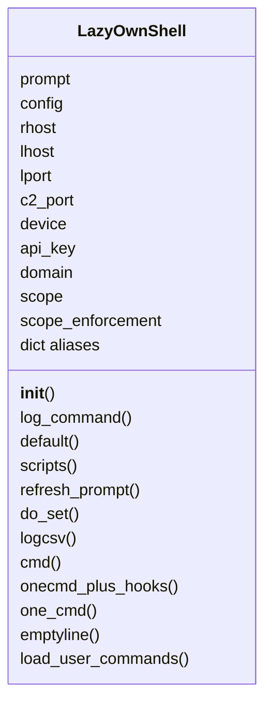
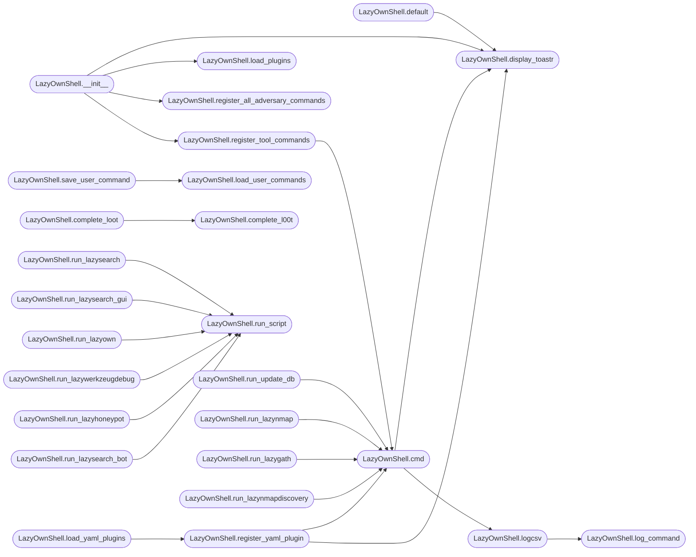

# `lazyown`

> Source: [lazyown.py:1](../../lazyown.py#L1) | language `py` | coverage 97.2% | [API index](../index.md)

lazyown

Author: Gris Iscomeback
Email: grisiscomeback at gmail dot com
Creation Date: 13/08/2024
License: AGPL v3

Description: This file contains the definition of the logic in the LazyOwnShell class

██╗      █████╗ ███████╗██╗   ██╗ ██████╗ ██╗    ██╗███╗   ██╗
██║     ██╔══██╗╚══███╔╝╚██╗ ██╔╝██╔═══██╗██║    ██║████╗  ██║
██║     ███████║  ███╔╝  ╚████╔╝ ██║   ██║██║ █╗ ██║██╔██╗ ██║
██║     ██╔══██║ ███╔╝    ╚██╔╝  ██║   ██║██║███╗██║██║╚██╗██║
███████╗██║  ██║███████╗   ██║   ╚██████╔╝╚███╔███╔╝██║ ╚████║
╚══════╝╚═╝  ╚═╝╚══════╝   ╚═╝    ╚═════╝  ╚══╝╚══╝ ╚═╝  ╚═══╝

## Contents

- **Classes:** [`LazyOwnShell`](#lazyownshell)
- **Functions:** [`main`](#main)
- **Constants:** [`SHELL_BUILTIN_TOKENS`](#shell_builtin_tokens)

## Type Diagram



## Call Graph

Solid arrows stay in this module, dashed arrows leave it.



## Classes

<a id="lazyownshell"></a>

### `LazyOwnShell`

`class` | [lazyown.py:297](../../lazyown.py#L297)

```python
class LazyOwnShell(cmd2.Cmd)
```

Bases: `cmd2.Cmd`

A custom interactive shell for the LazyOwn Framework.

This class extends the Cmd class to provide an interactive command-line interface for the LazyOwn Framework. It supports various commands and modules related to security and network operations. The shell is initialized with a set of parameters and scripts, allowing users to execute predefined functions and manage tasks within the framework.

Methods:
    __init__(): Initializes the shell with default parameters, script names,
                and an empty output string. Sets up the command prompt and
                custom prompt.

**Attributes**

| Name | Type | Default | Description |
|---|---|---|---|
| [`prompt`](#lazyownshell-prompt) | `str` | `getprompt()` | The command prompt for the shell, obtained from the `getprompt()` function. |
| [`config`](#lazyownshell-config) |  | `Config(load_payload())` |  |
| [`rhost`](#lazyownshell-rhost) |  | `config.rhost` |  |
| [`lhost`](#lazyownshell-lhost) |  | `config.lhost` |  |
| [`lport`](#lazyownshell-lport) |  | `config.lport` |  |
| [`c2_port`](#lazyownshell-c2_port) |  | `config.c2_port` |  |
| [`device`](#lazyownshell-device) |  | `config.device` |  |
| [`api_key`](#lazyownshell-api_key) |  | `config.api_key` |  |
| [`domain`](#lazyownshell-domain) |  | `config.domain` |  |
| [`scope`](#lazyownshell-scope) |  | `config.scope if config.scope is not None else []` |  |
| [`scope_enforcement`](#lazyownshell-scope_enforcement) |  | `config.scope_enforcement or 'warn'` |  |
| [`aliases`](#lazyownshell-aliases) | `dict` | `{}` | Populated at runtime in __init__ from cli/aliases.yaml. |

**Members**

| Member | Kind | Summary |
|---|---|---|
| [`__init__`](#lazyownshell-__init__) | constructor | Initializer for the LazyOwnShell class. |
| [`log_command`](#lazyownshell-log_command) | method | Logs the command execution details to a CSV file. |
| [`default`](#lazyownshell-default) | method | Handles undefined commands, including aliases. |
| [`scripts`](#lazyownshell-scripts) | property | Auto-discovered list of runnable script names. |
| [`refresh_prompt`](#lazyownshell-refresh_prompt) | method | Recompute the Neon Box prompt from the live payload. |
| [`do_set`](#lazyownshell-do_set) | method | Set a parameter — the unified ``set``/``assign`` surface. |
| [`logcsv`](#lazyownshell-logcsv) | method | Forward a command line to [`log_command`](contrib.legacy.lazyhoneypot.py.md#log_command) for CSV persistence. |
| [`cmd`](#lazyownshell-cmd) | method | Internal function to execute commands. |
| [`onecmd_plus_hooks`](#lazyownshell-onecmd_plus_hooks) | method | Dispatch a command, expanding payload placeholders in custom aliases. |
| [`one_cmd`](#lazyownshell-one_cmd) | method | Internal function to execute commands. |
| [`emptyline`](#lazyownshell-emptyline) | method | Handle the case where the user enters an empty line. |
| [`load_user_commands`](#lazyownshell-load_user_commands) | method | Carga los comandos personalizados desde user_commands.json |
| [`save_user_command`](#lazyownshell-save_user_command) | method | Guarda un nuevo comando en user_commands.json |
| [`list_files_in_directory`](#lazyownshell-list_files_in_directory) | method | Lista todos los archivos en un directorio dado. |
| [`register_tool_commands`](#lazyownshell-register_tool_commands) | method | Register every active ``tools/*.tool`` as a ``do_<toolname>`` command. |
| [`load_plugins`](#lazyownshell-load_plugins) | method | Load every Lua plugin from the 'plugins/' directory. |
| [`load_yaml_plugins`](#lazyownshell-load_yaml_plugins) | method | Loads all YAML plugins from the 'lazyaddons/' directory. |
| [`register_yaml_plugin`](#lazyownshell-register_yaml_plugin) | method | Register a YAML addon as a shell command. |
| [`register_all_adversary_commands`](#lazyownshell-register_all_adversary_commands) | method |  |
| [`display_toastr`](#lazyownshell-display_toastr) | method | Display the unified toastr panel from the shared toast bus. |
| [`completedefault`](#lazyownshell-completedefault) | method | Fall through to the payload-aware completer for unhandled commands. |
| [`preloop`](#lazyownshell-preloop) | method | Print a session-start pro tip and handle first-run setup. |
| [`postparsing_precmd`](#lazyownshell-postparsing_precmd) | method | Gate unauthenticated commands — anonymous operators can only run ``register``, ``login``, ``logout``, `[`whoami`](modules.cli_auth.py.md#whoami)`, ``help``, ``exit``, ``quit``, and ``set``... |
| [`postloop`](#lazyownshell-postloop) | method | Handle operations to perform after exiting the command loop. |
| [`complete_phase`](#lazyownshell-complete_phase) | method | Tab-complete phase names. |
| [`complete_l00t`](#lazyownshell-complete_l00t) | method | Tab-complete l00t subcommands. |
| [`complete_loot`](#lazyownshell-complete_loot) | method | Tab-complete loot subcommands (delegates to l00t). |
| [`complete_assign`](#lazyownshell-complete_assign) | method | Tab-complete the parameter name from the live payload keys. |
| [`complete_scope`](#lazyownshell-complete_scope) | method | Tab-complete the scope subcommands. |
| [`complete_palette`](#lazyownshell-complete_palette) | method | Tab-complete the palette command using the live command index. |
| [`run_lazysearch`](#lazyownshell-run_lazysearch) | method | Runs the internal module `modules/lazysearch.py`. |
| [`run_lazysearch_gui`](#lazyownshell-run_lazysearch_gui) | method | Run the internal module located at `modules/LazyOwnExplorer.py`. |
| [`run_lazyown`](#lazyownshell-run_lazyown) | method | Run the internal module located at `modules/lazyown_parquet_tool.py`. |
| [`run_update_db`](#lazyownshell-run_update_db) | method | Run the internal module located at `modules/update_db.sh`. |
| [`run_lazynmap`](#lazyownshell-run_lazynmap) | method | Runs the internal module `modules/lazynmap.sh` for multiple Nmap scans. |
| [`run_lazywerkzeugdebug`](#lazyownshell-run_lazywerkzeugdebug) | method | Run the internal module located at `modules/legacy/lazywerkzeug.py` in debug mode. |
| [`run_lazygath`](#lazyownshell-run_lazygath) | method | Run the internal module located at `modules/lazygat.sh`. to gathering the sistem :) |
| [`run_lazynmapdiscovery`](#lazyownshell-run_lazynmapdiscovery) | method | Runs the internal module `modules/lazynmap.sh` with discovery mode. |
| [`run_lazysniff`](#lazyownshell-run_lazysniff) | method | Run the sniffer internal module located at `modules/legacy/lazysniff.py` with the specified parameters. |
| [`run_lazyftpsniff`](#lazyownshell-run_lazyftpsniff) | method | Run the sniffer ftp internal module located at `modules/legacy/lazyftpsniff.py` with the specified parameters. |
| [`run_lazynetbios`](#lazyownshell-run_lazynetbios) | method | Run the internal module to search netbios vuln victims, located at `modules/legacy/lazynetbios.py` with the specified parameters. |
| [`run_lazyhoneypot`](#lazyownshell-run_lazyhoneypot) | method | Run the internal module located at `modules/legacy/lazyhoneypot.py` with the specified parameters. |
| [`run_lazysearch_bot`](#lazyownshell-run_lazysearch_bot) | method | Run the internal module GROQ AI located at `modules/legacy/lazysearch_bot.py` with the specified parameters. |
| [`run_lazymetaextract0r`](#lazyownshell-run_lazymetaextract0r) | method | Run the Metadata extractor internal module located at `modules/lazyown_metaextract0r.py` with the specified parameters. |
| [`run_lazylfi2rce`](#lazyownshell-run_lazylfi2rce) | method | Run the internal module located at `modules/legacy/lazylfi2rce.py` with the specified parameters. |
| [`run_lazylogpoisoning`](#lazyownshell-run_lazylogpoisoning) | method | Run the internal module located at `modules/legacy/lazylogpoisoning.py` with the specified parameters. |
| [`run_lazyssh77enum`](#lazyownshell-run_lazyssh77enum) | method | Run the internal module located at `modules/lazybrutesshuserenum.py` with the specified parameters. |
| [`run_lazyburpfuzzer`](#lazyownshell-run_lazyburpfuzzer) | method | Run the internal module located at `modules/lazyown_burpfuzzer.py` with the specified parameters. |
| [`run_lazyreverse_shell`](#lazyownshell-run_lazyreverse_shell) | method | Run the internal module located at `modules/lazyreverse_shell.sh` with the specified parameters. |
| [`run_lazyarpspoofing`](#lazyownshell-run_lazyarpspoofing) | method | Run the internal module located at `modules/legacy/lazyarpspoofing.py` with the specified parameters. |
| [`run_lazyattack`](#lazyownshell-run_lazyattack) | method | Run the internal module located at `modules/lazyatack.sh` with the specified parameters. |
| [`run_lazymsfvenom`](#lazyownshell-run_lazymsfvenom) | method | Executes the `msfvenom` tool to generate a variety of payloads based on user input. |
| [`run_lazyaslrcheck`](#lazyownshell-run_lazyaslrcheck) | method | Creates a path hijacking attack by performing the following steps: |
| [`run_lazypathhijacking`](#lazyownshell-run_lazypathhijacking) | method | Creates a path hijacking attack by performing the following steps: |
| [`run_script`](#lazyownshell-run_script) | method | Run a script with the given arguments |
| [`run_command`](#lazyownshell-run_command) | method | Run a command and print output in real-time |
| [`get_output`](#lazyownshell-get_output) | method | Devuelve la salida acumulada |
| [`upload_file_to_c2`](#lazyownshell-upload_file_to_c2) | method | Sube un archivo al C2. |
| [`complete_upload_c2`](#lazyownshell-complete_upload_c2) | method | Autocomplete implant names from implant_config_*.json files in sessions/ directory |
| [`download_file_from_c2`](#lazyownshell-download_file_from_c2) | method | Descarga un archivo desde el C2. |
| [`issue_command_to_c2`](#lazyownshell-issue_command_to_c2) | method | Ejecuta un comando en el cliente usando el C2. |
| [`complete_issue_command_to_c2`](#lazyownshell-complete_issue_command_to_c2) | method | Autocomplete: 1st arg = implant name, 2nd arg = beacon command (with : if needed) |
| [`view_code`](#lazyownshell-view_code) | method | Display C and ASM code side by side in a curses-based interface. |
| [`get_available_actions`](#lazyownshell-get_available_actions) | method | Returns a list of available actions using cmd2 introspection. |
| [`process_scan_csv`](#lazyownshell-process_scan_csv) | method | Processes a single scan CSV file. |
| [`process_vuln_csv`](#lazyownshell-process_vuln_csv) | method | Processes a single vulnerability CSV file. |
| [`do_event_log`](#lazyownshell-do_event_log) | method | Show recent EventBus events. |
| [`do_state_snapshot`](#lazyownshell-do_state_snapshot) | method | Show unified StateManager snapshot (DB + JSON caches). |
| [`do_route`](#lazyownshell-do_route) | method | Route a natural-language prompt to a LazyOwn tool. |

<a id="lazyownshell-aliases"></a>

#### `LazyOwnShell.aliases`

`attribute` | [lazyown.py:369](../../lazyown.py#L369)

```python
aliases: dict = {}
```

Populated at runtime in __init__ from cli/aliases.yaml.

<a id="lazyownshell-__init__"></a>

#### `LazyOwnShell.__init__`

`constructor` | [lazyown.py:372](../../lazyown.py#L372)

```python
def __init__(self)
```

Initializer for the LazyOwnShell class.

This method sets up the initial parameters and scripts for an instance of
the LazyOwnShell class. It initializes a dictionary of parameters with default
values and a list of script names that are part of the LazyOwnShell toolkit.

*Calls:* [`load_payload`](core.config.py.md#load_payload), [`print_warn`](core.console.py.md#print_warn), [`LazyOwnShell.display_toastr`](#lazyownshell-display_toastr), [`LazyOwnShell.load_plugins`](#lazyownshell-load_plugins), [`LazyOwnShell.register_all_adversary_commands`](#lazyownshell-register_all_adversary_commands), [`LazyOwnShell.register_tool_commands`](#lazyownshell-register_tool_commands), [`IP2ASN.__init__`](utils.py.md#ip2asn-__init__), [`getprompt`](utils.py.md#getprompt), [`load_user_aliases`](utils.py.md#load_user_aliases)

*Called by:* [`main`](#main), [`audit`](scripts.devtools.command_audit.py.md#audit)

<a id="lazyownshell-log_command"></a>

#### `LazyOwnShell.log_command`

`method` | [lazyown.py:786](../../lazyown.py#L786)

```python
def log_command(self, cmd_name, cmd_args, start_time=None, end_time=None, duration_ms=0)
```

Logs the command execution details to a CSV file.

**Parameters**

| Name | Type | Default | Description |
|---|---|---|---|
| `cmd_name` |  |  | The name of the command. |
| `cmd_args` |  |  | The arguments of the command. |
| `start_time` |  | `None` | Optional ``"%Y-%m-%d %H:%M:%S"`` string captured before execution. Defaults to the current time when omitted. |
| `end_time` |  | `None` | Optional ``"%Y-%m-%d %H:%M:%S"`` string captured after execution. Defaults to `[`start_time`](skills.toposwarm_autonomous.py.md#penteststate-start_time)` when omitted. |
| `duration_ms` |  | `0` | Measured wall-clock duration in milliseconds. |

*Called by:* [`LazyOwnShell.logcsv`](#lazyownshell-logcsv)

<a id="lazyownshell-default"></a>

#### `LazyOwnShell.default`

`method` | [lazyown.py:849](../../lazyown.py#L849)

```python
def default(self, line)
```

Handles undefined commands, including aliases.

This method checks if a given command (or its alias) exists within the class
by attempting to find a corresponding method. If the command or alias is not
found, it prints an error message.

**Parameters**

| Name | Type | Default | Description |
|---|---|---|---|
| `line` | `str` |  | The command or alias to be handled. |

**Returns:** None

*Calls:* [`print_warn`](core.console.py.md#print_warn), [`LazyOwnShell.display_toastr`](#lazyownshell-display_toastr)

<a id="lazyownshell-scripts"></a>

#### `LazyOwnShell.scripts`

`property` | [lazyown.py:878](../../lazyown.py#L878)

Decorators: `@property`

```python
def scripts(self) -> list
```

Auto-discovered list of runnable script names.

Dynamically scans the shell for ``run_<name>`` methods, excluding
internal plumbing helpers (`[`run_script`](#lazyownshell-run_script)`, ``run_command``). The
result is cached until the next shell restart.

**Returns:** `list` - List of script name strings available via ``run <name>``.

<a id="lazyownshell-refresh_prompt"></a>

#### `LazyOwnShell.refresh_prompt`

`method` | [lazyown.py:897](../../lazyown.py#L897)

```python
def refresh_prompt(self) -> None
```

Recompute the Neon Box prompt from the live payload.

Call after any payload change a prompt segment renders (`[`rhost`](#lazyownshell-rhost)`,
`[`lhost`](#lazyownshell-lhost)`, `[`domain`](#lazyownshell-domain)`) so the operator sees the new value without
restarting the shell. ``assign`` and ``config_banner`` both route
through this so the prompt and the status-bar hook never disagree.

*Calls:* [`getprompt`](utils.py.md#getprompt)

<a id="lazyownshell-do_set"></a>

#### `LazyOwnShell.do_set`

`method` | [lazyown.py:908](../../lazyown.py#L908)

```python
def do_set(self, line) -> None
```

Set a parameter — the unified ``set``/``assign`` surface.

Registered UX settables (``ui_hints``, ``tui_theme``,
``enable_toasts``...) keep native cmd2 semantics. Any other key
delegates to ``assign`` so documentation and muscle memory that
predate the split (``set rhost 10.10.10.10``) work again. With a
single unknown key and no value, prints the current value.

**Parameters**

| Name | Type | Default | Description |
|---|---|---|---|
| `line` |  |  |  |

*Calls:* [`print_msg`](core.console.py.md#print_msg), [`print_warn`](core.console.py.md#print_warn)

<a id="lazyownshell-logcsv"></a>

#### `LazyOwnShell.logcsv`

`method` | [lazyown.py:1301](../../lazyown.py#L1301)

```python
def logcsv(self, line, start_time=None, end_time=None, duration_ms=0)
```

Forward a command line to [`log_command`](contrib.legacy.lazyhoneypot.py.md#log_command) for CSV persistence.

**Parameters**

| Name | Type | Default | Description |
|---|---|---|---|
| `line` |  |  | Full command line in ``"<verb> <args>"`` form. |
| `start_time` |  | `None` | Optional pre-execution timestamp string forwarded verbatim to [`log_command`](contrib.legacy.lazyhoneypot.py.md#log_command). |
| `end_time` |  | `None` | Optional post-execution timestamp string forwarded verbatim to [`log_command`](contrib.legacy.lazyhoneypot.py.md#log_command). |
| `duration_ms` |  | `0` | Measured wall-clock duration in milliseconds. |

*Calls:* [`LazyOwnShell.log_command`](#lazyownshell-log_command), [`redact_secrets`](utils.py.md#redact_secrets)

*Called by:* [`LazyOwnShell.cmd`](#lazyownshell-cmd)

<a id="lazyownshell-cmd"></a>

#### `LazyOwnShell.cmd`

`method` | [lazyown.py:1342](../../lazyown.py#L1342)

```python
def cmd(self, line)
```

Internal function to execute commands.

Executes the given shell command, captures stdout via ``tee`` so the
operator both sees the output and a copy lands in ``sessions/logs/``,
and forwards a telemetry record to
[`modules.metrics.MetricsRecorder`](modules.metrics.py.md#metricsrecorder) so the duration and exit
code can be analysed later.

**Parameters**

| Name | Type | Default | Description |
|---|---|---|---|
| `line` |  |  |  |

**Returns:** `NoneType` - ``None``.

*Calls:* [`is_autonomous`](core.autonomous.py.md#is_autonomous), [`print_warn`](core.console.py.md#print_warn), [`LazyOwnShell.display_toastr`](#lazyownshell-display_toastr), [`LazyOwnShell.logcsv`](#lazyownshell-logcsv), [`needs_sudo`](utils.py.md#needs_sudo), [`redact_secrets`](utils.py.md#redact_secrets), [`sudo_available`](utils.py.md#sudo_available)

*Called by:* [`LazyOwnShell.register_tool_commands`](#lazyownshell-register_tool_commands), [`LazyOwnShell.register_yaml_plugin`](#lazyownshell-register_yaml_plugin), [`LazyOwnShell.run_lazyarpspoofing`](#lazyownshell-run_lazyarpspoofing), [`LazyOwnShell.run_lazyattack`](#lazyownshell-run_lazyattack), [`LazyOwnShell.run_lazygath`](#lazyownshell-run_lazygath), [`LazyOwnShell.run_lazylogpoisoning`](#lazyownshell-run_lazylogpoisoning), [`LazyOwnShell.run_lazymsfvenom`](#lazyownshell-run_lazymsfvenom), [`LazyOwnShell.run_lazynmap`](#lazyownshell-run_lazynmap), [`LazyOwnShell.run_lazynmapdiscovery`](#lazyownshell-run_lazynmapdiscovery), [`LazyOwnShell.run_lazypathhijacking`](#lazyownshell-run_lazypathhijacking), [`LazyOwnShell.run_lazyreverse_shell`](#lazyownshell-run_lazyreverse_shell), [`LazyOwnShell.run_lazyssh77enum`](#lazyownshell-run_lazyssh77enum) and 1 more

<a id="lazyownshell-onecmd_plus_hooks"></a>

#### `LazyOwnShell.onecmd_plus_hooks`

`method` | [lazyown.py:1434](../../lazyown.py#L1434)

```python
def onecmd_plus_hooks(self, statement, add_to_history=True, raise_keyboard_interrupt=True, orig_rl_history_length=None)
```

Dispatch a command, expanding payload placeholders in custom aliases.

This is the single chokepoint through which every interactive command
flows, so it also enforces the authorization scope guard before the
command runs. Accepts both raw strings and parsed cmd2 ``Statement``
objects.

**Parameters**

| Name | Type | Default | Description |
|---|---|---|---|
| `statement` |  |  | The command to run, as a string or ``Statement``. |
| `add_to_history` |  | `True` | Whether cmd2 should record the command in history. |
| `raise_keyboard_interrupt` |  | `True` | Whether to propagate Ctrl-C. |
| `orig_rl_history_length` |  | `None` | Readline bookkeeping passed through to cmd2. |

**Returns:** The `[`stop`](modules.lab_runtime.py.md#stop)` flag from cmd2 (``True`` ends the loop). A scope block
returns ``False`` so the offending command is skipped without
terminating the session.

*Calls:* [`DictPayloadProvider.__init__`](cli.cli_enhancements.py.md#dictpayloadprovider-__init__), [`DynamicAliasResolver`](cli.cli_enhancements.py.md#dynamicaliasresolver), [`DynamicAliasResolver.expand`](cli.cli_enhancements.py.md#dynamicaliasresolver-expand), [`print_warn`](core.console.py.md#print_warn)

<a id="lazyownshell-one_cmd"></a>

#### `LazyOwnShell.one_cmd`

`method` | [lazyown.py:1798](../../lazyown.py#L1798)

```python
def one_cmd(self, command)
```

Internal function to execute commands.

This method attempts to execute a given command using [`onecmd`](core.command_bridge.py.md#commandbridge-onecmd) and captures
the output. It sets the `output` attribute based on whether the command was
executed successfully or an exception occurred.

**Parameters**

| Name | Type | Default | Description |
|---|---|---|---|
| `command` | `str` |  | The command to be executed. |

**Returns:** `str` - A message indicating the result of the command execution.

<a id="lazyownshell-emptyline"></a>

#### `LazyOwnShell.emptyline`

`method` | [lazyown.py:1844](../../lazyown.py#L1844)

```python
def emptyline(self)
```

Handle the case where the user enters an empty line.

This method is called when the user submits an empty line of input in
the command-line interface. By default, it provides feedback indicating
that no command was entered.

It is useful for providing user-friendly messages or handling empty input
cases in a custom manner.

License: This function is part of a program released under the GNU General
Public License v3.0 (GPLv3). You can redistribute it and/or modify it
under the terms of the GPLv3, as published by the Free Software Foundation.

Note: This method is called by the cmd library when an empty line is
entered. You can override it in a subclass to change its behavior.

**Example**

```pycon
>>> shell = LazyOwnShell()
>>> shell.emptyline()
You didn't enter any command.
```

*Calls:* [`print_warn`](core.console.py.md#print_warn)

<a id="lazyownshell-load_user_commands"></a>

#### `LazyOwnShell.load_user_commands`

`method` | [lazyown.py:1869](../../lazyown.py#L1869)

```python
def load_user_commands(self)
```

Carga los comandos personalizados desde user_commands.json

*Calls:* [`print_error`](core.console.py.md#print_error)

*Called by:* [`LazyOwnShell.save_user_command`](#lazyownshell-save_user_command)

<a id="lazyownshell-save_user_command"></a>

#### `LazyOwnShell.save_user_command`

`method` | [lazyown.py:1881](../../lazyown.py#L1881)

```python
def save_user_command(self, alias, command)
```

Guarda un nuevo comando en user_commands.json

**Parameters**

| Name | Type | Default | Description |
|---|---|---|---|
| `alias` |  |  |  |
| `command` |  |  |  |

*Calls:* [`print_error`](core.console.py.md#print_error), [`print_msg`](core.console.py.md#print_msg), [`LazyOwnShell.load_user_commands`](#lazyownshell-load_user_commands)

<a id="lazyownshell-list_files_in_directory"></a>

#### `LazyOwnShell.list_files_in_directory`

`method` | [lazyown.py:1893](../../lazyown.py#L1893)

```python
def list_files_in_directory(self, directory)
```

Lista todos los archivos en un directorio dado.

**Parameters**

| Name | Type | Default | Description |
|---|---|---|---|
| `directory` |  |  |  |

<a id="lazyownshell-register_tool_commands"></a>

#### `LazyOwnShell.register_tool_commands`

`method` | [lazyown.py:1899](../../lazyown.py#L1899)

```python
def register_tool_commands(self)
```

Register every active ``tools/*.tool`` as a ``do_<toolname>`` command.

Placeholders in the tool's ``command`` template are resolved at call
time against ``self.params`` (so live config changes are honored).
Optional positional args passed to the command override ``port`` and
are appended as extra flags. When ``sessions/scan_<rhost>.nmap.xml``
exists and the tool's triggers match a discovered service, the host
and port are pre-populated from the scan; otherwise the command falls
back to `[`rhost`](#lazyownshell-rhost)`/``rport`` from ``payload.json``.

**Returns:** None

*Calls:* [`print_error`](core.console.py.md#print_error), [`print_msg`](core.console.py.md#print_msg), [`print_warn`](core.console.py.md#print_warn), [`LazyOwnShell.cmd`](#lazyownshell-cmd), [`replace_command_placeholders`](utils.py.md#replace_command_placeholders)

*Called by:* [`LazyOwnShell.__init__`](#lazyownshell-__init__)

<a id="lazyownshell-load_plugins"></a>

#### `LazyOwnShell.load_plugins`

`method` | [lazyown.py:2083](../../lazyown.py#L2083)

```python
def load_plugins(self)
```

Load every Lua plugin from the 'plugins/' directory.

*Calls:* [`print_error`](core.console.py.md#print_error), [`print_msg`](core.console.py.md#print_msg)

*Called by:* [`LazyOwnShell.__init__`](#lazyownshell-__init__)

<a id="lazyownshell-load_yaml_plugins"></a>

#### `LazyOwnShell.load_yaml_plugins`

`method` | [lazyown.py:2113](../../lazyown.py#L2113)

```python
def load_yaml_plugins(self)
```

Loads all YAML plugins from the 'lazyaddons/' directory.

This method scans the 'lazyaddons/' directory, reads each YAML file,
and registers enabled plugins as new commands.

*Calls:* [`print_error`](core.console.py.md#print_error), [`print_warn`](core.console.py.md#print_warn), [`LazyOwnShell.register_yaml_plugin`](#lazyownshell-register_yaml_plugin)

*Called by:* [`main`](#main)

<a id="lazyownshell-register_yaml_plugin"></a>

#### `LazyOwnShell.register_yaml_plugin`

`method` | [lazyown.py:2136](../../lazyown.py#L2136)

```python
def register_yaml_plugin(self, plugin_data)
```

Register a YAML addon as a shell command.

Reads the optional ``category`` field from the addon YAML (falls back
to ``"14. Yaml Addon."`` when absent) and sets the cmd2 category
attribute on the wrapper so the command appears in the correct palette
section without any hardcoded string in this method.

Also reads the optional ``tags`` list for future palette filtering,
the optional ``os`` field (MITRE platform: ``linux``, ``windows``,
``macos``, `[`network`](lazygui.config.constants.py.md#appconstants-network)`, ``containers``, ``saas``, ``iaas`` or
``any``) and the optional ``trigger`` list of nmap service names
consumed by the exploration engine. Both ``os`` and ``trigger``
default to ``any`` / ``[]`` so legacy addons keep loading.

A lightweight dependency check runs before first execution.

**Parameters**

| Name | Type | Default | Description |
|---|---|---|---|
| `plugin_data` |  |  |  |

*Calls:* [`normalise_os`](cli.exploration.py.md#normalise_os), [`normalise_trigger`](cli.exploration.py.md#normalise_trigger), [`print_msg`](core.console.py.md#print_msg), [`print_warn`](core.console.py.md#print_warn), [`is_binary_present`](core.process.py.md#is_binary_present), [`LazyOwnShell.cmd`](#lazyownshell-cmd), [`LazyOwnShell.display_toastr`](#lazyownshell-display_toastr), [`replace_command_placeholders`](utils.py.md#replace_command_placeholders)

*Called by:* [`LazyOwnShell.load_yaml_plugins`](#lazyownshell-load_yaml_plugins)

<a id="lazyownshell-register_all_adversary_commands"></a>

#### `LazyOwnShell.register_all_adversary_commands`

`method` | [lazyown.py:2282](../../lazyown.py#L2282)

```python
def register_all_adversary_commands(self)
```

*Calls:* [`print_error`](core.console.py.md#print_error)

*Called by:* [`LazyOwnShell.__init__`](#lazyownshell-__init__)

<a id="lazyownshell-display_toastr"></a>

#### `LazyOwnShell.display_toastr`

`method` | [lazyown.py:2311](../../lazyown.py#L2311)

```python
def display_toastr(self, message, type='info')
```

Display the unified toastr panel from the shared toast bus.

**Parameters**

| Name | Type | Default | Description |
|---|---|---|---|
| `message` |  |  |  |
| `type` |  | `'info'` |  |

*Calls:* [`rich_toastr_panel`](cli.toast_bus.py.md#rich_toastr_panel), [`shell_hint_bypass`](cli.toast_bus.py.md#shell_hint_bypass)

*Called by:* [`LazyOwnShell.__init__`](#lazyownshell-__init__), [`LazyOwnShell.cmd`](#lazyownshell-cmd), [`LazyOwnShell.default`](#lazyownshell-default), [`LazyOwnShell.register_yaml_plugin`](#lazyownshell-register_yaml_plugin)

<a id="lazyownshell-completedefault"></a>

#### `LazyOwnShell.completedefault`

`method` | [lazyown.py:2324](../../lazyown.py#L2324)

Decorators: `@cmd2.with_category(miscellaneous_category)`

```python
def completedefault(self, text, line, begidx, endidx)
```

Fall through to the payload-aware completer for unhandled commands.

**Parameters**

| Name | Type | Default | Description |
|---|---|---|---|
| `text` |  |  |  |
| `line` |  |  |  |
| `begidx` |  |  |  |
| `endidx` |  |  |  |

*Calls:* [`DictPayloadProvider.__init__`](cli.cli_enhancements.py.md#dictpayloadprovider-__init__), [`PayloadAwareCompleter.__init__`](cli.cli_enhancements.py.md#payloadawarecompleter-__init__), [`PayloadAwareCompleter.complete`](cli.cli_enhancements.py.md#payloadawarecompleter-complete)

<a id="lazyownshell-preloop"></a>

#### `LazyOwnShell.preloop`

`method` | [lazyown.py:2349](../../lazyown.py#L2349)

```python
def preloop(self)
```

Print a session-start pro tip and handle first-run setup.

Also attempts auto-login via remember-me token.
If no session exists, warns the operator to use ``login``.

*Calls:* [`print_session_brief`](cli.session_brief.py.md#print_session_brief), [`load_payload`](core.config.py.md#load_payload), [`save_payload`](core.config.py.md#save_payload), [`print_msg`](core.console.py.md#print_msg), [`print_warn`](core.console.py.md#print_warn), [`check_dangerous_defaults`](core.credential_vault.py.md#check_dangerous_defaults), [`seal_payload`](core.credential_vault.py.md#seal_payload), [`needs_login`](modules.cli_auth.py.md#needs_login), [`try_auto_login`](modules.cli_auth.py.md#try_auto_login)

<a id="lazyownshell-postparsing_precmd"></a>

#### `LazyOwnShell.postparsing_precmd`

`method` | [lazyown.py:2493](../../lazyown.py#L2493)

```python
def postparsing_precmd(self, statement)
```

Gate unauthenticated commands — anonymous operators can only run ``register``, ``login``, ``logout``, `[`whoami`](modules.cli_auth.py.md#whoami)`, ``help``, ``exit``, ``quit``, and ``set`` until they identify themselves.

**Parameters**

| Name | Type | Default | Description |
|---|---|---|---|
| `statement` |  |  |  |

**Returns:** The original statement to allow execution, or a statement with
an empty command string to block execution.

*Calls:* [`print_warn`](core.console.py.md#print_warn), [`needs_login`](modules.cli_auth.py.md#needs_login)

<a id="lazyownshell-postloop"></a>

#### `LazyOwnShell.postloop`

`method` | [lazyown.py:2521](../../lazyown.py#L2521)

```python
def postloop(self)
```

Handle operations to perform after exiting the command loop.

This method is called after the command loop terminates, typically used
for performing any final cleanup or displaying messages before the program
exits.

In this implementation, it prints a message indicating that the custom
shell is exiting.

License: This function is part of a program released under the GNU General
Public License v3.0 (GPLv3). You can redistribute it and/or modify it
under the terms of the GPLv3, as published by the Free Software Foundation.

Note: This method is called automatically by the [`cmd`](#lazyownshell-cmd) library's command
loop after the loop terminates. You can override it in a subclass to
customize its behavior.

**Example**

```pycon
>>> shell = LazyOwnShell()
>>> shell.cmdloop()  # Exits the command loop
GoodBye LazyOwner
```

*Calls:* [`print_warn`](core.console.py.md#print_warn), [`cleanup_ephemeral_infra`](modules.session_cleanup.py.md#cleanup_ephemeral_infra)

<a id="lazyownshell-complete_phase"></a>

#### `LazyOwnShell.complete_phase`

`method` | [lazyown.py:2554](../../lazyown.py#L2554)

Decorators: `@cmd2.with_category(miscellaneous_category)`

```python
def complete_phase(self, text, line, begidx, endidx)
```

Tab-complete phase names.

**Parameters**

| Name | Type | Default | Description |
|---|---|---|---|
| `text` |  |  |  |
| `line` |  |  |  |
| `begidx` |  |  |  |
| `endidx` |  |  |  |

<a id="lazyownshell-complete_l00t"></a>

#### `LazyOwnShell.complete_l00t`

`method` | [lazyown.py:2559](../../lazyown.py#L2559)

Decorators: `@cmd2.with_category(miscellaneous_category)`

```python
def complete_l00t(self, text, line, begidx, endidx)
```

Tab-complete l00t subcommands.

**Parameters**

| Name | Type | Default | Description |
|---|---|---|---|
| `text` |  |  |  |
| `line` |  |  |  |
| `begidx` |  |  |  |
| `endidx` |  |  |  |

*Called by:* [`LazyOwnShell.complete_loot`](#lazyownshell-complete_loot)

<a id="lazyownshell-complete_loot"></a>

#### `LazyOwnShell.complete_loot`

`method` | [lazyown.py:2565](../../lazyown.py#L2565)

Decorators: `@cmd2.with_category(miscellaneous_category)`

```python
def complete_loot(self, text, line, begidx, endidx)
```

Tab-complete loot subcommands (delegates to l00t).

**Parameters**

| Name | Type | Default | Description |
|---|---|---|---|
| `text` |  |  |  |
| `line` |  |  |  |
| `begidx` |  |  |  |
| `endidx` |  |  |  |

*Calls:* [`LazyOwnShell.complete_l00t`](#lazyownshell-complete_l00t)

<a id="lazyownshell-complete_assign"></a>

#### `LazyOwnShell.complete_assign`

`method` | [lazyown.py:2570](../../lazyown.py#L2570)

Decorators: `@cmd2.with_category(miscellaneous_category)`

```python
def complete_assign(self, text, line, begidx, endidx)
```

Tab-complete the parameter name from the live payload keys.

Driven entirely by ``self.params`` so the framework never has to
maintain a parallel list of completion targets — adding a new key to
``payload.json`` makes it tab-completable for free.

**Parameters**

| Name | Type | Default | Description |
|---|---|---|---|
| `text` |  |  |  |
| `line` |  |  |  |
| `begidx` |  |  |  |
| `endidx` |  |  |  |

<a id="lazyownshell-complete_scope"></a>

#### `LazyOwnShell.complete_scope`

`method` | [lazyown.py:2587](../../lazyown.py#L2587)

Decorators: `@cmd2.with_category(miscellaneous_category)`

```python
def complete_scope(self, text, line, begidx, endidx)
```

Tab-complete the scope subcommands.

**Parameters**

| Name | Type | Default | Description |
|---|---|---|---|
| `text` |  |  |  |
| `line` |  |  |  |
| `begidx` |  |  |  |
| `endidx` |  |  |  |

<a id="lazyownshell-complete_palette"></a>

#### `LazyOwnShell.complete_palette`

`method` | [lazyown.py:2638](../../lazyown.py#L2638)

Decorators: `@with_category('10. Command & Control')`

```python
def complete_palette(self, text, line, begidx, endidx)
```

Tab-complete the palette command using the live command index.

Position 1 yields phase identifiers and the ``--search`` / ``--info``
verbs; position 2 yields phase-scoped command names (or every name
when the first token is ``--info``). Driven entirely by
[`cli.palette_command.PaletteCompleter`](cli.palette_command.py.md#palettecompleter) so the framework never
has to maintain a parallel completion list — regenerating the index
is enough.

**Parameters**

| Name | Type | Default | Description |
|---|---|---|---|
| `text` |  |  |  |
| `line` |  |  |  |
| `begidx` |  |  |  |
| `endidx` |  |  |  |

<a id="lazyownshell-run_lazysearch"></a>

#### `LazyOwnShell.run_lazysearch`

`method` | [lazyown.py:2655](../../lazyown.py#L2655)

Decorators: `@cmd2.with_category(recon_category)`

```python
def run_lazysearch(self)
```

Runs the internal module `modules/lazysearch.py`.

This method executes the `lazysearch` script from the specified path, using
the `binary_name` parameter from the `self.params` dictionary. If `binary_name`
is not set, it prints an error message.

**Returns:** None

*Calls:* [`print_error`](core.console.py.md#print_error), [`LazyOwnShell.run_script`](#lazyownshell-run_script)

<a id="lazyownshell-run_lazysearch_gui"></a>

#### `LazyOwnShell.run_lazysearch_gui`

`method` | [lazyown.py:2672](../../lazyown.py#L2672)

Decorators: `@cmd2.with_category(recon_category)`

```python
def run_lazysearch_gui(self)
```

Run the internal module located at `modules/LazyOwnExplorer.py`.

This method executes the `LazyOwnExplorer.py` script, which is used for graphical user interface (GUI) functionality within the LazyOwn framework.

The function performs the following steps:

1. Calls `self.run_script` with `LazyOwnExplorer.py` to execute the GUI module.


Manual execution:
1. Ensure that the `modules/LazyOwnExplorer.py` script is present in the [`modules`](modules.__init__.py.md) directory.
2. Run the script with:
    `python3 modules/LazyOwnExplorer.py`

Example:
    To run `LazyOwnExplorer.py` directly, execute:
    `python3 modules/LazyOwnExplorer.py`

Note:
    - Ensure that the script has the appropriate permissions and dependencies to run.
    - Verify that your environment supports GUI operations if using this script in a non-graphical environment.

**Returns:** None

*Calls:* [`LazyOwnShell.run_script`](#lazyownshell-run_script)

<a id="lazyownshell-run_lazyown"></a>

#### `LazyOwnShell.run_lazyown`

`method` | [lazyown.py:2702](../../lazyown.py#L2702)

Decorators: `@cmd2.with_category(scanning_category)`

```python
def run_lazyown(self)
```

Run the internal module located at `modules/lazyown_parquet_tool.py`.

This method executes the `lazyown_parquet_tool.py` script, which is a
parquet search component of the LazyOwn framework.

The function performs the following steps:

1. Calls `self.run_script` with `lazyown_parquet_tool.py` to execute the script.


Manual execution:
1. Ensure that the `modules/lazyown_parquet_tool.py` script is present in the [`modules`](modules.__init__.py.md) directory.
2. Run the script with:
    `python3 modules/lazyown_parquet_tool.py`

Note:
    - Ensure that the script has the appropriate permissions and dependencies to run.

**Returns:** None

*Calls:* [`LazyOwnShell.run_script`](#lazyownshell-run_script)

<a id="lazyownshell-run_update_db"></a>

#### `LazyOwnShell.run_update_db`

`method` | [lazyown.py:2728](../../lazyown.py#L2728)

Decorators: `@cmd2.with_category(miscellaneous_category)`

```python
def run_update_db(self)
```

Run the internal module located at `modules/update_db.sh`.

This method executes the `update_db.sh` script to update the database of binary exploitables from `gtofbins`.

The function performs the following steps:

1. Executes the `update_db.sh` script located in the [`modules`](modules.__init__.py.md) directory using `os.system`.


Manual execution:
1. Ensure that the `modules/update_db.sh` script is present in the [`modules`](modules.__init__.py.md) directory.
2. Run the script with:
    `./modules/update_db.sh`

Example:
    To manually update the database, execute:
    `./modules/update_db.sh`

Note:
    - Ensure that the script has execute permissions.
    - The script should be run with the necessary privileges if required.

**Returns:** None

*Calls:* [`LazyOwnShell.cmd`](#lazyownshell-cmd)

<a id="lazyownshell-run_lazynmap"></a>

#### `LazyOwnShell.run_lazynmap`

`method` | [lazyown.py:2758](../../lazyown.py#L2758)

Decorators: `@cmd2.with_category(scanning_category)`

```python
def run_lazynmap(self)
```

Runs the internal module `modules/lazynmap.sh` for multiple Nmap scans.

OS detection (via ping TTL) is performed automatically before scanning
when the target OS is not yet known. This ensures the correct tool chain
is selected for subsequent enumeration: SMB/Kerberos/AD for Windows,
SSH/web for Linux/Unix.

This method executes the `lazynmap` script, using the current working directory
and the [`rhost`](#lazyownshell-rhost) parameter from the `self.params` dictionary as the target IP.
If [`rhost`](#lazyownshell-rhost) is not set, it prints an error message.

**Returns:** None

*Calls:* [`print_error`](core.console.py.md#print_error), [`print_msg`](core.console.py.md#print_msg), [`print_warn`](core.console.py.md#print_warn), [`LazyOwnShell.cmd`](#lazyownshell-cmd)

<a id="lazyownshell-run_lazywerkzeugdebug"></a>

#### `LazyOwnShell.run_lazywerkzeugdebug`

`method` | [lazyown.py:2817](../../lazyown.py#L2817)

Decorators: `@cmd2.with_category(scanning_category)`

```python
def run_lazywerkzeugdebug(self)
```

Run the internal module located at `modules/legacy/lazywerkzeug.py` in debug mode.

This method executes the `lazywerkzeug.py` script with the specified parameters for remote and local hosts and ports. It is used to test Werkzeug in debug mode.

The function performs the following steps:

1. Retrieves the [`rhost`](#lazyownshell-rhost), [`lhost`](#lazyownshell-lhost), `rport`, and [`lport`](#lazyownshell-lport) values from `self.params`.
2. Checks if all required parameters are set. If not, prints an error message and returns.
3. Calls `self.run_script` with `lazywerkzeug.py` and the specified parameters.


Manual execution:
1. Ensure that [`rhost`](#lazyownshell-rhost), [`lhost`](#lazyownshell-lhost), `rport`, and [`lport`](#lazyownshell-lport) are assign in `self.params`.
2. The script `modules/legacy/lazywerkzeug.py` should be present in the [`modules`](modules.__init__.py.md) directory.
3. Run the script with:
    `python3 modules/legacy/lazywerkzeug.py <rhost> <rport> <lhost> <lport>`

Example:
    To run `lazywerkzeug.py` with [`rhost`](#lazyownshell-rhost) assign to `"127.0.0.1"`, `rport` to `5000`, [`lhost`](#lazyownshell-lhost) to `"localhost"`, and [`lport`](#lazyownshell-lport) to `8000`, set:
    `self.params["rhost"] = "127.0.0.1"`
    `self.params["rport"] = 5000`
    `self.params["lhost"] = "localhost"`
    `self.params["lport"] = 8000`
    Then call:
    [`run_lazywerkzeugdebug`](#lazyownshell-run_lazywerkzeugdebug)

Note:
    - Ensure that `modules/legacy/lazywerkzeug.py` has the appropriate permissions and dependencies to run.
    - Verify that the specified hosts and ports are correct and available.

**Parameters**

| Name | Type | Default | Description |
|---|---|---|---|
| `rhost` | `str` |  | The remote host address. |
| `lhost` | `str` |  | The local host address. |
| `rport` | `int` |  | The remote port number. |
| `lport` | `int` |  | The local port number. |

**Returns:** None

*Calls:* [`print_error`](core.console.py.md#print_error), [`LazyOwnShell.run_script`](#lazyownshell-run_script)

<a id="lazyownshell-run_lazygath"></a>

#### `LazyOwnShell.run_lazygath`

`method` | [lazyown.py:2874](../../lazyown.py#L2874)

Decorators: `@cmd2.with_category(scanning_category)`

```python
def run_lazygath(self)
```

Run the internal module located at `modules/lazygat.sh`. to gathering the sistem :)

This method executes the `lazygat.sh` script located in the [`modules`](modules.__init__.py.md) directory with `sudo` privileges.

The function performs the following steps:

1. Retrieves the current working directory.
2. Executes the `lazygat.sh` script using `sudo` to ensure it runs with elevated permissions.


Manual execution:
1. Ensure that the `modules/lazygat.sh` script is present in the [`modules`](modules.__init__.py.md) directory.
2. Run the script with:
    `sudo ./modules/lazygat.sh`

Example:
    To manually run the script with elevated privileges, execute:
    `sudo ./modules/lazygat.sh`

Note:
    - Ensure that the script has execute permissions.
    - The script should be run with `sudo` if it requires elevated privileges.

**Returns:** None

*Calls:* [`LazyOwnShell.cmd`](#lazyownshell-cmd)

<a id="lazyownshell-run_lazynmapdiscovery"></a>

#### `LazyOwnShell.run_lazynmapdiscovery`

`method` | [lazyown.py:2906](../../lazyown.py#L2906)

Decorators: `@cmd2.with_category(scanning_category)`

```python
def run_lazynmapdiscovery(self)
```

Runs the internal module `modules/lazynmap.sh` with discovery mode.

This method executes the `lazynmap` script in discovery mode. It uses the current
working directory for locating the script.

**Returns:** None

*Calls:* [`LazyOwnShell.cmd`](#lazyownshell-cmd)

<a id="lazyownshell-run_lazysniff"></a>

#### `LazyOwnShell.run_lazysniff`

`method` | [lazyown.py:2921](../../lazyown.py#L2921)

Decorators: `@cmd2.with_category(scanning_category)`

```python
def run_lazysniff(self)
```

Run the sniffer internal module located at `modules/legacy/lazysniff.py` with the specified parameters.

This method executes the script with the following arguments:

- [`device`](#lazyownshell-device): The network interface to be used for sniffing, specified in `self.params`.

The function performs the following steps:

1. Retrieves the [`device`](#lazyownshell-device) value from `self.params`.
2. Sets up the environment variables `LANG` and `TERM` to ensure proper script execution.
3. Uses `subprocess.run` to execute the `lazysniff.py` script with the `-i` option to specify the network interface.


Manual execution:
1. Ensure that [`device`](#lazyownshell-device) is assign in `self.params`.
2. The script `modules/legacy/lazysniff.py` should be present in the [`modules`](modules.__init__.py.md) directory.
3. Run the script with:
    `python3 modules/legacy/lazysniff.py -i <device>`

Example:
    To run `lazysniff` with [`device`](#lazyownshell-device) assign to `"eth0"`, set:
    `self.params["device"] = "eth0"`
    Then call:
    [`run_lazysniff`](#lazyownshell-run_lazysniff)

Note:
    - Ensure that `modules/legacy/lazysniff.py` has the appropriate permissions and dependencies to run.
    - Ensure that the network interface specified is valid and properly configured.

**Parameters**

| Name | Type | Default | Description |
|---|---|---|---|
| `device` | `str` |  | The network interface to be used for sniffing. |

**Returns:** None

<a id="lazyownshell-run_lazyftpsniff"></a>

#### `LazyOwnShell.run_lazyftpsniff`

`method` | [lazyown.py:2970](../../lazyown.py#L2970)

Decorators: `@cmd2.with_category(scanning_category)`

```python
def run_lazyftpsniff(self)
```

Run the sniffer ftp internal module located at `modules/legacy/lazyftpsniff.py` with the specified parameters.

This function executes the script with the following arguments:

- [`device`](#lazyownshell-device): The network interface to be used for sniffing, specified in `self.params`.

The function performs the following steps:

1. Retrieves the [`device`](#lazyownshell-device) value from `self.params`.
2. Sets up the environment variables `LANG` and `TERM` to ensure proper script execution.
3. Uses `subprocess.run` to execute the `lazyftpsniff.py` script with the `-i` option to specify the network interface.


Manual execution:
1. Ensure that [`device`](#lazyownshell-device) is assign in `self.params`.
2. The script `modules/legacy/lazyftpsniff.py` should be present in the [`modules`](modules.__init__.py.md) directory.
3. Run the script with:
    `python3 modules/legacy/lazyftpsniff.py -i <device>`

Example:
    To run `lazyftpsniff` with [`device`](#lazyownshell-device) assign to `"eth0"`, set:
    `self.params["device"] = "eth0"`
    Then call:
    [`run_lazyftpsniff`](#lazyownshell-run_lazyftpsniff)

Note:
    - Ensure that `modules/legacy/lazyftpsniff.py` has the appropriate permissions and dependencies to run.
    - Ensure that the network interface specified is valid and properly configured.

**Parameters**

| Name | Type | Default | Description |
|---|---|---|---|
| `device` | `str` |  | The network interface to be used for sniffing. |

**Returns:** None

*Calls:* [`print_error`](core.console.py.md#print_error)

<a id="lazyownshell-run_lazynetbios"></a>

#### `LazyOwnShell.run_lazynetbios`

`method` | [lazyown.py:3016](../../lazyown.py#L3016)

Decorators: `@cmd2.with_category(scanning_category)`

```python
def run_lazynetbios(self)
```

Run the internal module to search netbios vuln victims, located at `modules/legacy/lazynetbios.py` with the specified parameters.

This function executes the script with the following arguments:

- `startip`: The starting IP address for the NetBIOS scan, specified in `self.params`.
- `endip`: The ending IP address for the NetBIOS scan, specified in `self.params`.
- `spoof_ip`: The IP address to be used for spoofing, specified in `self.params`.

The function performs the following steps:

1. Retrieves the `startip`, `endip`, and `spoof_ip` values from `self.params`.
2. Uses `subprocess.run` to execute the `lazynetbios.py` script with the specified parameters.


Manual execution:
1. Ensure that `startip`, `endip`, and `spoof_ip` are assign in `self.params`.
2. The script `modules/legacy/lazynetbios.py` should be present in the [`modules`](modules.__init__.py.md) directory.
3. Run the script with:
    `python3 modules/legacy/lazynetbios.py <startip> <endip> <spoof_ip>`

Example:
    To run `lazynetbios` with `startip` assign to `"192.168.1.1"`, `endip` assign to `"192.168.1.10"`, and `spoof_ip` assign to `"192.168.1.100"`, assign:
    `self.params["startip"] = "192.168.1.1"`
    `self.params["endip"] = "192.168.1.10"`
    `self.params["spoof_ip"] = "192.168.1.100"`
    Then call:
    [`run_lazynetbios`](#lazyownshell-run_lazynetbios)

Note:
    - Ensure that `modules/legacy/lazynetbios.py` has the appropriate permissions and dependencies to run.
    - Ensure that the IP addresses are correctly set and valid for the NetBIOS scan.

**Parameters**

| Name | Type | Default | Description |
|---|---|---|---|
| `startip` | `str` |  | The starting IP address for the NetBIOS scan. |
| `endip` | `str` |  | The ending IP address for the NetBIOS scan. |
| `spoof_ip` | `str` |  | The IP address to be used for spoofing. |

**Returns:** None

<a id="lazyownshell-run_lazyhoneypot"></a>

#### `LazyOwnShell.run_lazyhoneypot`

`method` | [lazyown.py:3067](../../lazyown.py#L3067)

Decorators: `@cmd2.with_category(recon_category)`

```python
def run_lazyhoneypot(self)
```

Run the internal module located at `modules/legacy/lazyhoneypot.py` with the specified parameters.

This function executes the script with the following arguments:

- `email_from`: The email address from which messages will be sent, specified in `self.params`.
- `email_to`: The recipient email address, specified in `self.params`.
- `email_username`: The username for email authentication, specified in `self.params`.
- `email_password`: The password for email authentication, specified in `self.params`.

The function performs the following steps:

1. Retrieves the `email_from`, `email_to`, `email_username`, and `email_password` values from `self.params`.
2. Calls the [`run_script`](#lazyownshell-run_script) method to execute the `lazyhoneypot.py` script with the provided email parameters.


Manual execution:
1. Ensure that `email_from`, `email_to`, `email_username`, and `email_password` are assign in `self.params`.
2. The script `modules/legacy/lazyhoneypot.py` should be present in the [`modules`](modules.__init__.py.md) directory.
3. Run the script with:
    `python3 modules/legacy/lazyhoneypot.py --email_from <email_from> --email_to <email_to> --email_username <email_username> --email_password <email_password>`

Example:
    To run `lazyhoneypot` with `email_from` assign to `"sender@example.com"`, `email_to` assign to `"recipient@example.com"`, `email_username` assign to `"user"`, and `email_password` assign to `"pass"`, set:
    `self.params["email_from"] = "sender@example.com"`
    `self.params["email_to"] = "recipient@example.com"`
    `self.params["email_username"] = "user"`
    `self.params["email_password"] = "pass"`
    Then call:
    [`run_lazyhoneypot`](#lazyownshell-run_lazyhoneypot)

Note:
    - Ensure that `modules/legacy/lazyhoneypot.py` has the appropriate permissions and dependencies to run.
    - Ensure that the email credentials are correctly set for successful authentication and operation.

**Parameters**

| Name | Type | Default | Description |
|---|---|---|---|
| `email_from` | `str` |  | The email address from which messages will be sent. |
| `email_to` | `str` |  | The recipient email address. |
| `email_username` | `str` |  | The username for email authentication. |
| `email_password` | `str` |  | The password for email authentication. |

**Returns:** None

*Calls:* [`LazyOwnShell.run_script`](#lazyownshell-run_script)

<a id="lazyownshell-run_lazysearch_bot"></a>

#### `LazyOwnShell.run_lazysearch_bot`

`method` | [lazyown.py:3133](../../lazyown.py#L3133)

```python
def run_lazysearch_bot(self)
```

Run the internal module GROQ AI located at `modules/legacy/lazysearch_bot.py` with the specified parameters.

This function executes the script with the following arguments:

- [`prompt`](utils.py.md#prompt): The prompt to be used by the script, specified in `self.params`.
- [`api_key`](#lazyownshell-api_key): The API key to be assign in the environment variable [`GROQ_API_KEY`](lazyc2.py.md#groq_api_key), specified in `self.params`.

The function performs the following steps:

1. Retrieves the [`prompt`](utils.py.md#prompt) and [`api_key`](#lazyownshell-api_key) values from `self.params`.
2. Checks if both [`prompt`](utils.py.md#prompt) and [`api_key`](#lazyownshell-api_key) are assign. If either is missing, it prints an error message and returns.
3. Sets the environment variable [`GROQ_API_KEY`](lazyc2.py.md#groq_api_key) with the provided [`api_key`](#lazyownshell-api_key).
4. Calls the [`run_script`](#lazyownshell-run_script) method to execute the `lazysearch_bot.py` script with the `--prompt` argument.


Manual execution:
1. Ensure that [`prompt`](utils.py.md#prompt) and [`api_key`](#lazyownshell-api_key) are assign in `self.params`.
2. The script `modules/legacy/lazysearch_bot.py` should be present in the [`modules`](modules.__init__.py.md) directory.
3. Set the environment variable [`GROQ_API_KEY`](lazyc2.py.md#groq_api_key) with the API key value.
4. Run the script with:
    `python3 modules/legacy/lazysearch_bot.py --prompt <prompt>`

Example:
    To run `lazysearch_bot` with [`prompt`](utils.py.md#prompt) assign to `"Search query"` and [`api_key`](#lazyownshell-api_key) assign to `"your_api_key"`, assign:
    `self.params["prompt"] = "Search query"`
    `self.params["api_key"] = "your_api_key"`
    Then call:
    [`run_lazysearch_bot`](#lazyownshell-run_lazysearch_bot)

Note:
    - Ensure that `modules/legacy/lazysearch_bot.py` has the appropriate permissions and dependencies to run.
    - The environment variable [`GROQ_API_KEY`](lazyc2.py.md#groq_api_key) must be correctly assign for the script to function.

**Parameters**

| Name | Type | Default | Description |
|---|---|---|---|
| `prompt` | `str` |  | The prompt to be used by the script. |
| `api_key` | `str` |  | The API key for accessing the service. |

**Returns:** None

*Calls:* [`print_error`](core.console.py.md#print_error), [`LazyOwnShell.run_script`](#lazyownshell-run_script)

<a id="lazyownshell-run_lazymetaextract0r"></a>

#### `LazyOwnShell.run_lazymetaextract0r`

`method` | [lazyown.py:3184](../../lazyown.py#L3184)

```python
def run_lazymetaextract0r(self)
```

Run the Metadata extractor internal module located at `modules/lazyown_metaextract0r.py` with the specified parameters.

This function executes the script with the following arguments:

- `path`: The file path to be processed by the script, specified in `self.params`.

The function performs the following steps:

1. Retrieves the value for `path` from `self.params`.
2. Checks if the `path` parameter is assign. If not, it prints an error message and returns.
3. Calls the [`run_script`](#lazyownshell-run_script) method to execute the `lazyown_metaextract0r.py` script with the appropriate argument.


Manual execution:
1. Ensure that `path` is assign in `self.params`.
2. The script `modules/lazyown_metaextract0r.py` should be present in the [`modules`](modules.__init__.py.md) directory.
3. Run the script with:
    `python3 modules/lazyown_metaextract0r.py --path <path>`

Example:
    To run `lazyown_metaextract0r` with `path` assign to `/home/user/file.txt`, set:
    `self.params["path"] = "/home/user/file.txt"`
    Then call:
    [`run_lazymetaextract0r`](#lazyownshell-run_lazymetaextract0r)

Note:
    - Ensure that `modules/lazyown_metaextract0r.py` has the appropriate permissions and dependencies to run.

**Parameters**

| Name | Type | Default | Description |
|---|---|---|---|
| `path` | `str` |  | The file path to be processed by the script. |

**Returns:** None

*Calls:* [`print_error`](core.console.py.md#print_error), [`LazyOwnShell.run_script`](#lazyownshell-run_script)

<a id="lazyownshell-run_lazylfi2rce"></a>

#### `LazyOwnShell.run_lazylfi2rce`

`method` | [lazyown.py:3225](../../lazyown.py#L3225)

```python
def run_lazylfi2rce(self)
```

Run the internal module located at `modules/legacy/lazylfi2rce.py` with the specified parameters.

This function executes the script with the following arguments:

- [`rhost`](#lazyownshell-rhost): The IP address of the remote host, specified in `self.params`.
- `rport`: The port number of the remote host, specified in `self.params`.
- [`lhost`](#lazyownshell-lhost): The IP address of the local host, specified in `self.params`.
- [`lport`](#lazyownshell-lport): The port number of the local host, specified in `self.params`.
- `field`: The field name for the LFI (Local File Inclusion) attack, specified in `self.params`.
- `wordlist`: The path to the wordlist file used for the attack, specified in `self.params`.

The function performs the following steps:

1. Retrieves the values for [`rhost`](#lazyownshell-rhost), `rport`, [`lhost`](#lazyownshell-lhost), [`lport`](#lazyownshell-lport), `field`, and `wordlist` from `self.params`.
2. Checks if all required parameters are set. If any are missing, it prints an error message and returns.
3. Calls the [`run_script`](#lazyownshell-run_script) method to execute the `lazylfi2rce.py` script with the appropriate arguments.


Manual execution:
1. Ensure that [`rhost`](#lazyownshell-rhost), `rport`, [`lhost`](#lazyownshell-lhost), [`lport`](#lazyownshell-lport), `field`, and `wordlist` are assign in `self.params`.
2. The script `modules/legacy/lazylfi2rce.py` should be present in the [`modules`](modules.__init__.py.md) directory.
3. Run the script with:
    `python3 modules/legacy/lazylfi2rce.py --rhost <rhost> --rport <rport> --lhost <lhost> --lport <lport> --field <field> --wordlist <wordlist>`

Example:
    To run the lazylfi2rce with [`rhost`](#lazyownshell-rhost) assign to `192.168.1.1`, `rport` assign to `80`, [`lhost`](#lazyownshell-lhost) assign to `192.168.1.2`, [`lport`](#lazyownshell-lport) assign to `8080`, `field` assign to [`file`](modules.playbook_admin.py.md#playbookentry-file), and `wordlist` assign to `path/to/wordlist.txt`, set:
    `self.params["rhost"] = "192.168.1.1"`
    `self.params["rport"] = 80`
    `self.params["lhost"] = "192.168.1.2"`
    `self.params["lport"] = 8080`
    `self.params["field"] = "file"`
    `self.params["wordlist"] = "path/to/wordlist.txt"`
    Then call:
    [`run_lazylfi2rce`](#lazyownshell-run_lazylfi2rce)

Note:
    - Ensure that `modules/legacy/lazylfi2rce.py` has the appropriate permissions and dependencies to run.

**Parameters**

| Name | Type | Default | Description |
|---|---|---|---|
| `rhost` | `str` |  | The IP address of the remote host. |
| `rport` | `int` |  | The port number of the remote host. |
| `lhost` | `str` |  | The IP address of the local host. |
| `lport` | `int` |  | The port number of the local host. |
| `field` | `str` |  | The field name for the LFI attack. |
| `wordlist` | `str` |  | The path to the wordlist file. |

**Returns:** None

*Calls:* [`print_error`](core.console.py.md#print_error), [`LazyOwnShell.run_script`](#lazyownshell-run_script)

<a id="lazyownshell-run_lazylogpoisoning"></a>

#### `LazyOwnShell.run_lazylogpoisoning`

`method` | [lazyown.py:3306](../../lazyown.py#L3306)

```python
def run_lazylogpoisoning(self)
```

Run the internal module located at `modules/legacy/lazylogpoisoning.py` with the specified parameters.

This function executes the script with the following arguments:

- [`rhost`](#lazyownshell-rhost): The IP address of the remote host, specified in `self.params`.
- [`lhost`](#lazyownshell-lhost): The IP address of the local host, specified in `self.params`.

The function performs the following steps:

1. Retrieves the values for [`rhost`](#lazyownshell-rhost) and [`lhost`](#lazyownshell-lhost) from `self.params`.
2. Checks if the required parameters [`rhost`](#lazyownshell-rhost) and [`lhost`](#lazyownshell-lhost) are assign. If not, it prints an error message and returns.
3. Calls the [`run_script`](#lazyownshell-run_script) method to execute the `lazylogpoisoning.py` script with the appropriate arguments.


Manual execution:
1. Ensure that [`rhost`](#lazyownshell-rhost) and [`lhost`](#lazyownshell-lhost) are assign in `self.params`.
2. The script `modules/legacy/lazylogpoisoning.py` should be present in the [`modules`](modules.__init__.py.md) directory.
3. Run the script with:
    `python3 modules/legacy/lazylogpoisoning.py --rhost <rhost> --lhost <lhost>`

Example:
    To run the lazylogpoisoning with [`rhost`](#lazyownshell-rhost) assign to `192.168.1.1` and [`lhost`](#lazyownshell-lhost) assign to `192.168.1.2`, set:
    `self.params["rhost"] = "192.168.1.1"`
    `self.params["lhost"] = "192.168.1.2"`
    Then call:
    [`run_lazylogpoisoning`](#lazyownshell-run_lazylogpoisoning)

Note:
    - Ensure that `modules/legacy/lazylogpoisoning.py` has the appropriate permissions and dependencies to run.

**Parameters**

| Name | Type | Default | Description |
|---|---|---|---|
| `rhost` | `str` |  | The IP address of the remote host. Must be assign in `self.params`. |
| `lhost` | `str` |  | The IP address of the local host. Must be assign in `self.params`. |

**Returns:** None

*Calls:* [`print_error`](core.console.py.md#print_error), [`LazyOwnShell.cmd`](#lazyownshell-cmd)

<a id="lazyownshell-run_lazyssh77enum"></a>

#### `LazyOwnShell.run_lazyssh77enum`

`method` | [lazyown.py:3353](../../lazyown.py#L3353)

```python
def run_lazyssh77enum(self)
```

Run the internal module located at `modules/lazybrutesshuserenum.py` with the specified parameters.

ONLY valid for 7.x Version !!!

The script will be executed with the following arguments:

- `wordlist`: The path to the wordlist file containing potential usernames for SSH enumeration.
- [`rhost`](#lazyownshell-rhost): The target IP address or hostname for SSH enumeration.

The function performs the following steps:

1. Retrieves the values for `wordlist` and [`rhost`](#lazyownshell-rhost) from `self.params`.
2. Prints a warning message about the potential inaccuracy of the results.
3. Constructs the command to run the `lazybrutesshuserenum.sh` script with the specified arguments.
4. Executes the command using the `os.system` method.


Manual execution:
1. Ensure that `wordlist` and [`rhost`](#lazyownshell-rhost) are assign in `self.params`.
2. Run the script `modules/lazybrutesshuserenum.sh` with the appropriate arguments.

Dependencies:
- `modules/lazybrutesshuserenum.sh` must be present in the [`modules`](modules.__init__.py.md) directory and must be executable.

Example:
    To run the SSH user enumeration with a wordlist located at `/path/to/wordlist.txt` and target IP `192.168.1.1`, set:
    `self.params["usrwordlist"] = "/path/to/wordlist.txt"`
    `self.params["rhost"] = "192.168.1.1"`
    Then call:
    [`run_lazyssh77enum`](#lazyownshell-run_lazyssh77enum)

Note:
    - The accuracy of the results may vary depending on the version of the script and the wordlist used.

**Parameters**

| Name | Type | Default | Description |
|---|---|---|---|
| `wordlist` | `str` |  | The path to the wordlist file for username enumeration. Must be assign in `self.params`. |
| `rhost` | `str` |  | The target IP address or hostname for SSH enumeration. Must be assign in `self.params`. |

**Returns:** None

*Calls:* [`print_error`](core.console.py.md#print_error), [`print_warn`](core.console.py.md#print_warn), [`LazyOwnShell.cmd`](#lazyownshell-cmd)

<a id="lazyownshell-run_lazyburpfuzzer"></a>

#### `LazyOwnShell.run_lazyburpfuzzer`

`method` | [lazyown.py:3403](../../lazyown.py#L3403)

```python
def run_lazyburpfuzzer(self)
```

Run the internal module located at `modules/lazyown_burpfuzzer.py` with the specified parameters.

The script will be executed with the following arguments:

- `--url`: The target URL for the fuzzer.
- `--method`: The HTTP method to use (e.g., GET, POST).
- `--proxy_port`: The port for the proxy server.
- `--headers`: Optional HTTP headers to include in the request.
- `--data`: Optional data to include in the request body.
- `--params`: Optional URL parameters to include in the request.
- `--json_data`: Optional JSON data to include in the request body.
- `-w`: Optional wordlist for fuzzing.
- `-hc`: Optional hide code for fuzzing.

The function performs the following steps:

1. Retrieves the values for `url`, `method`, `headers`, `params`, `data`, `json_data`, `proxy_port`, `wordlist`, and `hide_code` from `self.params`.
2. Constructs the command to run the `lazyown_burpfuzzer.py` script with the specified arguments.
3. Adds optional parameters based on whether the corresponding files (`headers_file`, `data_file`, `params_file`, `json_data_file`) are provided.
4. Executes the command using the `run_command` method.


Manual execution:
1. Ensure that `url`, `method`, and `proxy_port` are assign in `self.params`.
2. Provide additional parameters as needed.
3. Run the script `modules/lazyown_burpfuzzer.py` with the appropriate arguments.

Dependencies:
- `modules/lazyown_burpfuzzer.py` must be present in the [`modules`](modules.__init__.py.md) directory and must be executable.

Example:
    To run the fuzzer with URL `http://example.com`, HTTP method `POST`, and proxy port `8080`, set:
    `self.params["url"] = "http://example.com"`
    `self.params["method"] = "POST"`
    `self.params["proxy_port"] = 8080`
    Then call:
    [`run_lazyburpfuzzer`](#lazyownshell-run_lazyburpfuzzer)

Note:
    - Ensure that all required parameters are assign before calling this function.
    - Parameters can also be provided via corresponding files.

**Parameters**

| Name | Type | Default | Description |
|---|---|---|---|
| `url` | `str` |  | The target URL for the fuzzer. Must be assign in `self.params`. |
| `method` | `str` |  | The HTTP method to use. Must be assign in `self.params`. |
| `headers` | `str` |  | Optional HTTP headers. Must be assign in `self.params` or provided via `headers_file`. |
| `params` | `str` |  | Optional URL parameters. Must be assign in `self.params` or provided via `params_file`. |
| `data` | `str` |  | Optional data for the request body. Must be assign in `self.params` or provided via `data_file`. |
| `json_data` | `str` |  | Optional JSON data for the request body. Must be assign in `self.params` or provided via `json_data_file`. |
| `proxy_port` | `int` |  | The port for the proxy server. Must be assign in `self.params`. |
| `wordlist` | `str` |  | Optional wordlist for fuzzing. Must be assign in `self.params`. |
| `hide_code` | `int` |  | Optional code to hide. Must be assign in `self.params`. |
| `headers_file` | `str, optional` |  | Optional file containing headers. |
| `data_file` | `str, optional` |  | Optional file containing data. |
| `params_file` | `str, optional` |  | Optional file containing parameters. |
| `json_data_file` | `str, optional` |  | Optional file containing JSON data. |

**Returns:** None

*Calls:* [`LazyOwnShell.run_command`](#lazyownshell-run_command)

<a id="lazyownshell-run_lazyreverse_shell"></a>

#### `LazyOwnShell.run_lazyreverse_shell`

`method` | [lazyown.py:3529](../../lazyown.py#L3529)

```python
def run_lazyreverse_shell(self)
```

Run the internal module located at `modules/lazyreverse_shell.sh` with the specified parameters.

The script will be executed with the following arguments:
- `--ip`: The IP address to use for the reverse shell.
- `--puerto`: The port to use for the reverse shell.

The function performs the following steps:

1. Retrieves the values for [`rhost`](#lazyownshell-rhost) (IP address) and [`reverse_shell_port`](modules.beacon_config_builder.py.md#beaconconfig-reverse_shell_port) (port) from `self.params`.
2. Validates that [`rhost`](#lazyownshell-rhost) and [`reverse_shell_port`](modules.beacon_config_builder.py.md#beaconconfig-reverse_shell_port) parameters are assign.
3. Constructs the command to run the `lazyreverse_shell.sh` script with the specified arguments.
4. Executes the command.


Manual execution:
1. Ensure that [`rhost`](#lazyownshell-rhost) and [`reverse_shell_port`](modules.beacon_config_builder.py.md#beaconconfig-reverse_shell_port) are assign in `self.params`.
2. Run the script `modules/lazyreverse_shell.sh` with the appropriate arguments.

Dependencies:
- `modules/lazyreverse_shell.sh` must be present in the [`modules`](modules.__init__.py.md) directory and must be executable.

Example:
    To assign up a reverse shell with IP `192.168.1.100` and port `4444`, assign:
    `self.params["rhost"] = "192.168.1.100"`
    `self.params["reverse_shell_port"] = "4444"`
    Then call:
    [`run_lazyreverse_shell`](#lazyownshell-run_lazyreverse_shell)

Note:
    - Ensure that `modules/lazyreverse_shell.sh` has the necessary permissions to execute.
    - Parameters must be assign before calling this function.

**Parameters**

| Name | Type | Default | Description |
|---|---|---|---|
| `ip` | `str` |  | The IP address to use for the reverse shell. Must be assign in `self.params`. |
| `port` | `str` |  | The port to use for the reverse shell. Must be assign in `self.params`. |

**Returns:** None

*Calls:* [`print_error`](core.console.py.md#print_error), [`LazyOwnShell.cmd`](#lazyownshell-cmd)

<a id="lazyownshell-run_lazyarpspoofing"></a>

#### `LazyOwnShell.run_lazyarpspoofing`

`method` | [lazyown.py:3579](../../lazyown.py#L3579)

```python
def run_lazyarpspoofing(self)
```

Run the internal module located at `modules/legacy/lazyarpspoofing.py` with the specified parameters.

The script will be executed with the following arguments:
- `--device`: The network interface to use for ARP spoofing.
- [`lhost`](#lazyownshell-lhost): The local host IP address to spoof.
- [`rhost`](#lazyownshell-rhost): The remote host IP address to spoof.

The function performs the following steps:

1. Retrieves the values for [`lhost`](#lazyownshell-lhost), [`rhost`](#lazyownshell-rhost), and [`device`](#lazyownshell-device) from `self.params`.
2. Validates that [`lhost`](#lazyownshell-lhost), [`rhost`](#lazyownshell-rhost), and [`device`](#lazyownshell-device) parameters are assign.
3. Constructs the command to run the `lazyarpspoofing.py` script with the specified arguments.
4. Executes the command.


Manual execution:
1. Ensure that [`lhost`](#lazyownshell-lhost), [`rhost`](#lazyownshell-rhost), and [`device`](#lazyownshell-device) are assign in `self.params`.
2. Run the script `modules/legacy/lazyarpspoofing.py` with the appropriate arguments.

Dependencies:
- `modules/legacy/lazyarpspoofing.py` must be present in the [`modules`](modules.__init__.py.md) directory and must be executable.

Example:
    To execute ARP spoofing with local host `192.168.1.2`, remote host `192.168.1.1`, and device `eth0`, set:
    `self.params["lhost"] = "192.168.1.2"`
    `self.params["rhost"] = "192.168.1.1"`
    `self.params["device"] = "eth0"`
    Then call:
    [`run_lazyarpspoofing`](#lazyownshell-run_lazyarpspoofing)

Note:
    - Ensure that `modules/legacy/lazyarpspoofing.py` has the necessary permissions to execute.
    - Parameters must be assign before calling this function.

**Parameters**

| Name | Type | Default | Description |
|---|---|---|---|
| `lhost` | `str` |  | The local host IP address to spoof. Must be assign in `self.params`. |
| `rhost` | `str` |  | The remote host IP address to spoof. Must be assign in `self.params`. |
| `device` | `str` |  | The network interface to use for ARP spoofing. Must be assign in `self.params`. |

**Returns:** None

*Calls:* [`print_error`](core.console.py.md#print_error), [`LazyOwnShell.cmd`](#lazyownshell-cmd)

<a id="lazyownshell-run_lazyattack"></a>

#### `LazyOwnShell.run_lazyattack`

`method` | [lazyown.py:3633](../../lazyown.py#L3633)

```python
def run_lazyattack(self)
```

Run the internal module located at `modules/lazyatack.sh` with the specified parameters.

The script will be executed with the following arguments:
- `--modo`: The mode of the attack.
- `--ip`: The target IP address.
- `--atacante`: The attacker IP address.

The function performs the following steps:

1. Retrieves the current working directory.
2. Validates that `mode`, [`rhost`](#lazyownshell-rhost), and [`lhost`](#lazyownshell-lhost) parameters are assign.
3. Constructs the command to run the `lazyatack.sh` script with the specified arguments.
4. Executes the command.


Manual execution:
1. Ensure that `mode`, [`rhost`](#lazyownshell-rhost), and [`lhost`](#lazyownshell-lhost) are assign in `self.params`.
2. Run the script `modules/lazyatack.sh` with the appropriate arguments.

Dependencies:
- `modules/lazyatack.sh` must be present in the [`modules`](modules.__init__.py.md) directory and must be executable.

Example:
    To execute the attack with mode `scan`, target IP `192.168.1.100`, and attacker IP `192.168.1.1`, assign:
    `self.params["mode"] = "scan"`
    `self.params["rhost"] = "192.168.1.100"`
    `self.params["lhost"] = "192.168.1.1"`
    Then call:
    [`run_lazyattack`](#lazyownshell-run_lazyattack)

Note:
    - Ensure that `modules/lazyatack.sh` has the necessary permissions to execute.
    - Parameters must be assign before calling this function.

**Parameters**

| Name | Type | Default | Description |
|---|---|---|---|
| `mode` | `str` |  | The mode in which the attack should be run. Must be assign in `self.params`. |
| `target_ip` | `str` |  | The IP address of the target. Must be assign in `self.params`. |
| `attacker_ip` | `str` |  | The IP address of the attacker. Must be assign in `self.params`. |

**Returns:** None

*Calls:* [`print_error`](core.console.py.md#print_error), [`LazyOwnShell.cmd`](#lazyownshell-cmd)

<a id="lazyownshell-run_lazymsfvenom"></a>

#### `LazyOwnShell.run_lazymsfvenom`

`method` | [lazyown.py:3688](../../lazyown.py#L3688)

```python
def run_lazymsfvenom(self)
```

Executes the `msfvenom` tool to generate a variety of payloads based on user input.

This function prompts the user to select a payload type from a predefined list and runs the corresponding
`msfvenom` command to create the desired payload. It handles tasks such as generating different types of
payloads for Linux, Windows, macOS, and Android systems, including optional encoding with Shikata Ga Nai for C payloads.

The generated payloads are moved to a `sessions` directory, where appropriate permissions are assign. Additionally,
the payloads can be compressed using UPX for space efficiency. If the selected payload is an Android APK,
the function will also sign the APK and perform necessary post-processing steps.

**Parameters**

| Name | Type | Default | Description |
|---|---|---|---|
| `line` |  |  | Command line arguments for the script. |

**Returns:** None

*Calls:* [`print_error`](core.console.py.md#print_error), [`print_msg`](core.console.py.md#print_msg), [`print_warn`](core.console.py.md#print_warn), [`is_binary_present`](core.process.py.md#is_binary_present), [`LazyOwnShell.cmd`](#lazyownshell-cmd)

<a id="lazyownshell-run_lazyaslrcheck"></a>

#### `LazyOwnShell.run_lazyaslrcheck`

`method` | [lazyown.py:3865](../../lazyown.py#L3865)

```python
def run_lazyaslrcheck(self)
```

Creates a path hijacking attack by performing the following steps:

1. Appends the value of `binary_name` to a temporary script located at `modules/tmp.sh`.
2. Copies this temporary script to `/tmp` with the name specified by `binary_name`.
3. Sets executable permissions on the copied script.
4. Prepends `/tmp` to the system's PATH environment variable to ensure the script is executed in preference to other binaries.

The function then prints out each command being executed and a message indicating the binary name used for the path hijacking.


Manual execution:
1. Ensure that `binary_name` is assign in `self.params`.
2. Append the binary name to `modules/tmp.sh`.
3. Copy `modules/tmp.sh` to `/tmp/{binary_name}`.
4. assign executable permissions on the copied file.
5. Update the PATH environment variable to prioritize `/tmp`.

Dependencies:
- The `self.params` dictionary must contain a valid `binary_name`.
- Ensure that `modules/tmp.sh` exists and contains appropriate content for the attack.

Example:
    To execute the path hijacking attack with `binary_name` as `malicious`, ensure `self.params["binary_name"]` is assign to `"malicious"`, and then call:
    [`run_lazypathhijacking`](#lazyownshell-run_lazypathhijacking)

Note:
    - The `binary_name` parameter must be a string representing the name of the binary to hijack.
    - The method modifies the PATH environment variable, which may affect the execution of other binaries.

**Parameters**

| Name | Type | Default | Description |
|---|---|---|---|
| `binary_name` | `str` |  | The name of the binary to be used in the path hijacking attack. It should be assign in `self.params` before calling this method. |

**Returns:** None

*Calls:* [`print_error`](core.console.py.md#print_error), [`print_msg`](core.console.py.md#print_msg), [`print_warn`](core.console.py.md#print_warn)

<a id="lazyownshell-run_lazypathhijacking"></a>

#### `LazyOwnShell.run_lazypathhijacking`

`method` | [lazyown.py:3912](../../lazyown.py#L3912)

```python
def run_lazypathhijacking(self)
```

Creates a path hijacking attack by performing the following steps:

1. Appends the value of `binary_name` to a temporary script located at `modules/tmp.sh`.
2. Copies this temporary script to `/tmp` with the name specified by `binary_name`.
3. Sets executable permissions on the copied script.
4. Prepends `/tmp` to the system's PATH environment variable to ensure the script is executed in preference to other binaries.

The function then prints out each command being executed and a message indicating the binary name used for the path hijacking.

**Parameters**

| Name | Type | Default | Description |
|---|---|---|---|
| `binary_name` |  |  | The name of the binary to be used in the path hijacking attack. |

**Returns:** None

*Calls:* [`print_msg`](core.console.py.md#print_msg), [`LazyOwnShell.cmd`](#lazyownshell-cmd)

<a id="lazyownshell-run_script"></a>

#### `LazyOwnShell.run_script`

`method` | [lazyown.py:3945](../../lazyown.py#L3945)

```python
def run_script(self, script_name, *args)
```

Run a script with the given arguments

This method constructs and executes a command to run a Python script with the specified arguments. It uses the `run_command` method to execute the script and handle real-time output.


Manual execution:
1. Build the command list with "python3", the script name, and the arguments.
2. Call `run_command` with the constructed command list.

Dependencies:
- `run_command` method for executing the constructed command and streaming output.

Example:
    To execute a script named `example.py` with arguments `arg1` and `arg2`, call:
    `run_script("example.py", "arg1", "arg2")`

Note:
    - The `script_name` parameter should be a string representing the name of the script.
    - The `args` parameter is a variable-length argument list containing the arguments to be passed to the script.
    - Ensure that the script and arguments are properly specified.

**Parameters**

| Name | Type | Default | Description |
|---|---|---|---|
| `script_name` | `str` |  | The name of the script to be executed. |
| `*args` | `tuple of str` |  | The arguments to be passed to the script. |

**Returns:** None

*Calls:* [`LazyOwnShell.run_command`](#lazyownshell-run_command)

*Called by:* [`LazyOwnShell.run_lazyhoneypot`](#lazyownshell-run_lazyhoneypot), [`LazyOwnShell.run_lazylfi2rce`](#lazyownshell-run_lazylfi2rce), [`LazyOwnShell.run_lazymetaextract0r`](#lazyownshell-run_lazymetaextract0r), [`LazyOwnShell.run_lazyown`](#lazyownshell-run_lazyown), [`LazyOwnShell.run_lazysearch`](#lazyownshell-run_lazysearch), [`LazyOwnShell.run_lazysearch_bot`](#lazyownshell-run_lazysearch_bot), [`LazyOwnShell.run_lazysearch_gui`](#lazyownshell-run_lazysearch_gui), [`LazyOwnShell.run_lazywerkzeugdebug`](#lazyownshell-run_lazywerkzeugdebug)

<a id="lazyownshell-run_command"></a>

#### `LazyOwnShell.run_command`

`method` | [lazyown.py:3977](../../lazyown.py#L3977)

```python
def run_command(self, command)
```

Run a command and print output in real-time

This method executes a given command using `subprocess.Popen` and streams both the standard output and standard error to the console in real-time. The output from both streams is appended to the `self.output` attribute. If interrupted, the process is terminated gracefully.


Manual execution:
1. Execute the command specified by the `command` parameter.
2. Stream and print the command's standard output and error to the console in real-time.
3. Append all output to the `self.output` attribute.
4. Handle `KeyboardInterrupt` by terminating the process and printing an error message.

Dependencies:
- `subprocess` module for running the command and capturing output.
- [`print_msg`](core.console.py.md#print_msg) function for printing output to the console.
- [`print_error`](core.console.py.md#print_error) function for printing error messages to the console.

Example:
    To execute a command, call `run_command("ls -l")`.

Note:
    - The `command` parameter should be a string representing the command to be executed.
    - `self.output` must be initialized before calling this method.
    - Ensure proper exception handling to manage process interruptions.

**Parameters**

| Name | Type | Default | Description |
|---|---|---|---|
| `command` | `str` |  | The command to be executed. |

**Returns:** None

*Calls:* [`print_error`](core.console.py.md#print_error), [`print_msg`](core.console.py.md#print_msg)

*Called by:* [`LazyOwnShell.run_lazyburpfuzzer`](#lazyownshell-run_lazyburpfuzzer), [`LazyOwnShell.run_script`](#lazyownshell-run_script)

<a id="lazyownshell-get_output"></a>

#### `LazyOwnShell.get_output`

`method` | [lazyown.py:4057](../../lazyown.py#L4057)

Decorators: `@cmd2.with_category(command_and_control_category)`

```python
def get_output(self)
```

Devuelve la salida acumulada

<a id="lazyownshell-upload_file_to_c2"></a>

#### `LazyOwnShell.upload_file_to_c2`

`method` | [lazyown.py:4062](../../lazyown.py#L4062)

Decorators: `@cmd2.with_category(lateral_movement_category)`

```python
def upload_file_to_c2(self, file_path, clientid=None)
```

Sube un archivo al C2.

file_path (str): Ruta del archivo a subir.

None

**Parameters**

| Name | Type | Default | Description |
|---|---|---|---|
| `file_path` |  |  |  |
| `clientid` |  | `None` |  |

<a id="lazyownshell-complete_upload_c2"></a>

#### `LazyOwnShell.complete_upload_c2`

`method` | [lazyown.py:4088](../../lazyown.py#L4088)

Decorators: `@cmd2.with_category(lateral_movement_category)`

```python
def complete_upload_c2(self, text, line, begidx, endidx)
```

Autocomplete implant names from implant_config_*.json files in sessions/ directory

**Parameters**

| Name | Type | Default | Description |
|---|---|---|---|
| `text` |  |  |  |
| `line` |  |  |  |
| `begidx` |  |  |  |
| `endidx` |  |  |  |

<a id="lazyownshell-download_file_from_c2"></a>

#### `LazyOwnShell.download_file_from_c2`

`method` | [lazyown.py:4116](../../lazyown.py#L4116)

Decorators: `@cmd2.with_category(exfiltration_category)`

```python
def download_file_from_c2(self, file_name, clientid='')
```

Descarga un archivo desde el C2.

file_name (str): Nombre del archivo a descargar.
clientid (str): Identificador del cliente (opcional).

None

**Parameters**

| Name | Type | Default | Description |
|---|---|---|---|
| `file_name` |  |  |  |
| `clientid` |  | `''` |  |

*Calls:* [`print_error`](core.console.py.md#print_error), [`print_msg`](core.console.py.md#print_msg)

<a id="lazyownshell-issue_command_to_c2"></a>

#### `LazyOwnShell.issue_command_to_c2`

`method` | [lazyown.py:4185](../../lazyown.py#L4185)

```python
def issue_command_to_c2(self, command, client_id='')
```

Ejecuta un comando en el cliente usando el C2.

command (str): Comando a ejecutar.
client_id (str): ID del cliente (opcional).

None

**Parameters**

| Name | Type | Default | Description |
|---|---|---|---|
| `command` |  |  |  |
| `client_id` |  | `''` |  |

*Calls:* [`print_error`](core.console.py.md#print_error), [`print_msg`](core.console.py.md#print_msg)

<a id="lazyownshell-complete_issue_command_to_c2"></a>

#### `LazyOwnShell.complete_issue_command_to_c2`

`method` | [lazyown.py:4219](../../lazyown.py#L4219)

Decorators: `@cmd2.with_category(post_exploitation_category)`

```python
def complete_issue_command_to_c2(self, text, line, begidx, endidx)
```

Autocomplete: 1st arg = implant name, 2nd arg = beacon command (with : if needed)

**Parameters**

| Name | Type | Default | Description |
|---|---|---|---|
| `text` |  |  |  |
| `line` |  |  |  |
| `begidx` |  |  |  |
| `endidx` |  |  |  |

<a id="lazyownshell-view_code"></a>

#### `LazyOwnShell.view_code`

`method` | [lazyown.py:4285](../../lazyown.py#L4285)

Decorators: `@cmd2.with_category(reporting_category)`

```python
def view_code(self, stdscr)
```

Display C and ASM code side by side in a curses-based interface.

This function sets up a curses window to display C code and its corresponding
assembly code side by side. It allows the user to select a .c file from the
'sessions' directory and then displays the code with scrolling capabilities
both vertically and horizontally. A green vertical line separates the C code
from the ASM code.

**Parameters**

| Name | Type | Default | Description |
|---|---|---|---|
| `stdscr` | `curses.window` |  | The curses window object to draw on. |

**Returns:** None

<a id="lazyownshell-get_available_actions"></a>

#### `LazyOwnShell.get_available_actions`

`method` | [lazyown.py:4390](../../lazyown.py#L4390)

Decorators: `@cmd2.with_category(post_exploitation_category)`

```python
def get_available_actions(self)
```

Returns a list of available actions using cmd2 introspection.

<a id="lazyownshell-process_scan_csv"></a>

#### `LazyOwnShell.process_scan_csv`

`method` | [lazyown.py:4473](../../lazyown.py#L4473)

Decorators: `@cmd2.with_category(reporting_category)`

```python
def process_scan_csv(self, csv_file, ip, port, all_data, processed_ips)
```

Processes a single scan CSV file.

**Parameters**

| Name | Type | Default | Description |
|---|---|---|---|
| `csv_file` |  |  |  |
| `ip` |  |  |  |
| `port` |  |  |  |
| `all_data` |  |  |  |
| `processed_ips` |  |  |  |

<a id="lazyownshell-process_vuln_csv"></a>

#### `LazyOwnShell.process_vuln_csv`

`method` | [lazyown.py:4496](../../lazyown.py#L4496)

```python
def process_vuln_csv(self, csv_file, ip, all_data, processed_ips)
```

Processes a single vulnerability CSV file.

**Parameters**

| Name | Type | Default | Description |
|---|---|---|---|
| `csv_file` |  |  |  |
| `ip` |  |  |  |
| `all_data` |  |  |  |
| `processed_ips` |  |  |  |

<a id="lazyownshell-do_event_log"></a>

#### `LazyOwnShell.do_event_log`

`method` | [lazyown.py:4628](../../lazyown.py#L4628)

Decorators: `@cmd2.with_category('Event Bus')`

```python
def do_event_log(self, line: str) -> None
```

Show recent EventBus events.

Usage: event_log [N] [category]

**Parameters**

| Name | Type | Default | Description |
|---|---|---|---|
| `line` | `str` |  |  |

*Calls:* [`print_error`](core.console.py.md#print_error), [`print_msg`](core.console.py.md#print_msg), [`EventCategory`](modules.event_bus.py.md#eventcategory), [`get_event_bus`](modules.event_bus.py.md#get_event_bus)

<a id="lazyownshell-do_state_snapshot"></a>

#### `LazyOwnShell.do_state_snapshot`

`method` | [lazyown.py:4658](../../lazyown.py#L4658)

Decorators: `@cmd2.with_category('State Manager')`

```python
def do_state_snapshot(self, line: str) -> None
```

Show unified StateManager snapshot (DB + JSON caches).

**Parameters**

| Name | Type | Default | Description |
|---|---|---|---|
| `line` | `str` |  |  |

*Calls:* [`print_error`](core.console.py.md#print_error), [`print_msg`](core.console.py.md#print_msg), [`get_state_manager`](modules.state_manager.py.md#get_state_manager)

<a id="lazyownshell-do_route"></a>

#### `LazyOwnShell.do_route`

`method` | [lazyown.py:4697](../../lazyown.py#L4697)

Decorators: `@cmd2.with_category('Unified Bridge')`

```python
def do_route(self, line: str) -> None
```

Route a natural-language prompt to a LazyOwn tool.

Usage: route <prompt>

**Parameters**

| Name | Type | Default | Description |
|---|---|---|---|
| `line` | `str` |  |  |

*Calls:* [`print_error`](core.console.py.md#print_error), [`print_msg`](core.console.py.md#print_msg), [`print_warn`](core.console.py.md#print_warn), [`UnifiedBridge.get`](modules.unified_bridge.py.md#unifiedbridge-get)

---

## Functions

<a id="main"></a>

### `main`

`function` | [lazyown.py:4720](../../lazyown.py#L4720)

```python
def main()
```

*Calls:* [`HeadlessRunner.__init__`](cli.headless.py.md#headlessrunner-__init__), [`HeadlessRunner.run_chain`](cli.headless.py.md#headlessrunner-run_chain), [`HeadlessRunner.run_command`](cli.headless.py.md#headlessrunner-run_command), [`ensure_blocking_stdio`](core.console.py.md#ensure_blocking_stdio), [`print_error`](core.console.py.md#print_error), [`LazyOwnShell.__init__`](#lazyownshell-__init__), [`LazyOwnShell.load_yaml_plugins`](#lazyownshell-load_yaml_plugins)

---

## Constants

<a id="shell_builtin_tokens"></a>

### `SHELL_BUILTIN_TOKENS`

`constant` | [lazyown.py:259](../../lazyown.py#L259)

```python
SHELL_BUILTIN_TOKENS
```

Leading tokens of addon commands that are shell builtins, not binaries.

The addon binary preflight must never warn about ``export`` or ``cd``:
vulnbot-style addons start with ``cd ... && export KEY=... && python3 ...``
and the first token is a builtin, which is always available.

---
