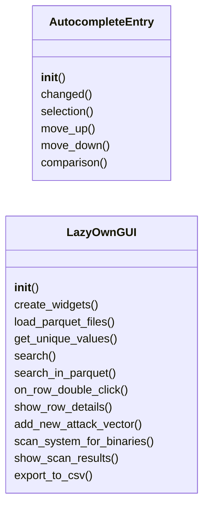
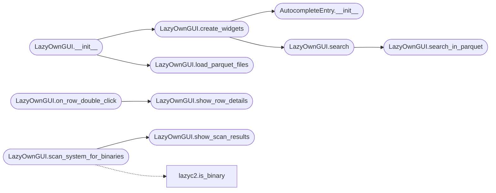

# `modules.LazyOwnExplorer`

> Source: [modules/LazyOwnExplorer.py:1](../../modules/LazyOwnExplorer.py#L1) | language `py` | coverage 4.8% | [API index](../index.md)

main.py

Autor: Gris Iscomeback
Correo electrónico: grisiscomeback[at]gmail[dot]com
Fecha de creación: 09/06/2024
Licencia: AGPL v3

Descripción: Gui to search in gtfobins db

██╗      █████╗ ███████╗██╗   ██╗ ██████╗ ██╗    ██╗███╗   ██╗
██║     ██╔══██╗╚══███╔╝╚██╗ ██╔╝██╔═══██╗██║    ██║████╗  ██║
██║     ███████║  ███╔╝  ╚████╔╝ ██║   ██║██║ █╗ ██║██╔██╗ ██║
██║     ██╔══██║ ███╔╝    ╚██╔╝  ██║   ██║██║███╗██║██║╚██╗██║
███████╗██║  ██║███████╗   ██║   ╚██████╔╝╚███╔███╔╝██║ ╚████║
╚══════╝╚═╝  ╚═╝╚══════╝   ╚═╝    ╚═════╝  ╚══╝╚══╝ ╚═╝  ╚═══╝

## Contents

- **Classes:** [`AutocompleteEntry`](#autocompleteentry), [`LazyOwnGUI`](#lazyowngui)

## Type Diagram



## Call Graph

Solid arrows stay in this module, dashed arrows leave it.



## Classes

<a id="autocompleteentry"></a>

### `AutocompleteEntry`

`class` | [modules/LazyOwnExplorer.py:30](../../modules/LazyOwnExplorer.py#L30)

```python
class AutocompleteEntry(tk.Entry)
```

Bases: `tk.Entry`

**Members**

| Member | Kind | Summary |
|---|---|---|
| [`__init__`](#autocompleteentry-__init__) | constructor |  |
| [`changed`](#autocompleteentry-changed) | method |  |
| [`selection`](#autocompleteentry-selection) | method |  |
| [`move_up`](#autocompleteentry-move_up) | method |  |
| [`move_down`](#autocompleteentry-move_down) | method |  |
| [`comparison`](#autocompleteentry-comparison) | method |  |

<a id="autocompleteentry-__init__"></a>

#### `AutocompleteEntry.__init__`

`constructor` | [modules/LazyOwnExplorer.py:31](../../modules/LazyOwnExplorer.py#L31)

```python
def __init__(self, get_suggestions_func, *args, **kwargs)
```

**Parameters**

| Name | Type | Default | Description |
|---|---|---|---|
| `get_suggestions_func` |  |  |  |
| `*args` |  |  |  |
| `**kwargs` |  |  |  |

*Called by:* [`LazyOwnGUI.create_widgets`](#lazyowngui-create_widgets)

<a id="autocompleteentry-changed"></a>

#### `AutocompleteEntry.changed`

`method` | [modules/LazyOwnExplorer.py:45](../../modules/LazyOwnExplorer.py#L45)

```python
def changed(self, name, index, mode)
```

**Parameters**

| Name | Type | Default | Description |
|---|---|---|---|
| `name` |  |  |  |
| `index` |  |  |  |
| `mode` |  |  |  |

<a id="autocompleteentry-selection"></a>

#### `AutocompleteEntry.selection`

`method` | [modules/LazyOwnExplorer.py:68](../../modules/LazyOwnExplorer.py#L68)

```python
def selection(self, event)
```

**Parameters**

| Name | Type | Default | Description |
|---|---|---|---|
| `event` |  |  |  |

<a id="autocompleteentry-move_up"></a>

#### `AutocompleteEntry.move_up`

`method` | [modules/LazyOwnExplorer.py:75](../../modules/LazyOwnExplorer.py#L75)

```python
def move_up(self, event)
```

**Parameters**

| Name | Type | Default | Description |
|---|---|---|---|
| `event` |  |  |  |

<a id="autocompleteentry-move_down"></a>

#### `AutocompleteEntry.move_down`

`method` | [modules/LazyOwnExplorer.py:87](../../modules/LazyOwnExplorer.py#L87)

```python
def move_down(self, event)
```

**Parameters**

| Name | Type | Default | Description |
|---|---|---|---|
| `event` |  |  |  |

<a id="autocompleteentry-comparison"></a>

#### `AutocompleteEntry.comparison`

`method` | [modules/LazyOwnExplorer.py:99](../../modules/LazyOwnExplorer.py#L99)

```python
def comparison(self, pattern)
```

**Parameters**

| Name | Type | Default | Description |
|---|---|---|---|
| `pattern` |  |  |  |

---

<a id="lazyowngui"></a>

### `LazyOwnGUI`

`class` | [modules/LazyOwnExplorer.py:104](../../modules/LazyOwnExplorer.py#L104)

```python
class LazyOwnGUI(tk.Tk)
```

Bases: `tk.Tk`

**Members**

| Member | Kind | Summary |
|---|---|---|
| [`__init__`](#lazyowngui-__init__) | constructor |  |
| [`create_widgets`](#lazyowngui-create_widgets) | method |  |
| [`load_parquet_files`](#lazyowngui-load_parquet_files) | method |  |
| [`get_unique_values`](#lazyowngui-get_unique_values) | method |  |
| [`search`](#lazyowngui-search) | method |  |
| [`search_in_parquet`](#lazyowngui-search_in_parquet) | method |  |
| [`on_row_double_click`](#lazyowngui-on_row_double_click) | method |  |
| [`show_row_details`](#lazyowngui-show_row_details) | method |  |
| [`add_new_attack_vector`](#lazyowngui-add_new_attack_vector) | method |  |
| [`scan_system_for_binaries`](#lazyowngui-scan_system_for_binaries) | method |  |
| [`show_scan_results`](#lazyowngui-show_scan_results) | method |  |
| [`export_to_csv`](#lazyowngui-export_to_csv) | method |  |

<a id="lazyowngui-__init__"></a>

#### `LazyOwnGUI.__init__`

`constructor` | [modules/LazyOwnExplorer.py:105](../../modules/LazyOwnExplorer.py#L105)

```python
def __init__(self)
```

*Calls:* [`LazyOwnGUI.create_widgets`](#lazyowngui-create_widgets), [`LazyOwnGUI.load_parquet_files`](#lazyowngui-load_parquet_files)

<a id="lazyowngui-create_widgets"></a>

#### `LazyOwnGUI.create_widgets`

`method` | [modules/LazyOwnExplorer.py:119](../../modules/LazyOwnExplorer.py#L119)

```python
def create_widgets(self)
```

*Calls:* [`AutocompleteEntry.__init__`](#autocompleteentry-__init__), [`LazyOwnGUI.search`](#lazyowngui-search)

*Called by:* [`LazyOwnGUI.__init__`](#lazyowngui-__init__)

<a id="lazyowngui-load_parquet_files"></a>

#### `LazyOwnGUI.load_parquet_files`

`method` | [modules/LazyOwnExplorer.py:181](../../modules/LazyOwnExplorer.py#L181)

```python
def load_parquet_files(self)
```

*Called by:* [`LazyOwnGUI.__init__`](#lazyowngui-__init__)

<a id="lazyowngui-get_unique_values"></a>

#### `LazyOwnGUI.get_unique_values`

`method` | [modules/LazyOwnExplorer.py:241](../../modules/LazyOwnExplorer.py#L241)

```python
def get_unique_values(self)
```

<a id="lazyowngui-search"></a>

#### `LazyOwnGUI.search`

`method` | [modules/LazyOwnExplorer.py:248](../../modules/LazyOwnExplorer.py#L248)

```python
def search(self)
```

*Calls:* [`LazyOwnGUI.search_in_parquet`](#lazyowngui-search_in_parquet)

*Called by:* [`LazyOwnGUI.create_widgets`](#lazyowngui-create_widgets)

<a id="lazyowngui-search_in_parquet"></a>

#### `LazyOwnGUI.search_in_parquet`

`method` | [modules/LazyOwnExplorer.py:267](../../modules/LazyOwnExplorer.py#L267)

```python
def search_in_parquet(self, term)
```

**Parameters**

| Name | Type | Default | Description |
|---|---|---|---|
| `term` |  |  |  |

*Called by:* [`LazyOwnGUI.search`](#lazyowngui-search)

<a id="lazyowngui-on_row_double_click"></a>

#### `LazyOwnGUI.on_row_double_click`

`method` | [modules/LazyOwnExplorer.py:278](../../modules/LazyOwnExplorer.py#L278)

```python
def on_row_double_click(self, event)
```

**Parameters**

| Name | Type | Default | Description |
|---|---|---|---|
| `event` |  |  |  |

*Calls:* [`LazyOwnGUI.show_row_details`](#lazyowngui-show_row_details)

<a id="lazyowngui-show_row_details"></a>

#### `LazyOwnGUI.show_row_details`

`method` | [modules/LazyOwnExplorer.py:283](../../modules/LazyOwnExplorer.py#L283)

```python
def show_row_details(self, row)
```

**Parameters**

| Name | Type | Default | Description |
|---|---|---|---|
| `row` |  |  |  |

*Called by:* [`LazyOwnGUI.on_row_double_click`](#lazyowngui-on_row_double_click)

<a id="lazyowngui-add_new_attack_vector"></a>

#### `LazyOwnGUI.add_new_attack_vector`

`method` | [modules/LazyOwnExplorer.py:305](../../modules/LazyOwnExplorer.py#L305)

```python
def add_new_attack_vector(self)
```

<a id="lazyowngui-scan_system_for_binaries"></a>

#### `LazyOwnGUI.scan_system_for_binaries`

`method` | [modules/LazyOwnExplorer.py:357](../../modules/LazyOwnExplorer.py#L357)

```python
def scan_system_for_binaries(self)
```

*Calls:* [`is_binary`](lazyc2.py.md#is_binary), [`LazyOwnGUI.show_scan_results`](#lazyowngui-show_scan_results)

<a id="lazyowngui-show_scan_results"></a>

#### `LazyOwnGUI.show_scan_results`

`method` | [modules/LazyOwnExplorer.py:374](../../modules/LazyOwnExplorer.py#L374)

```python
def show_scan_results(self, binaries)
```

**Parameters**

| Name | Type | Default | Description |
|---|---|---|---|
| `binaries` |  |  |  |

*Called by:* [`LazyOwnGUI.scan_system_for_binaries`](#lazyowngui-scan_system_for_binaries)

<a id="lazyowngui-export_to_csv"></a>

#### `LazyOwnGUI.export_to_csv`

`method` | [modules/LazyOwnExplorer.py:385](../../modules/LazyOwnExplorer.py#L385)

```python
def export_to_csv(self)
```

---
