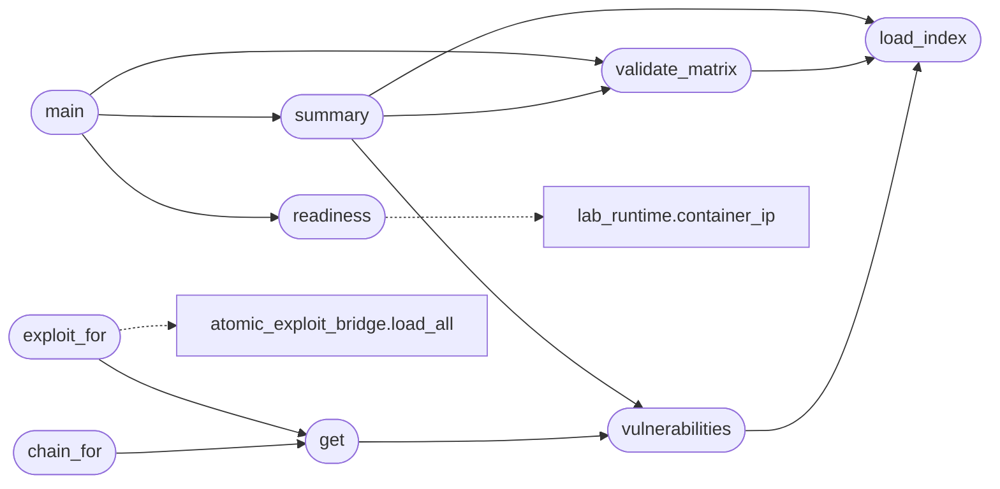

# `modules.ad_gym`

> Source: [modules/ad_gym.py:1](../../modules/ad_gym.py#L1) | language `py` | coverage 100.0% | [API index](../index.md)

AD lab gym catalogue (Docker Samba DC): index, exploits, chains.

Mirrors [`modules.metasploitable_gym`](modules.metasploitable_gym.py.md) for the ``ad-lab`` scenario: a
single disposable Samba Active Directory DC container (fast to start,
destroyed with ``lab stop ad-lab``). The catalogue binds the
``playbooks/gym_ad_lab.yaml`` index to per-vector exploit specs and
chains so ``gym start`` can auto-launch the golden path.

## Contents

- **Functions:** [`load_index`](#load_index), [`vulnerabilities`](#vulnerabilities), [`get`](#get), [`chain_for`](#chain_for), [`exploit_for`](#exploit_for), [`validate_matrix`](#validate_matrix), [`summary`](#summary), [`readiness`](#readiness), [`main`](#main)
- **Constants:** [`BASE_DIR`](#base_dir), [`INDEX_PATH`](#index_path), [`EXPLOITS_DIR`](#exploits_dir), [`CHAINS_DIR`](#chains_dir), [`MAX_INDEX_BYTES`](#max_index_bytes), [`ID_RE`](#id_re), [`REQUIRED`](#required)

## Call Graph

Solid arrows stay in this module, dashed arrows leave it.



## Functions

<a id="load_index"></a>

### `load_index`

`function` | [modules/ad_gym.py:38](../../modules/ad_gym.py#L38)

```python
def load_index(path: Path | str = INDEX_PATH) -> dict
```

Load the gym index, returning an empty mapping on failure.

**Parameters**

| Name | Type | Default | Description |
|---|---|---|---|
| `path` | `Path \| str` | `INDEX_PATH` |  |

**Returns:** `dict`

*Called by:* [`summary`](#summary), [`validate_matrix`](#validate_matrix), [`vulnerabilities`](#vulnerabilities)

---

<a id="vulnerabilities"></a>

### `vulnerabilities`

`function` | [modules/ad_gym.py:43](../../modules/ad_gym.py#L43)

```python
def vulnerabilities(path: Path | str = INDEX_PATH) -> list[dict]
```

Return every indexed lab vector.

**Parameters**

| Name | Type | Default | Description |
|---|---|---|---|
| `path` | `Path \| str` | `INDEX_PATH` |  |

**Returns:** `list[dict]`

*Calls:* [`load_index`](#load_index)

*Called by:* [`get`](#get), [`summary`](#summary)

---

<a id="get"></a>

### `get`

`function` | [modules/ad_gym.py:49](../../modules/ad_gym.py#L49)

```python
def get(vuln_id: str, path: Path | str = INDEX_PATH) -> dict | None
```

Return one lab vector by id, or None.

**Parameters**

| Name | Type | Default | Description |
|---|---|---|---|
| `vuln_id` | `str` |  |  |
| `path` | `Path \| str` | `INDEX_PATH` |  |

**Returns:** `dict | None`

*Calls:* [`vulnerabilities`](#vulnerabilities)

*Called by:* [`chain_for`](#chain_for), [`exploit_for`](#exploit_for)

---

<a id="chain_for"></a>

### `chain_for`

`function` | [modules/ad_gym.py:58](../../modules/ad_gym.py#L58)

```python
def chain_for(vuln_id: str, path: Path | str = INDEX_PATH)
```

Return the resolved chain for one lab vector, or None.

**Parameters**

| Name | Type | Default | Description |
|---|---|---|---|
| `vuln_id` | `str` |  |  |
| `path` | `Path \| str` | `INDEX_PATH` |  |

*Calls:* [`get`](#get)

---

<a id="exploit_for"></a>

### `exploit_for`

`function` | [modules/ad_gym.py:68](../../modules/ad_gym.py#L68)

```python
def exploit_for(vuln_id: str, path: Path | str = INDEX_PATH)
```

Return the exploit spec for one lab vector, or None.

**Parameters**

| Name | Type | Default | Description |
|---|---|---|---|
| `vuln_id` | `str` |  |  |
| `path` | `Path \| str` | `INDEX_PATH` |  |

*Calls:* [`get`](#get), [`load_all`](modules.atomic_exploit_bridge.py.md#load_all)

---

<a id="validate_matrix"></a>

### `validate_matrix`

`function` | [modules/ad_gym.py:78](../../modules/ad_gym.py#L78)

```python
def validate_matrix(path: Path | str = INDEX_PATH) -> list[str]
```

Validate the index, exploit files and chains as one matrix.

**Parameters**

| Name | Type | Default | Description |
|---|---|---|---|
| `path` | `Path \| str` | `INDEX_PATH` |  |

**Returns:** `list[str]`

*Calls:* [`load_index`](#load_index)

*Called by:* [`main`](#main), [`summary`](#summary)

---

<a id="summary"></a>

### `summary`

`function` | [modules/ad_gym.py:127](../../modules/ad_gym.py#L127)

```python
def summary(path: Path | str = INDEX_PATH) -> dict[str, Any]
```

Return counts by severity and service for operators.

**Parameters**

| Name | Type | Default | Description |
|---|---|---|---|
| `path` | `Path \| str` | `INDEX_PATH` |  |

**Returns:** `dict[str, Any]`

*Calls:* [`load_index`](#load_index), [`validate_matrix`](#validate_matrix), [`vulnerabilities`](#vulnerabilities)

*Called by:* [`main`](#main)

---

<a id="readiness"></a>

### `readiness`

`function` | [modules/ad_gym.py:146](../../modules/ad_gym.py#L146)

```python
def readiness() -> dict[str, Any]
```

Report whether the AD lab container is attackable right now.

**Returns:** `dict[str, Any]` - Mapping with ``scenario``, ``container``, ``running`` and
``ip`` (empty when Docker is unavailable).

*Calls:* [`container_ip`](modules.lab_runtime.py.md#container_ip)

*Called by:* [`main`](#main)

---

<a id="main"></a>

### `main`

`function` | [modules/ad_gym.py:166](../../modules/ad_gym.py#L166)

```python
def main() -> None
```

CLI: list | validate | summary | readiness.

**Raises**

- `SystemExit`: (raised in the body, not documented)

*Calls:* [`readiness`](#readiness), [`summary`](#summary), [`validate_matrix`](#validate_matrix)

---

## Constants

<a id="base_dir"></a>

### `BASE_DIR`

`constant` | [modules/ad_gym.py:18](../../modules/ad_gym.py#L18)

```python
BASE_DIR = Path(__file__).resolve().parent.parent
```

---

<a id="index_path"></a>

### `INDEX_PATH`

`constant` | [modules/ad_gym.py:19](../../modules/ad_gym.py#L19)

```python
INDEX_PATH = BASE_DIR / 'playbooks' / 'gym_ad_lab.yaml'
```

---

<a id="exploits_dir"></a>

### `EXPLOITS_DIR`

`constant` | [modules/ad_gym.py:20](../../modules/ad_gym.py#L20)

```python
EXPLOITS_DIR = BASE_DIR / 'exploits'
```

---

<a id="chains_dir"></a>

### `CHAINS_DIR`

`constant` | [modules/ad_gym.py:21](../../modules/ad_gym.py#L21)

```python
CHAINS_DIR = BASE_DIR / 'chains'
```

---

<a id="max_index_bytes"></a>

### `MAX_INDEX_BYTES`

`constant` | [modules/ad_gym.py:22](../../modules/ad_gym.py#L22)

```python
MAX_INDEX_BYTES = 200000
```

---

<a id="id_re"></a>

### `ID_RE`

`constant` | [modules/ad_gym.py:23](../../modules/ad_gym.py#L23)

```python
ID_RE = re.compile('^[a-z][a-z0-9_]{0,63}$')
```

---

<a id="required"></a>

### `REQUIRED`

`constant` | [modules/ad_gym.py:24](../../modules/ad_gym.py#L24)

```python
REQUIRED = ('id', 'name', 'mitre', 'port', 'service', 'severity', 'exploit', 'chain')
```

---
